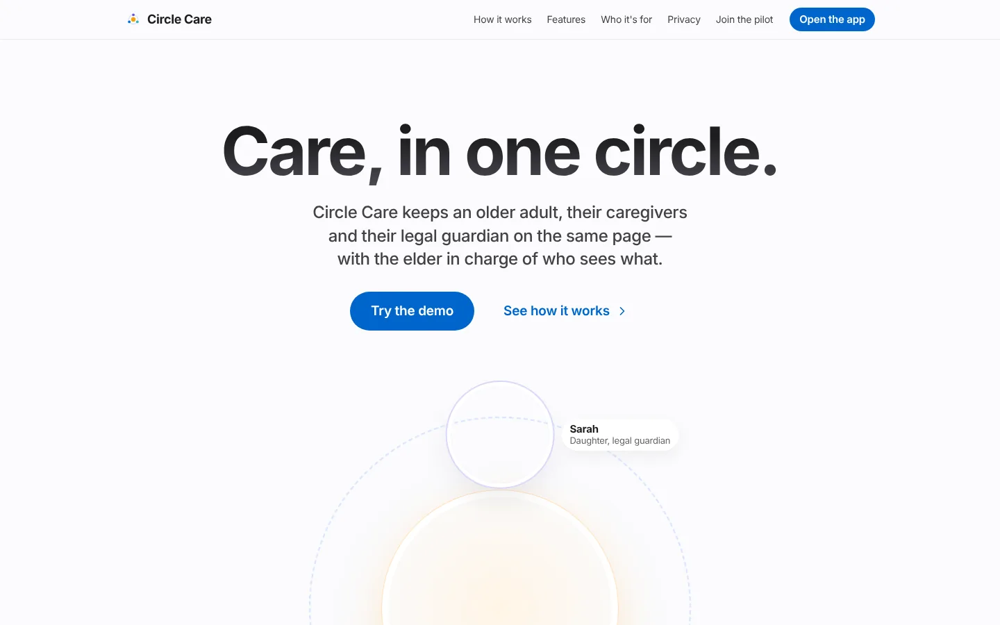
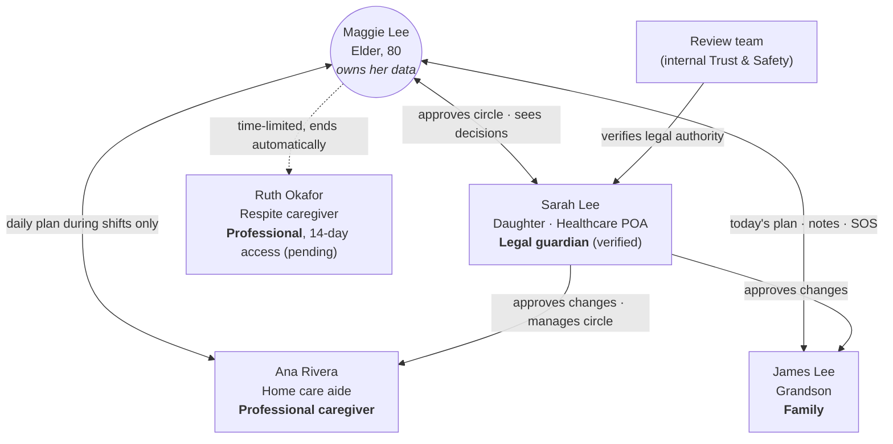

# Circle Care Product Wiki

**Care, in one circle.** Circle Care is a privacy-first care-coordination app for an older adult who lives at home, the professional and family caregivers who help them, and the legal guardian who makes decisions with them. It puts everyone on the same daily plan — medicines, tasks, visits, check-ins and emergencies — while the older adult stays in charge of who can see what. This wiki documents the product end to end: why it exists, who it serves, every feature in the working prototype, how it is built and secured, and what comes next.

!!! info "Concept product — fictional people and data"
    Circle Care is a portfolio and training product created by **Sumanth** (Product Owner, Certified Scrum Product Owner) from a CSPO course assignment. Every person, phone number, address, medicine and health reading in the prototype and in this wiki is **fictional**. No real health information is collected, stored or sent anywhere.

## Circle Care in 30 seconds

| | |
|---|---|
| **What** | One app with three experiences — elder, caregiver and legal guardian — plus a marketing website. Installable on a phone as a Progressive Web App (PWA). |
| **Who** | Margaret "Maggie" Lee (80, lives alone in San Francisco), her daughter and healthcare power of attorney Sarah, her home care aide Ana, her grandson James, and a time-limited respite caregiver, Ruth. |
| **Problem** | Care for an older adult at home is split across texts, paper notes, phone calls and memory. Doses get missed or doubled, nobody knows who is covering tonight, and the older adult loses privacy and control. |
| **Answer** | A shared daily plan, gentle reminders, verified caregiver check-ins, a self-drafting shift hand-off, a hold-to-send SOS that escalates until someone answers, and a Privacy Center where the elder sees and controls access. |
| **Principles** | Privacy-first · Elder in control · Minimum necessary access. |
| **Status** | Working prototype **v0.4**. Runs entirely in the browser with encrypted demo data. No backend, no real notifications, not for real patients. |
| **North Star** | *Verified care tasks completed on time per week* — shown on the guardian's home screen and weekly digest. |

<figure markdown="span">
  { loading=lazy }
  <figcaption>The public website introduces the product and links into the demo app.</figcaption>
</figure>

## The problem

Most older adults want to keep living in their own home. Doing that safely usually depends on a small, informal team: an adult child who handles medical and legal decisions, a paid home care aide for a few hours a day, and other relatives who help on weekends. That team rarely shares one source of truth.

- **Medicines** are the highest-risk part of the day. A missed blood-pressure tablet or a double dose of a diabetes medicine is easy when three people are involved and nobody can see what the others did.
- **Coverage** is fragile. A late or absent caregiver is often discovered hours later. Uncovered evening shifts go unnoticed until they arrive.
- **Emergencies** depend on one phone call being answered. If the first person doesn't pick up, there is no automatic next step.
- **Privacy and dignity** are an afterthought. Existing tools tend to treat the older adult as a patient being monitored, not as the person whose information it is.
- **Decision-makers are remote.** A legal guardian who lives two hours away learns about problems days later, from someone else.

Circle Care's research plan (see [Research & Compliance](wiki/research-and-compliance.md)) frames these as hypotheses to validate with interviews; the prototype exists to make those conversations concrete.

## Who it serves and what each person gets

=== "Elder (Maggie)"

    **Value: independence with a safety net.**

    - A home screen with exactly three large actions: **What's next**, **SOS**, **Call my person**.
    - Spoken reminders, three text sizes, high contrast and 48 px+ touch targets.
    - A one-tap daily **"I'm OK"** check-in instead of a worried phone call.
    - A **Privacy Center** to see who has access, who looked at her information, pause sharing and remove people.
    - Sees every decision made about her care and can ask a question.

=== "Caregiver (Ana)"

    **Value: know exactly what this shift needs.**

    - Check in at the door; today's medicines and tasks unlock only for the shift.
    - Doses in time order with *Due now / Late / Overdue* states and high-priority medicines called out.
    - Reads the previous caregiver's hand-off before starting.
    - At check-out the hand-off note is **drafted automatically** from what was logged.
    - Two-week schedule, shift offers and swap requests.

=== "Legal guardian (Sarah)"

    **Value: peace of mind from a distance, without micromanaging.**

    - **Today at a glance**: check-in, doses, tasks, who is with Maggie now, health and next appointment.
    - A short **Needs your attention** list instead of a stream of notifications.
    - **Approvals** for medicine changes, new members and shift swaps — Maggie sees every decision.
    - Health readings (only while Maggie shares them), a medication-appointment calendar and a weekly digest.
    - Care circle management, SOS order, alert timing and quiet hours.

## The care circle

## Product principles

!!! note "1. Privacy-first"
    Health information stays inside the app. Lock-screen notifications and emails never name a medicine, condition or note. Data is encrypted on the device, every access is logged in a tamper-evident chain, and exports are passphrase-protected.

!!! note "2. The elder is in control"
    The circle is built around one person. Maggie confirms members, sees who looked at her information, can pause sharing with one switch (SOS still works), decides whether her health readings are shared, and is told about every decision made about her. Refusing a medicine is recorded as her choice, not as an error.

!!! note "3. Minimum necessary"
    Each role sees only what it needs. Professional caregivers see medicines and tasks **only while checked in** to a shift. Notes can be shared with everyone or with the guardian only. Guardian powers depend on verified legal documents. One permission matrix (`src/data/policy.ts`) decides every read and write.

## Current status — prototype v0.4

| Area | In the prototype (real code, demo data) | Simulated or not built |
|---|---|---|
| Users and sign-in | Sign-in screens, 6-digit MFA step, 5-attempt lockout, Face ID-style elder sign-in, consent | No real accounts, passwords or SMS; the MFA code is always `482913`; Face ID is an animation |
| Data | Full domain model, rules engine, permission checks, audit chain — all running in the browser | No server or database; each browser has its own copy |
| Security | AES-256-GCM encryption at rest with a non-extractable key, SHA-256 hash-chained audit log, passphrase export, CSP on production builds | No TLS-terminated API, key management, server-side audit or penetration test |
| Notifications | In-app banners and an Alerts list with PHI-free titles | No push, SMS or email delivery |
| Health readings | Charts, detection rules, sharing consent | Readings are generated, not read from a watch |
| Location | Check-in flow and manual fallback | No GPS is read |
| Calls and 911 | `tel:` links | No call routing or emergency-service integration |

See [Release notes](wiki/product/release-notes.md) for what changed in each version and [Roadmap](wiki/roadmap.md) for what is planned.

## How to navigate this wiki

| If you are… | Start with |
|---|---|
| An executive or recruiter | This page → [Personas](wiki/product/personas.md) → [Roadmap](wiki/roadmap.md) |
| Running a demo | [Demo guide](wiki/product/demo-guide.md) |
| A designer | [Personas](wiki/product/personas.md) → [Elder experience](wiki/features/elder-experience.md) → [Features overview](wiki/features/index.md) |
| A new engineer | [System overview](wiki/architecture/system-overview.md) → [Data model](wiki/architecture/data-model.md) → [Traceability matrix](wiki/traceability.md) |
| QA | [Quality & testing](wiki/architecture/quality-and-testing.md) → the *Test coverage* section of each feature page |
| A compliance or security reviewer | [Security & privacy](wiki/architecture/security-and-privacy.md) → [Permission matrix](security/permission-matrix.md) → [Research & Compliance](wiki/research-and-compliance.md) |
| Editing this wiki | [How to contribute](wiki/how-to-contribute.md) |

Unfamiliar terms (care circle, POA, PHI, escalation chain, hand-off…) are defined in the [Glossary](wiki/product/glossary.md).

## Quick links

| Link | Where |
|---|---|
| Live demo | Your Replit URL (published as a static deployment from this repo; see [System overview](wiki/architecture/system-overview.md#build-and-deploy)) |
| Source code | [github.com/sumanth1996/circle-care](https://github.com/sumanth1996/circle-care) |
| Roadmap, epics and user stories | Notion — *Circle Care — Product Hub* (private workspace; story IDs `CC-n` match this wiki) |
| Demo MFA code | `482913` |

!!! note "About these screenshots"
    Screenshots in this wiki were captured from the prototype on Monday, October 19, 2026, with the demo clock at the time of capture, so times and counts differ from what you will see live. The live app loads stock photography from Unsplash; in some screenshots those photos did not load and appear as soft, empty placeholders or plain coloured circles instead of faces. Everything else on screen is the real UI.

## Document control

| Field | Value |
|---|---|
| Owner | Sumanth — Product Owner (CSPO) |
| Version | 1.0 |
| Date | 2026-10-19 |
| Status | Approved draft |
| Applies to | Circle Care prototype v0.4 (commit `428fa2e`) |
| Review cycle | Update with every release; the code is the source of truth when they disagree |
