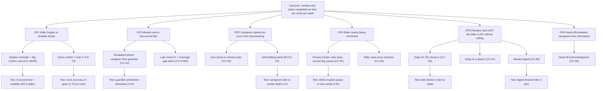

# Opportunity Solution Tree

Notion story: CC-6 Build the opportunity solution tree
Status: DRAFT v0 — opportunities are hypotheses drawn from the personas and CC-5 hypothesis journeys. Re-rank after CC-2/3/4 interviews and the CC-74 pilot.

## Desired outcome (North Star)

**Verified care tasks completed on time, per circle, per week.**

- *Care task* = a scheduled dose or a scheduled care task (meal, shower, walk…).
- *Verified* = confirmed in the app by the elder or a circle member, with a caregiver-verified flag where the dose was given during a visit (`DoseLog.verified`, CC-41).
- *On time* = confirmed within the escalation window (dose: before the caregiver escalation at 30 min, `settings.doseEscalation.caregiverMin`).
- Measured per circle, per week; reported as the median across circles on the pilot dashboard (CC-77).

Why this metric: it rises only when the elder is safer **and** the circle has less doubt. It does not reward sending more notifications or collecting more data.

**Guardrail metrics** (must not get worse):
- Elder-initiated privacy actions that indicate distress (members removed, sharing paused for 7+ days) — watch, don't suppress.
- Alert volume per guardian per week (alert fatigue).
- Refused doses must be recorded honestly; a "refused" is not a failure of the metric — it counts as a verified task outcome.

## Tree

## Opportunities (problem space)

| ID | Opportunity (user's words, hypothesis) | Persona | Evidence status | Links |
|---|---|---|---|---|
| OP1 | "I'm not sure if I took the morning one." | Elder | Hypothesis (H-E1, H-E4) | Journey 1 Medicines |
| OP2 | "Why didn't anyone tell me? That was Tuesday." | Guardian | Hypothesis (H-G2, H-G3) | Journey 3 Problem appears |
| OP3 | "Another 15 minutes I'm not paid for." | Caregiver | Hypothesis (H-C1, H-C2) | Journey 2 Leaving |
| OP4 | "I don't want to be watched like a child." | Elder | Hypothesis (H-E2, H-E3) | Journey 1 Aide visit |
| OP5 | "No news is… good news?" | Guardian, family | Hypothesis (H-G1, H-G6) | Journey 3 At work |
| OP6 | "The next aide never reads the notebook." | Caregiver | Hypothesis (H-C4) | Journey 2 Hand-off |

## Solutions already in the prototype

All of these exist in the React prototype as demonstrations with fictional data. "Exists" does not mean validated.

| Solution | Story | Where in prototype | Primary opportunity |
|---|---|---|---|
| Spoken reminder; taken/skipped/refused | CC-39, CC-40 | `/app/elder/next` | OP1 |
| Voice confirmation (on-device only) | CC-73 | `src/lib/voice.ts` | OP1 |
| Dose escalation timers (30/60 min defaults) | CC-42 | `src/data/store.tsx` rules | OP2 |
| Late check-in, coverage gaps | CC-57, CC-60 | `/app/guardian/schedule` | OP2 |
| Shift check-in unlocks plan (pro@shift) | CC-56, CC-18 | `/app/caregiver`, `src/data/policy.ts` | OP3, OP4 |
| Self-drafting hand-off | CC-82 | `/app/caregiver/handoff` | OP3, OP6 |
| Privacy Center + Pause sharing | CC-81 | `/app/elder/privacy` | OP4 |
| Elder sees every decision | CC-65 | `/app/elder/decisions` | OP4 |
| Daily I'm OK | CC-52 | Elder home | OP5 |
| Today at a glance | CC-61 | `/app/guardian` | OP5 |
| Weekly digest (PHI-free email version) | CC-83 | `/app/guardian/digest` | OP5 |

## Assumption tests

Each test targets the riskiest assumption under a solution. Order by risk × cost.

| # | Solution | Riskiest assumption | Type | Test | Pass criterion | Cost | Status |
|---|---|---|---|---|---|---|---|
| T1 | Reminder + confirm card | Elders understand the card without training | Usability | Task T2 in CC-2 with 6 elders | 5 of 6 succeed unaided | Low | Not started |
| T2 | Voice confirm | Recognition is reliable enough in real homes | Feasibility | 20 utterances × 3 rooms (quiet, TV on, kitchen) using browsers that support on-device recognition | ≥90% correct, 0 false "taken" | Low | Not started |
| T3 | Escalation timers | Guardians want the caregiver to get first chance | Desirability | H-G3 questions in CC-4 | 3 of 5 | Low | Not started |
| T4 | Self-drafting hand-off | Caregivers trust a drafted summary | Desirability | Task T3 in CC-3; count edits | 4 of 6 send with ≤2 edits | Low | Not started |
| T5 | Pause sharing | Elders understand that SOS still works when paused | Usability | Task T3 in CC-2; explain-back | 5 of 6 correct | Low | Not started |
| T6 | Daily I'm OK | Elders keep tapping after novelty wears off | Viability | Pilot week-over-week check-in rate (CC-74) | ≥80% of days in week 8 | Med | Not started |
| T7 | Weekly digest | Guardians share it with family | Desirability | Pilot: guardian-reported forwards (no tracking pixels) | 50% forward at least once | Med | Not started |
| T8 | Whole product | Agencies allow caregivers to use a second app beside EVV | Viability | 3 agency owner conversations | 2 of 3 open to a pilot | Med | Not started |

## How to update this tree

1. After synthesis (CC-5 process), replace each opportunity's wording with the strongest participant quote.
2. Delete opportunities supported by fewer than 3 participants.
3. Add new opportunities from themes that have no solution yet — do not attach a solution until compared against at least 2 alternatives.
4. Mark tests done with date and result; prune solutions whose tests failed.
