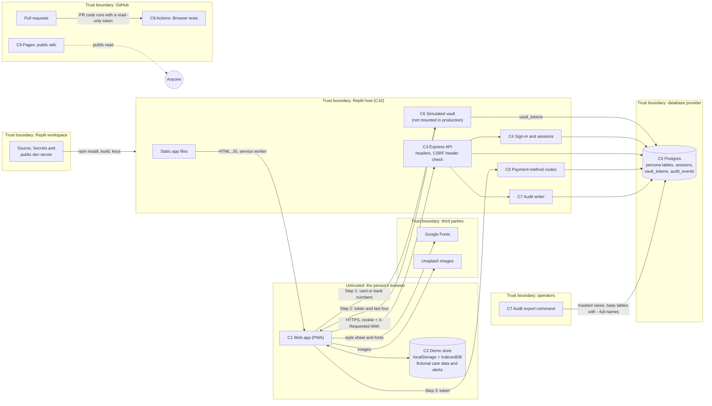

# Threat Model (STRIDE): Circle Care as built

Notion story: CC-10 Threat model for MVP architecture
Status: DRAFT v3, reviewed against `main` (cc3e577) on 2026-11-15. It replaces the October 19 draft, which was written against a planned architecture and said the prototype had no backend. v3 adds availability threats and the Lead Architect's corrections. C8-T1 was updated on 2026-11-15 when CC-198 locked down the Browser tests workflow. C3-I3, C3-D2, C4-S1, C4-S2, C4-S3 and C10-D1 were updated on 2026-11-16 for CC-200, CC-201 and CC-204 (branch `feat/server-auth-hardening`, not yet merged). C4-S4 was added on 2026-11-16 for CC-235 (Sprint 21).

!!! warning "Still needs human security review"
    This model was written and checked by the build team's agents. Before any real data is used, it still needs review by **an engineer with security experience** and sign-off by the **designated security officer** (CC-79). It is not a penetration test (CC-78).

All care data in Circle Care today is fictional (the browser demo). The accounts server accepts real names, emails and phone numbers, but outside production it refuses real SSNs, bank accounts and cards (CC-182). Risks below are rated for a **production launch with real people**, which is what the gaps would cost then.

## 1. Scope

In scope, as built on `main`:

| ID | Component | What it is |
|---|---|---|
| C1 | Web app | React PWA (`src/`), service worker (`public/sw.js`), production CSP, served by the host as static files (`server/index.ts`) |
| C2 | Demo store | Care-circle data, alerts, permission checks, access log, files and export, all in the browser (`src/data/store.tsx`, `src/lib/secureStorage.ts`) |
| C3 | Express API | Accounts, profile, SSN and photo routes (`server/app.ts`, `server/account.ts`) |
| C4 | Sign-in, sessions and MFA | Passwords, lockout, session cookies (`server/auth.ts`); the MFA step exists only in the browser demo |
| C5 | Postgres | Persona tables, sessions, payment tokens, audit table (`server/migrations/001_init.sql`, `server/db.ts`) |
| C6 | Payment vault | Simulated vault outside production and the payment-method routes (`server/vault.ts`, `server/payments.ts`) |
| C7 | Audit log and export | Server audit events, masked views and the export command (`server/audit.ts`, `server/cli/audit-export.ts`) |
| C8 | GitHub Actions | The Browser tests workflow on every pull request (`.github/workflows/browser-tests.yml`) |
| C9 | GitHub Pages | This wiki, published by hand with `mkdocs gh-deploy` |
| C10 | Hosting and config | Replit workspace and autoscale deploy running `APP_ENV=staging` (`.replit`), environment keys (`server/config.ts`) |

Out of scope: integrations not built (pharmacy, EHR, wearables), a real Stripe integration (production mode answers 503 for new payment methods), native apps. Real push, SMS and email providers aren't built, but **alert delivery is in scope**: today an alert never leaves the device that raised it (C2-D1).

## 2. Data-flow diagram

Trust boundaries: browser to host; browser to third parties; host to database provider; operators to database; workspace to host; GitHub to the public. The care data and alerts in C2 never cross to the host today: there is no care-data API yet.

## 3. How risks are rated

Each threat records its **Impact** and **Likelihood**, and the **Risk** follows from them. The threat-model test checks every row.

- **Impact:** High means real health, identity or financial data exposed or changed, or a safety alert lost. Medium means account data or availability. Low means nuisance or information about the system.
- **Likelihood:** how easy the attack is with the control as it stands. High: anyone can do it today. Medium: it needs an insider, a stolen password or some skill. Low: it needs several controls to fail.
- **Risk:** score High as 3, Medium as 2 and Low as 1, and multiply. 6 or more is High (High with High or Medium), 3 or 4 is Medium (Medium with Medium, or High with Low), 2 or less is Low.
- **Status:** **In place** (the control exists in code, file named), **Partial** (some of it exists, file named), **Demo only** (it exists in the browser demo but not on the server, file named), **Missing** (no control in this repository).
- **Owner:** the role that fixes it: Dev Agent, Release Agent, Security officer (CC-79) or PO.
- **Story:** for a gap, the backlog story that fixes it; for a control in place, the story that built or tests it. Blank when no story exists yet.

Code references are written `` `file:symbol` ``. A unit test (`src/__tests__/threat-model.test.ts`) fails if a referenced file is gone or no longer contains the symbol outside a comment, if a row is malformed or an ID repeats, if a risk doesn't follow from its impact and likelihood, if a control that exists names no file, or if a High risk that isn't In place has no story.

## 4. Threats by component

### C1 Web app

| ID | STRIDE | Threat | Control in code today | Status | Impact | Likelihood | Risk | Owner | Story |
|---|---|---|---|---|---|---|---|---|---|
| C1-I1 | I | Cross-site scripting steals session data or care data | CSP header from the server with `script-src 'self'` and `object-src 'none'` (`server/app.ts:"script-src 'self'"`); the build also adds a meta CSP (`vite.config.ts:http-equiv`); the session cookie is HttpOnly (`server/auth.ts:"HttpOnly", "SameSite=Strict"`). The two CSP lists are kept separately and can drift | In place | High | Low | Medium | Dev Agent | CC-78 |
| C1-T1 | T | The app is framed and clicked through (clickjacking) | `frame-ancestors 'none'` and `X-Frame-Options: DENY` from the server (`server/app.ts:"frame-ancestors 'none'"`, `server/app.ts:res.setHeader("X-Frame-Options", "DENY")`). `vite preview` and the dev server send neither for app pages | In place | Medium | Low | Low | Dev Agent | CC-78 |
| C1-I2 | I | The service worker caches API answers holding account data | API and vault paths are never cached (`public/sw.js:/api/`) | In place | Medium | Low | Low | Dev Agent | |
| C1-I3 | I | A third-party style sheet (Google Fonts) or image host is changed to leak data | Loaded from `index.html` with no integrity hash (`index.html:fonts.googleapis.com/css2`); the CSP limits styles, fonts and images to those hosts | Partial | Medium | Low | Low | Dev Agent | |
| C1-I4 | I | A lock-screen notification shows a medicine or condition | Alert titles are generic, details only in the app (`src/data/store.tsx:title: "Update from Circle Care"`); one test pins a title, nothing enforces it for every alert | Partial | High | Low | Medium | Dev Agent | CC-31 |

### C2 Demo store (browser)

The demo store is a prototype: one browser holds every persona's view of a fictional circle, and the presenter switches persona freely. Its controls show the design; none of them can stop the person who owns the browser.

| ID | STRIDE | Threat | Control in code today | Status | Impact | Likelihood | Risk | Owner | Story |
|---|---|---|---|---|---|---|---|---|---|
| C2-E1 | E | A family member reads or changes records they shouldn't by editing their own browser, switching persona, accepting their own invitation or opening the review queue | One permission matrix and `can()` (`src/data/policy.ts:export function can`), called by `guard()` in most store actions (`src/data/store.tsx:const guard`). All of it runs in the browser. `acceptInvite` has no check, `invite` takes any role from the caller, `/app/review` has no route guard (`src/App.tsx:/app/review`), and `can()` doesn't check whether a guardian is verified | Demo only | High | High | High | Dev Agent | CC-202 |
| C2-E2 | E | A revoked, expired or pending member keeps access | `roleOf()` returns nothing unless the member is active (`src/data/policy.ts:m.status !== "active"`); time-limited access is revoked by the rules engine (tested in `src/__tests__/rules.test.ts`) | Demo only | High | Medium | High | Dev Agent | CC-202 |
| C2-I1 | I | A paid caregiver browses records off shift | `pro@shift` rule (`src/data/policy.ts:rules.includes("pro@shift") && onShift`). Check-in itself has no shift-window check, so a caregiver can check in at any time | Demo only | High | Medium | High | Dev Agent | CC-202 |
| C2-T1 | T | Stored data on the device is altered | AES-GCM with a fresh IV per save and a non-extractable key (`src/lib/secureStorage.ts:name: "AES-GCM"`). A value without the `enc:v1:` prefix is still accepted as plain JSON (`src/lib/secureStorage.ts:!raw.startsWith("enc:v1:")`) | Partial | Medium | Low | Low | Dev Agent | |
| C2-I2 | I | A lost or shared device exposes care data | Encryption at rest as above; inactivity lock (`src/components/AppShell.tsx:setLocked`); close circle wipes data and key (`src/lib/secureStorage.ts:export async function wipeDevice`), with saving paused so no save in flight can write the circle back (`src/data/store.tsx:saver.pause()`). The unlock button checks nothing and a reload unlocks | Demo only | High | Medium | High | Dev Agent | CC-202 |
| C2-R1 | R | Someone denies viewing or changing a record | Hash-chained access log (`src/data/audit.ts:export function verifyChain`). The chain has no key, so anyone holding the state can rebuild it, and views of the same resource within 10 minutes are logged once for all personas (`src/data/store.tsx:(viewed.current[resource] ?? 0) < 10 * 60000`) | Demo only | Medium | Medium | Medium | Dev Agent | CC-202 |
| C2-I3 | I | An export file is leaked | Passphrase export with PBKDF2 (250,000 rounds) and AES-GCM (`src/lib/secureStorage.ts:250000`). The "Confirm with Face ID" step does nothing, the file is written before the permission check runs (`src/pages/shared/PrivacyCenter.tsx:actions.exported()`), and it includes guardian-only notes | Demo only | High | Medium | High | Dev Agent | CC-202 |
| C2-T2 | T | A disguised file is uploaded as a care document | Signature check for PDF, PNG and JPEG with a 10 MB limit (`src/lib/secureStorage.ts:export function inspectUpload`). No malware scan; photo metadata is stripped only from profile photos, and only in the browser | Partial | Medium | Medium | Medium | Dev Agent | |
| C2-I4 | I | A document is screenshotted or downloaded and shared | Viewer name shown over the document and every view logged (`src/pages/shared/Notes.tsx:watermark`). The overlay is visual only; the file itself is unchanged | Partial | Medium | Low | Low | PO | |
| C2-I5 | I | A family member bulk-views records out of curiosity or pressure | Suspicious-access rules: 8 views in 5 minutes or 3 denials in 10 minutes alert the guardian (`src/data/store.tsx:n >= 8`) | Demo only | Medium | Medium | Medium | Dev Agent | CC-202 |
| C2-I6 | I | A health detail is posted into the family chat | The chat's health-detail check warns before sending (`src/data/everyday.ts:export function phiHint`). It is a warning in the screen, not a block in `sendChat` | Partial | Medium | Low | Low | PO | |
| C2-D1 | D | An SOS, missed check-in or vital alert never reaches anyone else | Alerts are added to the device's own stored state (`src/data/store.tsx:export function pushAlert`) and escalation runs in that browser, so they show only on the device that raised them. CC-31 covers what an alert says, not how it travels | Demo only | High | High | High | Dev Agent | CC-205 |
| C2-D2 | D | A failed decrypt or unreadable storage silently starts a fresh demo, losing escalation contacts and settings | Nothing tells the person: the load falls back to a new demo (`src/data/store.tsx:return seed();`) | Missing | Medium | Low | Low | Dev Agent | CC-205 |

### C3 Express API

| ID | STRIDE | Threat | Control in code today | Status | Impact | Likelihood | Risk | Owner | Story |
|---|---|---|---|---|---|---|---|---|---|
| C3-T1 | T | Cross-site request forgery changes an account | Every non-GET request must carry `X-Requested-With: circle-care` (`server/app.ts:req.get("X-Requested-With") !== "circle-care"`); cookies are `SameSite=Strict` (`server/auth.ts:"HttpOnly", "SameSite=Strict"`); no CORS is enabled | In place | Medium | Low | Low | Dev Agent | |
| C3-E1 | E | One account reads or changes another's records (IDOR) | Every query is scoped to the signed-in user, and other users' card ids answer 404 (`server/payments.ts:AND user_id = $2`); payment and vault routes are guardian-only | In place | High | Low | Medium | Dev Agent | |
| C3-T2 | T | Oversized or malformed input | JSON bodies limited to 32 KB (`server/app.ts:express.json({ limit: "32kb" })`), photos to 2 MB with a file-signature check (`server/account.ts:sniffImage`); SSN, bank and card validators (`src/lib/validation.ts:luhn`). Photo metadata is stripped in the browser only (`src/lib/photos.ts:export async function preparePhoto`; also used for memory-aid and scam photos, which stay on the device); the server stores photo bytes as sent | Partial | Medium | Low | Low | Dev Agent | |
| C3-I1 | I | An error or log line leaks a request body, SSN or stack trace | The error handler returns safe messages and logs only the message (`server/http.ts:err instanceof Error ? err.message : "unknown"`); the API returns only the SSN's last four, and the tests scan every response for a full SSN | In place | High | Low | Medium | Dev Agent | |
| C3-S1 | S | Whoever holds an open session changes the account's contact email or phone | Profile changes need only the session and change the contact details in the persona table; the sign-in email can't be changed at all. Changing an SSN needs the password again (`server/account.ts:verifyPassword(str(req.body?.password)`), but nothing protects a contact change | Missing | Medium | Medium | Medium | Dev Agent | |
| C3-I2 | I | `/api/health` tells an attacker the environment and database kind | It returns `env` and `db` (`server/app.ts:app.get("/api/health"`) | Partial | Low | Medium | Low | Dev Agent | |
| C3-I3 | I | A signed-in account learns whether an SSN is already registered | A taken SSN answers 409 and is logged (`server/account.ts:action: "ssn.duplicate"`). Saving an SSN is limited to 10 tries an hour per account, counted in a store every instance shares, and going over is audited without the number (`server/account.ts:name: "ssn"`). Setting a first SSN still needs no password, and someone with many accounts gets 10 checks an hour from each; sign-up is limited to 10 an hour per address (`server/auth.ts:name: "signup"`) | Partial | High | Medium | High | Dev Agent | CC-204 |
| C3-D1 | D | Someone registers a victim's SSN first, so the victim's own account is refused | One account per SSN by fingerprint (`server/account.ts:SELECT user_id FROM ssn_fingerprints`); the refused person is told to contact support, and no support process exists to release a number | Partial | Medium | Medium | Medium | PO | |
| C3-D2 | D | Request floods slow or stop the API | Every instance counts in one Postgres table with an atomic upsert (`server/ratelimit.ts:ON CONFLICT (key) DO UPDATE`): sign-in 30 per 10 minutes per address (`server/auth.ts:name: "signin"`), sign-up and reset requests 10 an hour per address, and per-account limits on profile, SSN, photo, payment and vault writes. Expired counters are deleted while the limiter runs and at the daily clean-up (`server/ratelimit.ts:export async function pruneRateLimits`). Each sign-in under the limit still runs scrypt, and reads such as `GET /api/me` have no limit | Partial | Medium | Medium | Medium | Dev Agent | CC-204 |

### C4 Sign-in, sessions and MFA

| ID | STRIDE | Threat | Control in code today | Status | Impact | Likelihood | Risk | Owner | Story |
|---|---|---|---|---|---|---|---|---|---|
| C4-S1 | S | A stolen or reused password opens a guardian account that holds an SSN and bank details | Guardians and caregivers must set up an authenticator app before any account, payment or vault route answers (`server/mfa.ts:export const MFA_REQUIRED`). For an account with the second step on, a password starts no session: it returns a hashed, single-use 5-minute challenge (`server/auth.ts:mfaRequired: true`). The code is checked on the server to RFC 6238 (`server/totp.ts:export function verifyTotp`), and each time step works once (`server/mfa.ts:totp_last_counter < $2`). Setting it up from a sign-in more than 10 minutes old asks for the password again (`server/mfa.ts:REAUTH_MINUTES`). The secret is stored encrypted and never shown again after set-up; 10 recovery codes are stored as HMACs and each works once; 5 wrong codes in 15 minutes pause the step, audit it and email the owner. The browser demo's fixed code means nothing to the server. Elders can turn it on but don't have to, and passkeys aren't offered yet | In place | High | Low | Medium | Dev Agent | CC-200 |
| C4-S2 | S | Password guessing across many tries or many server instances | 5 failures lock the account for 15 minutes and email the owner, without ending their sessions (`server/auth.ts:const LOCK_AFTER = 5`). Sign-in is limited to 30 tries per 10 minutes per address, in a store every instance shares (`server/ratelimit.ts:export function limit`); the address is the one the configured number of proxies forwarded, so a forged left-most `X-Forwarded-For` lands in the same bucket (`server/app.ts:app.set("trust proxy", d.cfg.trustProxyHops)`). Guardians and caregivers also need a second step (C4-S1). scrypt still uses N = 16384 (`server/crypto.ts:N: 16384`), below OWASP's minimum of 2^17 | Partial | High | Low | Medium | Dev Agent | CC-204 |
| C4-S4 | S | Someone with the password uses "lost phone" recovery to remove the second step, or a real owner who lost phone and codes is locked out for good | A reset needs a live password challenge, then an emailed link (SHA-256 stored, single use, 30 minutes, newest only, at most 3 a day; `server/mfaRecovery.ts:CONFIRM_MINUTES = 30`), then a 72-hour wait (`server/config.ts:mfaRecoveryWaitHours`, fixed outside tests). The wait is emailed with a cancel link, shown on every signed-in device with Cancel, and cancelled by any password change or reset (`server/mfaRecovery.ts:export async function cancelOpenRecovery`). Finishing needs the password again, clears the key and codes, and ends every session (`server/mfaRecovery.ts:/complete`). Every step is audited without the link. An attacker would need both the password and the mailbox and the owner to miss two emails and three days. No outside vendor | In place | High | Low | Medium | Dev Agent | CC-235 |
| C4-S3 | S | A session that was stolen, or used on a shared computer, can't be ended | Idle 30 minutes and absolute 12 hours (`server/config.ts:sessionIdleMinutes: 30`); session tokens are stored hashed (`server/auth.ts:sha256(token)`). Sign out everywhere ends every session (`server/auth.ts:/signout-everywhere`). A password change checks the current password and ends every other session (`server/auth.ts:AND token_hash <> $2`). A forgotten-password link is stored hashed and works once, for 30 minutes (`server/auth.ts:const RESET_MINUTES = 30`), and using it ends every session. All three are audited, and changes and resets are emailed. Expired sessions, links and challenges are deleted at start-up and daily (`server/cleanup.ts:export async function cleanupExpired`). Until an email provider is connected, production records reset emails as undelivered instead of sending them (section 7) | In place | High | Low | Medium | Dev Agent | CC-201 |
| C4-I1 | I | Someone learns whether an email has an account | For an unknown email sign-in still runs a password hash (`server/auth.ts:await verifyPassword(password, await dummyHash())`), so the message is the same. A wrong password for a real account also records a failure (two writes and an audit event), so timing differs a little. Sign-up answers 409 for an existing email, and a locked account answers 429 | Partial | Medium | Medium | Medium | Dev Agent | |
| C4-D1 | D | An attacker locks a guardian out on purpose before an emergency | Lockout lasts 15 minutes and is per account (`server/auth.ts:attempts >= LOCK_AFTER`), so anyone who knows the email can trigger it; SOS in the demo needs no sign-in | Partial | Medium | Medium | Medium | Security officer | |
| C4-I2 | I | The session cookie is sent over plain HTTP | `Secure` is set in production and staging (`server/auth.ts:parts.push("Secure")`); HSTS is sent in production only (`server/app.ts:Strict-Transport-Security`) | Partial | Medium | Low | Low | Release Agent | |

### C5 Postgres

| ID | STRIDE | Threat | Control in code today | Status | Impact | Likelihood | Risk | Owner | Story |
|---|---|---|---|---|---|---|---|---|---|
| C5-I1 | I | Someone between the app and the database reads or changes data | A remote database always uses TLS and its certificate is verified (`server/db.ts:pgConnection`, `rejectUnauthorized: true`, optional `DATABASE_CA_CERT`); URL settings that would turn the check off are removed, `sslmode=disable` is refused (except Replit's built-in development database at host `helium`, only when running on Replit, which offers no TLS and sits on the Repl's private network), and the server stops before listening if the certificate can't be verified | In place | High | Low | Medium | Dev Agent | CC-203 |
| C5-I2 | I | A database copy or backup exposes SSNs and photos | SSNs and photos are encrypted with AES-256-GCM under a 32-byte key from the environment (`server/crypto.ts:aes-256-gcm`); SSN lookups use an HMAC under a separate key. Names, emails and phones are plain text, the ciphertext isn't bound to its row, and there is no re-encryption tool for key rotation | Partial | High | Low | Medium | Security officer | CC-26 |
| C5-E1 | E | The app's database user can change or empty the audit table | A trigger blocks UPDATE and DELETE on `audit_events` (`server/migrations/001_init.sql:audit_events_no_change`). No roles or grants are created, so the app's user owns the tables and could TRUNCATE them or drop the trigger | Partial | Medium | Medium | Medium | Release Agent | |
| C5-T1 | T | A bad value is written straight to the database | CHECK constraints keep last-four columns to four digits and photos under 2 MB (`server/migrations/001_init.sql:CHECK (ssn_last4 ~ '^[0-9]{4}$')`, `server/migrations/001_init.sql:CHECK (size_bytes <= 2097152)`) | In place | Low | Low | Low | Dev Agent | |

### C6 Payment vault

| ID | STRIDE | Threat | Control in code today | Status | Impact | Likelihood | Risk | Owner | Story |
|---|---|---|---|---|---|---|---|---|---|
| C6-I1 | I | A full card or bank number is stored | Only tokens, brand or bank name, type, expiry and last four are written, and the last-four columns can't hold more than four digits (`server/migrations/001_init.sql:CHECK (last4 ~ '^[0-9]{4}$')`). `vault_tokens.metadata` (jsonb) and `holder_name` have no such limit | Partial | High | Low | Medium | Dev Agent | |
| C6-E1 | E | The simulated vault is reachable in production | It is mounted only outside production with the simulated provider (`server/app.ts:paymentProvider === "simulated"`); production needs a live Stripe key (`server/config.ts:sk_live_`) | In place | High | Low | Medium | Release Agent | |
| C6-T1 | T | A vault token is reused or claimed by another account | Tokens are checked for owner, kind, a 15-minute age, single use and revocation under a row lock (`server/payments.ts:FOR UPDATE`) | In place | Medium | Low | Low | Dev Agent | |
| C6-I2 | I | Card numbers pass through the app server | Outside production the simulated vault runs in the same process (`server/app.ts:app.use("/vault/v1", vaultRouter(d))`), so full test numbers reach it. A real provider's hosted fields would keep them off the server, but that integration isn't built | Partial | High | Low | Medium | Dev Agent | |

### C7 Audit log and export

| ID | STRIDE | Threat | Control in code today | Status | Impact | Likelihood | Risk | Owner | Story |
|---|---|---|---|---|---|---|---|---|---|
| C7-R1 | R | A person denies a sign-in or a change to identity or payment details | Events for each such action with actor and time (`server/audit.ts:AuditAction`); details that look like an SSN or long number are refused (`server/audit.ts:LOOKS_SENSITIVE`). No IP address or device is recorded, and failed sign-ins for unknown emails aren't recorded | Partial | Medium | Medium | Medium | Dev Agent | |
| C7-I1 | I | An audit export leaks identity or payment data | By default the export reads the masked views, rescans its output and records a SHA-256 of each file (`server/cli/audit-export.ts:createHash("sha256")`). With `--full-names` it reads names from the base persona tables (`server/cli/audit-export.ts:opts.fullNames`); no read-only auditor role exists though the migration calls for one; and mode 600 applies only to new files (`server/cli/audit-export.ts:mode: 0o600`), so an overwritten export keeps its old permissions | Partial | High | Low | Medium | Security officer | CC-184 |
| C7-S1 | S | Anyone with database credentials runs an export under any name | The operator's name is whatever is typed (`server/cli/audit-export.ts:opts.operator`); there is no access check beyond the database login | Partial | Medium | Medium | Medium | Security officer | |

### C8 GitHub Actions

| ID | STRIDE | Threat | Control in code today | Status | Impact | Likelihood | Risk | Owner | Story |
|---|---|---|---|---|---|---|---|---|---|
| C8-E1 | E | A pull request's code gets write access or secrets | The workflow runs on `pull_request` (not `pull_request_target`) with a read-only token and no secrets (`.github/workflows/browser-tests.yml:contents: read`) | In place | Medium | Low | Low | Release Agent | |
| C8-T1 | T | A changed outside action alters what runs | Every action is pinned to a full commit SHA (`.github/workflows/browser-tests.yml:actions/checkout@3d3c42e5aac5ba805825da76410c181273ba90b1`), checkout keeps no token (`.github/workflows/browser-tests.yml:persist-credentials: false`), and a unit test fails if either slips (`src/__tests__/ci-workflow.test.ts:keeps no credentials after any checkout`). A pinned release that was bad when pinned is still trusted | In place | Medium | Low | Low | Release Agent | CC-198 |
| C8-T2 | T | A compromised npm or PyPI package runs in CI or the build | CI installs from the lockfile with integrity hashes (`.github/workflows/browser-tests.yml:run: npm ci`); Playwright is pinned by version without a hash. No dependency audit or Dependabot | Partial | Medium | Medium | Medium | Release Agent | |

### C9 GitHub Pages

| ID | STRIDE | Threat | Control in code today | Status | Impact | Likelihood | Risk | Owner | Story |
|---|---|---|---|---|---|---|---|---|---|
| C9-I1 | I | The public wiki tells an attacker where the gaps are | Everything under `docs/` is published (`mkdocs.yml:docs_dir`), including this model, the code reviews and the risk analysis. No secrets or contact details were found; the PO's first name appears on several pages. Publishing is by hand after the PO's yes | Partial | Medium | Medium | Medium | PO | |
| C9-T1 | T | The published site is changed to mislead readers | No control in this repository: GitHub's own permissions decide who can push `gh-pages`, and no branch protection is recorded for it | Missing | Medium | Low | Low | PO | |

### C10 Hosting and config

| ID | STRIDE | Threat | Control in code today | Status | Impact | Likelihood | Risk | Owner | Story |
|---|---|---|---|---|---|---|---|---|---|
| C10-E1 | E | Production starts without its protections | The server exits without both keys, a database URL and a live payment provider, and refuses a live key outside production (`server/config.ts:throw new ConfigError`) | In place | High | Low | Medium | Release Agent | CC-183 |
| C10-I1 | I | Real SSNs, bank accounts or cards land in a test environment | Outside production only test values are accepted (`server/account.ts:checkSsn(str(req.body?.ssn), d.cfg.testData)`), and a refusal is logged by field name only (`server/account.ts:action: "nonprod.blocked"`) | In place | High | Low | Medium | Release Agent | CC-182 |
| C10-T1 | T | The deployed build differs from what was tested | The Replit build runs `npm install`, not `npm ci`, so the lockfile isn't enforced (`.replit:npm install && npm run build`), and the server runs through `tsx` (`package.json:tsx server/index.ts`) | Partial | Medium | Medium | Medium | Release Agent | |
| C10-I2 | I | The deployed copy is opened over HTTP | It runs as staging, which sets `Secure` cookies but sends no HSTS (`.replit:APP_ENV=staging`) | Partial | Medium | Low | Low | Release Agent | |
| C10-S1 | S | The dev server is reached from another site (DNS rebinding) | The dev and preview servers accept any host name (`vite.config.ts:allowedHosts: true`). The dev server is also what the Replit workspace serves publicly (C10-I3) | Partial | Medium | Low | Low | Dev Agent | |
| C10-I3 | I | The Replit workspace's public dev server exposes the dev API | The workspace runs `npm run dev` (`.replit:run = "npm install && npm run dev"`) on port 5000 mapped to port 80 (`.replit:externalPort = 80`). The dev API sends no CSP (`server/app.ts:if (!opts.dev)`), its cookies have no `Secure`, and its development keys sit in `.data/` (`server/config.ts:join(process.cwd(), ".data")`). Only test SSNs, bank accounts and cards are accepted there | Missing | Medium | Medium | Medium | Release Agent | |
| C10-I4 | I | Someone with access to the Replit workspace reads the encryption keys and database URL | Keys come only from environment secrets (`server/config.ts:key32("DATA_ENCRYPTION_KEY"`); who can open the workspace and its Secrets is set in Replit and recorded nowhere | Missing | High | Low | Medium | Security officer | |
| C10-D1 | D | Behind more than one proxy, every user shares one address and one sign-in limit | The number of proxies to trust comes from `TRUST_PROXY_HOPS` (default 1, the Replit proxy), checked at start-up as a whole number from 0 to 5 (`server/config.ts:TRUST_PROXY_HOPS must be a whole number`) and used as Express's hop count (`server/app.ts:app.set("trust proxy", d.cfg.trustProxyHops)`). A wrong value still gives wrong limits, so it has to match the deploy (section 7) | In place | Medium | Low | Low | Release Agent | CC-204 |

## 5. High risks and their stories

| Threat | Risk | Status | Story | What the story's criteria require |
|---|---|---|---|---|
| C2-E1, C2-E2, C2-I1, C2-I2, C2-I3 Care data and permission checks run only in the browser | High | Demo only | CC-202 Move care-circle data and permission checks to the server | The API applies the permission matrix to every care record, checks invitations, shifts, unlocks and exports on the server, and separates the reviewer role |
| C2-D1 Safety alerts never leave the device that raised them | High | Demo only | CC-205 Deliver safety alerts from the server to the people who need them | The server records and delivers alerts to each member's own devices, catches up after offline, escalates without the elder's device, and keeps settings and tells the person after a storage reset |
| C3-I3 An SSN can still be checked from many accounts | High | Partial | CC-204 Shared rate limits for sign-in and account changes | Done in CC-204: 10 tries an hour per account in a shared store, audited. Still open, for the next refinement: a password before the first SSN, and a limit across accounts |

C5-I1 (database certificate not verified) left this table when CC-203 put the certificate check in place; it is now Medium (High impact, Low likelihood). CC-200, CC-201 and CC-204 moved C4-S1 and C4-S3 to In place and C4-S2 to Medium. All four were built in Sprint 15 on the branch `sprint-15-backlog`; the ratings still need the human security review in §7.

Each story is in the Notion backlog with its full Given/When/Then criteria and a link back to its threat.

Two stories are marked Done for the browser demo only, and the server versions are the new stories: CC-12 (MFA) is covered by CC-200, and CC-19 (access rules) by CC-202.

Medium risks with no story yet, for the next refinement: the scrypt cost below OWASP's minimum (C4-S2), contact changes without re-authentication (C3-S1), one shared CSP list for the build and the server (C1-I1), SSN squatting and its support process (C3-D1), account enumeration (C4-I1), deliberate lockout (C4-D1), database roles for the audit table (C5-E1), audit export access (C7-S1), IP or device in audit events (C7-R1), dependency checks (C8-T2), where security documents are published (C9-I1), deploy with `npm ci` (C10-T1), the public workspace dev server (C10-I3) and who can read the Replit Secrets (C10-I4).

## 6. What changed since the October draft

- **Backend:** the October draft said the prototype has no backend and payments were out of scope. The accounts server, Postgres, sessions and the payment vault now exist (C3 to C7).
- **Clickjacking (old I7):** `frame-ancestors 'none'` and `X-Frame-Options: DENY` are now sent as server headers.
- **Guarded actions (old T1):** most data-changing store actions call `guard()`, but `acceptInvite` doesn't, `invite` accepts any role, and the review queue has no route guard (C2-E1).
- **Tamper (old T4):** a plain-JSON value is still accepted (C2-T1), and a failed decrypt resets the demo without telling anyone (C2-D2).
- **Export re-auth (old I4):** the confirm step does nothing yet (C2-I3).
- **Reviewer (old I10) and guardian verification (old E1):** any visitor can open the review queue, and `can()` doesn't check whether a guardian is verified (C2-E1).
- **View logging (old R1):** views are deduplicated per resource across personas (C2-R1).
- **Availability:** alert delivery, request floods, lockouts and the proxy setting are now modelled (C2-D1, C2-D2, C3-D1, C3-D2, C4-D1, C10-D1).
- **Sign-in hardening (2026-11-16):** a server second step for guardians and caregivers (C4-S1), sign out everywhere, password change and reset (C4-S3), and shared rate limits with a configured proxy count (C3-D2, C3-I3, C4-S2, C10-D1).
- **New areas:** chat, check-ins, CI, the public wiki, the Replit workspace and hosting are now modelled (C2-I6, C8 to C10).

## 7. Human actions

- [ ] Review by an engineer with security experience.
- [ ] Sign-off by the designated security officer (CC-79).
- [ ] Decide whether security documents stay on the public wiki (C9-I1).
- [ ] Decide who can open the Replit workspace and its Secrets, and record it (C10-I4).
- [ ] Connect an email provider before launch (CC-201). Until then, production records password-reset, lockout and two-step reset emails as undelivered instead of sending them, so nobody can reset a forgotten password or a lost phone (CC-235).
- [ ] Set `TRUST_PROXY_HOPS` to the number of proxies in front of the production server, and check it after any hosting change (C10-D1).
- [ ] Re-run this model when CC-202 moves care data to the server, and before any integration is built.
