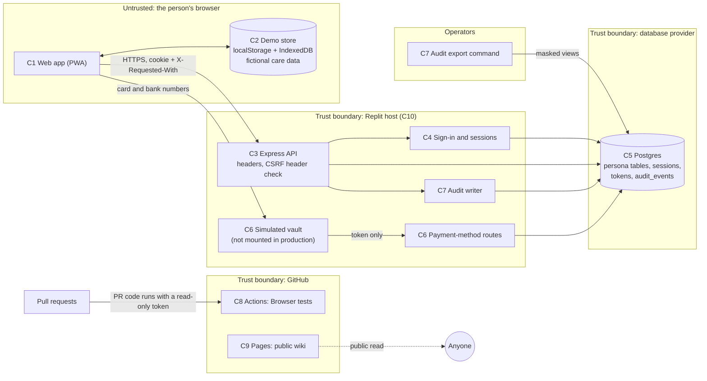

# Threat Model (STRIDE): Circle Care as built

Notion story: CC-10 Threat model for MVP architecture
Status: DRAFT v2, reviewed against `main` (cc3e577) on 2026-11-15. It replaces the October 19 draft, which was written against a planned architecture and said the prototype had no backend.

!!! warning "Still needs human security review"
    This model was written and checked by the build team's agents. Before any real data is used, it still needs review by **an engineer with security experience** and sign-off by the **designated security officer** (CC-79). It is not a penetration test (CC-78).

All data in Circle Care today is fictional (the browser demo) or test-only (the accounts server refuses real SSNs, bank accounts and cards outside production, CC-182). Risks below are rated for a **production launch with real people**, which is what the gaps would cost then.

## 1. Scope

In scope, as built on `main`:

| ID | Component | What it is |
|---|---|---|
| C1 | Web app | React PWA (`src/`), service worker (`public/sw.js`), production CSP |
| C2 | Demo store | Care-circle data, permission checks, access log, files and export, all in the browser (`src/data/store.tsx`, `src/lib/secureStorage.ts`) |
| C3 | Express API | Accounts, profile, SSN and photo routes (`server/app.ts`, `server/account.ts`) |
| C4 | Sign-in, sessions and MFA | Passwords, lockout, session cookies (`server/auth.ts`); the MFA step exists only in the browser demo |
| C5 | Postgres | Persona tables, sessions, payment tokens, audit table (`server/migrations/001_init.sql`, `server/db.ts`) |
| C6 | Payment vault | Simulated vault outside production and the payment-method routes (`server/vault.ts`, `server/payments.ts`) |
| C7 | Audit log and export | Server audit events, masked views and the export command (`server/audit.ts`, `server/cli/audit-export.ts`) |
| C8 | GitHub Actions | The Browser tests workflow on every pull request (`.github/workflows/browser-tests.yml`) |
| C9 | GitHub Pages | This wiki, published by hand with `mkdocs gh-deploy` |
| C10 | Hosting and config | Replit autoscale deploy running `APP_ENV=staging` (`.replit`), environment keys (`server/config.ts`) |

Out of scope: integrations not built (pharmacy, EHR, wearables), real push, SMS and email providers, a real Stripe integration (production mode answers 503 for new payment methods), native apps.

## 2. Data-flow diagram

Trust boundaries: browser to host; host to database provider; operator to database; GitHub to the public. The care data in C2 never crosses to the host today: there is no care-data API yet.

## 3. How risks are rated

- **Impact:** High means real health, identity or financial data exposed or changed, or a safety alert lost. Medium means account data or availability. Low means nuisance or information about the system.
- **Likelihood:** how easy the attack is with the control as it stands.
- **Risk:** High when both are at least medium and one is high; Low when both are low; Medium otherwise.
- **Status:** **In place** (the control exists in code, file named), **Partial** (some of it exists), **Demo only** (it exists in the browser demo but not on the server), **Missing** (no control in code).
- **Owner:** the role that fixes it: Dev Agent, Release Agent, Security officer (CC-79) or PO.

Code references are written `` `file:symbol` ``. A unit test (`src/__tests__/threat-model.test.ts`) fails if a referenced file is gone or no longer contains the symbol, if an ID repeats, or if a High risk that is Missing or Partial has no story.

## 4. Threats by component

### C1 Web app

| ID | STRIDE | Threat | Control in code today | Status | Risk | Owner | Story |
|---|---|---|---|---|---|---|---|
| C1-I1 | I | Cross-site scripting steals session data or care data | CSP header from the server with `script-src 'self'` and `object-src 'none'` (`server/app.ts:script-src 'self'`); the build also adds a meta CSP (`vite.config.ts:Content-Security-Policy`); the session cookie is HttpOnly (`server/auth.ts:HttpOnly`) | In place | Medium | Dev Agent | CC-78 |
| C1-T1 | T | The app is framed and clicked through (clickjacking) | `frame-ancestors 'none'` and `X-Frame-Options: DENY` from the server (`server/app.ts:frame-ancestors 'none'`, `server/app.ts:X-Frame-Options`). `vite preview` and the dev server send neither | In place | Low | Dev Agent | CC-78 |
| C1-I2 | I | The service worker caches API answers holding account data | API and vault paths are never cached (`public/sw.js:/api/`) | In place | Low | Dev Agent | |
| C1-I3 | I | A third-party style sheet (Google Fonts) is changed to leak data | Loaded from `index.html` with no integrity hash; CSP limits styles to that host | Partial | Low | Dev Agent | |
| C1-I4 | I | A lock-screen notification shows a medicine or condition | Alert titles are generic ("Update from Circle Care"), details only in the app (`src/data/store.tsx:Update from Circle Care`); one test pins a title, nothing enforces it for every alert | Partial | Medium | Dev Agent | CC-31 |

### C2 Demo store (browser)

The demo store is a prototype: one browser holds every persona's view of a fictional circle, and the presenter switches persona freely. Its controls show the design; none of them can stop the person who owns the browser.

| ID | STRIDE | Threat | Control in code today | Status | Risk | Owner | Story |
|---|---|---|---|---|---|---|---|
| C2-E1 | E | A family member reads or changes records they shouldn't by editing their own browser, switching persona, accepting their own invitation or opening the review queue | One permission matrix and `can()` (`src/data/policy.ts:export function can`), called by `guard()` in most store actions (`src/data/store.tsx:const guard`). All of it runs in the browser. `acceptInvite` has no check, `invite` takes any role from the caller, and `/app/review` has no route guard (`src/App.tsx:/app/review`) | Demo only | High | Dev Agent | CC-202 |
| C2-E2 | E | A revoked, expired or pending member keeps access | `roleOf()` returns nothing unless the member is active (`src/data/policy.ts:m.status !== "active"`); time-limited access is revoked by the rules engine (tested in `src/__tests__/rules.test.ts`) | Demo only | High | Dev Agent | CC-202 |
| C2-I1 | I | A paid caregiver browses records off shift | `pro@shift` rule (`src/data/policy.ts:pro@shift`). Check-in itself has no shift-window check, so a caregiver can check in at any time | Demo only | Medium | Dev Agent | CC-202 |
| C2-T1 | T | Stored data on the device is altered | AES-GCM with a fresh IV per save and a non-extractable key (`src/lib/secureStorage.ts:AES-GCM`). A value without the `enc:v1:` prefix is still accepted as plain JSON (`src/lib/secureStorage.ts:enc:v1:`), and a failed decrypt silently starts a fresh demo | Partial | Low | Dev Agent | |
| C2-I2 | I | A lost or shared device exposes care data | Encryption at rest as above; inactivity lock (`src/components/AppShell.tsx:setLocked`); close circle wipes data and key (`src/lib/secureStorage.ts:wipeDevice`). The unlock button checks nothing and a reload unlocks | Demo only | Medium | Dev Agent | CC-202 |
| C2-R1 | R | Someone denies viewing or changing a record | Hash-chained access log (`src/data/audit.ts:verifyChain`). The chain has no key, so anyone holding the state can rebuild it, and views of the same resource within 10 minutes are logged once for all personas (`src/data/store.tsx:10 * 60000`) | Demo only | Medium | Dev Agent | CC-202 |
| C2-I3 | I | An export file is leaked | Passphrase export with PBKDF2 (250,000 rounds) and AES-GCM (`src/lib/secureStorage.ts:250000`). The "Confirm with Face ID" step does nothing, the file is written before the permission check runs (`src/pages/shared/PrivacyCenter.tsx:actions.exported()`), and it includes guardian-only notes | Partial | Medium | Dev Agent | CC-202 |
| C2-T2 | T | A disguised file is uploaded as a care document | Signature check for PDF, PNG and JPEG with a 10 MB limit (`src/lib/secureStorage.ts:inspectUpload`). No malware scan; photo metadata is stripped only from profile photos, not documents | Partial | Medium | Dev Agent | |
| C2-I4 | I | A document is screenshotted or downloaded and shared | Viewer name shown over the document and every view logged (`src/pages/shared/Notes.tsx:watermark`). The overlay is visual only; the file itself is unchanged | Partial | Low | PO | |
| C2-I5 | I | A family member bulk-views records out of curiosity or pressure | Suspicious-access rules: 8 views in 5 minutes or 3 denials in 10 minutes alert the guardian (`src/data/store.tsx:n >= 8`) | Demo only | Medium | Dev Agent | CC-202 |
| C2-I6 | I | A health detail is posted into the family chat | The chat's health-detail check warns before sending (`src/data/everyday.ts:phiHint`). It is a warning in the screen, not a block in `sendChat` | Partial | Low | PO | |

### C3 Express API

| ID | STRIDE | Threat | Control in code today | Status | Risk | Owner | Story |
|---|---|---|---|---|---|---|---|
| C3-T1 | T | Cross-site request forgery changes an account | Every non-GET request must carry `X-Requested-With: circle-care` (`server/app.ts:X-Requested-With`); cookies are `SameSite=Strict` (`server/auth.ts:SameSite=Strict`); no CORS is enabled | In place | Low | Dev Agent | |
| C3-E1 | E | One account reads or changes another's records (IDOR) | Every query is scoped to the signed-in user, and other users' card ids answer 404 (`server/payments.ts:AND user_id = $2`); payment and vault routes are guardian-only | In place | Medium | Dev Agent | |
| C3-T2 | T | Oversized or malformed input | JSON bodies limited to 32 KB (`server/app.ts:32kb`), photos to 2 MB with a file-signature check (`server/account.ts:sniffImage`); SSN, bank and card validators (`src/lib/validation.ts:luhn`) | In place | Low | Dev Agent | |
| C3-I1 | I | An error or log line leaks a request body, SSN or stack trace | The error handler returns safe messages and logs only the message (`server/http.ts:Never log request bodies`); the API returns only the SSN's last four, and the tests scan every response for a full SSN | In place | Low | Dev Agent | |
| C3-S1 | S | An account's email or phone is changed by whoever holds an open session | Profile changes need only the session; changing an SSN needs the password (`server/account.ts:Changing an SSN needs the password again`) | Partial | Medium | Dev Agent | CC-201 |
| C3-I2 | I | `/api/health` tells an attacker the environment and database kind | It returns `env` and `db` (`server/app.ts:/api/health`) | Partial | Low | Dev Agent | |

### C4 Sign-in, sessions and MFA

| ID | STRIDE | Threat | Control in code today | Status | Risk | Owner | Story |
|---|---|---|---|---|---|---|---|
| C4-S1 | S | A stolen or reused password opens a guardian account that holds an SSN and bank details | The server has no second factor. The six-digit step exists only in the browser demo with a fixed code (`src/pages/SignIn.tsx:482913`) | Missing | High | Dev Agent | CC-200 |
| C4-S2 | S | Password guessing across many tries or many server instances | scrypt hashing (`server/crypto.ts:N: 16384`), 5 failures lock the account for 15 minutes (`server/auth.ts:LOCK_AFTER`), and a per-address limit on sign-in and sign-up (`server/http.ts:export function rateLimit`). The limit is kept in each process, the deploy is autoscale, and the address comes from a forwarded header (`server/app.ts:trust proxy`) | Partial | High | Dev Agent | CC-204 |
| C4-S3 | S | A session that was stolen, or used on a shared computer, can't be ended | Idle 30 minutes and absolute 12 hours (`server/config.ts:sessionIdleMinutes`); sign-out deletes the current session; session tokens are stored hashed (`server/auth.ts:sha256(token)`). There is no sign out everywhere and no password change or reset; a sign-in lockout leaves open sessions alone, and an expired session row is removed only when it is presented | Missing | High | Dev Agent | CC-201 |
| C4-I1 | I | Someone learns whether an email has an account | Sign-in gives the same message and timing either way (`server/auth.ts:dummyHash`). Sign-up answers 409 for an existing email, and a locked account answers 429 | Partial | Medium | Dev Agent | CC-201 |
| C4-D1 | D | An attacker locks a guardian out on purpose before an emergency | Lockout lasts 15 minutes; SOS in the demo needs no sign-in. Lockout is per account, so anyone who knows the email can trigger it | Partial | Medium | Security officer | CC-201 |
| C4-I2 | I | The session cookie is sent over plain HTTP | `Secure` is set in production and staging (`server/auth.ts:Secure`); HSTS is sent in production only (`server/app.ts:Strict-Transport-Security`) | Partial | Low | Release Agent | |

### C5 Postgres

| ID | STRIDE | Threat | Control in code today | Status | Risk | Owner | Story |
|---|---|---|---|---|---|---|---|
| C5-I1 | I | Someone between the app and the database reads or changes data | The connection uses TLS but doesn't verify the server's certificate (`server/db.ts:rejectUnauthorized: false`) | Missing | High | Dev Agent | CC-203 |
| C5-I2 | I | A database copy or backup exposes SSNs and photos | SSNs and photos are encrypted with AES-256-GCM under a 32-byte key from the environment (`server/crypto.ts:aes-256-gcm`); SSN lookups use an HMAC under a separate key. Names, emails and phones are plain text, the ciphertext isn't bound to its row, and there is no re-encryption tool for key rotation | Partial | Medium | Security officer | CC-26 |
| C5-E1 | E | The app's database user can change or empty the audit table | A trigger blocks UPDATE and DELETE on `audit_events` (`server/migrations/001_init.sql:audit_events_no_change`). No roles or grants are created, so the app's user owns the tables and could TRUNCATE them or drop the trigger | Partial | Medium | Release Agent | |
| C5-T1 | T | A bad value is written straight to the database | CHECK constraints keep last-four columns to four digits and photos under 2 MB (`server/migrations/001_init.sql:CHECK`) | In place | Low | Dev Agent | |

### C6 Payment vault

| ID | STRIDE | Threat | Control in code today | Status | Risk | Owner | Story |
|---|---|---|---|---|---|---|---|
| C6-I1 | I | A full card or bank number is stored | Only tokens, brand or bank name, type, expiry and last four are stored (`server/vault.ts:never stored`); no column can hold a full number | In place | Medium | Dev Agent | |
| C6-E1 | E | The simulated vault is reachable in production | It is mounted only outside production with the simulated provider (`server/app.ts:paymentProvider === "simulated"`); production needs a live Stripe key (`server/config.ts:sk_live_`) | In place | Medium | Release Agent | |
| C6-T1 | T | A vault token is reused or claimed by another account | Tokens are checked for owner, kind, a 15-minute age, single use and revocation under a row lock (`server/payments.ts:FOR UPDATE`) | In place | Low | Dev Agent | |
| C6-I2 | I | Card numbers pass through the app server | Outside production the simulated vault runs in the same process, so full test numbers reach it. A real provider's hosted fields would keep them off the server, but that integration isn't built | Partial | Medium | Dev Agent | |

### C7 Audit log and export

| ID | STRIDE | Threat | Control in code today | Status | Risk | Owner | Story |
|---|---|---|---|---|---|---|---|
| C7-R1 | R | A person denies a sign-in or a change to identity or payment details | Events for each such action with actor and time (`server/audit.ts:AuditAction`); details that look like an SSN or long number are refused (`server/audit.ts:LOOKS_SENSITIVE`). No IP address or device is recorded, and failed sign-ins for unknown emails aren't recorded | Partial | Medium | Dev Agent | |
| C7-I1 | I | An audit export leaks identity or payment data | The export reads the masked views, rescans its output, writes files only the operator can read and records a SHA-256 of each (`server/cli/audit-export.ts:sha256`) | In place | Medium | Security officer | CC-184 |
| C7-S1 | S | Anyone with database credentials runs an export under any name | The operator's name is whatever is typed (`server/cli/audit-export.ts:--operator`); there is no access check beyond the database login | Partial | Medium | Security officer | CC-79 |

### C8 GitHub Actions

| ID | STRIDE | Threat | Control in code today | Status | Risk | Owner | Story |
|---|---|---|---|---|---|---|---|
| C8-E1 | E | A pull request's code gets write access or secrets | The workflow runs on `pull_request` (not `pull_request_target`) with a read-only token and no secrets (`.github/workflows/browser-tests.yml:contents: read`) | In place | Low | Release Agent | |
| C8-T1 | T | A changed outside action alters what runs | Actions are pinned to tags, not commits (`.github/workflows/browser-tests.yml:actions/checkout@v4`), and checkout keeps its token | Partial | Medium | Release Agent | CC-198 |
| C8-T2 | T | A compromised npm or PyPI package runs in CI or the build | `npm ci` from a lockfile with integrity hashes in CI; Playwright pinned by version without a hash. No dependency audit or Dependabot | Partial | Medium | Release Agent | |

### C9 GitHub Pages

| ID | STRIDE | Threat | Control in code today | Status | Risk | Owner | Story |
|---|---|---|---|---|---|---|---|
| C9-I1 | I | The public wiki tells an attacker where the gaps are | Everything under `docs/` is published (`mkdocs.yml:docs_dir`), including this model, the code reviews and the risk analysis. No secrets, real names or contact details were found. Publishing is by hand after the PO's yes | Partial | Medium | PO | |
| C9-T1 | T | The published site is changed to mislead readers | Only people with write access to the repository can push `gh-pages` | In place | Low | PO | |

### C10 Hosting and config

| ID | STRIDE | Threat | Control in code today | Status | Risk | Owner | Story |
|---|---|---|---|---|---|---|---|
| C10-E1 | E | Production starts without its protections | The server exits without both keys, a database URL and a live payment provider, and refuses a live key outside production (`server/config.ts:ConfigError`) | In place | Medium | Release Agent | CC-183 |
| C10-I1 | I | Real SSNs, bank accounts or cards land in a test environment | Outside production only test values are accepted, and a refusal is logged by field name only (`server/config.ts:testData`) | In place | Medium | Release Agent | CC-182 |
| C10-T1 | T | The deployed build differs from what was tested | The Replit build runs `npm install`, not `npm ci`, so the lockfile isn't enforced (`.replit:npm install`), and the server runs through `tsx` (`package.json:tsx server/index.ts`) | Partial | Medium | Release Agent | |
| C10-I2 | I | The deployed copy is opened over HTTP | It runs as staging, which sets `Secure` cookies but sends no HSTS (`.replit:APP_ENV=staging`) | Partial | Low | Release Agent | |
| C10-S1 | S | The dev server is reached from another site (DNS rebinding) | The dev and preview servers accept any host name (`vite.config.ts:allowedHosts: true`); dev only | Partial | Low | Dev Agent | |

## 5. High risks and their stories

| Threat | Risk | Status | Story |
|---|---|---|---|
| C4-S1 No second sign-in step on the server | High | Missing | CC-200 Second sign-in step on the server for guardians and caregivers |
| C4-S3 Sessions can't be ended everywhere; no password change or reset | High | Missing | CC-201 End every session when an account may be at risk |
| C2-E1, C2-E2 Care data and permission checks run only in the browser | High | Demo only | CC-202 Move care-circle data and permission checks to the server |
| C5-I1 Database certificate not verified | High | Missing | CC-203 Verify the database server's certificate |
| C4-S2 Rate limits per process, address from a forwarded header | High | Partial | CC-204 Shared rate limits for sign-in and account changes |

Each story is in the Notion backlog as Needs refinement, with Given/When/Then criteria and a link back to its threat. None is in Sprint 14.

Two stories are marked Done for the browser demo only, and the server versions are the new stories: CC-12 (MFA) is covered by CC-200, and CC-19 (access rules) by CC-202.

Medium risks with no story yet, for the next refinement: database roles for the audit table (C5-E1), deploy with `npm ci` (C10-T1), dependency checks (C8-T2), where security documents are published (C9-I1), audit export access (C7-S1), and IP or device in audit events (C7-R1).

## 6. What changed since the October draft

- **Backend:** the October draft said the prototype has no backend and payments were out of scope. The accounts server, Postgres, sessions and the payment vault now exist (C3 to C7).
- **Clickjacking (old I7):** `frame-ancestors 'none'` and `X-Frame-Options: DENY` are now sent as server headers.
- **Guarded actions (old T1):** most data-changing store actions call `guard()`, but `acceptInvite` doesn't, `invite` accepts any role, and the review queue has no route guard (C2-E1).
- **Tamper (old T4):** a plain-JSON value is still accepted, and a failed decrypt resets the demo without telling anyone (C2-T1).
- **Export re-auth (old I4):** the confirm step does nothing yet (C2-I3).
- **Reviewer (old I10) and guardian verification (old E1):** any visitor can open the review queue, and `can()` doesn't check whether a guardian is verified (C2-E1).
- **View logging (old R1):** views are deduplicated per resource across personas (C2-R1).
- **New areas:** chat, check-ins, CI, the public wiki and hosting are now modelled (C2-I6, C8 to C10).

## 7. Human actions

- [ ] Review by an engineer with security experience.
- [ ] Sign-off by the designated security officer (CC-79).
- [ ] Decide whether security documents stay on the public wiki (C9-I1).
- [ ] Re-run this model when CC-202 moves care data to the server, and before any integration is built.
