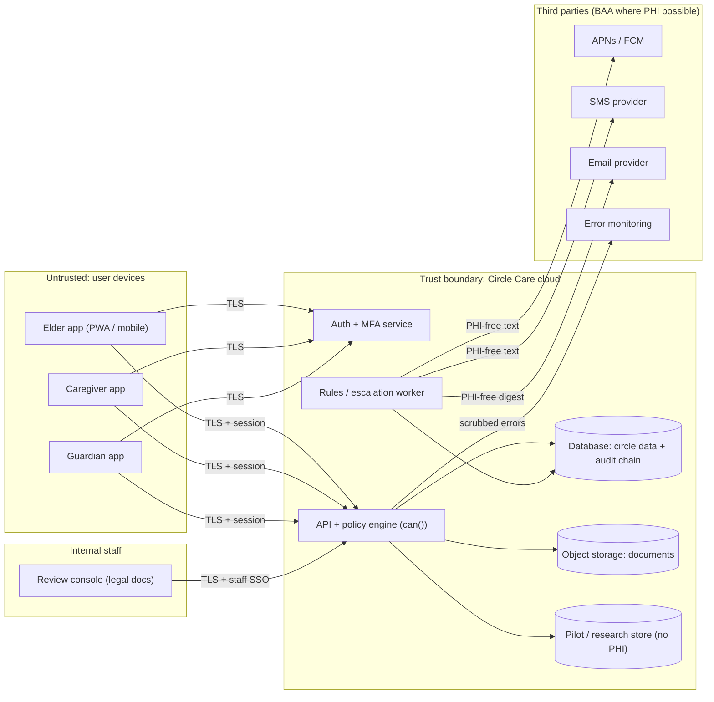

# Threat Model (STRIDE) — MVP Architecture

Notion story: CC-10 Threat model the MVP architecture
Status: DRAFT v1 — written by the product owner on 2026-10-19 against the **planned** MVP architecture. The prototype has no backend; production components below are not built. Needs review by an engineer with security experience and the designated security officer (CC-79).

## 1. Scope

In scope: mobile/web clients (elder, caregiver, guardian), API, authentication and MFA, primary database, object storage for documents, notification providers (push, SMS, email), the internal review console for legal documents, pilot/research store.
Out of scope for v1: integrations with EHRs/pharmacies, wearables, payment.

## 2. Data flow diagram

Trust boundaries: device ↔ cloud; staff ↔ cloud; cloud ↔ each vendor.

## 3. Threats

Legend for status: **Demo** = demonstrated in the browser prototype; **Prod** = production work not started.

### Spoofing

| ID | Threat | Component | Mitigation | Story | Status |
|---|---|---|---|---|---|
| S1 | Attacker signs in as a guardian using stolen password | Auth | MFA required for guardian and caregiver; lockout after 5 wrong codes for 15 minutes with a security notice | CC-12 | Demo (code `482913`; lockout alert in `lockedOut`). Prod: real TOTP/passkeys, rate limiting server-side |
| S2 | Someone claims to be a guardian without legal authority | Review console | Legal documents reviewed before guardian permissions apply; rejection reasons recorded | CC-23/24 | Demo (`/app/review`). Prod: reviewer training, identity verification vendor |
| S3 | Stolen/shared caregiver phone used by another person | Clients | Session lock after inactivity (default 15 min for caregiver/guardian); Sign out everywhere | CC-14, CC-27 | Demo. Prod: revoke server sessions and push tokens |
| S4 | Forged invite link | Invite | Single-use, expiring invite tokens; role set by inviter only | CC-17 | Prod |
| S5 | Spoofed SMS appearing to come from Circle Care (phishing) | SMS | Registered sender; messages never ask for codes or links to sign in; educate users | CC-31 | Prod |

### Tampering

| ID | Threat | Component | Mitigation | Story | Status |
|---|---|---|---|---|---|
| T1 | Client bypasses UI to perform disallowed action | API | Policy check on every request server-side using the same matrix | CC-19 | Demo in data layer only; several actions not yet guarded (see permission matrix "Coverage gaps"). Prod: API enforcement |
| T2 | Insider edits or deletes audit entries to hide access | DB | Hash-chained audit log; `verifyChain()` detects alteration; write-once storage in prod | CC-28 | Demo (`src/data/audit.ts`, tests in `audit.test.ts`). Prod: append-only store, external anchor |
| T3 | Malicious file upload (disguised executable) | Object storage | Check content signature (PDF/PNG/JPEG), 10 MB limit; malware scan | CC-67 | Demo (`inspectUpload`). Prod: server-side scan |
| T4 | Local storage altered on device | Client | AES-GCM authenticated encryption; tampered data fails to decrypt | CC-26 | Demo |
| T5 | Caregiver fakes visit check-in time | API | Server timestamps; location confirmed once at the door; manual reason recorded | CC-56 | Demo (manualReason). Prod: server time, location policy (CC-8 Q6) |

### Repudiation

| ID | Threat | Mitigation | Story | Status |
|---|---|---|---|---|
| R1 | Member denies viewing records | Every view logged and visible to elder/guardian | CC-28, CC-29 | Demo (`logView`, 10-minute dedupe per resource) |
| R2 | Guardian denies approving a med change | Approval with `decidedAt`, actor in audit; elder notified | CC-64, CC-65 | Demo |
| R3 | Caregiver denies giving a dose | Dose `by`, `at`, `verified` flag | CC-41 | Demo |

### Information disclosure

| ID | Threat | Component | Mitigation | Story | Status |
|---|---|---|---|---|---|
| I1 | Lock-screen notification reveals a medicine or condition | Push/SMS | Generic titles only ("You have a reminder from Circle Care"); details in app after unlock | CC-31 | Demo (`Alert.title` rule) |
| I2 | Caregiver browses records off shift | API | `pro@shift` rule | CC-18/19 | Demo + tested |
| I3 | Lost device exposes data | Client | Device encryption with non-extractable key; session lock; Sign out everywhere; close circle destroys key | CC-26, CC-27, CC-14 | Demo |
| I4 | Export file leaked | Export | Passphrase-encrypted export (PBKDF2 250k → AES-256-GCM); export logged; re-auth before export | CC-32 | Demo |
| I5 | Family member bulk-views records (curiosity or coercion) | API/rules | Suspicious access detection: 8+ views in 5 min or 3+ denials in 10 min → guardian alert | CC-35 | Demo (`simulate("suspicious-access")`, `rules.test.ts`) |
| I6 | PHI in vendor logs (error monitoring, email) | Vendors | Scrub payloads; PHI-free email digest; BAAs where unavoidable | CC-30, CC-83 | Prod |
| I7 | XSS steals session/data | Clients | Content Security Policy on production build (`script-src 'self'`, `object-src 'none'`, `frame-src blob:` limits what the app itself can embed), no-referrer | CC-78 | Demo (CSP injected as a `<meta>` tag in `vite.config.ts`). Note: the code comment says "nothing can frame the app", but `frame-ancestors` is not in the policy and is ignored in `<meta>` CSP anyway — clickjacking protection needs an HTTP header (`frame-ancestors 'none'` / `X-Frame-Options`). Prod |
| I8 | Document screenshots shared outside circle | Docs viewer | Watermark with viewer name and time; each view logged | CC-67 | Demo |
| I9 | Pilot research data re-identifies a family | Research store | Separate store, minimal fields, health-word scrub, cohort suppression <5 | CC-74/76/77 | Demo |
| I10 | Reviewer sees more than legal docs | Review console | Reviewer role limited to `docs.legal` review | CC-24 | Demo; Prod: separate app |

### Denial of service

| ID | Threat | Mitigation | Story | Status |
|---|---|---|---|---|
| D1 | Push provider outage delays SOS | SMS fallback (`via: "sms-fallback"`); escalation chain advances every `escalationDelayMin` (default 2) | CC-46–48 | Demo (state only); Prod: real multi-channel delivery, monitoring |
| D2 | Alert storm causes guardian to mute app | De-duplication keys on alerts; quiet hours; critical bypass for SOS only | CC-50, CC-63 | Demo |
| D3 | Account lockout used to block a guardian during emergency | Lockout limited to 15 min; SOS respond path doesn't require re-auth beyond unlock | CC-12 | Partial; review |

### Elevation of privilege

| ID | Threat | Mitigation | Story | Status |
|---|---|---|---|---|
| E1 | Family member promotes self to guardian | Only elder/guardian can invite/revoke; guardian role requires verification | CC-18, CC-24 | Demo |
| E2 | Revoked or expired member keeps access | Status check in `roleOf()`; time-bound access auto-revokes | CC-25 | Demo + tested |
| E3 | Pending member (invited, not accepted) acts | `status !== "active"` → no access | CC-17 | Demo + tested |
| E4 | Staff/admin access to all circles | Break-glass only, logged, reviewed; no standing access | CC-79 | Prod |

## 4. Prototype vs. production summary

**Demonstrated (browser, fictional data):** permission matrix and pro@shift; sharing pause; hash-chained audit; device encryption; encrypted file store with signature checks; passphrase export; PHI-free alert titles; session lock; lockout notice; Sign out everywhere (state only); suspicious access rules; guardian document review queue; CSP on build.

**Production work required:** API with server-side policy, real auth/MFA, managed key encryption at rest, append-only audit storage, malware scanning, vendor BAAs (CC-30), real push/SMS with critical-alert entitlements, rate limiting, logging with PHI scrubbing, incident response (CC-34), external pen test (CC-78), HIPAA risk analysis (CC-79).

## 5. Human actions

- [ ] Engineering review of this model once an architecture is chosen.
- [ ] Add threats for any integration (pharmacy, EHR) before building it.
- [ ] Re-run STRIDE at each major release.
