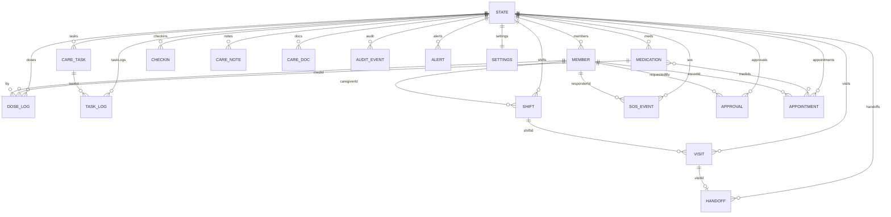
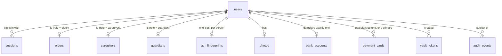

# Data model

All entities are defined in `src/data/types.ts` and seeded in `src/data/demo.ts`. In the prototype the whole model lives in one `State` object in the browser. The [data inventory (CC-9)](../../compliance/09-data-inventory.md) classifies every field (PHI, personal, operational) and proposes retention.

## Entity relationships

## Enumerations

| Type | Values |
|---|---|
| `Persona` | `elder`, `caregiver`, `guardian` (app experiences) |
| `Role` | `elder`, `guardian`, `family`, `pro` (circle roles); plus `reviewer` for the actor `trust-safety` in policy |
| `DoseStatus` | `taken`, `skipped`, `refused` |
| `AppointmentKind` | `doctor`, `lab`, `refill`, `review` |
| `AuditEvent.action` | `viewed`, `created`, `updated`, `removed`, `approved`, `declined`, `exported`, `signed in`, `signed out`, `denied` |
| `Alert.severity` | `info`, `warning`, `critical` |

## Entities

### Member

| Field | Type | Notes |
|---|---|---|
| `id` | string | e.g. `m-maggie`, `m-sarah`, `m-ana`, `m-james`, `m-ruth` |
| `name`, `short` | string | Full and first name |
| `role` | `Role` | |
| `relation` | string | e.g. *Daughter · Healthcare power of attorney* |
| `phone` | string | Fictional `+1 (415) 555-01xx` |
| `color`, `photo?` | string | Avatar colour; photo key |
| `status` | `active` · `pending` · `revoked` | |
| `verification?` | `verified` · `pending` · `none` | Guardian legal authority (CC-23/24) |
| `expiresOn?` | `YYYY-MM-DD` | Time-bound access (CC-25) |
| `favorite?` | boolean | Shown in *Call my person* |
| `invitedAt?` | ISO time | For 72-hour invite expiry |

### Medication

| Field | Type | Notes |
|---|---|---|
| `id`, `name`, `strength`, `dose` | string | |
| `times` | `HH:MM[]` | Daily schedule |
| `instructions`, `prescriber`, `purpose` | string | |
| `critical` | boolean | High priority — escalates twice as fast |
| `paused` | boolean | Excluded from today's doses |
| `pill` | `{ color, shape: round · oval · capsule }` | Drawn by `PillArt` |
| `history` | `{ at, by, change }[]` | Change log |

### DoseLog

| Field | Type | Notes |
|---|---|---|
| `id`, `medId` | string | |
| `date`, `time` | `YYYY-MM-DD`, `HH:MM` | The scheduled slot |
| `status` | `DoseStatus` | |
| `by`, `at` | member id, ISO | Who recorded, when |
| `verified` | boolean | Caregiver on shift (CC-41) |
| `reason?` | string | For skipped / refused |

### CareTask and TaskLog

| Entity | Fields |
|---|---|
| `CareTask` | `id`, `title`, `icon` (lucide key), `time`, `recurrence` (daily · weekdays · weekends), `assignee` (`caregiver`, `elder` or a member id) |
| `TaskLog` | `taskId`, `date`, `by`, `at`, `note?` |

### Shift, Visit and Handoff

| Entity | Fields |
|---|---|
| `Shift` | `id`, `caregiverId` (or null = uncovered), `days` (0 = Sunday), `start`, `end`, `accepted` |
| `Visit` | `id`, `shiftId`, `caregiverId`, `date`, `checkIn?`, `checkOut?`, `manualReason?` |
| `Handoff` | `id`, `visitId`, `by`, `at`, `mood`, `meals`, `concerns`, `notes`, `summary`, `acknowledgedBy?`, `acknowledgedAt?`, `skippedReason?` |

### SosEvent and Checkin

| Entity | Fields |
|---|---|
| `SosEvent` | `id`, `startedAt`, `status` (active · acknowledged · resolved), `step` (index into escalation chain), `responderId?`, `acknowledgedAt?`, `resolvedAt?`, `outcome?`, `via` (app · sms-fallback) |
| `Checkin` | `date`, `at`, `mood?` (emoji) |

### Approval

| Field | Type | Notes |
|---|---|---|
| `id`, `kind` | `med-change` · `member` · `shift-swap` | |
| `title`, `detail` | string | |
| `requestedBy`, `at` | member id, ISO | |
| `status` | `pending` · `approved` · `declined` | |
| `decidedAt?`, `note?` | | Guardian's decision and note |
| `payload?` | object | e.g. `{ medId, from, to }`, `{ med }`, `{ memberId }`, `{ shiftId, to }` |
| `elderSeen?`, `elderQuestion?` | | CC-65 |

### CareNote and CareDoc

| Entity | Fields |
|---|---|
| `CareNote` | `id`, `by`, `at`, `text`, `visibility` (everyone · guardian) |
| `CareDoc` | `id`, `name`, `kind` (Care plan · Discharge summary · Legal authority · Other), `by`, `at`, `size`, `status?` (pending · verified · rejected), `rejectReason?`, `fileId?` (encrypted file store), `mime?` |

### Appointment

| Field | Type |
|---|---|
| `id`, `date`, `time`, `durationMin` | |
| `kind` | `AppointmentKind` |
| `title`, `provider`, `location`, `prep?` | string |
| `medIds` | medication ids |
| `escortId?` | member id |
| `status` | scheduled · done · cancelled |
| `createdBy` | member id |

### AuditEvent

| Field | Type | Notes |
|---|---|---|
| `id`, `at`, `actorId` | | `actorId` may be `system` or `trust-safety` |
| `action` | see enumeration | |
| `resource` | string | Human-readable resource name; never a health value |
| `prev`, `hash` | 64-hex SHA-256 | Tamper-evident chain (CC-28) |

### Alert

| Field | Type | Notes |
|---|---|---|
| `id`, `key?`, `at` | | `key` de-duplicates rule alerts |
| `to` | `Persona[]` | |
| `title` | string | Lock-screen text, PHI-free (CC-31) |
| `detail` | string | In-app only |
| `severity` | info · warning · critical | |
| `read` | `Persona[]` | |
| `link?` | route | |

### Settings

| Field | Default | Notes |
|---|---|---|
| `checkinWindow` | `{ 08:00, 10:00 }` | |
| `escalation` | `[Sarah, Ana, James]` | SOS order |
| `escalationDelayMin` | 2 | |
| `doseEscalation` | `{ caregiverMin: 30, guardianMin: 60 }` | |
| `quietHours` | `{ on: true, 22:00, 07:00 }` | |
| `channels` | `{ push: true, sms: true, email: false }` | |
| `criticalBypass` | true | |
| `textSize` | `xl` | large · xl · xxl |
| `highContrast`, `readAloud` | false, true | |
| `sharingPaused` | false | CC-81 |
| `consent?` | `{ version: "1.0", at, by, onBehalfReason? }` | CC-22 |
| `sessionLockMin` | 15 | Caregiver and guardian |
| `elderLockMin` | 0 (never) | CC-14 |
| `toured` | `{}` | CC-75 |
| `setupCallRequested?` | ISO | CC-75 |
| `vitals` | `{ intervalMin: 30, thresholds: { hrHigh 110, hrLow 50, hrJump 25, spo2Low 92, spo2Drop 4 }, shareWithGuardian: true }` | CC-84 – 88 |
| `emergencyCard` | allergies, conditions, directives, bloodType, approvedByElder, approvedAt | CC-53 |

### State (root)

| Field | Notes |
|---|---|
| `version` | `STATE_VERSION` = 6 |
| `persona` | Current app persona or null |
| `signedIn` | Per persona |
| `clockOffsetMin` | Demo clock offset |
| `elderId` | `m-maggie` |
| `health` | `{ heightCm: 163, birthYear: 1946, device: "Maggie's watch", overrides[] }` |
| Collections | As above |

## Data outside the main state

| Store | Contents |
|---|---|
| `localStorage["circle-care-demo"]` | The encrypted `State` (`enc:v1:<iv>:<ciphertext>`) |
| IndexedDB `circle-care-keys` | The non-extractable AES-GCM `CryptoKey` |
| IndexedDB `circle-care-files` | Encrypted document files `{ iv, ct }` |
| `localStorage["circle-care-pilot-leads"]`, `["circle-care-nps"]` | Pilot and NPS data (de-identified, unencrypted, kept apart from care data) |
| `localStorage["circle-care-deletions"]` | Timestamps of closed circles |
| `sessionStorage["cc-nps-dismissed-<persona>"]` | NPS dismissed this session |

## Computed, not stored

Vital-sign readings, activity, sleep, weight series, dose states, coverage gaps, streaks, adherence, North Star and the activity feed are all **derived** on demand (`src/lib/health.ts`, `src/data/selectors.ts`).

## Server database (PostgreSQL) — accounts, identity & payments {#server-database}

Since Sprint 11 (CC-189), real accounts live in PostgreSQL, separately from the browser-only demo state described above. The schema is in `server/migrations/001_init.sql` and is applied by versioned migrations.

| Table | Key columns | Notes |
|---|---|---|
| `users` | `id`, `email` (unique, lower-case), `password_hash` (scrypt), `role`, `failed_attempts`, `locked_until` | Sign-in identity |
| `sessions` | `token_hash` (SHA-256), `user_id`, `last_seen_at`, `expires_at` | The raw token exists only in the cookie |
| `elders` / `caregivers` / `guardians` | `user_id` (unique), `first_name`, `last_name`, `phone` (`+1XXXXXXXXXX`), `email`, `ssn_enc`, `ssn_last4` | **Separate table per persona**; `ssn_enc` is AES-256-GCM ciphertext |
| `ssn_fingerprints` | `fingerprint` (HMAC-SHA256, PK), `user_id` (unique) | Duplicate-SSN detection without decrypting |
| `photos` | `user_id`, `content_type`, `data_enc`, `size_bytes ≤ 2 MB` | Encrypted image |
| `bank_accounts` | `vault_token`, `bank_name`, `account_type`, `account_last4`, `routing_last4`, `ach_fee_cents = 0` | One per user; `CHECK` stops full numbers |
| `payment_cards` | `vault_token`, `brand`, `funding`, `last4`, `exp_month`, `exp_year`, `is_primary` | Unique index allows only one primary per user |
| `vault_tokens` | `token`, `kind`, `owner_user_id`, `metadata` (last four only), `attached_at`, `revoked_at` | Simulated vault register; tokens expire after 15 min if unused |
| `audit_events` | `at`, `actor_user_id`, `subject_user_id`, `action`, `detail` (masked JSON) | Append-only (trigger blocks UPDATE/DELETE) |
| `audit_people_masked`, `audit_payment_methods_masked` | views | The only objects an auditor's role should be able to read |

See [Accounts, identity & payments](../features/accounts-identity-payments.md).

## Related pages

- [System overview](system-overview.md)
- [Security & privacy](security-and-privacy.md)
- [Data inventory (CC-9)](../../compliance/09-data-inventory.md)
