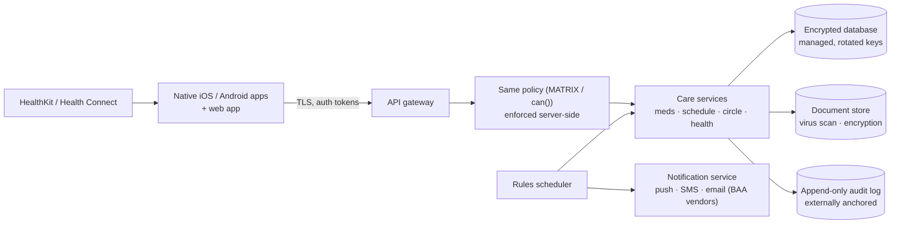

# System overview

This page describes how the Circle Care **prototype v0.5** is built. It is a single-page web application. All care data, rules and permission checks run in the browser. Since Sprint 11, a small API server holds real accounts, identity and payment methods in PostgreSQL ([Accounts, identity & payments](../features/accounts-identity-payments.md)); it never receives care data. Where a production design differs, it is called out as **In production (planned)**.

## At a glance

| Concern | Prototype choice |
|---|---|
| UI | React 19 + TypeScript, Vite build, lucide-react icons, hand-written CSS (no UI framework) |
| Routing | React Router 7 `HashRouter` (URLs like `/#/app/guardian`) so any static host works without rewrites |
| State | One `State` object in a React context (`StoreProvider` in `src/data/store.tsx`), updated immutably via `structuredClone` |
| Business rules | `evaluate()` rules engine, run every 15 s and after every change |
| Everyday care (Sprint 12) | `src/data/everyday.ts` (derived views) and `src/data/everydayActions.ts` (changes): refills, daily check-ins, family chat, evening recap |
| Authorisation | `can()` and the `MATRIX` in `src/data/policy.ts` |
| Persistence | Browser `localStorage`, encrypted with AES-256-GCM; key and files in IndexedDB |
| Audit | SHA-256 hash-chained log (`src/data/audit.ts`, `src/lib/sha256.ts`) |
| Offline / install | Web app manifest + service worker (`public/`) |
| Charts | Dependency-free SVG components (`src/components/charts.tsx`) |
| Speech | Web Speech API — synthesis for read-aloud; recognition only when on-device |
| Accounts server (Sprint 11) | Express 5 + TypeScript in `server/`; PostgreSQL through `DATABASE_URL`; PGlite (Postgres in WASM) when `DATABASE_URL` isn't set, in development and tests, never in production |
| Hosting | Replit autoscale deployment (`.replit`): `npm run build`, then `npm start` serves the app and the API |

## Component diagram

```mermaid
flowchart TB
    subgraph Browser["Browser (single device)"]
      direction TB
      subgraph UI["React UI — src/pages, src/components"]
        Site["Website pages<br/>Landing, site/*"]
        Shell["AppShell<br/>tabs, banners, lock, privacy shield,<br/>persona switcher"]
        Elder["Elder pages"]
        Care["Caregiver pages"]
        Guard["Guardian pages"]
        Shared["Shared pages<br/>Privacy Center, Notes, Alerts,<br/>Emergency card, SOS responder,<br/>Family chat"]
        Account["Account pages<br/>Join, Login, My account"]
        Internal["Internal pages<br/>Review console, Pilot dashboard"]
      end
      subgraph Data["Data layer — src/data"]
        Store["store.tsx<br/>StoreProvider · actions · guard()"]
        Rules["evaluate()<br/>rules engine"]
        Policy["policy.ts<br/>MATRIX · can()"]
        Sel["selectors.ts<br/>derived views"]
        Every["everyday.ts · everydayActions.ts<br/>refills · check-ins · chat · recap"]
        Audit["audit.ts<br/>hash chain"]
        Seed["demo.ts<br/>seed data"]
      end
      subgraph Lib["Libraries — src/lib"]
        Sec["secureStorage.ts<br/>AES-GCM · PBKDF2 · upload checks"]
        Health["health.ts<br/>simulated readings · detection"]
        Voice["voice.ts<br/>on-device recognition"]
        Pilot["pilot.ts<br/>NPS · leads · scrubbing"]
        Sha["sha256.ts"]
      end
      LS[("localStorage<br/>enc:v1:… state<br/>pilot + NPS keys")]
      IDB[("IndexedDB<br/>non-extractable key<br/>encrypted files")]
      SW["Service worker<br/>sw.js"]
    end
    API["Accounts API server<br/>server/ · /api/*, /vault/*<br/>PostgreSQL"]
    Unsplash["images.unsplash.com<br/>(stock photos)"]
    Fonts["Google Fonts"]

    UI --> Store
    Store --> Policy
    Store --> Rules
    Store --> Audit
    Rules --> Sel
    Rules --> Health
    UI --> Sel
    UI --> Every
    Store --> Every
    Rules --> Every
    Account -->|"HTTPS, session cookie"| API
    Audit --> Sha
    Store --> Sec
    Sec --> LS
    Sec --> IDB
    Guard --> Health
    Elder --> Voice
    UI --> Pilot
    Pilot --> LS
    Seed --> Store
    UI -.-> Unsplash
    UI -.-> Fonts
```

### In production (planned)

Everything that touches health information must run on vendors that have signed a BAA (see the [vendor & BAA register](../../compliance/30-vendor-baa-register.md)).

## Routes

From `src/App.tsx`. All paths are hash routes (prefix `/#`).

### Website and entry

| Path | Component | Purpose |
|---|---|---|
| `/` | `Landing` | Home page |
| `/how-it-works` | `site/HowItWorks` | A day in the circle; setup steps |
| `/features` | `site/Features` | Features per persona |
| `/who-its-for` | `site/WhoItsFor` | Personas |
| `/privacy` | `site/Privacy` | Privacy pillars, "never" list, FAQ |
| `/pilot` | `site/Pilot` | Pilot recruitment |
| `/app` | `Welcome` | Choose a person; sign-up |
| `/app/join`, `/app/join/:role` | `account/Join` | Create a real account (CC-172, CC-173) |
| `/app/login` | `account/Login` | Sign in to a real account (CC-174) |
| `/app/account` | `account/MyAccount` | Profile, identity, photo, payment methods (CC-176 – CC-188) |
| `/app/sign-in/:persona` | `SignIn` | Demo sign-in, MFA, consent |
| `/app/invite/:memberId` | `Invite` | Accept an invitation |
| `/app/review` | `internal/Review` | Review team console |
| `/app/pilot` | `internal/PilotDashboard` | Pilot dashboard |
| `/app/sos` | `SosRedirect` | Redirects to the current persona's SOS page |
| `/app/chat` | `SosRedirect to="chat"` | Redirects to the current persona's family chat |
| `*` | — | Redirects to `/` |

### Elder — `/app/elder` (inside `AppShell persona="elder"`)

| Path | Component |
|---|---|
| (index) | `elder/ElderHome` |
| `next` | `elder/ElderNext` |
| `sos` | `elder/ElderSos` |
| `call` | `elder/ElderCall` |
| `privacy` | `shared/PrivacyCenter` |
| `settings` | `elder/ElderSettings` |
| `decisions` | `elder/ElderDecisions` |
| `card` | `shared/EmergencyCard` |
| `chat` | `ChatView large` (CC-165) |

### Caregiver — `/app/caregiver`

| Path | Component |
|---|---|
| (index) | `caregiver/CaregiverToday` |
| `handoff` | `caregiver/CaregiverHandoff` |
| `schedule` | `caregiver/CaregiverSchedule` |
| `notes` | `shared/Notes` wrapped in `AccessGuard resource="notes"` |
| `card` | `shared/EmergencyCard` |
| `alerts` | `shared/Alerts` |
| `sos` | `shared/SosResponder` |
| `chat` | `ChatView` (CC-164) |

### Guardian — `/app/guardian`

| Path | Component |
|---|---|
| (index) | `guardian/GuardianHome` |
| `meds` | `guardian/Medications` |
| `health` | `guardian/Health` |
| `calendar` | `guardian/Calendar` |
| `approvals` | `guardian/Approvals` |
| `circle` | `guardian/Circle` |
| `schedule` | `guardian/Schedule` |
| `feed` | `guardian/Feed` |
| `digest` | `guardian/Digest` |
| `notes` | `shared/Notes` |
| `privacy` | `shared/PrivacyCenter` |
| `card` | `shared/EmergencyCard` |
| `settings` | `guardian/GuardianSettings` |
| `alerts` | `shared/Alerts` |
| `sos` | `shared/SosResponder` |
| `chat` | `ChatView` (CC-164) |

`AppShell` redirects to `/app/sign-in/<persona>` when that persona is not signed in. On the guardian app, Home, Health, Calendar, Chat and Approvals are tabs on phones; the rest are under **More**. The caregiver app gets a Chat tab only once Maggie or Sarah adds the caregiver to the chat.

## State model

- **One state object** (`State` in `src/data/types.ts`) holds the whole circle: members, medicines (with pills on hand), doses, tasks, shifts, visits, hand-offs, SOS events, check-ins, daily check-ins, the family chat, approvals, notes, documents, appointments, health settings, audit log, alerts and settings. See [Data model](data-model.md).
- **Updates** go through `update(fn)`: the state is deep-copied with `structuredClone`, the action mutates the draft, `evaluate()` runs, and React re-renders.
- **Actions** (`actions` in `useStoreState`) are the only way to change data. Each guarded action calls `guard(state, action, resource)` → `can()`; refusals change nothing and write a `denied` audit entry.
- **Selectors** (`src/data/selectors.ts`) compute derived views — dose states, next item, late check-ins, coverage gaps, streaks, adherence, North Star, activity feed.
- **Demo clock**: `clock(state)` = now + `clockOffsetMin` so presenters can skip ahead.
- **Versioning**: `STATE_VERSION` (`src/data/demo.ts`) = 11. `loadState()` in `store.tsx` discards and reseeds a stored state with any other version. See [State versions](data-model.md#state-versions).
- **Persistence**: each change starts an encrypted save at once, with the device key loaded before the first save (`src/data/saver.ts`, CC-195). A save only writes when nothing newer is stored, and the state is saved again when the page is hidden or closed. The 15 second tick keeps the same state when nothing changed, so it doesn't save, but screens that show time still re-render. Closing the circle pauses saving while the data and key are wiped. See [Security & privacy](security-and-privacy.md#encryption-at-rest).
- **Read logging**: `logView(resource)` writes a *viewed* entry at most once per resource every 10 minutes.

## Rules engine

`evaluate(state)` in `src/data/store.tsx` is a pure function over the state draft. It runs **every 15 seconds** (`setInterval`) and **after every action**.

| Order | Rule | Story |
|---|---|---|
| 1 | Dose repeat reminder at +10 min; caregiver and guardian escalation at their thresholds | CC-39, CC-42, CC-43 |
| 2 | Missed check-in: elder prompt after window end; guardian at +15 min | CC-52 |
| 3 | Late caregiver check-in (> 15 min) | CC-57 |
| 4 | SOS escalation step every `escalationDelayMin` minutes | CC-48 |
| 5 | Approval waiting > 24 h | CC-64 |
| 6 | Suspicious access: ≥ 8 views in 5 min, ≥ 3 denials in 10 min | CC-35 |
| 7 | Unusual vital signs (if shared) | CC-86, CC-88 |
| 8 | Low medicine supply: one alert per bottle to Sarah and Ana when days left reach `refillAlertDays`, until someone requests a refill; plus a refill entry on the Calendar 3 days before it runs out | CC-121 |
| 9 | Cancel the automatic refill entry of a paused or removed medicine | CC-121 |
| 10 | Daily check-in: one gentle reminder to Maggie at 7 PM, only if she logged nothing | CC-142 |
| 11 | No meals logged for 2 days: one note to Sarah, only while Maggie shares check-ins, from 9 AM, and only if she logged a meal in the 5 days before (private or unshared days never count) | CC-143 |
| 12 | Evening recap: one update to Sarah at 7 PM (catches up until 11 PM), unless she turned it off or it falls in quiet hours | CC-191 |
| 13 | Expire time-limited members (and take them out of the chat) | CC-25 |

`pushAlert()` ignores an alert whose `key` already exists, which makes the engine idempotent. Full catalogue: [Alerts & notifications](../features/alerts-and-notifications.md).

**In production (planned):** the same rules run server-side on a scheduler, independent of any open browser, with delivery through a notification service.

## Everyday care (Sprint 12)

| Feature | Elder (Maggie) | Caregiver (Ana) | Guardian (Sarah) | Code |
|---|---|---|---|---|
| Refill tracker (CC-120, CC-121) | Nothing new on her screens | *Pills on hand* on Today during her shift, with New bottle and Request refill; the low-supply alert | Days left for each medicine in Medications; the low-supply alert and a Calendar refill entry | `SupplyRow` in `guardianEveryday.tsx` |
| Daily check-ins (CC-142, CC-143) | *My day* card on Home: six drawn faces, water glasses, three meals, one tap each; her own sharing switch in My privacy (Privacy Center) | No access | Today's check-in on Home and a 7-day view in Health, only while Maggie shares | `DailyCheckins` in `everyday.tsx`, `DailyWeek` in `guardianEveryday.tsx` |
| Family chat (CC-164, CC-165) | Large-text chat at `/app/elder/chat` with one microphone and a read-back card before sending; a chat tile on Home she can hide | Chat tab only once added; sees messages from when she joined | Chat tab with an unread count; the header names who can read | `ChatView`, `ElderChatTile` in `chat.tsx` |
| Evening recap (CC-191) | Nothing changes; her check-in appears only while she shares | No access | *Evening recap* card on Home from 6 PM; one 7 PM update that says only "Update from Circle Care", which she can turn off in Settings | `EveningRecap` in `guardianEveryday.tsx`, `recap()` in `everyday.ts` |

Every chat message, typed or spoken, from anyone, passes a health-detail check that offers Notes instead (`phiHint`, CC-164; fewer false alarms since CC-192).

Permissions are in `MATRIX` (`src/data/policy.ts`): `supply` (elder, guardian and family; paid caregivers only on shift), `wellbeing` (elder writes; guardian reads only while Maggie shares and sharing isn't paused) and `chat` (elder, guardian and family; paid caregivers only once added, and elder and guardian can add them; while Maggie pauses sharing, only she and Sarah can use it). Lock screens never show medicine names or check-in details.

## Cross-cutting UI

| Component | Responsibility | Story |
|---|---|---|
| `AppShell` | Header, side nav / tab bar, SOS bar, sharing-paused banner, notification banners, session lock, NPS card, welcome tour, privacy shield | CC-14, CC-26, CC-75, CC-76 |
| `PersonaSheet` | Demo mode and presenter controls | CC-80 |
| `Extras.tsx` | `PrivacyShield`, `AccessGuard`, `WelcomeTour`, `NpsCard` | CC-19, CC-26, CC-75, CC-76 |
| `ui.tsx` | Avatar (contrast-aware initials), Toggle, Segmented, Sheet, Ring, PillArt, Toast, `useSpeech`, `download` | CC-71, CC-72 |
| `charts.tsx` | LineChart, ColumnChart, Sparkline, Meter, ChartLegend | CC-84 |
| `Site.tsx` | Website navigation, footer with photo credits, page hero | — |

## PWA and service worker

| Item | Detail |
|---|---|
| Manifest | `public/manifest.webmanifest` — name *Circle Care*, `start_url: /#/app`, `display: standalone`, background/theme `#FBFBFD`, 192/512 PNG icons (512 also maskable) and an SVG icon |
| Service worker | `public/sw.js`, cache `circle-care-v2`. Pre-caches the app shell (`/`, `/index.html`, manifest, icons). **Network-first** for same-origin GET requests, falling back to cache and then to `/index.html`. `/api/*` and `/vault/*` are never cached (CC-181) |
| Registration | `src/main.tsx`, production builds only |
| Install | Safari → *Share → Add to Home Screen*; Chrome → *Install app* / *Add to Home Screen* |

## Build and deploy {#build-and-deploy}

| Command | What it does |
|---|---|
| `npm install` | Install dependencies (Node 20.11+) |
| `npm run dev` | Vite dev server on port **5000**, all hosts (Replit preview); `/api` and `/vault` are served in-process by the accounts server (PGlite unless `DATABASE_URL` is set) |
| `npm test` | Vitest unit tests (app and server) |
| `npm run typecheck` | Type-check the app and the server |
| `npm run build` | Type-check the app and the server, then `vite build` into `dist/` with the CSP meta tag injected |
| `npm start` | Run the accounts server (`server/index.ts`), which also serves `dist/` |
| `npm run db:migrate` | Apply database migrations (`server/migrations`) |
| `npm run audit:export` | Masked audit export (CC-184) |
| `npm run preview` | Serve `dist/` on port 4173 (no API) |

**Replit.** `.replit` runs `npm install && npm run dev` (Node 20, port 5000 → 80). The deployment target is **autoscale**: build `npm install && npm run build`, run `APP_ENV=staging npm start`. The deployed copy is *staging*: a real server and PostgreSQL database with test data only. It needs `DATA_ENCRYPTION_KEY` and `DATA_HMAC_KEY` in Secrets and a PostgreSQL database. See [Accounts, identity & payments](../features/accounts-identity-payments.md).

**This wiki** is built separately with MkDocs (`mkdocs build`, `mkdocs gh-deploy`) — see [How to contribute](../how-to-contribute.md).

## External dependencies at runtime

| Dependency | Why | Notes |
|---|---|---|
| `images.unsplash.com` | Stock photography on the website and avatars | Allowed by CSP `img-src`; credited in the footer; app works without it |
| Google Fonts (Inter) | Typography | Allowed by CSP `style-src` / `font-src` |

No analytics and no trackers. The only API calls go to Circle Care's own accounts server (`/api/*`, plus the simulated payment vault `/vault/v1/*` when the simulated payment provider is in use, never in production; CSP `connect-src 'self'`); care data never leaves the browser.

## Related pages

- [Data model](data-model.md)
- [Security & privacy](security-and-privacy.md)
- [Quality & testing](quality-and-testing.md)
- [Traceability matrix](../traceability.md)
