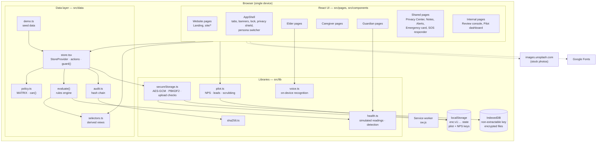
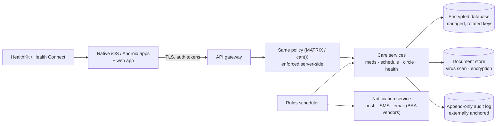

# System overview

This page describes how the Circle Care **prototype v0.4** is built. It is a single-page web application with no backend: all data, rules and permission checks run in the browser. Where a production design differs, it is called out as **In production (planned)**.

## At a glance

| Concern | Prototype choice |
|---|---|
| UI | React 19 + TypeScript, Vite build, lucide-react icons, hand-written CSS (no UI framework) |
| Routing | React Router 7 `HashRouter` (URLs like `/#/app/guardian`) so any static host works without rewrites |
| State | One `State` object in a React context (`StoreProvider` in `src/data/store.tsx`), updated immutably via `structuredClone` |
| Business rules | `evaluate()` rules engine, run every 15 s and after every change |
| Authorisation | `can()` and the `MATRIX` in `src/data/policy.ts` |
| Persistence | Browser `localStorage`, encrypted with AES-256-GCM; key and files in IndexedDB |
| Audit | SHA-256 hash-chained log (`src/data/audit.ts`, `src/lib/sha256.ts`) |
| Offline / install | Web app manifest + service worker (`public/`) |
| Charts | Dependency-free SVG components (`src/components/charts.tsx`) |
| Speech | Web Speech API — synthesis for read-aloud; recognition only when on-device |
| Hosting | Replit static deployment (`.replit`) |

## Component diagram

### In production (planned)

Everything that touches health information must run on vendors that have signed a BAA (see the [vendor & BAA register](../../compliance/30-vendor-baa-register.md)).

## Routes

From `src/App.tsx`. All paths are hash routes (prefix `/#`).

### Website and entry

| Path | Component | Purpose |
|---|---|---|
| `/` | `Landing` | Home page |
| `/how-it-works` | `site/HowItWorks` | A day in the circle; setup steps |
| `/features` | `site/Features` | Features per persona |
| `/who-its-for` | `site/WhoItsFor` | Personas |
| `/privacy` | `site/Privacy` | Privacy pillars, "never" list, FAQ |
| `/pilot` | `site/Pilot` | Pilot recruitment |
| `/app` | `Welcome` | Choose a person; sign-up |
| `/app/sign-in/:persona` | `SignIn` | Sign-in, MFA, consent |
| `/app/invite/:memberId` | `Invite` | Accept an invitation |
| `/app/review` | `internal/Review` | Review team console |
| `/app/pilot` | `internal/PilotDashboard` | Pilot dashboard |
| `/app/sos` | `SosRedirect` | Redirects to the current persona's SOS page |
| `*` | — | Redirects to `/` |

### Elder — `/app/elder` (inside `AppShell persona="elder"`)

| Path | Component |
|---|---|
| (index) | `elder/ElderHome` |
| `next` | `elder/ElderNext` |
| `sos` | `elder/ElderSos` |
| `call` | `elder/ElderCall` |
| `privacy` | `shared/PrivacyCenter` |
| `settings` | `elder/ElderSettings` |
| `decisions` | `elder/ElderDecisions` |
| `card` | `shared/EmergencyCard` |

### Caregiver — `/app/caregiver`

| Path | Component |
|---|---|
| (index) | `caregiver/CaregiverToday` |
| `handoff` | `caregiver/CaregiverHandoff` |
| `schedule` | `caregiver/CaregiverSchedule` |
| `notes` | `shared/Notes` wrapped in `AccessGuard resource="notes"` |
| `card` | `shared/EmergencyCard` |
| `alerts` | `shared/Alerts` |
| `sos` | `shared/SosResponder` |

### Guardian — `/app/guardian`

| Path | Component |
|---|---|
| (index) | `guardian/GuardianHome` |
| `meds` | `guardian/Medications` |
| `health` | `guardian/Health` |
| `calendar` | `guardian/Calendar` |
| `approvals` | `guardian/Approvals` |
| `circle` | `guardian/Circle` |
| `schedule` | `guardian/Schedule` |
| `feed` | `guardian/Feed` |
| `digest` | `guardian/Digest` |
| `notes` | `shared/Notes` |
| `privacy` | `shared/PrivacyCenter` |
| `card` | `shared/EmergencyCard` |
| `settings` | `guardian/GuardianSettings` |
| `alerts` | `shared/Alerts` |
| `sos` | `shared/SosResponder` |

`AppShell` redirects to `/app/sign-in/<persona>` when that persona is not signed in. On the guardian app, Home, Health, Calendar and Approvals are tabs on phones; the rest are under **More**.

## State model

- **One state object** (`State` in `src/data/types.ts`) holds the whole circle: members, medicines, doses, tasks, shifts, visits, hand-offs, SOS events, check-ins, approvals, notes, documents, appointments, health settings, audit log, alerts and settings. See [Data model](data-model.md).
- **Updates** go through `update(fn)`: the state is deep-copied with `structuredClone`, the action mutates the draft, `evaluate()` runs, and React re-renders.
- **Actions** (`actions` in `useStoreState`) are the only way to change data. Each guarded action calls `guard(state, action, resource)` → `can()`; refusals change nothing and write a `denied` audit entry.
- **Selectors** (`src/data/selectors.ts`) compute derived views — dose states, next item, late check-ins, coverage gaps, streaks, adherence, North Star, activity feed.
- **Demo clock**: `clock(state)` = now + `clockOffsetMin` so presenters can skip ahead.
- **Versioning**: `STATE_VERSION = 6`. A stored state with another version is discarded and reseeded.
- **Persistence**: saves are debounced by 250 ms and flushed on `pagehide`. See [Security & privacy](security-and-privacy.md#encryption-at-rest).
- **Read logging**: `logView(resource)` writes a *viewed* entry at most once per resource every 10 minutes.

## Rules engine

`evaluate(state)` in `src/data/store.tsx` is a pure function over the state draft. It runs **every 15 seconds** (`setInterval`) and **after every action**.

| Order | Rule | Story |
|---|---|---|
| 1 | Dose repeat reminder at +10 min; caregiver and guardian escalation at their thresholds | CC-39, CC-42, CC-43 |
| 2 | Missed check-in: elder prompt after window end; guardian at +15 min | CC-52 |
| 3 | Late caregiver check-in (> 15 min) | CC-57 |
| 4 | SOS escalation step every `escalationDelayMin` minutes | CC-48 |
| 5 | Approval waiting > 24 h | CC-64 |
| 6 | Suspicious access: ≥ 8 views in 5 min, ≥ 3 denials in 10 min | CC-35 |
| 7 | Unusual vital signs (if shared) | CC-86, CC-88 |
| 8 | Expire time-limited members | CC-25 |

`pushAlert()` ignores an alert whose `key` already exists, which makes the engine idempotent. Full catalogue: [Alerts & notifications](../features/alerts-and-notifications.md).

**In production (planned):** the same rules run server-side on a scheduler, independent of any open browser, with delivery through a notification service.

## Cross-cutting UI

| Component | Responsibility | Story |
|---|---|---|
| `AppShell` | Header, side nav / tab bar, SOS bar, sharing-paused banner, notification banners, session lock, NPS card, welcome tour, privacy shield | CC-14, CC-26, CC-75, CC-76 |
| `PersonaSheet` | Demo mode and presenter controls | CC-80 |
| `Extras.tsx` | `PrivacyShield`, `AccessGuard`, `WelcomeTour`, `NpsCard` | CC-19, CC-26, CC-75, CC-76 |
| `ui.tsx` | Avatar (contrast-aware initials), Toggle, Segmented, Sheet, Ring, PillArt, Toast, `useSpeech`, `download` | CC-71, CC-72 |
| `charts.tsx` | LineChart, ColumnChart, Sparkline, Meter, ChartLegend | CC-84 |
| `Site.tsx` | Website navigation, footer with photo credits, page hero | — |

## PWA and service worker

| Item | Detail |
|---|---|
| Manifest | `public/manifest.webmanifest` — name *Circle Care*, `start_url: /#/app`, `display: standalone`, background/theme `#FBFBFD`, 192/512 PNG icons (512 also maskable) and an SVG icon |
| Service worker | `public/sw.js`, cache `circle-care-v1`. Pre-caches the app shell (`/`, `/index.html`, manifest, icons). **Network-first** for same-origin GET requests, falling back to cache and then to `/index.html` |
| Registration | `src/main.tsx`, production builds only |
| Install | Safari → *Share → Add to Home Screen*; Chrome → *Install app* / *Add to Home Screen* |

## Build and deploy {#build-and-deploy}

| Command | What it does |
|---|---|
| `npm install` | Install dependencies (Node 20+) |
| `npm run dev` | Vite dev server on port **5000**, all hosts (Replit preview) |
| `npm test` | Vitest unit tests |
| `npm run build` | `tsc --noEmit` type-check, then `vite build` into `dist/` with the CSP meta tag injected |
| `npm run preview` | Serve `dist/` on port 4173 |

**Replit.** `.replit` runs `npm install && npm run dev` (Node 20, port 5000 → 80). The deployment target is **static**: build `npm install && npm run build`, public directory `dist`. Import the GitHub repository into Replit, press **Run**, then **Deploy → Static**. The deployed URL is the live demo ("your Replit URL").

**This wiki** is built separately with MkDocs (`mkdocs build`, `mkdocs gh-deploy`) — see [How to contribute](../how-to-contribute.md).

## External dependencies at runtime

| Dependency | Why | Notes |
|---|---|---|
| `images.unsplash.com` | Stock photography on the website and avatars | Allowed by CSP `img-src`; credited in the footer; app works without it |
| Google Fonts (Inter) | Typography | Allowed by CSP `style-src` / `font-src` |

No analytics, no trackers and no API calls.

## Related pages

- [Data model](data-model.md)
- [Security & privacy](security-and-privacy.md)
- [Quality & testing](quality-and-testing.md)
- [Traceability matrix](../traceability.md)
