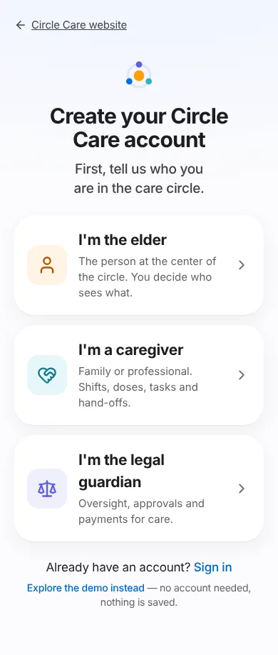
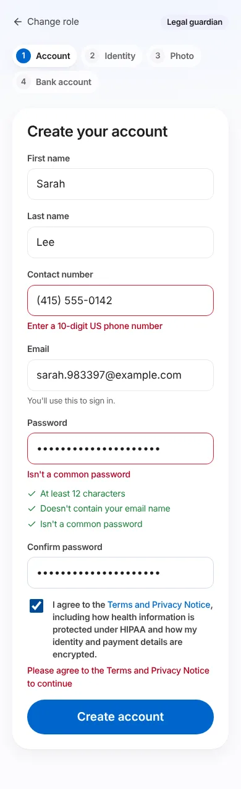
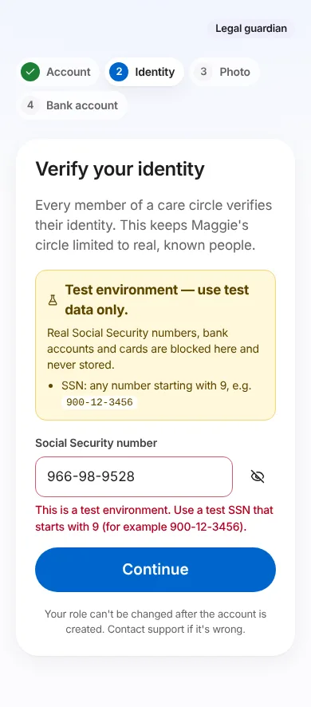
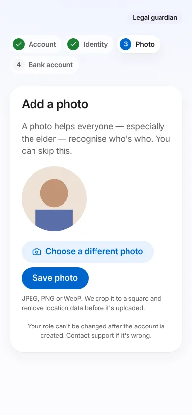
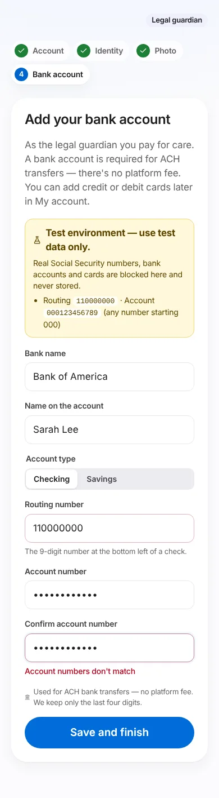
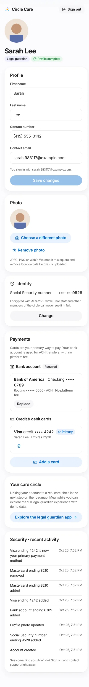
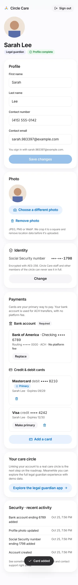
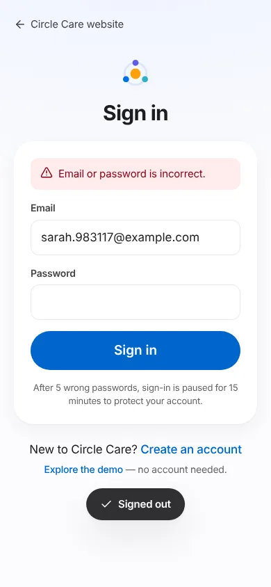

# Accounts, identity & payments

<div class="cc-meta" markdown>

| | |
|---|---|
| **Feature ID / area** | F-14 · Real accounts (`/app/join`, `/app/login`, `/app/account`) · API (`server/`) · PostgreSQL |
| **Personas** | Maggie (elder), Ana (caregiver), Sarah (legal guardian) — each with their own account and record |
| **Status** | <span class="cc-badge cc-badge--built">Built</span> — server, database, sign-up, profiles, photo, SSN, guardian bank account and cards. Payments run through a **simulated vault** (Stripe-ready); money doesn't move yet. |
| **Related stories** | CC-172 role picker · CC-173 sign-up · CC-174 sessions · CC-175 lockout · CC-176 – CC-178 persona profiles · CC-179 photo · CC-180 SSN · CC-181 SSN masking · CC-182 non-production guard · CC-183 production start-up checks · CC-184 masked audit export · CC-185 activity log · CC-186 bank account · CC-187 cards · CC-188 manage cards · CC-189 schema · CC-190 API & Replit · CC-200 two-step sign-in on the server · CC-201 sign out everywhere, password change and reset · CC-204 shared rate limits · CC-235 reset two-step sign-in after a lost phone |
| **Sprint** | Sprint 11 — Accounts, Identity & Payments (Oct 26 – Nov 8, 2026) |
| **Team** | PO: Sumanth · Developer: Dev Agent · Tester: QA Agent · Build & Deploy: Release Agent · Approver: Lead Architect Agent |
| **Last updated** | 2026-11-16 (CC-200, CC-201, CC-204 on branch `feat/server-auth-hardening`, not yet merged) |

</div>

## Overview

**What.** Circle Care now has real accounts. Anyone can open the website, pick **who they are in the care circle** — the elder, a caregiver or the legal guardian — create an account, and complete a profile: name, contact number, email, a photo and their Social Security number. The legal guardian also adds the **bank account** used to pay for care by ACH (no platform fee) and can add **credit or debit cards**, one of them primary. Everything is stored on the server in PostgreSQL, with elders, caregivers and guardians in **separate tables**.

**Why.** The earlier prototype switched between demo people and kept everything in the browser. A real care product needs real, verified people, and the guardian needs a way to pay. Because that means holding Social Security numbers and bank details, the feature is built around protecting them: encrypted, never shown in full, never present in test environments, and masked for audits.

**Business value.**

- Turns the demo into a working product foundation that every roadmap epic builds on.
- Identity verification keeps care circles limited to known people, which families and agencies expect.
- No-fee ACH plus card payments prepares for paid care and subscriptions (Release 4–5).
- Field-level encryption, tokenized payments and masked audit exports make HIPAA, GLBA, PCI DSS and FDIC/legal audit requests answerable.

!!! info "The demo is still there"
    **Explore the demo** keeps working exactly as before, with fictional people stored only in the browser. Real accounts and the demo never mix.

## User journey

### 1. Choose your role (CC-172)

From **Get started** in the site header, or **Create an account** on `/app`, the person sees three large choices: **I'm the elder**, **I'm a caregiver**, **I'm the legal guardian**. Each says in one line what that role does. **Sign in** and **Explore the demo instead** are on the same screen.

<figure markdown="span">
  { loading=lazy width="320" }
  <figcaption>Step 0 — choose your role.</figcaption>
</figure>

The next screens show the role badge and a step indicator: **Account → Identity → Photo** for the elder and caregivers, plus **Bank account** for the legal guardian. **Change role** goes back to the picker and keeps the name, phone and email already typed.

### 2. Create the account (CC-173)

First name, last name, contact number, email, password and confirmation, plus agreement to the Terms and Privacy Notice. A live checklist shows the password rules as they're met. Mistakes are explained next to the field, and focus moves to the first one.

<figure markdown="span">
  { loading=lazy width="320" }
  <figcaption>Step 1 — account. The password checklist turns green as each rule is met.</figcaption>
</figure>

### 3. Verify identity (CC-180, CC-182)

The person enters their Social Security number. It's hidden as they type (with a show/hide button) and formatted as `###-##-####`. In test environments a yellow banner explains that only test numbers starting with 9 are accepted.

<figure markdown="span">
  { loading=lazy width="320" }
  <figcaption>Step 2 — identity. In test environments only SSNs starting with 9 are accepted.</figcaption>
</figure>

### 4. Add a photo (CC-179)

Choose a JPEG, PNG or WebP photo. It's cropped to a square, resized to 512 × 512 and re-encoded **on the phone**, which removes location and camera data before anything is uploaded. **Skip for now** is allowed.

<figure markdown="span">
  { loading=lazy width="320" }
  <figcaption>Step 3 — photo, with a preview before saving.</figcaption>
</figure>

### 5. Bank account — legal guardian only (CC-186)

Bank name, name on the account, checking or savings, routing number, account number and confirmation. The numbers go to the payment vault, which returns a token; Circle Care keeps only the bank name, type and last four digits. The guardian can't finish sign-up without it.

<figure markdown="span">
  { loading=lazy width="320" }
  <figcaption>Step 4 (guardian) — bank account for no-fee ACH transfers.</figcaption>
</figure>

### 6. My account (CC-176 – CC-188)

Photo, name, role and **Profile complete** (or a list of what's missing). Sections: **Profile** (edit name, phone, contact email), **Photo** (change or remove), **Identity** (SSN shown as `•••-••-1234`; changing it needs the password), **Payments** for the guardian (bank account, cards, add card, make primary, remove), **Your care circle** (open the role's app with demo data), and **Security · recent activity**.

<figure markdown="span">
  { loading=lazy width="320" }
  <figcaption>My account on a phone.</figcaption>
</figure>

<figure markdown="span">
  { loading=lazy width="320" }
  <figcaption>Payments: one bank account for ACH, up to five cards with one primary.</figcaption>
</figure>

### 7. Two-step sign-in (CC-200)

Guardians and caregivers can see care and payment details, so right after creating the account they set up a second step: a 6-digit code from an authenticator app. Until they do, the server answers every account, payment and vault request with `403 mfa_enrolment_required`, and the app sends them to **Set up two-step sign-in** (`/app/two-step`). Elders can turn it on from My account but don't have to.

1. **Set up two-step sign-in** asks the server for a new key. If the sign-in is more than 10 minutes old, the page first asks for the password again, so someone at an unlocked computer can't attach their own phone (`server/mfa.ts:REAUTH_MINUTES`); a wrong password is refused and shows in the account's activity. The key is shown once, in groups of four (`ABCD EFGH …`), with **Copy key**, and an `otpauth://` link under *On this phone? Use the setup link instead* (as a link and as text).
2. The person adds the key to their app and enters the code it shows. **Turn on two-step sign-in** checks it on the server.
3. The server answers with **10 recovery codes**, shown once, with **Copy codes**. **Continue** stays disabled until *I've saved my recovery codes somewhere safe* is ticked.

From then on, sign-in takes the password and then **Enter your sign-in code**, with **Use a recovery code instead**. The password alone never starts a session.

Passkeys (WebAuthn) are out of scope for CC-200: they need a WebAuthn library, and this story adds no packages. They are a candidate follow-up.

### 7a. Lost phone and recovery codes (CC-235)

Someone who has lost both their phone and every recovery code can reset two-step sign-in themselves. It uses only what the account already has, the password and the email address, plus time, so it needs no outside service and nobody at Circle Care.

1. At **Enter your sign-in code**, after a correct password, **Lost your phone and your recovery codes?** explains the three steps and offers **Email me a link**. The reply is the same every time, and at most 3 links a day go to one account.
2. The email's link opens **Reset two-step sign-in?** (`/app/recover-two-step`). The link is taken out of the address bar at once, and nothing happens until **Start the 72-hour wait** is pressed, so a mail scanner that opens links can't start a reset. Links work once, for 30 minutes, and only the newest one works.
3. A second email says when the wait ends and carries a cancel link (`/app/recover-two-step/cancel`). Any device that's still signed in shows **Someone asked to reset two-step sign-in** on My account with **Cancel the reset**. Changing or resetting the password also cancels it, because whoever asked knew the old password.
4. After 72 hours, signing in with the password again opens **Your reset is ready**. **Finish the reset** removes the old key and every recovery code, ends every session, and starts a new session that can only set up two-step sign-in again. Elders who had opted in are simply signed in.

Every step is in the account's activity and audit trail, without any link. Like the password reset, this works in production only once an email provider is connected. Two other ways in were considered and left for later: a family admin vouching for the person (server accounts aren't linked into circles yet) and a support-assisted reset (needs staff and an identity check).

### 8. Sign-in & security on My account (CC-201)

- **Change password** asks for the current password and a new one that meets the same rules as sign-up. Other devices are signed out; this one stays signed in. The owner gets an email.
- **Sign out everywhere** asks once more, then ends every session, including this one, and returns to sign-in with "You've been signed out on every device."
- **Forgot your password?** on the sign-in page asks for an email and always gives the same answer: *"If an account uses that email, we've sent it a link to reset the password. The link works once, for 30 minutes."* The link opens **Choose a new password** (`/app/reset-password`); the token is taken out of the address bar as soon as the page reads it. A reset ends every session and is emailed.

### 9. Sign in (CC-174, CC-175)

Email and password. A wrong password and an unknown email give the same message. After five wrong passwords in 15 minutes, sign-in is paused for 15 minutes.

<figure markdown="span">
  { loading=lazy width="320" }
  <figcaption>Sign in — the error never says which part was wrong.</figcaption>
</figure>

## Functional details & business rules

### Account and profile

| Field | Rule | Message when wrong |
|---|---|---|
| First / last name | 1–50 letters, spaces, apostrophes, periods or hyphens | "Use letters, spaces, apostrophes or hyphens" |
| Contact number | 10-digit US number in any format; stored as `+1XXXXXXXXXX` | "Enter a 10-digit US phone number" |
| Email | Valid address; trimmed and lower-cased; one account per email | "Enter a valid email address" · duplicate: "We couldn't create an account with these details. If you already have one, sign in." |
| Password | ≥ 12 characters, not containing the email name, not a common password | Checklist item that isn't met |
| Terms | Must be ticked | "Please agree to the Terms and Privacy Notice to continue" |

- The role is fixed once the account exists. Changing it is a support process.
- **Profile complete** means: name, phone, email and SSN for everyone, **plus a bank account for the legal guardian**. Otherwise the API returns `profileStatus: "incomplete"` and a `missing` list (`ssn`, `bank_account`).
- The sign-in email and the contact email start the same. The contact email can change in My account, and the sign-in email stays as it was.

### Social Security number

| Rule | Production | Every other environment (development, test, staging, Replit) |
|---|---|---|
| Must be 9 digits, not all the same, not a known invalid number (e.g. 123-45-6789, 078-05-1120) | ✔ | ✔ |
| Group `00` or serial `0000` | Rejected | Rejected |
| Area `000`, `666` | Rejected | Rejected |
| Area `900–999` | **Rejected** (never issued as SSNs) | **Required** — the only numbers accepted |
| `9XX` with middle digits 50–65, 70–88, 90–92 or 94–99 | Rejected | **Rejected** — the IRS issues these as real ITINs, so test numbers must use middle digits 01–49, 66–69, 89 or 93 |
| Same SSN on two accounts | Rejected: "This number can't be used. Contact support." | Same |
| Changing an existing SSN | Requires the account password | Same |

### Payments (legal guardian only)

| Item | Rule |
|---|---|
| Bank account | Exactly one, required. Replacing it saves the new one in the same transaction that removes the old, so the guardian is never without one. It can't be removed outright. |
| Routing number | 9 digits passing the ABA checksum. Outside production: only `110000000`. |
| Account number | 4–17 digits; must match the confirmation. Outside production: must start with `000`. |
| ACH fee | **$0 platform fee.** Enforced in the database (`CHECK (ach_fee_cents = 0)`) and shown on screen. |
| Cards | Up to 5. Luhn-checked, brand detected as you type, expiry must be this month or later, 3-digit (4 for Amex) security code, 5-digit ZIP. |
| Primary card | The first card becomes primary. A new card can be made primary. Removing the primary card promotes the most recently added remaining card, and the app says which. Exactly one primary is enforced by a unique index. |
| Test cards (outside production) | Visa `4242 4242 4242 4242` · Visa debit `4000 0566 5566 5556` · Mastercard `5555 5555 5555 4444` · Mastercard debit `5200 8282 8282 8210` · Amex `3782 822463 10005` · Discover `6011 1111 1111 1117` |
| Vault tokens | Belong to the person who created them, can be used once, and expire after 15 minutes. Removing a card revokes its token. |

## Permissions & privacy

| Data | Who can see it | How it's stored |
|---|---|---|
| Name, phone, email | Only the account owner (the care-circle sharing rules still apply to the demo app) | Plain columns in `elders`, `caregivers` or `guardians` |
| SSN | Nobody in full — not the owner, other members or staff. The API returns the last four digits only. | AES-256-GCM ciphertext (`ssn_enc`), last four (`ssn_last4`), HMAC fingerprint in `ssn_fingerprints` for duplicate checks |
| Photo | Only the owner (`Cache-Control: private, no-store`) | Encrypted bytes in `photos`; location data removed on the device |
| Bank account | Owner: bank name, type, last four of account and routing numbers | Vault token + last four. **The full number is never stored, even encrypted.** |
| Cards | Owner: brand, credit/debit, last four, expiry | Vault token + last four. The full number and security code are never stored. |
| Activity | Owner (last 20 events) | Append-only `audit_events` with masked details |

- **Card numbers never reach the Circle Care API.** The browser sends them straight to the vault and the API only receives a token, which keeps Circle Care out of the heaviest PCI DSS scope (SAQ A once Stripe Elements is connected).
- The service worker never caches `/api` or `/vault` responses, so personal details aren't left in the browser's offline cache.
- Request bodies are never logged. The audit writer refuses any detail that looks like a full SSN, account or card number.

## Environments & test data (CC-182, CC-183)

| `APP_ENV` | Use | Accepts real SSN / bank / card? | Database | Keys |
|---|---|---|---|---|
| `development` (default) | Local and Replit **Run** | **No** — test values only | Replit PostgreSQL if `DATABASE_URL` is set, otherwise embedded Postgres in `.data/` | Generated once into `.data/dev-keys.json` if not set |
| `test` | Automated tests | No | In-memory Postgres | Random per run |
| `staging` | Replit **Deploy** | No | `DATABASE_URL` **required** | **Required** (stable across restarts); cookies are `Secure` |
| `production` | A real launch, when approved | Yes | `DATABASE_URL` **required** | **Required**, plus Stripe live key; the simulated vault is disabled |

If anything required is missing in production, the server **does not start** and lists what's wrong. A live Stripe key is refused outside production. Every non-production screen that collects sensitive data shows the yellow **Test environment — use test data only** banner with the test values.

## Audits: masked export (CC-184)

For an FDIC examination, a legal request or an internal audit, an operator runs:

```bash
npm run audit:export -- --out ./audit-export --operator "Jane Doe"
# add --full-names only for a legal hold that requires full names
```

| File | Contents |
|---|---|
| `people.csv` | Role, name (first name + last initial), email `m•••@domain.com`, phone `(•••) •••-1234`, SSN `•••-••-1234`, created date |
| `payment_methods.csv` | Bank `••••6789` / routing `•••••0000` / fee `0`; cards `Visa •••• 4242`, credit/debit, primary |
| `audit_events.csv` | Every audit event with masked details |
| `manifest.json` | Time, environment, operator, masking rules, row counts and a SHA-256 for each file |

The export reads only the masked database views (`audit_people_masked`, `audit_payment_methods_masked`). If a file would contain anything that looks like a full number, it refuses to write it. The export itself is recorded as an `audit.exported` event. An auditor's read-only database role should be granted **only these views**.

!!! tip
    With the embedded development database, stop `npm run dev` before running the export, because only one process can open it. With `DATABASE_URL` this isn't needed.

## Data captured

| Table | Purpose |
|---|---|
| `users` | Sign-in email, scrypt password hash, role, lockout counters |
| `sessions` | SHA-256 of the session token, created / last seen / absolute expiry |
| `elders`, `caregivers`, `guardians` | One row per person, separate per role: names, phone, email, `ssn_enc`, `ssn_last4` |
| `ssn_fingerprints` | One SSN per person across all three tables |
| `photos` | Encrypted photo, type, size (≤ 2 MB) |
| `bank_accounts`, `payment_cards` | Tokens and display details only (`CHECK` constraints stop full numbers being stored) |
| `vault_tokens` | The simulated vault's token register (last four only) |
| `audit_events` | Append-only trail (a trigger blocks UPDATE and DELETE) |
| `password_resets` | Hash of each reset link, its 30-minute expiry and when it was used (CC-201) |
| `mfa_recovery_codes`, `mfa_challenges` | Hashed recovery codes and the hashed 5-minute token between the password and the code (CC-200). The authenticator secret is encrypted in `users.mfa_secret_enc` |
| `mfa_recovery_requests` | Each reset of two-step sign-in: hashes of its confirm and cancel links, when the wait ends, and whether it was cancelled or finished (CC-235) |
| `rate_limits` | Shared counters for every instance; keys are hashes, never an address (CC-204) |

See [Data model](../architecture/data-model.md) and [Security & privacy](../architecture/security-and-privacy.md).

## API

| Method & path | Purpose |
|---|---|
| `GET /api/health` · `GET /api/config` | Health check · environment and test values |
| `POST /api/auth/signup` · `/signin` · `/signout` · `GET /api/auth/me` | Accounts and sessions. For an account with two-step sign-in on, `/signin` sets no cookie and answers `{ mfaRequired: true, challenge, expiresInSeconds: 300 }` |
| `POST /api/auth/mfa/verify` | `{ challenge, code }` or `{ challenge, recoveryCode }`: checks the second step and starts the session (CC-200) |
| `POST /api/auth/mfa/enrol/start` · `POST /api/auth/mfa/enrol/confirm` | Set up two-step sign-in: the key and `otpauth://` link once, then `{ code }` turns it on and returns 10 recovery codes once (CC-200) |
| `POST /api/auth/mfa/recovery/request` · `/confirm` · `/cancel` · `/complete` · `GET /api/auth/mfa/recovery` | Reset two-step sign-in after a lost phone: `{ challenge }` emails a link; `{ token }` starts the 72-hour wait; `{ token }` or a signed-in session cancels it; `{ challenge }` after the wait clears the key and codes and ends every session (CC-235). `/signin` adds `recovery: { readyAt, ready }` while a reset waits |
| `POST /api/auth/signout-everywhere` | End every session of this account (CC-201) |
| `POST /api/auth/password` | `{ currentPassword, newPassword }`: change the password and end every other session (CC-201) |
| `POST /api/auth/password-reset/request` · `POST /api/auth/password-reset/confirm` | `{ email }` always answers the same; `{ token, password }` sets a new password and ends every session (CC-201) |
| `GET/PATCH /api/me` | My profile |
| `PUT /api/me/ssn` | Set or change SSN (change needs `password`) |
| `PUT/GET/DELETE /api/me/photo` | Photo (raw image body, ≤ 2 MB) |
| `GET /api/me/activity` | Last 20 audit events in plain language |
| `GET /api/me/payment-methods` · `POST …/bank-account` · `POST …/cards` · `POST …/cards/:id/primary` · `DELETE …/cards/:id` | Guardian payment methods (tokens only) |
| `POST /vault/v1/bank-accounts` · `POST /vault/v1/cards` | Simulated vault (absent in production) |

Guardians and caregivers who haven't set up two-step sign-in get `403` with `code: "mfa_enrolment_required"` from every `/api/me` and `/vault` route. Going over a rate limit answers `429` with `code: "rate_limited"` and a `Retry-After` header.

All requests that change data must send `X-Requested-With: circle-care`. Together with the `SameSite=Strict` session cookie, this blocks cross-site requests that change data.

## Security controls

| Control | Detail |
|---|---|
| Passwords | scrypt (N=16384, r=8, p=1), 16-byte salt, constant-time comparison. Unknown emails are checked against a dummy hash so timing doesn't reveal which accounts exist. |
| Sessions | 32-byte random token in an `HttpOnly; SameSite=Strict` cookie (`Secure` in production). Only its SHA-256 is stored. Expires after 30 idle minutes and 12 hours absolute. Sign out everywhere, a password change (other devices) and a reset (all devices) end sessions at once; expired sessions, reset links and challenges are deleted at start-up and once a day (CC-201). |
| Two-step sign-in | TOTP to RFC 6238 (SHA-1, 6 digits, 30 seconds, one step either side), checked in constant time on the server. The secret is AES-256-GCM encrypted and never returned after set-up; each time step works once per account. The step between password and code is a hashed, single-use token that lasts 5 minutes. Recovery codes are HMAC-SHA256 hashed and work once, and each use is audited. 5 wrong codes in 15 minutes stop codes for 15 minutes, are audited without the code and email the owner. The browser demo's fixed code means nothing to the server (CC-200). |
| Password reset | The answer and its timing don't depend on whether the email has an account: the reply goes out before the lookup. Links are 32 random bytes, stored as SHA-256, work once for 30 minutes, and only the newest link works; at most 3 reset emails an hour per account (CC-201). |
| Email | Sent through a `Mailer` interface. Development and test keep messages in an in-memory outbox (development also prints them to the server console). Production has no email provider yet: each email is recorded as `email.undeliverable` in the audit log, and the server warns at start-up. Connecting a provider is a launch task. |
| Lockout | 5 failures in 15 minutes locks the account for 15 minutes and emails the owner; existing sessions stay, so a locked-out attacker can't sign the owner out. Failures are counted with one atomic database update, so parallel guesses can't slip past the limit. Wrong passwords on the SSN-change and password-change steps count too; reaching the limit there also signs the account out everywhere. |
| Rate limits | Counted in one Postgres table every instance shares, with an atomic upsert (CC-204). Per network: sign-up 10 an hour, sign-in 30 per 10 minutes, code checks 30 per 10 minutes, reset requests 10 an hour. Per account: SSN saves 10 an hour, profile changes 30, photo changes 20, payment-method changes 30, password changes 10, vault 30 per 10 minutes. Going over answers 429 with `Retry-After`, and the per-account limits write a `ratelimit.exceeded` audit event naming only the limit. The network address is the one `TRUST_PROXY_HOPS` proxies forwarded (default 1), so a forged `X-Forwarded-For` can't pick a fresh bucket. Expired counters are deleted as the limiter runs and daily. |
| Encryption | AES-256-GCM with a key id in every ciphertext (`v1.<keyId>.…`) for rotation (`DATA_ENCRYPTION_KEY_PREVIOUS`). Tampered data fails to decrypt. |
| Headers | CSP with `frame-ancestors 'none'`, `X-Frame-Options: DENY`, `nosniff`, `Referrer-Policy: no-referrer`, HSTS in production, `Cache-Control: no-store` on the API. |
| Uploads | File signature checked (JPEG/PNG/WebP). The `Content-Type` header isn't trusted. 2 MB limit. |

## Accessibility

- Every field has a visible label. Errors are linked with `aria-describedby`, announced, and focus moves to the first one.
- Role choices and all buttons are at least 48 px tall and work by keyboard. The step indicator uses `aria-current="step"`.
- The masked SSN is read as "Social Security number ending in 1 2 3 4".
- All new screens pass the axe WCAG 2.1 AA audit: `/app/join`, `/app/join/guardian`, `/app/login`, `/app/account` with the card form open. Layouts work at 375 px with no sideways scrolling.
- Two-step sign-in and password screens (CC-200, CC-201) use the same labelled fields and linked errors, 44 px or larger targets, and move focus to the recovery-codes heading when the codes appear. The key is read out group by group, and the code field uses `autocomplete="one-time-code"` and a numeric keypad. `a11y.py` audits them against the real server.

## Test coverage

| Suite | What it proves |
|---|---|
| `server/__tests__/api.test.ts` (81 tests) | Every sign-up rule, sessions and expiry, CSRF, lockout, profile isolation, completeness, photo checks, SSN rules per environment, duplicate SSN, re-authentication, tamper detection, bank and card rules, token ownership, use-once and expiry, primary-card rules, append-only audit, schema constraints, and regression tests for every Lead Architect review finding (parallel-guess lockout, SSN step-up lockout, ITIN ranges, bank-name digits, malformed cookie). **It also scans every API response in the suite and fails if a full SSN appears.** |
| `server/__tests__/mfa.test.ts` (27 tests) | RFC 4226, RFC 6238 (SHA-1, SHA-256, SHA-512) and RFC 4648 test vectors; the enrolment gate for guardians and caregivers; nothing stored in the clear; no session from a password alone; challenge hashed, single use and expiring; replayed codes refused; 5 wrong codes in parallel; recovery codes once each; `482913` refused in production, staging and test, and absent from server code |
| `server/__tests__/sessions.test.ts` (17 tests) | Sign out everywhere; password change rules and lockout; the same reset reply for any email, unaffected by a slow mailer; single-use, parallel-use, expiry and newest-link rules; production with no email provider; the lockout email; the clean-up and its start-up and daily, unref'd schedule |
| `server/__tests__/mfa-recovery.test.ts` (14 tests) | Needs a live password challenge; the same reply and at most 3 links a day; nothing changes until the link is used; links single use, 30 minutes, newest only, under parallel use; cancel by email link, by a signed-in device and by password change or reset; Finish refused during the wait, then clears the key and codes and ends every session; no link in the audit trail or stored in the clear; production with no email provider; the wait fixed at 72 hours outside tests; clean-up |
| `tests/e2e/sprint21.py` (7 scenarios, Playwright) | The lost-phone panel, both emailed links and their expired states, the waiting and ready states at sign-in, the warning and Cancel on a signed-in device, and finishing into set-up, each with an axe check. The preview has no API, so the file answers `/api` with a stand-in that follows the server's replies |
| `server/__tests__/ratelimit.test.ts` (13 tests) | Two app instances share one bucket and let exactly the limit through under parallel requests; window reset and pruning; hashed keys; a forged left-most `X-Forwarded-For` lands in the same bucket; `TRUST_PROXY_HOPS` validation; per-account SSN, profile, photo and payment limits with their audit event |
| `server/__tests__/config-and-export.test.ts` (14 tests) | Production and staging start-up checks, live-key guard, Secure cookie, HSTS and vault disabled in production. The masked export's contents, manifest and hashes, and that no full number appears in any file. |
| `tests/e2e/accounts.py` (20 scenarios, Playwright) | The full guardian journey on a phone-sized screen, including two-step set-up, sign-in with a code and with a recovery code, password change, sign out everywhere and the forgotten-password pages; elder journey, duplicate email, wrong password, lockout, cards, activity, profile edit. Also checks that the SSN and account number never appear in the page. Codes come from `tests/e2e/totp_helper.py` (Python standard library). |
| `tests/e2e/a11y.py` | axe audit including the account screens and, against the real server, the two-step, code-step and password pages |

## Known limitations & production gaps

- **Payments don't move money yet.** The vault is simulated. Production needs the Stripe adapter (Stripe Elements for cards, Financial Connections or micro-deposits to verify bank accounts) and a BAA review. Until then, adding payment methods in a `stripe` environment returns "not available yet".
- **Identity is checked for format, not verified with a third party** (e.g. an identity-verification provider). That is a follow-up story.
- **No email provider is connected.** Reset links and lockout emails are recorded as undelivered in production, so nobody can reset a forgotten password there until one is connected (a human launch task; see the README). Staging has no visible outbox either.
- **Two-step sign-in can't be turned off or given new recovery codes yet,** and passkeys aren't offered. Someone who loses their phone and every recovery code can reset it with the password, an emailed link and a 72-hour wait (CC-235), which needs an email provider in production. Email verification is still missing.
- **Accounts aren't linked into a shared care circle yet.** *Explore the … app* opens the role's demo experience.
- **The embedded database is single-process.** Use Replit PostgreSQL (`DATABASE_URL`) for anything shared.

## Related pages

[Data model](../architecture/data-model.md) · [Security & privacy](../architecture/security-and-privacy.md) · [Privacy Center](privacy-center.md) · [Roadmap](../roadmap.md) · [How to contribute](../how-to-contribute.md)
