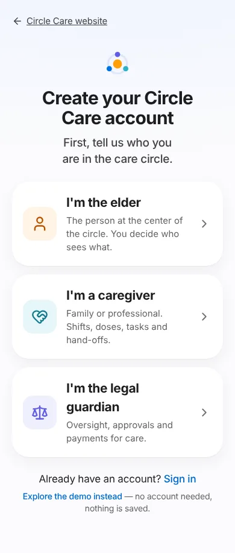
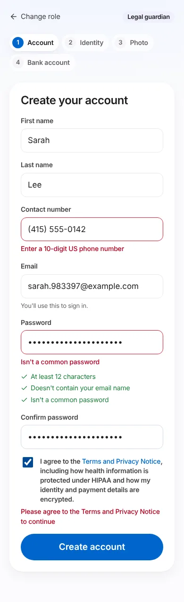
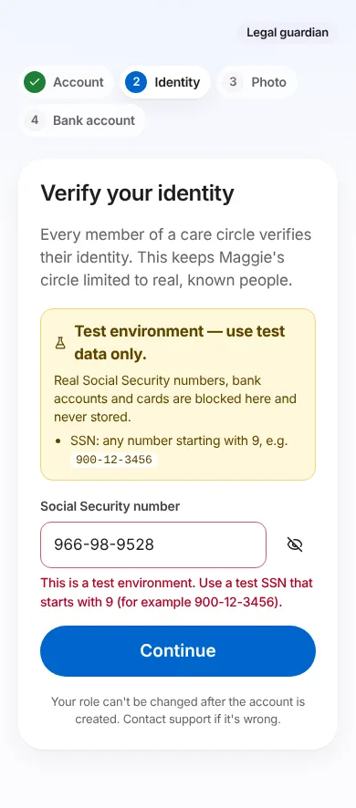
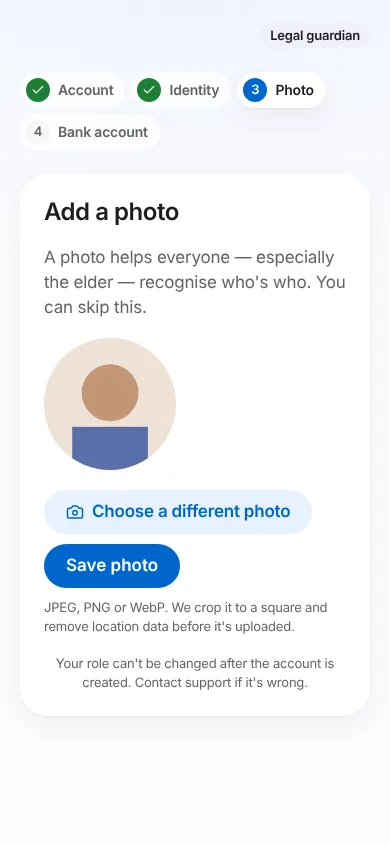
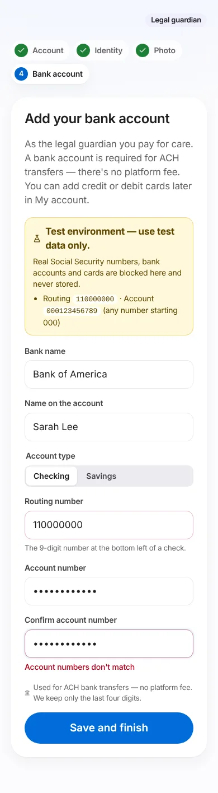
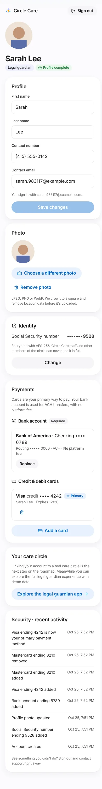
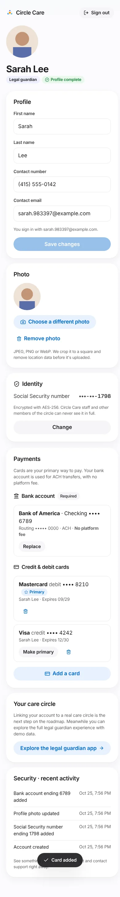
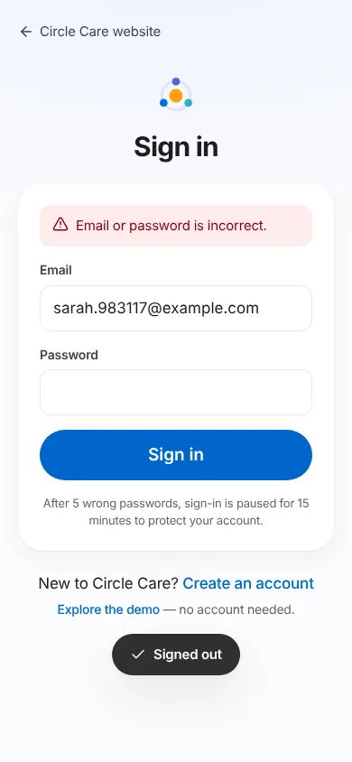

# Accounts, identity & payments

<div class="cc-meta" markdown>

| | |
|---|---|
| **Feature ID / area** | F-14 · Real accounts (`/app/join`, `/app/login`, `/app/account`) · API (`server/`) · PostgreSQL |
| **Personas** | Maggie (elder), Ana (caregiver), Sarah (legal guardian) — each with their own account and record |
| **Status** | <span class="cc-badge cc-badge--built">Built</span> — server, database, sign-up, profiles, photo, SSN, guardian bank account and cards. Payments run through a **simulated vault** (Stripe-ready); money doesn't move yet. |
| **Related stories** | CC-172 role picker · CC-173 sign-up · CC-174 sessions · CC-175 lockout · CC-176 – CC-178 persona profiles · CC-179 photo · CC-180 SSN · CC-181 SSN masking · CC-182 non-production guard · CC-183 production start-up checks · CC-184 masked audit export · CC-185 activity log · CC-186 bank account · CC-187 cards · CC-188 manage cards · CC-189 schema · CC-190 API & Replit |
| **Sprint** | Sprint 11 — Accounts, Identity & Payments (Oct 26 – Nov 8, 2026) |
| **Team** | PO: Sumanth · Developer: Dev Agent · Tester: QA Agent · Build & Deploy: Release Agent · Approver: Lead Architect Agent |
| **Last updated** | 2026-10-25 |

</div>

## Overview

**What.** Circle Care now has real accounts. Anyone can open the website, pick **who they are in the care circle** — the elder, a caregiver or the legal guardian — create an account, and complete a profile: name, contact number, email, a photo and their Social Security number. The legal guardian also adds the **bank account** used to pay for care by ACH (no platform fee) and can add **credit or debit cards**, one of them primary. Everything is stored on the server in PostgreSQL, with elders, caregivers and guardians in **separate tables**.

**Why.** The earlier prototype switched between demo people and kept everything in the browser. A real care product needs real, verified people, and the guardian needs a way to pay. Because that means holding Social Security numbers and bank details, the feature is built around protecting them: encrypted, never shown in full, never present in test environments, and masked for audits.

**Business value.**

- Turns the demo into a working product foundation that every roadmap epic builds on.
- Identity verification keeps care circles limited to known people, which families and agencies expect.
- No-fee ACH plus card payments prepares for paid care and subscriptions (Release 4–5).
- Field-level encryption, tokenized payments and masked audit exports make HIPAA, GLBA, PCI DSS and FDIC/legal audit requests answerable.

!!! info "The demo is still there"
    **Explore the demo** keeps working exactly as before, with fictional people stored only in the browser. Real accounts and the demo never mix.

## User journey

### 1. Choose your role (CC-172)

From **Get started** in the site header, or **Create an account** on `/app`, the person sees three large choices: **I'm the elder**, **I'm a caregiver**, **I'm the legal guardian**. Each says in one line what that role does. **Sign in** and **Explore the demo instead** are on the same screen.

<figure markdown="span">
  { loading=lazy width="320" }
  <figcaption>Step 0 — choose your role.</figcaption>
</figure>

The next screens show the role badge and a step indicator: **Account → Identity → Photo** for the elder and caregivers, plus **Bank account** for the legal guardian. **Change role** goes back to the picker and keeps the name, phone and email already typed.

### 2. Create the account (CC-173)

First name, last name, contact number, email, password and confirmation, plus agreement to the Terms and Privacy Notice. A live checklist shows the password rules as they're met. Mistakes are explained next to the field, and focus moves to the first one.

<figure markdown="span">
  { loading=lazy width="320" }
  <figcaption>Step 1 — account. The password checklist turns green as each rule is met.</figcaption>
</figure>

### 3. Verify identity (CC-180, CC-182)

The person enters their Social Security number. It's hidden as they type (with a show/hide button) and formatted as `###-##-####`. In test environments a yellow banner explains that only test numbers starting with 9 are accepted.

<figure markdown="span">
  { loading=lazy width="320" }
  <figcaption>Step 2 — identity. In test environments only SSNs starting with 9 are accepted.</figcaption>
</figure>

### 4. Add a photo (CC-179)

Choose a JPEG, PNG or WebP photo. It's cropped to a square, resized to 512 × 512 and re-encoded **on the phone**, which removes location and camera data before anything is uploaded. **Skip for now** is allowed.

<figure markdown="span">
  { loading=lazy width="320" }
  <figcaption>Step 3 — photo, with a preview before saving.</figcaption>
</figure>

### 5. Bank account — legal guardian only (CC-186)

Bank name, name on the account, checking or savings, routing number, account number and confirmation. The numbers go to the payment vault, which returns a token; Circle Care keeps only the bank name, type and last four digits. The guardian can't finish sign-up without it.

<figure markdown="span">
  { loading=lazy width="320" }
  <figcaption>Step 4 (guardian) — bank account for no-fee ACH transfers.</figcaption>
</figure>

### 6. My account (CC-176 – CC-188)

Photo, name, role and **Profile complete** (or a list of what's missing). Sections: **Profile** (edit name, phone, contact email), **Photo** (change or remove), **Identity** (SSN shown as `•••-••-1234`; changing it needs the password), **Payments** for the guardian (bank account, cards, add card, make primary, remove), **Your care circle** (open the role's app with demo data), and **Security · recent activity**.

<figure markdown="span">
  { loading=lazy width="320" }
  <figcaption>My account on a phone.</figcaption>
</figure>

<figure markdown="span">
  { loading=lazy width="320" }
  <figcaption>Payments: one bank account for ACH, up to five cards with one primary.</figcaption>
</figure>

### 7. Sign in (CC-174, CC-175)

Email and password. A wrong password and an unknown email give the same message. After five wrong passwords in 15 minutes, sign-in is paused for 15 minutes.

<figure markdown="span">
  { loading=lazy width="320" }
  <figcaption>Sign in — the error never says which part was wrong.</figcaption>
</figure>

## Functional details & business rules

### Account and profile

| Field | Rule | Message when wrong |
|---|---|---|
| First / last name | 1–50 letters, spaces, apostrophes, periods or hyphens | "Use letters, spaces, apostrophes or hyphens" |
| Contact number | 10-digit US number in any format; stored as `+1XXXXXXXXXX` | "Enter a 10-digit US phone number" |
| Email | Valid address; trimmed and lower-cased; one account per email | "Enter a valid email address" · duplicate: "We couldn't create an account with these details. If you already have one, sign in." |
| Password | ≥ 12 characters, not containing the email name, not a common password | Checklist item that isn't met |
| Terms | Must be ticked | "Please agree to the Terms and Privacy Notice to continue" |

- The role is fixed once the account exists. Changing it is a support process.
- **Profile complete** means: name, phone, email and SSN for everyone, **plus a bank account for the legal guardian**. Otherwise the API returns `profileStatus: "incomplete"` and a `missing` list (`ssn`, `bank_account`).
- The sign-in email and the contact email start the same. The contact email can change in My account, and the sign-in email stays as it was.

### Social Security number

| Rule | Production | Every other environment (development, test, staging, Replit) |
|---|---|---|
| Must be 9 digits, not all the same, not a known invalid number (e.g. 123-45-6789, 078-05-1120) | ✔ | ✔ |
| Group `00` or serial `0000` | Rejected | Rejected |
| Area `000`, `666` | Rejected | Rejected |
| Area `900–999` | **Rejected** (never issued) | **Required** — the only numbers accepted |
| Same SSN on two accounts | Rejected: "This number can't be used. Contact support." | Same |
| Changing an existing SSN | Requires the account password | Same |

### Payments (legal guardian only)

| Item | Rule |
|---|---|
| Bank account | Exactly one, required. Replacing it saves the new one in the same transaction that removes the old, so the guardian is never without one. It can't be removed outright. |
| Routing number | 9 digits passing the ABA checksum. Outside production: only `110000000`. |
| Account number | 4–17 digits; must match the confirmation. Outside production: must start with `000`. |
| ACH fee | **$0 platform fee.** Enforced in the database (`CHECK (ach_fee_cents = 0)`) and shown on screen. |
| Cards | Up to 5. Luhn-checked, brand detected as you type, expiry must be this month or later, 3-digit (4 for Amex) security code, 5-digit ZIP. |
| Primary card | The first card becomes primary. A new card can be made primary. Removing the primary card promotes the most recently added remaining card, and the app says which. Exactly one primary is enforced by a unique index. |
| Test cards (outside production) | Visa `4242 4242 4242 4242` · Visa debit `4000 0566 5566 5556` · Mastercard `5555 5555 5555 4444` · Mastercard debit `5200 8282 8282 8210` · Amex `3782 822463 10005` · Discover `6011 1111 1111 1117` |
| Vault tokens | Belong to the person who created them, can be used once, and expire after 15 minutes. Removing a card revokes its token. |

## Permissions & privacy

| Data | Who can see it | How it's stored |
|---|---|---|
| Name, phone, email | Only the account owner (the care-circle sharing rules still apply to the demo app) | Plain columns in `elders`, `caregivers` or `guardians` |
| SSN | Nobody in full — not the owner, other members or staff. The API returns the last four digits only. | AES-256-GCM ciphertext (`ssn_enc`), last four (`ssn_last4`), HMAC fingerprint in `ssn_fingerprints` for duplicate checks |
| Photo | Only the owner (`Cache-Control: private, no-store`) | Encrypted bytes in `photos`; location data removed on the device |
| Bank account | Owner: bank name, type, last four of account and routing numbers | Vault token + last four. **The full number is never stored, even encrypted.** |
| Cards | Owner: brand, credit/debit, last four, expiry | Vault token + last four. The full number and security code are never stored. |
| Activity | Owner (last 20 events) | Append-only `audit_events` with masked details |

- **Card numbers never reach the Circle Care API.** The browser sends them straight to the vault and the API only receives a token, which keeps Circle Care out of the heaviest PCI DSS scope (SAQ A once Stripe Elements is connected).
- The service worker never caches `/api` or `/vault` responses, so personal details aren't left in the browser's offline cache.
- Request bodies are never logged. The audit writer refuses any detail that looks like a full SSN, account or card number.

## Environments & test data (CC-182, CC-183)

| `APP_ENV` | Use | Accepts real SSN / bank / card? | Database | Keys |
|---|---|---|---|---|
| `development` (default) | Local and Replit **Run** | **No** — test values only | Replit PostgreSQL if `DATABASE_URL` is set, otherwise embedded Postgres in `.data/` | Generated once into `.data/dev-keys.json` if not set |
| `test` | Automated tests | No | In-memory Postgres | Random per run |
| `staging` | Replit **Deploy** | No | `DATABASE_URL` | **Required** (stable across restarts) |
| `production` | A real launch, when approved | Yes | `DATABASE_URL` **required** | **Required**, plus Stripe live key; the simulated vault is disabled |

If anything required is missing in production, the server **does not start** and lists what's wrong. A live Stripe key is refused outside production. Every non-production screen that collects sensitive data shows the yellow **Test environment — use test data only** banner with the test values.

## Audits: masked export (CC-184)

For an FDIC examination, a legal request or an internal audit, an operator runs:

```bash
npm run audit:export -- --out ./audit-export --operator "Jane Doe"
# add --full-names only for a legal hold that requires full names
```

| File | Contents |
|---|---|
| `people.csv` | Role, name (first name + last initial), email `m•••@domain.com`, phone `(•••) •••-1234`, SSN `•••-••-1234`, created date |
| `payment_methods.csv` | Bank `••••6789` / routing `•••••0000` / fee `0`; cards `Visa •••• 4242`, credit/debit, primary |
| `audit_events.csv` | Every audit event with masked details |
| `manifest.json` | Time, environment, operator, masking rules, row counts and a SHA-256 for each file |

The export reads only the masked database views (`audit_people_masked`, `audit_payment_methods_masked`). If a file would contain anything that looks like a full number, it refuses to write it. The export itself is recorded as an `audit.exported` event. An auditor's read-only database role should be granted **only these views**.

!!! tip
    With the embedded development database, stop `npm run dev` before running the export, because only one process can open it. With `DATABASE_URL` this isn't needed.

## Data captured

| Table | Purpose |
|---|---|
| `users` | Sign-in email, scrypt password hash, role, lockout counters |
| `sessions` | SHA-256 of the session token, created / last seen / absolute expiry |
| `elders`, `caregivers`, `guardians` | One row per person, separate per role: names, phone, email, `ssn_enc`, `ssn_last4` |
| `ssn_fingerprints` | One SSN per person across all three tables |
| `photos` | Encrypted photo, type, size (≤ 2 MB) |
| `bank_accounts`, `payment_cards` | Tokens and display details only (`CHECK` constraints stop full numbers being stored) |
| `vault_tokens` | The simulated vault's token register (last four only) |
| `audit_events` | Append-only trail (a trigger blocks UPDATE and DELETE) |

See [Data model](../architecture/data-model.md) and [Security & privacy](../architecture/security-and-privacy.md).

## API

| Method & path | Purpose |
|---|---|
| `GET /api/health` · `GET /api/config` | Health check · environment and test values |
| `POST /api/auth/signup` · `/signin` · `/signout` · `GET /api/auth/me` | Accounts and sessions |
| `GET/PATCH /api/me` | My profile |
| `PUT /api/me/ssn` | Set or change SSN (change needs `password`) |
| `PUT/GET/DELETE /api/me/photo` | Photo (raw image body, ≤ 2 MB) |
| `GET /api/me/activity` | Last 20 audit events in plain language |
| `GET /api/me/payment-methods` · `POST …/bank-account` · `POST …/cards` · `POST …/cards/:id/primary` · `DELETE …/cards/:id` | Guardian payment methods (tokens only) |
| `POST /vault/v1/bank-accounts` · `POST /vault/v1/cards` | Simulated vault (absent in production) |

All requests that change data must send `X-Requested-With: circle-care`. Together with the `SameSite=Strict` session cookie, this blocks cross-site requests that change data.

## Security controls

| Control | Detail |
|---|---|
| Passwords | scrypt (N=16384, r=8, p=1), 16-byte salt, constant-time comparison. Unknown emails are checked against a dummy hash so timing doesn't reveal which accounts exist. |
| Sessions | 32-byte random token in an `HttpOnly; SameSite=Strict` cookie (`Secure` in production). Only its SHA-256 is stored. Expires after 30 idle minutes and 12 hours absolute. |
| Lockout | 5 failures in 15 minutes locks the account for 15 minutes. |
| Rate limits | Sign-up 10 per hour and sign-in 30 per 10 minutes per network; vault 30 per 10 minutes per user. |
| Encryption | AES-256-GCM with a key id in every ciphertext (`v1.<keyId>.…`) for rotation (`DATA_ENCRYPTION_KEY_PREVIOUS`). Tampered data fails to decrypt. |
| Headers | CSP with `frame-ancestors 'none'`, `X-Frame-Options: DENY`, `nosniff`, `Referrer-Policy: no-referrer`, HSTS in production, `Cache-Control: no-store` on the API. |
| Uploads | File signature checked (JPEG/PNG/WebP). The `Content-Type` header isn't trusted. 2 MB limit. |

## Accessibility

- Every field has a visible label. Errors are linked with `aria-describedby`, announced, and focus moves to the first one.
- Role choices and all buttons are at least 48 px tall and work by keyboard. The step indicator uses `aria-current="step"`.
- The masked SSN is read as "Social Security number ending in 1 2 3 4".
- All new screens pass the axe WCAG 2.1 AA audit: `/app/join`, `/app/join/guardian`, `/app/login`, `/app/account` with the card form open. Layouts work at 375 px with no sideways scrolling.

## Test coverage

| Suite | What it proves |
|---|---|
| `server/__tests__/api.test.ts` (69 tests) | Every sign-up rule, sessions and expiry, CSRF, lockout, profile isolation, completeness, photo checks, SSN rules per environment, duplicate SSN, re-authentication, tamper detection, bank and card rules, token ownership, use-once and expiry, primary-card rules, append-only audit, schema constraints. **It also scans every API response in the suite and fails if a full SSN appears.** |
| `server/__tests__/config-and-export.test.ts` (15 tests) | Production and staging start-up checks, live-key guard, Secure cookie, HSTS and vault disabled in production. The masked export's contents, manifest and hashes, and that no full number appears in any file. |
| `tests/e2e/accounts.py` (15 scenarios, Playwright) | The full guardian journey on a phone-sized screen, elder journey, duplicate email, wrong password, lockout, cards, activity, profile edit. Also checks that the SSN and account number never appear in the page. |
| `tests/e2e/a11y.py` | axe audit including the four new screens |

## Known limitations & production gaps

- **Payments don't move money yet.** The vault is simulated. Production needs the Stripe adapter (Stripe Elements for cards, Financial Connections or micro-deposits to verify bank accounts) and a BAA review. Until then, adding payment methods in a `stripe` environment returns "not available yet".
- **Identity is checked for format, not verified with a third party** (e.g. an identity-verification provider). That is a follow-up story.
- **No MFA, password reset or email verification for real accounts yet.** The demo shows the intended MFA design. These are the next stories in the Accounts epic.
- **Accounts aren't linked into a shared care circle yet.** *Explore the … app* opens the role's demo experience.
- **The embedded database is single-process.** Use Replit PostgreSQL (`DATABASE_URL`) for anything shared.

## Related pages

[Data model](../architecture/data-model.md) · [Security & privacy](../architecture/security-and-privacy.md) · [Privacy Center](privacy-center.md) · [Roadmap](../roadmap.md) · [How to contribute](../how-to-contribute.md)
