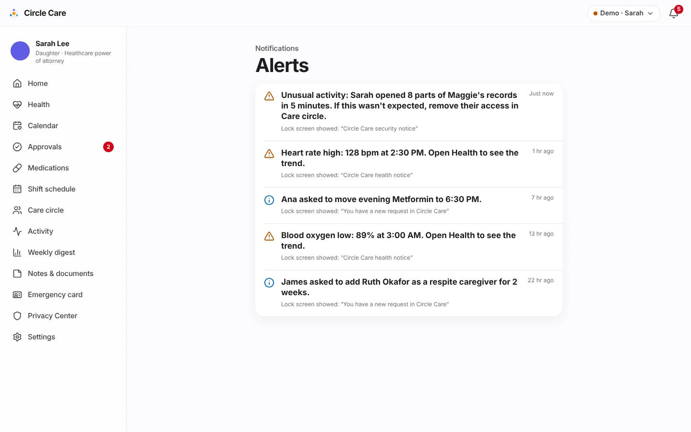

# Alerts & notifications

| | |
|---|---|
| **Feature ID / area** | F-12 · Rules engine, alert centre and in-app banners |
| **Personas** | All — elder (banners only), caregiver and guardian (banners and Alerts list) |
| **Status** | Partially built — alerts are generated and shown in-app; push, SMS and email delivery are not built |
| **Related stories** | CC-31 PHI-free notifications · CC-35 suspicious-access detection · CC-39 repeat reminder · CC-42 dose escalation · CC-50 critical alerts · CC-52 missed check-in · CC-57 late caregiver · CC-63 channels & quiet hours · CC-64 approval reminder · CC-86 health alerts · CC-25 access expiry · CC-206 all-clear · CC-207 reminder repeats & snooze · CC-208 quiet-hours morning summary · CC-199 doses and check-ins that cross midnight |
| **Last updated** | 2026-11-15 |

## Overview

**What.** A **rules engine** turns time and state into alerts: missed doses, missed check-ins, late caregivers, SOS escalation, stale approvals, suspicious access, unusual health readings and expired access. Each alert has a **lock-screen title that never contains health information** and an **in-app detail** shown only after the app is unlocked. Alerts appear as a banner when they arrive and in the **Alerts** list (bell icon).

**Why.** Families are buried in messages; health details on a lock screen are a privacy breach waiting to happen. Circle Care is *"quiet unless it matters"* — and when it speaks, the lock screen says only *"You have a reminder from Circle Care."*

**Business value.** Trustworthy, low-noise alerting is what lets the guardian stop calling every day, and PHI-free notification text is a prerequisite for using third-party push and SMS providers.

## User journey

1. Something happens (e.g. a dose passes its threshold). Within 15 seconds the rules engine creates an alert.
2. If the recipient has the app open, a banner slides in: **Circle Care** · *now* · the lock-screen title, and *"Lock-screen text above has no health details. Tap to see more."* Critical alerts are red. Banners disappear after 7 seconds.
3. Tapping the banner opens the relevant screen.
4. The bell shows an unread count. **Alerts** lists each alert with its in-app detail, *"Lock screen showed: "…""*, and the age. Alerts are marked read 1.5 seconds after the list opens.

<figure markdown="span">
  { loading=lazy }
  <figcaption>Every alert shows the generic lock-screen text it would have displayed.</figcaption>
</figure>

## Functional details & business rules

### Rules engine schedule

`evaluate(state)` in `src/data/store.tsx` runs **every 15 seconds** while the app is open and **after every change**. Alerts are de-duplicated by `key`, so a rule fires once per condition (per dose slot per day, per SOS step, per 10-minute window for security rules).

**Across midnight (CC-199).** Dose and check-in alerts belong to the day the dose was due or the check-in window opened, and their keys carry that day, so nothing repeats when the date rolls over. If the app was asleep when a step came due the evening before (a closed laptop, a phone tab in the background), the step goes out on the first run after midnight instead of being dropped: the app keeps the time it last ran (`lastRunAt`), and a follow-up that was already due then, or whose first alert went out, carries on until it's settled. A first run with no record of a last run, or one after a day away, looks back at nothing.

- A dose due late in the evening whose escalation is still running at midnight (Sarah's step falls at or after 00:00, for example a 23:30 dose) keeps the same steps and timings: still missed at 00:40, Ana and then Sarah are alerted as for a daytime dose. Its reminders and snooze carry on past midnight too. Marked after midnight, it settles as usual: the alerts show as resolved and the all-clear goes out.
- A check-in window that ends after midnight (for example 22:00–00:30), or whose prompt to Sarah falls after midnight, prompts Maggie and then Sarah as usual. A check-in made once her button showed for that window, before or after midnight, covers it.
- Only the day before is looked at, and only for those late items. A dose or window that finished escalating before midnight, anything already escalated or resolved, and anything from earlier days is never raised again. Quiet hours work as at any other time, so Sarah's non-urgent alerts after midnight wait for the morning summary.
- The screens show the same items, so each alert can be acted on. Last night's open doses are listed, labelled as from last night, on Maggie's *What's next*, Ana's *Today* and Sarah's *Needs your attention*; marking one there settles its alerts and sends the all-clear, and Maggie can snooze its reminder after midnight (`snoozeReminder` and `reminderState` take the day the dose was due). Maggie's **I'm OK** button stays until a window that ends after midnight has ended, and while last night's window is being followed up. Sarah's check-in tile and evening recap count a window as missed only once the follow-ups would, so a 22:00–00:30 window never reads as missed in the evening; a missed one shows as *"Maggie didn't check in last night"*.
- Between midnight and 5 AM greetings are a neutral *"Hello"*, so Maggie's check-in prompt reads *"Hello, Maggie. Tap "I'm OK" so Sarah knows you're fine."* rather than *"Good morning"*.

### Alert catalogue

| # | Alert | Rule | To | Severity | Lock-screen title |
|---|---|---|---|---|---|
| 1 | Dose reminder (CC-207) | At the dose time, then every 10 min (15 after a snooze) up to Sarah's limit (1–5, default 3). In-app text starts *"Reminder 2 of 3"*. Stops once the dose is marked | Elder | Info | You have a reminder from Circle Care |
| 2 | Dose — caregiver | ≥ 30 min (15 high-priority), also after midnight for a late-evening dose | Caregiver | Warning / Critical* | You have a reminder from Circle Care |
| 3 | Dose — guardian | ≥ 60 min (30 high-priority), also after midnight for a late-evening dose | Guardian | Warning / Critical* | Circle Care needs your attention |
| 4 | Check-in — elder | No check-in after window end (10:00), also when the window ends after midnight | Elder | Info | You have a reminder from Circle Care |
| 5 | Check-in — guardian | Window end + 15 min, also after midnight. In-app: *"Maggie hasn't checked in today"*, or *"last night"* for the previous evening's window | Guardian | Warning | Circle Care needs your attention |
| 6 | Late caregiver | Shift start + 15 min, no check-in | Guardian, caregiver | Warning | Circle Care needs your attention |
| 7 | SOS sent | Elder sends SOS | Guardian, caregiver | Critical | Emergency alert from Circle Care |
| 8 | SOS escalation | Every 2 min until acknowledged | Guardian, caregiver | Critical | Emergency alert from Circle Care |
| 9 | SOS acknowledged | Responder taps *I'm on my way* | Elder, guardian, caregiver | Info | Update from Circle Care |
| 10 | Approval reminder | Pending > 24 hours | Guardian | Info | You have a reminder from Circle Care |
| 11 | Bulk access | ≥ 8 record views by one person (not the elder) in 5 min | Guardian | Warning | Circle Care security notice |
| 12 | Repeated denials | ≥ 3 refused actions by one person in 10 min | Guardian | Warning | Circle Care security notice |
| 13 | Unusual health reading | Detection rules, only if Maggie shares | Guardian | Warning (high/low) · Info (sudden) | Circle Care health notice |
| 14 | Access expired | `expiresOn` < today | — (audit entry only) | — | — |
| 15 | MFA lockout | 5 wrong codes | The person | Warning | Circle Care security notice |
| 16a | All-clear (CC-206) | A dose that triggered a missed-dose alert is marked taken. Goes to each person who got that alert (not Ana while sharing is paused). In-app: *"All clear: the 8:00 AM dose was taken at 9:10 AM."* No medicine named | Caregiver, guardian | Info | Update from Circle Care |
| 16b | Morning summary (CC-208) | Quiet hours end (or Sarah turns them off) and something waited overnight. Lists what waited, in the app only | Guardian | Info | Update from Circle Care |
| 16 | Evening recap (CC-191) | Once a day at 19:00 (catches up until 23:00 if the app first runs later, never inside quiet hours), unless Sarah turned it off or quiet hours cover 19:00. In-app text: *"Your evening recap is ready."* | Guardian | Info | Update from Circle Care |

\* Critical when the medicine is high-priority.

Action-driven alerts (new requests, decisions, invitations, shift offers, appointments, sharing changes, legal-document review) are listed on each feature page under *Notifications*. Help board alerts (CC-209, CC-210) are on the [Help board](help-board.md#notifications) page.

### Lock-screen titles in use

| Title | Used for |
|---|---|
| You have a reminder from Circle Care | Reminders to the elder; dose reminders to the caregiver; approval reminders |
| Circle Care needs your attention | Escalations to the guardian (dose, check-in, late caregiver) |
| Emergency alert from Circle Care | SOS |
| Circle Care security notice | Suspicious access, MFA lockout |
| Circle Care health notice | Unusual readings |
| You have a new request in Circle Care | Change, member and swap requests |
| You have a new message in Circle Care | Elder questions and suggestions |
| You have a new shift in Circle Care | Shift offers |
| You have an update in Circle Care | Decisions, escort requests |
| Update from Circle Care | Informational updates |

!!! note "PHI-free by design (CC-31)"
    No title names a person's condition, a medicine or a note. Details such as *"Lisinopril (08:00) is 70 minutes overdue"* appear only inside the app. The same rule applies to the weekly digest email.

### Severity

| Severity | Icon / colour | Meaning |
|---|---|---|
| Critical | Siren, red banner | SOS, high-priority dose escalation. Should break through silent mode when *Emergencies break through silent mode* is on |
| Warning | Triangle, orange | Needs attention soon |
| Info | Info, blue | For awareness |

### Guardian delivery settings (CC-63)

| Setting | Default | Prototype effect |
|---|---|---|
| Push / Text messages / Email | On / On / Off | Stored only |
| Quiet hours | Off for a new circle; the demo has it on, 22:00–07:00 | Enforced for Sarah (CC-208): non-urgent alerts are held, not listed or bannered, and go out as one morning summary when quiet hours end. Critical alerts (SOS, high-priority medicines), security notices and readings outside Maggie's thresholds still come at once |
| Reminder repeats | 3 (1–5) | Reminders Maggie gets per dose (CC-207). A change applies from the next dose. Missed-dose timers are unaffected |
| Emergencies break through silent mode | On | Stored only |

## Permissions & privacy

- Alerts are addressed to **personas** (`elder`, `caregiver`, `guardian`), not to individual members, because the demo has one app per persona.
- Security alerts go only to the guardian. Health alerts go only to the guardian and only while Maggie shares readings.
- Lock-screen text never contains health details. A health alert's reading shows only in its in-app detail, and the access log can name a medicine or a document, so both are protected as PHI.

## Notifications

This page *is* the notification reference; see the catalogue above.

## Accessibility

- Banners are announced through an `aria-live="assertive"` region.
- The bell has an accessible name including the unread count (*"Notifications, 4 unread"*).
- Severity is shown by icon and text, not colour alone.

## Data captured

| Field | Meaning |
|---|---|
| `id`, `key?` | Identity and de-duplication key |
| `at` | Created time |
| `to[]` | Recipient personas |
| `title` | Lock-screen text (PHI-free) |
| `detail` | In-app text |
| `severity` | info · warning · critical |
| `read[]` | Personas that have read it |
| `link?` | Screen to open |

## Edge cases & error states

| Situation | Behaviour |
|---|---|
| Rule condition persists | No repeat alert (same key) |
| Alerts created before the screen opened | No banner; they are in the Alerts list |
| Elder taps a banner | Always routed to an elder screen |
| Presenter skips time ahead | All time-based rules re-evaluate immediately |
| No alerts | *"You're all caught up."* |

## Test coverage

| Type | Test |
|---|---|
| Unit — `rules.test.ts` | Escalates a missed dose to the caregiver, then the guardian · does not repeat the same alert · missed check-in prompts the elder first, then the guardian 15 minutes later · flags bulk record viewing · flags repeated denials · reminds the guardian about requests older than a day · ends time-limited access automatically · across midnight (CC-199): a 23:30 dose still missed at 00:40 escalates, daytime timings kept, a window ending after midnight and one whose guardian prompt falls after it, no follow-up after a check-in before midnight, no alert twice when the rules run every minute past midnight, nothing for two nights ago, a dose taken after midnight resolves with an all-clear, reminders and snooze carry on, quiet hours and the morning summary still apply |
| Unit — `overnight-screens.test.ts` | After midnight: a 23:30 dose shows at 00:20 as last night's and marking it settles its alerts, not given settles with no all-clear, a dose that finished escalating before midnight isn't listed, `logDose` accepts only today or yesterday, last night's reminder snoozed with its date, a neutral greeting after midnight, the *I'm OK* button for a window ending after midnight, and Sarah's tile and recap using the follow-up rule |
| Unit — `health.test.ts` | Detection rules for alerts 13 |
| E2E | *CC-35 suspicious access alerts the guardian* · *CC-64 24-hour approval reminder* · *CC-86 a sudden heart-rate change alerts the guardian* · *Missed dose escalates…* |
| Unit — `calm-alerts.test.ts` | Sprint 16: all-clear to each person alerted, none before an alert, Skipped and Refused shown with who and why, reminders cleared, paused sharing, audit · 3 reminders 10 minutes apart then stop, missed-dose timers unchanged, snooze, Sarah's 1–5 setting, high-priority timing · quiet hours hold and summarise at 7 AM, urgent alerts at once, no empty summary, off delivers at once, generic lock-screen line |
| E2E — `calm.py` | *CC-207 Maggie sees which reminder this is and snoozes it* · *CC-207 Sarah sets how many reminders Maggie gets* · *CC-206 Sarah gets an all-clear naming no medicine* |
| Gaps | No unit tests for late-caregiver or SOS-escalation alerts |

## Known limitations & production gaps

| In the prototype | In production (planned) |
|---|---|
| Rules run in the browser, only while a tab is open | Server-side scheduler with idempotent jobs |
| Banners only | Push (APNs/FCM) with iOS critical-alert entitlement, SMS and email via BAA-covered vendors ([R2](../roadmap.md)) |
| Channels and critical bypass not enforced; quiet hours apply to Sarah only | Delivery policy per person and severity |
| Alerts addressed to personas | Addressed to members, with per-member preferences |
| English only | Translated notifications ([R2 Language Access](../roadmap.md)) |
| Fixed security thresholds | Tuned anomaly detection and security-team escalation |

## Related pages

- [Medications & tasks](medications-and-tasks.md) · [SOS & emergency](sos-and-emergency.md) · [Health insights](health-insights.md)
- [System overview — rules engine](../architecture/system-overview.md#rules-engine)
- [Security & privacy](../architecture/security-and-privacy.md)
