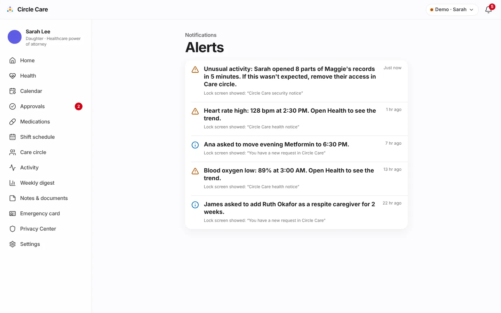

# Alerts & notifications

| | |
|---|---|
| **Feature ID / area** | F-12 · Rules engine, alert centre and in-app banners |
| **Personas** | All — elder (banners only), caregiver and guardian (banners and Alerts list) |
| **Status** | Partially built — alerts are generated and shown in-app; push, SMS and email delivery are not built |
| **Related stories** | CC-31 PHI-free notifications · CC-35 suspicious-access detection · CC-39 repeat reminder · CC-42 dose escalation · CC-50 critical alerts · CC-52 missed check-in · CC-57 late caregiver · CC-63 channels & quiet hours · CC-64 approval reminder · CC-86 health alerts · CC-25 access expiry |
| **Last updated** | 2026-10-19 |

## Overview

**What.** A **rules engine** turns time and state into alerts: missed doses, missed check-ins, late caregivers, SOS escalation, stale approvals, suspicious access, unusual health readings and expired access. Each alert has a **lock-screen title that never contains health information** and an **in-app detail** shown only after the app is unlocked. Alerts appear as a banner when they arrive and in the **Alerts** list (bell icon).

**Why.** Families are buried in messages; health details on a lock screen are a privacy breach waiting to happen. Circle Care is *"quiet unless it matters"* — and when it speaks, the lock screen says only *"You have a reminder from Circle Care."*

**Business value.** Trustworthy, low-noise alerting is what lets the guardian stop calling every day, and PHI-free notification text is a prerequisite for using third-party push and SMS providers.

## User journey

1. Something happens (e.g. a dose passes its threshold). Within 15 seconds the rules engine creates an alert.
2. If the recipient has the app open, a banner slides in: **Circle Care** · *now* · the lock-screen title, and *"Lock-screen text above has no health details. Tap to see more."* Critical alerts are red. Banners disappear after 7 seconds.
3. Tapping the banner opens the relevant screen.
4. The bell shows an unread count. **Alerts** lists each alert with its in-app detail, *"Lock screen showed: "…""*, and the age. Alerts are marked read 1.5 seconds after the list opens.

<figure markdown="span">
  { loading=lazy }
  <figcaption>Every alert shows the generic lock-screen text it would have displayed.</figcaption>
</figure>

## Functional details & business rules

### Rules engine schedule

`evaluate(state)` in `src/data/store.tsx` runs **every 15 seconds** while the app is open and **after every change**. Alerts are de-duplicated by `key`, so a rule fires once per condition (per dose slot per day, per SOS step, per 10-minute window for security rules).

### Alert catalogue

| # | Alert | Rule | To | Severity | Lock-screen title |
|---|---|---|---|---|---|
| 1 | Dose repeat reminder | Unconfirmed dose ≥ 10 min past time | Elder | Info | You have a reminder from Circle Care |
| 2 | Dose — caregiver | ≥ 30 min (15 high-priority) | Caregiver | Warning / Critical* | You have a reminder from Circle Care |
| 3 | Dose — guardian | ≥ 60 min (30 high-priority) | Guardian | Warning / Critical* | Circle Care needs your attention |
| 4 | Check-in — elder | No check-in after window end (10:00) | Elder | Info | You have a reminder from Circle Care |
| 5 | Check-in — guardian | Window end + 15 min | Guardian | Warning | Circle Care needs your attention |
| 6 | Late caregiver | Shift start + 15 min, no check-in | Guardian, caregiver | Warning | Circle Care needs your attention |
| 7 | SOS sent | Elder sends SOS | Guardian, caregiver | Critical | Emergency alert from Circle Care |
| 8 | SOS escalation | Every 2 min until acknowledged | Guardian, caregiver | Critical | Emergency alert from Circle Care |
| 9 | SOS acknowledged | Responder taps *I'm on my way* | Elder, guardian, caregiver | Info | Update from Circle Care |
| 10 | Approval reminder | Pending > 24 hours | Guardian | Info | You have a reminder from Circle Care |
| 11 | Bulk access | ≥ 8 record views by one person (not the elder) in 5 min | Guardian | Warning | Circle Care security notice |
| 12 | Repeated denials | ≥ 3 refused actions by one person in 10 min | Guardian | Warning | Circle Care security notice |
| 13 | Unusual health reading | Detection rules, only if Maggie shares | Guardian | Warning (high/low) · Info (sudden) | Circle Care health notice |
| 14 | Access expired | `expiresOn` < today | — (audit entry only) | — | — |
| 15 | MFA lockout | 5 wrong codes | The person | Warning | Circle Care security notice |

\* Critical when the medicine is high-priority.

Action-driven alerts (new requests, decisions, invitations, shift offers, appointments, sharing changes, legal-document review) are listed on each feature page under *Notifications*.

### Lock-screen titles in use

| Title | Used for |
|---|---|
| You have a reminder from Circle Care | Reminders to the elder; dose reminders to the caregiver; approval reminders |
| Circle Care needs your attention | Escalations to the guardian (dose, check-in, late caregiver) |
| Emergency alert from Circle Care | SOS |
| Circle Care security notice | Suspicious access, MFA lockout |
| Circle Care health notice | Unusual readings |
| You have a new request in Circle Care | Change, member and swap requests |
| You have a new message in Circle Care | Elder questions and suggestions |
| You have a new shift in Circle Care | Shift offers |
| You have an update in Circle Care | Decisions, escort requests |
| Update from Circle Care | Informational updates |

!!! note "PHI-free by design (CC-31)"
    No title names a person's condition, a medicine or a note. Details such as *"Lisinopril (08:00) is 70 minutes overdue"* appear only inside the app. The same rule applies to the weekly digest email.

### Severity

| Severity | Icon / colour | Meaning |
|---|---|---|
| Critical | Siren, red banner | SOS, high-priority dose escalation. Should break through silent mode when *Emergencies break through silent mode* is on |
| Warning | Triangle, orange | Needs attention soon |
| Info | Info, blue | For awareness |

### Guardian delivery settings (CC-63)

| Setting | Default | Prototype effect |
|---|---|---|
| Push / Text messages / Email | On / On / Off | Stored only |
| Quiet hours | On, 22:00–07:00 — *"Non-urgent alerts wait until morning"* | Stored only |
| Emergencies break through silent mode | On | Stored only |

## Permissions & privacy

- Alerts are addressed to **personas** (`elder`, `caregiver`, `guardian`), not to individual members, because the demo has one app per persona.
- Security alerts go only to the guardian. Health alerts go only to the guardian and only while Maggie shares readings.
- The access log and alerts never contain health values; health-alert details show the reading inside the app only.

## Notifications

This page *is* the notification reference; see the catalogue above.

## Accessibility

- Banners are announced through an `aria-live="assertive"` region.
- The bell has an accessible name including the unread count (*"Notifications, 4 unread"*).
- Severity is shown by icon and text, not colour alone.

## Data captured

| Field | Meaning |
|---|---|
| `id`, `key?` | Identity and de-duplication key |
| `at` | Created time |
| `to[]` | Recipient personas |
| `title` | Lock-screen text (PHI-free) |
| `detail` | In-app text |
| `severity` | info · warning · critical |
| `read[]` | Personas that have read it |
| `link?` | Screen to open |

## Edge cases & error states

| Situation | Behaviour |
|---|---|
| Rule condition persists | No repeat alert (same key) |
| Alerts created before the screen opened | No banner; they are in the Alerts list |
| Elder taps a banner | Always routed to an elder screen |
| Presenter skips time ahead | All time-based rules re-evaluate immediately |
| No alerts | *"You're all caught up."* |

## Test coverage

| Type | Test |
|---|---|
| Unit — `rules.test.ts` | Escalates a missed dose to the caregiver, then the guardian · does not repeat the same alert · missed check-in prompts the elder first, then the guardian 15 minutes later · flags bulk record viewing · flags repeated denials · reminds the guardian about requests older than a day · ends time-limited access automatically |
| Unit — `health.test.ts` | Detection rules for alerts 13 |
| E2E | *CC-35 suspicious access alerts the guardian* · *CC-64 24-hour approval reminder* · *CC-86 a sudden heart-rate change alerts the guardian* · *Missed dose escalates…* |
| Gaps | No unit tests for late-caregiver or SOS-escalation alerts |

## Known limitations & production gaps

| In the prototype | In production (planned) |
|---|---|
| Rules run in the browser, only while a tab is open | Server-side scheduler with idempotent jobs |
| Banners only | Push (APNs/FCM) with iOS critical-alert entitlement, SMS and email via BAA-covered vendors ([R2](../roadmap.md)) |
| Channels, quiet hours and critical bypass not enforced | Delivery policy per person and severity |
| Alerts addressed to personas | Addressed to members, with per-member preferences |
| English only | Translated notifications ([R2 Language Access](../roadmap.md)) |
| Fixed security thresholds | Tuned anomaly detection and security-team escalation |

## Related pages

- [Medications & tasks](medications-and-tasks.md) · [SOS & emergency](sos-and-emergency.md) · [Health insights](health-insights.md)
- [System overview — rules engine](../architecture/system-overview.md#rules-engine)
- [Security & privacy](../architecture/security-and-privacy.md)
