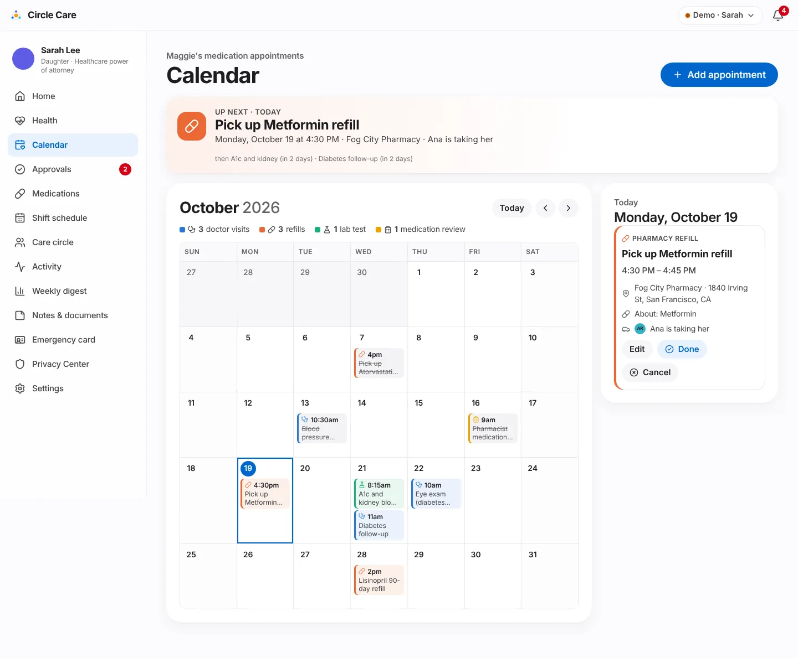
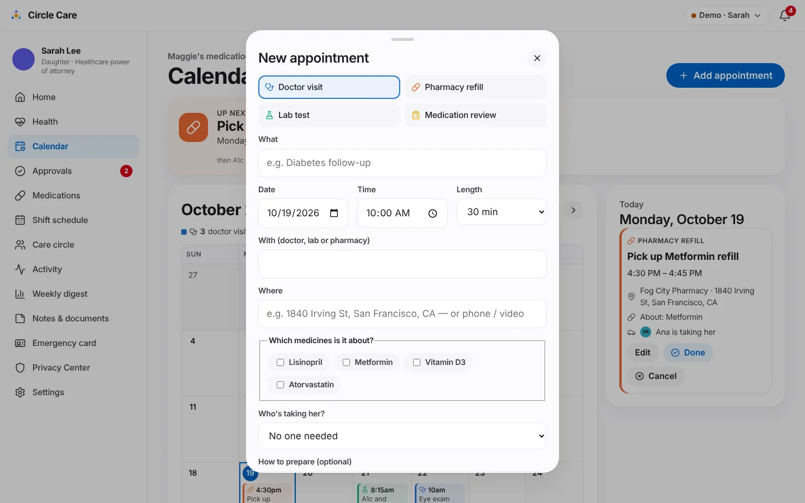
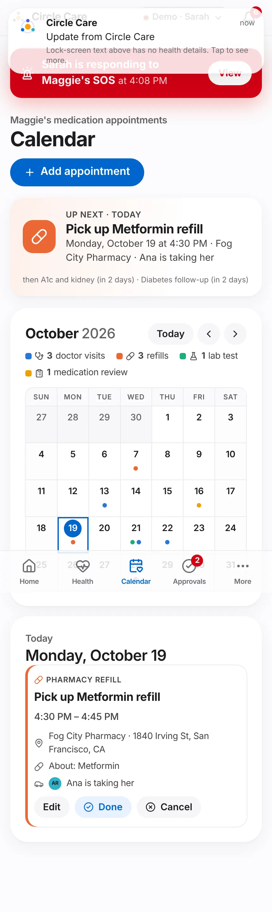

# Care calendar

| | |
|---|---|
| **Feature ID / area** | F-08 · Medication-related appointments (`/app/guardian/calendar`) |
| **Personas** | Sarah (plans), Ana and James (escorts), Maggie (is told about new appointments) |
| **Status** | Built in prototype |
| **Related stories** | CC-94 – CC-98 medication appointment calendar — month view (CC-94), add / edit (CC-96), appointment types (CC-98); CC-95 and CC-97 are covered by the same range comment in code, with titles in Notion |
| **Last updated** | 2026-10-19 |

## Overview

**What.** A full-month calendar of appointments that relate to Maggie's medicines: **doctor visits**, **pharmacy refills**, **lab tests** and **medication reviews**. Each appointment records who it is with, where, which medicines it concerns, who is taking Maggie, and how to prepare. An **Up next** banner keeps the next few appointments in view.

**Why.** Medication safety depends on more than doses: refills must be picked up, fasting lab tests must be prepared for, and follow-ups must have someone to drive. These usually live in one person's head or phone.

**Business value.** Reduces missed refills and appointments, and links each appointment to the medicines it concerns — the foundation for [Release 2](../roadmap.md) patient-portal appointment sync and pharmacy refill integration.

## User journey

1. Sarah opens **Calendar** — *"Maggie's medication appointments"*.
2. The **Up next** banner shows the next appointment in its type colour: *"UP NEXT · TODAY — Pick up Metformin refill — Monday, October 19 at 4:30 PM · Fog City Pharmacy · Ana is taking her"* and the following two (*"then A1c and kidney (in 2 days) · Diabetes follow-up (in 2 days)"*). Tapping it jumps to that day.
3. The **month grid** (*October 2026*) has **Today**, previous and next buttons and a legend counting this month's appointments by type (*3 doctor visits · 3 refills · 1 lab test · 1 medication review*). Each day shows up to three chips (icon, time, title) and *+N more*; past appointments are struck through.
4. Selecting a day fills the **day panel**: type, title, time range, provider and location, *About: Metformin*, *Ana is taking her*, preparation notes, and **Edit**, **Done** (today or earlier) and **Cancel**.
5. **Add appointment** (or *Add one* on an empty day) opens **New appointment**: type buttons (*Doctor visit, Pharmacy refill, Lab test, Medication review*), *What*, *Date*, *Time*, *Length*, *With (doctor, lab or pharmacy)*, *Where*, *Which medicines is it about?*, *Who's taking her?* and *How to prepare (optional)* → **Add to calendar** — *"Appointment added — Maggie will see it"*.
6. On phones the grid switches to a compact view with coloured dots per day.

<figure markdown="span">
  { loading=lazy }
  <figcaption>Month view with the Up next banner and the selected day's details.</figcaption>
</figure>

<figure markdown="span">
  { loading=lazy width="460" }
  <figcaption>Adding an appointment.</figcaption>
</figure>
<figure markdown="span" class="cc-phone">
  { loading=lazy }
  <figcaption>Compact phone layout.</figcaption>
</figure>

## Functional details & business rules

### Appointment types

| Type (`kind`) | Label | Colour | Icon | Default length (seed) |
|---|---|---|---|---|
| `doctor` | Doctor visit | Blue `#2a78d6` | Stethoscope | 45 min |
| `refill` | Pharmacy refill | Orange `#eb6834` | Pill | 15 min |
| `lab` | Lab test | Green `#1baf7a` | Flask | 20 min |
| `review` | Medication review | Amber `#eda100` | Clipboard | 45 min |

Every chip and legend entry pairs colour with an icon and text.

### Rules

| Rule | Value |
|---|---|
| Required fields | *What*, *Date*, *Time*, *With* |
| Length options | 15, 30, 45, 60, 90 minutes |
| Escort options | Any active member except the elder, or *No one needed* |
| Status | `scheduled` → `done` (only on or after the appointment date) or `cancelled` |
| Up next | First scheduled appointment that hasn't ended yet; the banner also names the next two |
| Day chips | Up to 3 per day, then *+N more*; cancelled appointments are hidden from the grid but kept in the day panel with a **Cancelled** badge |
| Seed data | 14 appointments from 12 days ago to 35 days ahead, including **two on the same day** (lab test 08:15 and diabetes follow-up 11:00, in 2 days) and the eye exam on the next Thursday that matches a care note |

### Demo providers (fictional, San Francisco)

| Provider | Location |
|---|---|
| Dr. Hannah Brooks | Golden Gate Family Medicine, 2100 Webster St |
| Dr. Omar Patel | Presidio Eye Care, 3700 California St |
| Dr. Lena Ortiz | Bay Heart Center, 1100 Van Ness Ave |
| Bay Area Lab | Suite 210, 3801 Sacramento St |
| Fog City Pharmacy | 1840 Irving St (or mail order / phone) |

## Permissions & privacy

| Resource | Read | Write |
|---|---|---|
| `appointments` | elder, guardian, family, pro (on or off shift) | **guardian only** |

The **Add appointment**, **Edit**, **Done** and **Cancel** controls are hidden for anyone without `appointments: write`. Opening the calendar writes *"viewed the appointment calendar"* to the access log; changes write *created* / *updated* entries with the appointment title.

## Notifications

| Trigger | Recipient | Lock-screen text | In-app detail |
|---|---|---|---|
| New appointment | Elder | Update from Circle Care | New appointment: Blood pressure recheck on 2026-10-21 at 10:00 AM. |
| New appointment with a professional caregiver as escort | Caregiver | You have an update in Circle Care | Sarah asked you to take Maggie to "Blood pressure recheck" on 2026-10-21 at 10:00 AM. |

Family escorts are not notified (the demo has no family app). The elder alert is also sent when an existing appointment is edited.

## Accessibility

- The month grid uses `role="grid"`, `row`, `columnheader` and `gridcell`; each day cell has a full label, e.g. *"Wednesday, October 21, 2 appointments: Lab test 8:15 AM, Doctor visit 11:00 AM"*.
- The selected day is announced through an `aria-live` panel.
- Appointment types are a labelled radio group; medicines are checkboxes.
- `/app/guardian/calendar` passes axe-core.

## Data captured

| Field | Type |
|---|---|
| `date`, `time`, `durationMin` | `YYYY-MM-DD`, `HH:MM`, minutes |
| `kind` | doctor · lab · refill · review |
| `title`, `provider`, `location`, `prep?` | text |
| `medIds[]` | medicines the appointment is about |
| `escortId?` | member taking Maggie |
| `status` | scheduled · done · cancelled |
| `createdBy` | member id |

## Edge cases & error states

| Situation | Behaviour |
|---|---|
| Day with no appointments | *"No appointments."* with **Add one** (guardian) |
| Clicking a day in the previous or next month | Selects it and switches month |
| More than three appointments in a day | *+N more* chip |
| Appointment for a paused medicine | Allowed; the medicine name still shows |

## Test coverage

| Type | Test |
|---|---|
| E2E | *CC-94/96/97 month calendar: next-up, navigation, add and cancel* — checks *Up next*, that the grid has 7 cells per row, next-month and **Today** navigation, adding *Blood pressure recheck* for Lisinopril, and cancelling it |
| Unit | `health.test.ts` — *everyone in the circle can see appointments; only the guardian edits them* · *seeds medication appointments including two on one day* |
| Accessibility | `/app/guardian/calendar` |

## Known limitations & production gaps

| In the prototype | In production (planned) |
|---|---|
| The elder and caregiver apps have **no calendar screen**; they receive a notification only (the form says *"Maggie sees every appointment in her app"*) | Elder and caregiver views of upcoming appointments |
| Appointments entered by hand | Patient-portal appointment sync and pharmacy refill integration ([R2](../roadmap.md)) |
| No reminders before appointments or preparation steps | Reminders the day before and on the day; fasting reminders |
| No ride booking | Ride booking for appointments ([R4](../roadmap.md)) |
| No recurring appointments | Recurrence (e.g. 90-day refills) |
| Dates shown as `YYYY-MM-DD` in notification text | Localised dates |

## Related pages

- [Medications & tasks](medications-and-tasks.md)
- [Guardian dashboard & approvals](guardian-dashboard-and-approvals.md#home) — *Next appointment* tile
- [Roadmap](../roadmap.md)
