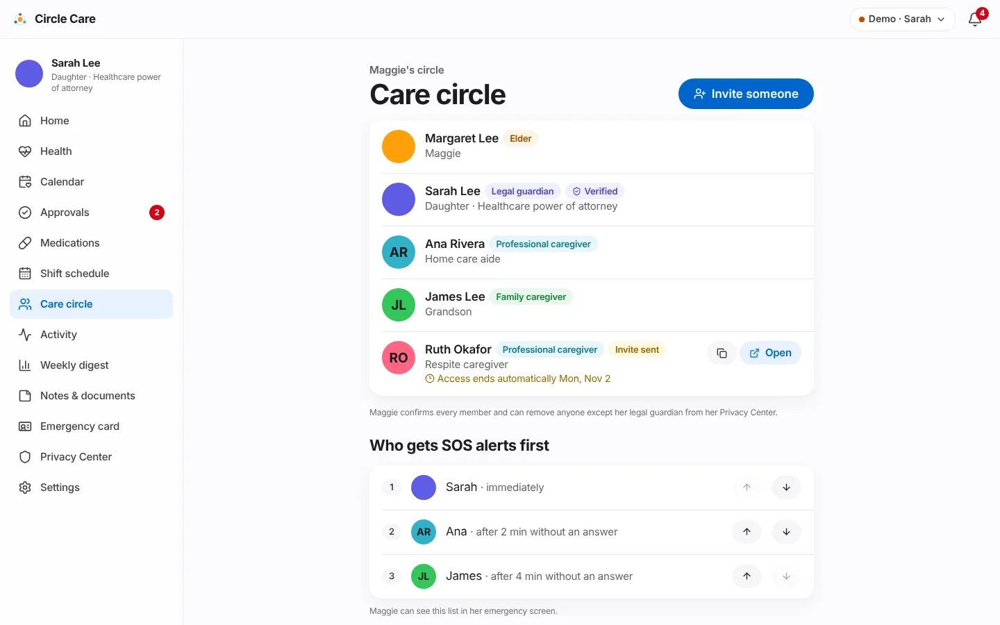
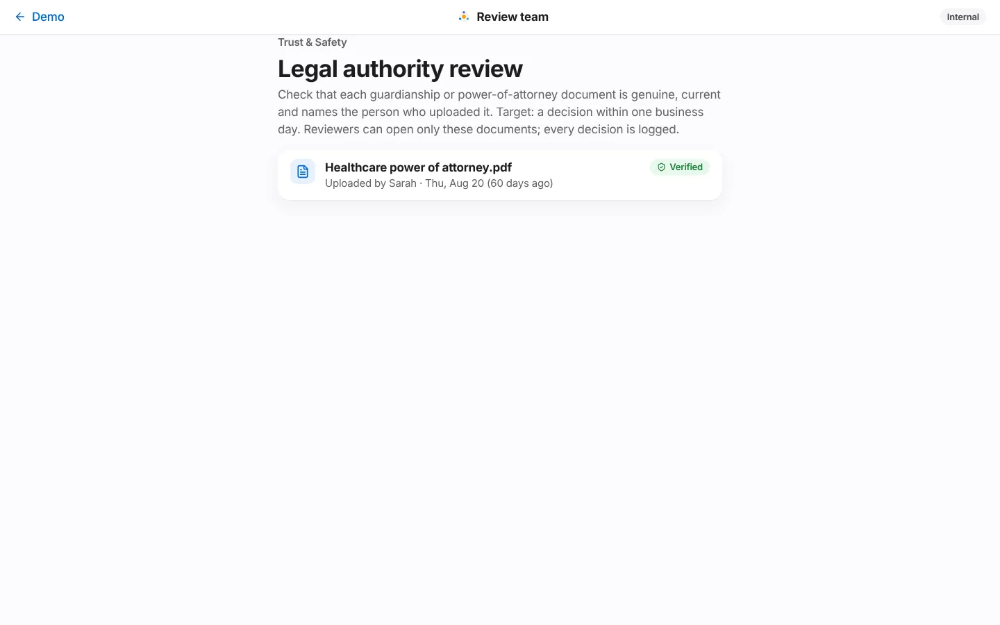

# Care circle & access

| | |
|---|---|
| **Feature ID / area** | F-09 · Membership, roles, invitations and legal-authority verification |
| **Personas** | Sarah (manages the circle), Maggie (confirms and removes members), invited helpers (Ruth), internal review team |
| **Status** | Built in prototype — identity checks and invite delivery are simulated |
| **Related stories** | CC-15 create a care circle · CC-16 invite by role · CC-17 accept an invitation · CC-18 role permission matrix · CC-19 single enforcement point · CC-20 who can see my data · CC-21 revoke access · CC-23 upload legal authority · CC-24 guardian verification (review console) · CC-25 time-limited access · CC-48 SOS escalation order |
| **Last updated** | 2026-10-19 |

## Overview

**What.** The **care circle** is the set of people allowed to help Maggie, each with a **role** that decides what they can see and do. The guardian invites people by role, can make access **temporary**, and sets the **SOS order**. Maggie sees everyone and can remove anyone except her legal guardian. A guardian's legal powers depend on a power-of-attorney or guardianship document that an internal **review team** verifies.

**Why.** Shared family logins and group chats give everyone everything. Care requires the opposite: the right person sees the right thing, only for as long as needed, and the elder can see and change it.

**Business value.** Role-based, time-bound access is what makes Circle Care safe to recommend to agencies and acceptable to elders. Guardian verification protects against the most serious abuse risk: someone falsely claiming authority over an older adult.

## User journey

### Manage the circle (guardian)

1. Sarah opens **Care circle** — *"Maggie's circle"*. Each member shows a role badge (*Elder, Legal guardian, Family caregiver, Professional caregiver*), *Verified* for a verified guardian, *Invite sent* for pending invitations, the relationship, and *"Access ends automatically Mon, Nov 2"* for temporary access.
2. For pending invitations she can **copy the invite link** or **Open** it.
3. **Who gets SOS alerts first** lists the escalation order — *"Sarah · immediately"*, *"Ana · after 2 min without an answer"*, *"James · after 4 min without an answer"* — with up/down arrows. *"Maggie can see this list in her emergency screen."*
4. **Legal authority** lists POA or guardianship documents with *In review*, *Verified* or *Needs resubmission*. In the demo, *In review* items have a **Simulate approval** button.

<figure markdown="span">
  { loading=lazy }
  <figcaption>The care circle with roles, a pending time-limited invitation and the SOS order.</figcaption>
</figure>

### Invite someone (CC-15, CC-16)

5. **Invite someone** → **Invite to Maggie's circle**: *Name*, *Mobile number or email*, *Role* (**Family** — *"Sees today's medicines, tasks, notes and alerts."* or **Professional** — *"Sees today's plan only during their shifts."*), *How they're related (optional)*, and **Temporary access** with an *Access ends* date (default 14 days ahead).
6. *"The invite link works once and expires in 72 hours. The message contains no health information. Maggie is notified."* → **Send invite** (*"Invite sent to Lena Park"*). The member appears as *Invite sent*.
7. The invitee accepts at `/app/invite/<id>` — see [Website & onboarding](website-and-onboarding.md#invitation-acceptance).

### Time-limited access (CC-25) {#time-limited-access}

8. Members with an end date show it everywhere they appear. When the date passes, the rules engine revokes access automatically and writes *"Circle Care removed Ruth Okafor's access (time limit ended)"* to the access log.

### Remove someone (CC-21)

9. In her Privacy Center, Maggie taps **Remove** next to any member except Sarah → *"Remove Ana? Ana will stop seeing your information right away, on every device. Sarah will be told."* → **Remove Ana** / **Keep Ana**.
10. The member is revoked, removed from the SOS chain, and listed under *"No longer has access"*. *"Sarah is your legal guardian. Her access can only be changed through the legal process, not in the app."*

### Guardian verification and review console (CC-23, CC-24) {#guardian-verification-and-review-console}

11. Sarah uploads a document of type **Legal authority** in [Notes & documents](notes-and-documents.md). She is told: *"We received "court-order.png". Our review team usually responds within one business day."*
12. A reviewer opens the internal **Review team** console (`/app/review`) — *"Legal authority review"*. *"Check that each guardianship or power-of-attorney document is genuine, current and names the person who uploaded it. Target: a decision within one business day. Reviewers can open only these documents; every decision is logged."*
13. **Verify** → the document and the uploader become *Verified*; Maggie and Sarah are told *"Sarah's legal authority was verified."*
14. **Reject** → choose a reason the uploader will see → **Reject and notify**. Sarah sees *"court-order.png couldn't be verified: It has expired. Upload a new copy as "Legal authority"."*

<figure markdown="span">
  { loading=lazy }
  <figcaption>The internal review console sees only legal-authority documents.</figcaption>
</figure>

## Functional details & business rules

### Roles

| Role (`Member.role`) | Label | What the Privacy Center says they can see |
|---|---|---|
| `elder` | Elder | Everything |
| `guardian` | Legal guardian | Everything, and approves big decisions |
| `family` | Family caregiver | Today's medicines, tasks, notes and alerts |
| `pro` | Professional caregiver | Today's plan, only during their shifts |
| `reviewer` (actor `trust-safety`) | Review team | Legal-authority documents only |

### Member status

| Status | Meaning | Access |
|---|---|---|
| `pending` | Invited, not yet active | None (`roleOf()` returns null) |
| `active` | In the circle | Per role |
| `revoked` | Removed or expired | None |

### Rules

| Rule | Value | Source |
|---|---|---|
| Who can invite | Elder and guardian (`circle: invite`) — the UI offers invites to the guardian | `policy.ts` |
| Who can revoke | Elder and guardian (`circle: revoke`); **the elder and the guardian themselves can never be revoked** | `store.revoke` |
| Roles offered in the invite form | Family, Professional | `Circle.tsx` |
| Invite link | Single use, 72-hour expiry | `Invite.tsx` |
| Temporary access | `expiresOn` date; revoked automatically the day after | `evaluate()` |
| Pending member becomes active | When they accept the invitation, or when the guardian approves a *member* request | `acceptInvite`, `decide` |
| SOS order | Guardian re-orders; Maggie can suggest changes; revoked members are removed from it | CC-48 |
| Rejection reasons | The name doesn't match the guardian's name · The document is unreadable or cut off · It isn't signed or certified by a court · It has expired · It's the wrong type of document | `Review.tsx` |

### The permission matrix

The single source of truth is `MATRIX` in `src/data/policy.ts`, read through `can(state, actorId, action, resource)`. Every data-changing store action is guarded; refused actions change nothing and are written to the access log as `denied`. The full table, rules (`pro@shift`, `ALWAYS_SHARED`) and open design questions are in the [Permission matrix](../../security/permission-matrix.md); a summary is in [Security & privacy](../architecture/security-and-privacy.md#permission-model).

## Permissions & privacy

| Resource | Read | Invite / revoke | Other |
|---|---|---|---|
| `circle` | elder, guardian, family, pro | elder, guardian | Always shared, even when sharing is paused |
| `docs.legal` | elder, guardian | write: guardian | review: reviewer only |

!!! note "Reviewers see the minimum"
    The review console lists only legal-authority documents — nothing else about the elder. Every decision is logged as the actor *"Circle Care review team"*.

## Notifications

| Trigger | Recipient | Lock-screen text | In-app detail |
|---|---|---|---|
| Member invited | Elder | Update from Circle Care | Lena Park was invited to your circle as Family caregiver. |
| Member removed | Guardian | Update from Circle Care | Maggie removed Ana Rivera from the circle. |
| Legal document received | Guardian | Update from Circle Care | We received "*file*". Our review team usually responds within one business day. |
| Legal authority verified | Elder, guardian | Update from Circle Care | Sarah's legal authority was verified. |
| Legal document rejected | Elder, guardian | Update from Circle Care | "*file*" couldn't be verified: *reason*. Please upload a new copy. |
| SOS-list suggestion | Guardian | You have a new message in Circle Care | Maggie suggested a change to her SOS list: "*text*" |

## Accessibility

- Role, status and verification are badges with text, not colour alone.
- Re-order buttons have labels (*"Move Ana up"*); the first and last are disabled at the ends.
- Copy-link buttons are labelled (*"Copy invite link for Ruth"*).
- `/app/guardian/circle` and `/app/review` pass axe-core.

## Data captured

| Entity | Fields |
|---|---|
| `Member` | `name`, `short`, `role`, `relation`, `phone`, `color`, `status`, `verification?`, `expiresOn?`, `favorite?`, `invitedAt?` |
| `CareDoc` (legal) | `status` (pending / verified / rejected), `rejectReason?` |
| `Settings.escalation` | Ordered member ids |
| `AuditEvent` | invitation created, access removed, legal document approved / declined |

## Edge cases & error states

| Situation | Behaviour |
|---|---|
| Trying to revoke the elder or the guardian | Ignored by the store |
| Revoked member tries any action | Refused (`roleOf()` is null) |
| Invite accepted after 72 hours | Expired screen; request a new link |
| Guardian uploads a non-PDF/PNG/JPEG as legal authority | Rejected before upload (see [Notes & documents](notes-and-documents.md)) |

## Test coverage

| Type | Test |
|---|---|
| E2E | *Guardian invites a new member* · *CC-67 upload checks file type…* (legal-authority upload) · *CC-24 review team rejects with reason; guardian told to resubmit* · *Elder pauses sharing…* |
| Unit | `rules.test.ts` — *ends time-limited access automatically (CC-25)*. `policy.test.ts` — generated tests for every cell of the matrix (elder, guardian, family; caregiver on and off shift) · *unknown and removed people get nothing* · *only the review team can review legal documents* |

## Known limitations & production gaps

| In the prototype | In production (planned) |
|---|---|
| Invites are not sent; the link is copied | SMS/email delivery with signed, single-use tokens |
| Accepting an invite activates the member directly | Identity verification and, where required, guardian approval before access |
| The circle page says *"Until documents are verified, a guardian has family-member access only"*, but the code does not downgrade an unverified guardian — `verification` only gates consenting on Maggie's behalf | Enforce guardian powers only after verification |
| The guardian's Care circle page has **no remove button**, although the suspicious-access alert says *"remove their access in Care circle"*; only Maggie can remove members (from her Privacy Center) | Add removal to the guardian's circle page |
| The elder has no invite screen (the matrix allows it) | Elder-initiated invitations |
| *Simulate approval* button on the guardian's page | Removed; a separate internal app with its own authentication, MFA and audit |
| One elder per circle; no agency accounts | Agency multi-client accounts ([R5](../roadmap.md)) |

## Related pages

- [Permission matrix](../../security/permission-matrix.md)
- [Privacy Center](privacy-center.md)
- [Notes & documents](notes-and-documents.md)
- [Website & onboarding](website-and-onboarding.md)
- [Security & privacy](../architecture/security-and-privacy.md)
