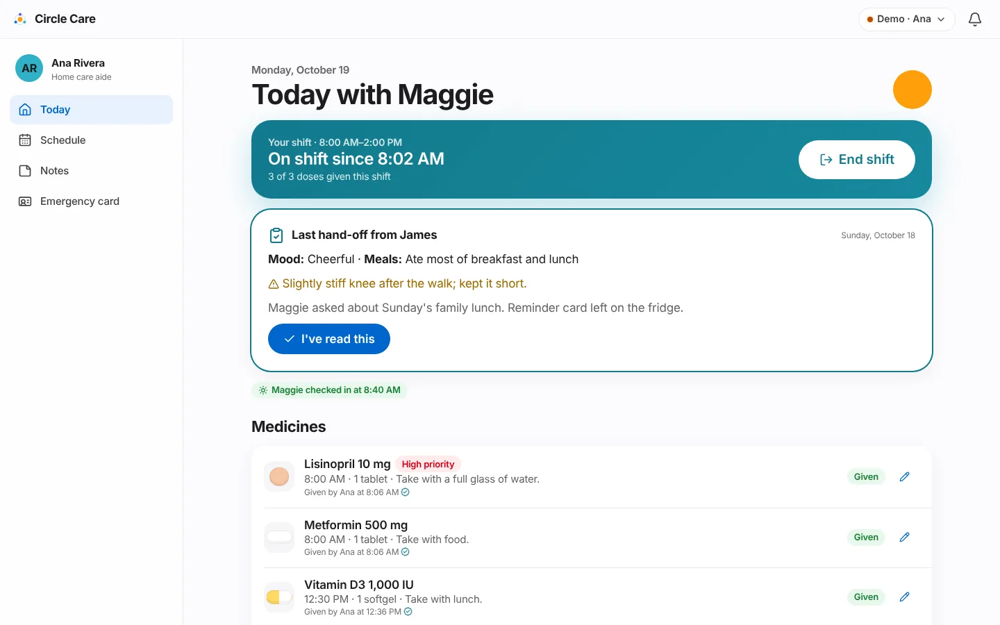
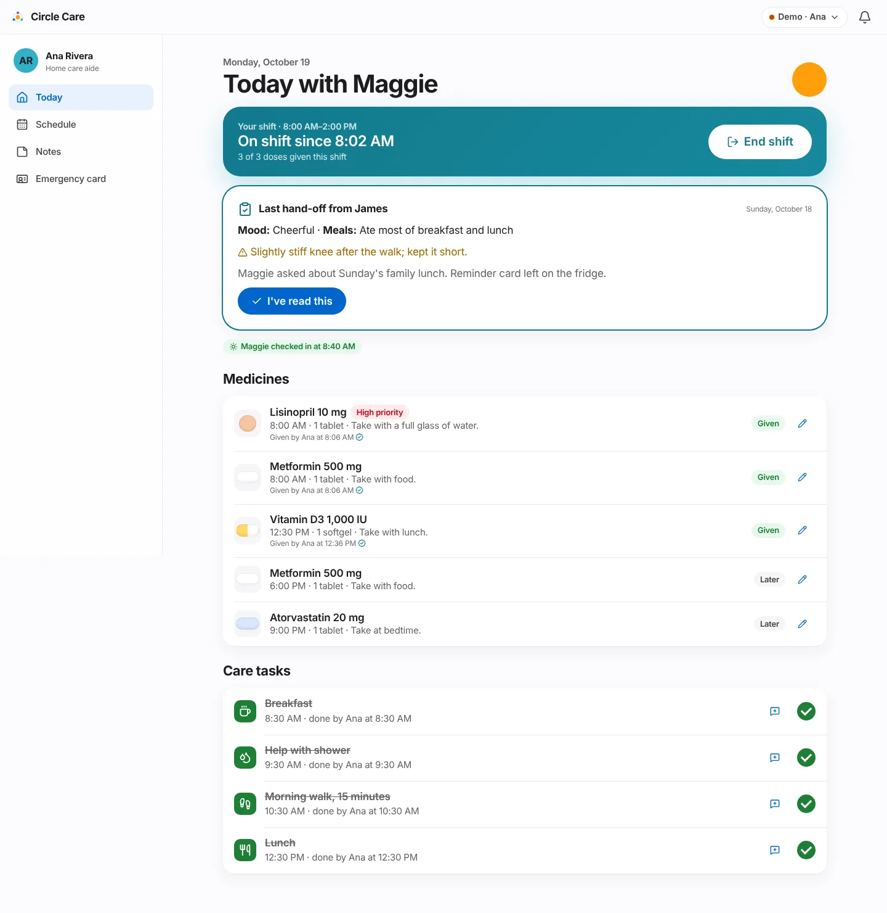
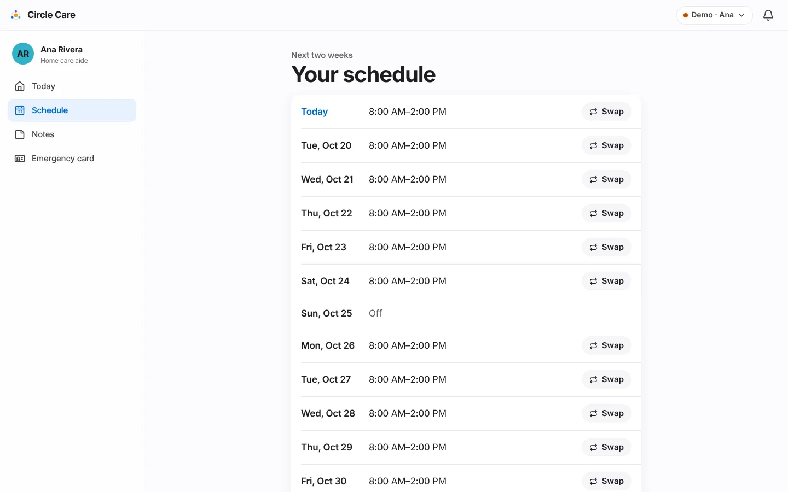
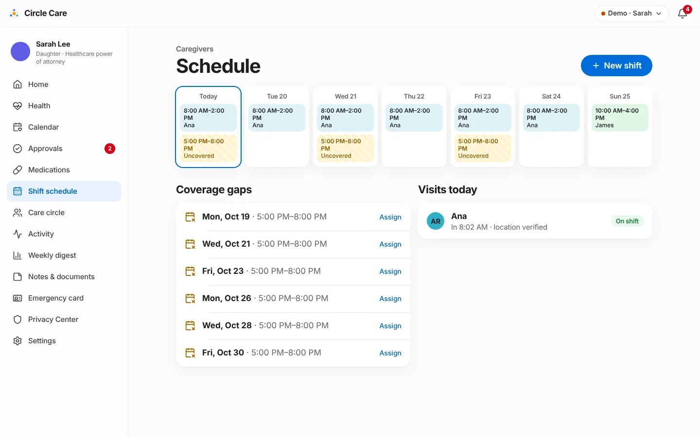

# Caregiver shifts & hand-offs

<div class="cc-meta" markdown>

| | |
|---|---|
| **Feature ID / area** | F-05 · Shift scheduling, visit verification and hand-offs |
| **Personas** | Ana (professional caregiver), Sarah (guardian), James (family, weekend shifts) |
| **Status** | <span class="cc-badge cc-badge--partial">Partially built</span> — location check is simulated |
| **Related stories** | CC-38 today's schedule · CC-54 recurring shifts · CC-55 shift swap requests · CC-56 visit check-in / check-out · CC-57 late check-in alert · CC-58 structured end-of-shift hand-off · CC-59 acknowledge hand-off · CC-60 coverage gaps · CC-82 smart hand-off summary (approved addition) |
| **Last updated** | 2026-10-19 |

</div>

## Overview

**What.** Sarah sets up **recurring shifts** and assigns caregivers, who **accept** them. Ana **checks in** at Maggie's door, which unlocks the care plan for the shift; the guardian sees *who is with Maggie now*. At the end of the shift Ana sends a **hand-off** — drafted automatically from what she logged — and the next caregiver reads and **acknowledges** it. Late arrivals and uncovered shifts are flagged to the guardian before they become problems.

**Why.** *"Half my morning is figuring out what happened yesterday."* (caregiver hypothesis, CC-3). Coverage problems are usually discovered too late, and verbal hand-offs lose information.

**Business value.** Verified visits are evidence of care for families and, later, agencies (electronic visit verification is a [Release 5](../roadmap.md) item). The self-drafting hand-off removes the most-skipped paperwork from a caregiver's day.

## User journey

### Check in (CC-56)

1. Off shift, Ana's **Today with Maggie** shows *"Not checked in"* and a locked panel: *"Check in to see today's care plan."*
2. **Check in** opens a sheet: *"Maggie's home — We check your location once, only at check-in and check-out."* → **Check in — I'm here** (*Confirming location…*) → toast *"Checked in — Sarah can see you're here"*.
3. If location fails: **Location not working? Check in manually** → *Why are you checking in manually?* (required) → **Check in manually**. *"Sarah will see that this check-in was manual."*

<figure markdown="span">
  { loading=lazy }
  <figcaption>Before check-in, care details are hidden (minimum necessary).</figcaption>
</figure>

### During the shift (CC-38, CC-59)

4. The shift card turns teal: *"On shift since 8:02 AM · 3 of 3 doses given this shift"* with **End shift**.
5. If the previous hand-off hasn't been read, it appears first: **Last hand-off from James** — mood, meals, any concern (highlighted), notes — and **I've read this** (*"Hand-off acknowledged"*).
6. A badge shows whether Maggie has checked in today. Below are **Medicines** and **Care tasks** ([Medications & tasks](medications-and-tasks.md)).

<figure markdown="span">
  { loading=lazy }
  <figcaption>On shift: the previous hand-off, then today's plan in time order.</figcaption>
</figure>

### Smart hand-off (CC-58, CC-82) {#smart-hand-off}

7. **End shift** opens **Hand-off**. A panel **Drafted from your shift** contains a summary written on the device from the shift's records, for example:

    ```text
    Medicines: 3 given (Lisinopril 8:00 AM, Metformin 8:00 AM, Vitamin D3 12:30 PM).
    Tasks: 4 of 4 done.
    Maggie checked in at 8:40 AM.
    ```

8. Ana can edit the text or tap **Redo draft**. *"Written on this device from what you checked off. Review and edit before sending."*
9. She picks **Maggie's mood** (*Cheerful, Calm, Tired, Upset*) and fills **Meals**, **Anything to watch?** and **Notes for the next caregiver**.
10. **Send hand-off and check out** → *"Hand-off sent — you're checked out"*. The Today screen shows *"Thanks, Ana — your shift is complete."*
11. Alternatively **Skip the hand-off** → *Why are you skipping?* (required) → **Check out without a hand-off**. The activity feed records *"Hand-off skipped — reason"*.

<figure markdown="span">
  { loading=lazy }
  <figcaption>The draft is generated locally; nothing is sent until Ana confirms.</figcaption>
</figure>

### Schedule, offers and swaps (CC-54, CC-55) {#schedule-offers-and-swaps}

12. Ana's **Your schedule** shows the next two weeks (*Today*, then *Tue, Oct 20*, …) with her accepted shifts or *Off*.
13. A **New shift offered** card appears when Sarah assigns her a shift → **Accept** (*"Shift accepted"*).
14. **Swap** on any day → **Ask to swap this shift** — choose another active family member or caregiver, add a reason → **Send request** (*"Request sent to Sarah"*). *"Sarah approves the final swap."*

<figure markdown="span" class="cc-phone">
  { loading=lazy }
  <figcaption>Ana's two-week schedule.</figcaption>
</figure>

### Guardian: schedule, late arrivals and gaps (CC-54, CC-57, CC-60)

15. Sarah's **Schedule** shows the next 7 days as columns with shift chips coloured by caregiver; uncovered or unaccepted shifts are striped amber (*Uncovered* or *James (not accepted)*).
16. **New shift** (or tapping any chip) opens a sheet: *Repeats on* (day buttons), *Starts*, *Ends*, *Caregiver* (or *Not assigned yet*). *"The caregiver gets a notification to accept."*
17. **Coverage gaps** lists uncovered shifts in the next 14 days with **Assign**. **Visits today** shows each caregiver's check-in (*"In 8:02 AM · location verified"* or *"(manual)"*), check-out and a status badge (*Expected, On shift, Done*).
18. If a caregiver is more than 15 minutes late, a banner reads *"Ana hasn't checked in — The 08:00 shift started 25 minutes ago."* with **Call**.

<figure markdown="span">
  { loading=lazy }
  <figcaption>The guardian's schedule: week grid, coverage gaps and today's visits.</figcaption>
</figure>

## Functional details & business rules

### Demo shifts (seed data)

| Shift | Caregiver | Days | Time | Accepted |
|---|---|---|---|---|
| `s-ana` | Ana Rivera | Mon–Sat | 08:00–14:00 | Yes |
| `s-james` | James Lee | Sun | 10:00–16:00 | Yes |
| `s-evening` | — | Mon, Wed, Fri | 17:00–20:00 | No (coverage gap) |

### Rules

| Rule | Value | Source |
|---|---|---|
| Who can check in | Members with role `pro` only; others are refused and logged | `visitCheckIn` |
| On shift | A visit today with `checkIn` and no `checkOut` | `onShift()` in `policy.ts` |
| Doses counted "this shift" | Scheduled between shift start − 60 min and shift end | `CaregiverToday.tsx` |
| Late check-in | Assigned, accepted shift; no check-in; now > start + **15 min** and before shift end | `lateCheckins()` |
| Coverage gap | Shift with no caregiver or not accepted, in the next **14 days** (guardian Home counts the next 7); today's gaps that already ended are ignored | `coverageGaps()` |
| Unread hand-off on guardian Home | Not acknowledged and sent in the last **3 days** | `GuardianHome.tsx` |
| Hand-off defaults | Meals blank → *"Not noted"*; concerns blank → *"None"* | `CaregiverHandoff.tsx` |
| Shift reassigned | Changing the caregiver resets *accepted* to false and notifies the new caregiver | `ShiftSheet` |
| Swap approved | The shift's caregiver changes to the requested person | `decide()` |
| Accept a shift | Only the caregiver it was offered to | `acceptShift` |

### Hand-off draft lines (in order; empty lines are omitted)

| Line | Content |
|---|---|
| Medicines | *N given (name time, …).* |
| Not given | *name time — skipped/refused, "reason"; …* |
| Still open | Doses due or overdue with no record |
| Tasks | *X of Y done; still to do: …* |
| Check-in | *Maggie checked in at …* or *Maggie hasn't checked in today.* |
| SOS today | Outcome of any SOS started today |

## Permissions & privacy

| Resource | Read | Write | Propose |
|---|---|---|---|
| `handoffs` | guardian, family, pro (on or off shift) | **pro@shift** only | — |
| `schedule` | elder, guardian, family, pro | guardian | pro, family |

!!! note "Location is checked once"
    The check-in sheet promises *"We check your location once, only at check-in and check-out."* Continuous tracking is out of scope. In the prototype no location is read at all.

The elder cannot read hand-offs in the current matrix (`handoffs` read = guardian, family, pro). This raises the same "her data, her decision" question as guardian-only notes; see [permission matrix — notable design choices](../../security/permission-matrix.md#notable-design-choices-to-review). The `handoffs`, `vitals` and `appointments` resources were added to the code after that document's table was written.

## Notifications

| Trigger | Recipients | Severity | Lock-screen text | In-app detail |
|---|---|---|---|---|
| Caregiver > 15 min late | Guardian, caregiver | Warning | Circle Care needs your attention | Ana hasn't checked in for the 08:00 shift. |
| Shift offered | Caregiver | Info | You have a new shift in Circle Care | Sarah offered you a shift, 17:00–20:00. |
| Swap requested | Guardian | Info | You have a new request in Circle Care | Ana asked to swap a shift with James. |
| Swap decided | Caregiver | Info | You have an update in Circle Care | Sarah approved your request: Swap 08:00–14:00 shift to James |

## Accessibility

- The shift card and check-in sheet use large buttons and plain verbs (*Check in — I'm here*, *End shift*).
- Mood uses a segmented control with text labels; the summary textarea has a screen-reader label *Summary*.
- The week grid shows the caregiver name in text, not only colour; gaps use a striped pattern plus the word *Uncovered*.
- `/app/caregiver` passes axe-core. The hand-off and schedule screens are covered by e2e but not by the axe list.

## Data captured

| Entity | Fields |
|---|---|
| `Shift` | `caregiverId`, `days[]`, `start`, `end`, `accepted` |
| `Visit` | `shiftId`, `caregiverId`, `date`, `checkIn`, `checkOut`, `manualReason?` |
| `Handoff` | `visitId`, `by`, `at`, `mood`, `meals`, `concerns`, `notes`, `summary`, `acknowledgedBy?`, `acknowledgedAt?`, `skippedReason?` |
| `Approval` (shift-swap) | `payload {shiftId, to}` |

## Edge cases & error states

| Situation | Behaviour |
|---|---|
| Opening Hand-off when not on shift | *"You're not on shift right now."* with **Back to today** |
| No shift today | *"No shift scheduled today"*; no check-in button |
| Already checked out | *"Checked out at …"*; the plan stays hidden |
| Caregiver checks in with no scheduled visit | A visit is created against her first shift |
| Maggie paused sharing | The caregiver app shows *"Maggie has paused sharing"* (except SOS) |
| Saving a shift with no days | **Save shift** disabled |

## Test coverage

| Type | Test |
|---|---|
| E2E | *Smart hand-off draft and check-out* (draft contains *Medicines:* and *Tasks:*, then *Checked out at*) · *Missed dose escalates…* (includes **Check in — I'm here**) · *CC-19 caregiver off shift cannot open notes* · *Elder pauses sharing; caregiver view is blocked* |
| Unit | `policy.test.ts` — `handoffs` and `schedule` for every role, on and off shift |
| Gap | No unit test for `lateCheckins()` or `coverageGaps()`; no e2e for shift swap or shift offers |

## Known limitations & production gaps

| In the prototype | In production (planned) |
|---|---|
| Location check is a 0.9-second animation | One-time geofence check against the home address at check-in/out; manual override with reason |
| On-shift state comes from the device clock | Server-recorded check-ins (see [permission matrix — production enforcement](../../security/permission-matrix.md#production-enforcement-not-built)) |
| Hand-off draft is rule-based text | Voice visit notes and photo proof of care ([R4](../roadmap.md)) |
| One recurring pattern per shift; no exceptions or holidays | One-off changes, time off, shift marketplace ([R4](../roadmap.md)) |
| No timesheets | Timesheets, invoices and EVV for agencies ([R4](../roadmap.md), [R5](../roadmap.md)) |

## Related pages

- [Medications & tasks](medications-and-tasks.md)
- [Guardian dashboard & approvals](guardian-dashboard-and-approvals.md)
- [Care circle & access](care-circle-and-access.md)
