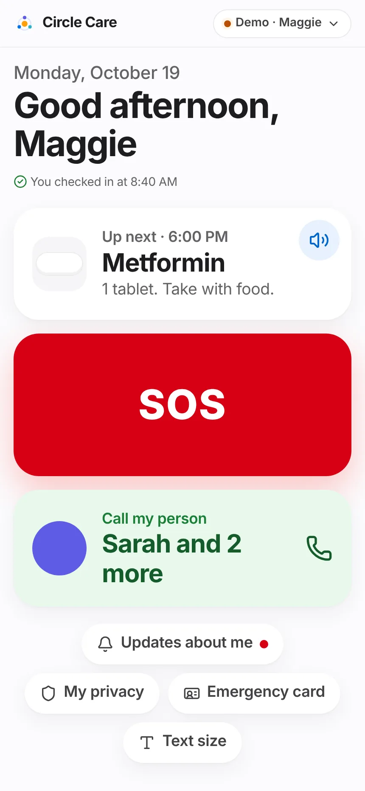
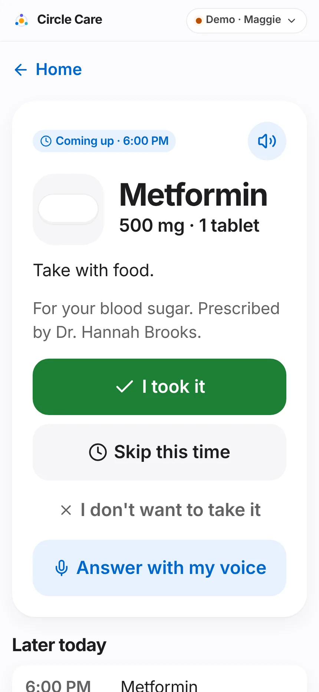
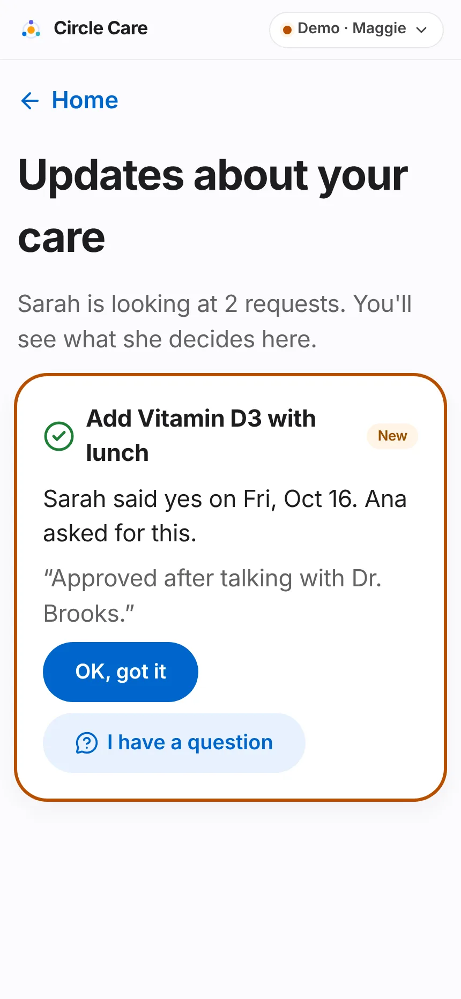
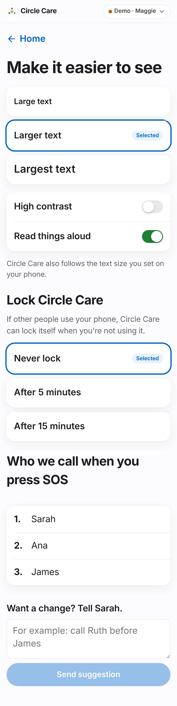
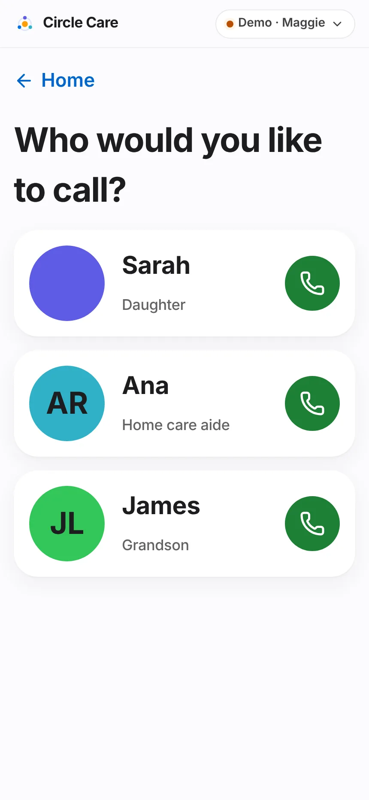

# Elder experience

| | |
|---|---|
| **Feature ID / area** | F-02 · Elder app (`/app/elder`) |
| **Personas** | Maggie (elder) |
| **Status** | Built in prototype — voice depends on browser support for on-device speech recognition |
| **Related stories** | CC-39 reminder card · CC-40 taken / skipped / refused · CC-48 SOS-list suggestion · CC-52 daily check-in · CC-65 decisions visible to the elder · CC-68 three-action home · CC-69 call my person · CC-70 text size & contrast · CC-71 colour contrast · CC-72 read-aloud · CC-73 voice confirmation · CC-14 elder lock option |
| **Last updated** | 2026-10-19 |

## Overview

**What.** A deliberately small app for the older adult: one home screen with **three large actions** — *What's next*, *SOS* and *Call my person* — plus a morning "I'm OK" check-in, medicine reminders that can be read aloud or answered by voice, a list of decisions made about her care, and simple display settings.

**Why.** The landing page puts it plainly: *"Designed for 81, not 21."* Older adults abandon apps with menus, small text and jargon. Every elder screen shows one thing at a time, in large type, with buttons of at least 48 px.

**Business value.** The elder is the person whose adoption the whole circle depends on. A simple, respectful experience increases dose confirmation and daily check-ins (both inputs to the North Star) and reduces worried phone calls for the guardian.

## User journey

1. Maggie opens the app and sees today's date and a greeting — *"Good morning, Maggie"* (before noon), *"Good afternoon"* (until 5 PM), *"Good evening"*.
2. From one hour before the check-in window opens until she checks in, a banner asks **"How are you this morning?"** — *"Let Sarah know you're OK."* She taps **I'm OK**. Toast and spoken confirmation: *"Sarah will see you're OK"*. The banner becomes *"You checked in at 8:40 AM"*.
3. The **What's next** tile shows the single most important item, e.g. *"Up next · 6:00 PM — Metformin — 1 tablet. Take with food."* A speaker button reads it aloud.
4. She taps the tile to open the **reminder card** (see below) and answers **I took it**, **Skip this time** or **I don't want to take it**.
5. The red **SOS** tile opens the hold-to-send screen ([SOS & emergency](sos-and-emergency.md)).
6. The green **Call my person** tile (*"Sarah and 2 more"*) opens **Who would you like to call?** with large photo cards for up to three favourite people; each is a one-tap phone call.
7. Below the tiles: **Updates about me** (a red dot when there is a new decision), **My privacy**, **Emergency card** and **Text size**.

<figure markdown="span" class="cc-phone">
  { loading=lazy }
  <figcaption>Elder home: three actions and four small links.</figcaption>
</figure>
<figure markdown="span" class="cc-phone">
  { loading=lazy }
  <figcaption>Reminder card with voice answer.</figcaption>
</figure>

### Reminder card (CC-39, CC-40, CC-73)

8. The card shows a badge (**Time to take it · time** when due, **Coming up · time** otherwise), a drawing of the pill in its real colour and shape, name, strength and dose, instructions and *"For your blood sugar. Prescribed by Dr. Hannah Brooks."*
9. **I took it** → *"Great — marked as taken"*. **Skip this time** → *"OK — marked as skipped"*.
10. **I don't want to take it** → *"That's your choice. Would you like to tell Sarah why? (optional)"* with a free-text box (*"For example: it upsets my stomach"*) → **Send** → *"Got it. Sarah will see your note"*.
11. **Answer with my voice** → *"Listening… say "I took it" or "skip""*. The answer is recorded the same way as a tap.
12. **Later today** lists up to five upcoming doses and tasks.
13. When the next item is a task (e.g. *Drink a glass of water*), the card shows a single **Done** button → *"Nice work!"*.

### Updates about me (CC-65)

14. **Updates about your care** lists every decided request: *"Sarah said yes on Mon, Oct 19. Ana asked for this."*, Sarah's note, and a **New** badge until Maggie taps **OK, got it**.
15. **I have a question** opens a text box → **Send to Sarah**. Sarah sees *"Maggie has a question"* at the top of Approvals.

<figure markdown="span" class="cc-phone">
  { loading=lazy }
  <figcaption>Every decision about Maggie is visible to her.</figcaption>
</figure>

### Make it easier to see (CC-70, CC-14, CC-48)

16. **Text size**: *Large*, *Larger* (default) or *Largest* text, each shown at its real size.
17. **High contrast** and **Read things aloud** switches.
18. **Lock Circle Care**: *Never lock* (default), *After 5 minutes*, *After 15 minutes* — *"If other people use your phone, Circle Care can lock itself when you're not using it."*
19. **Who we call when you press SOS** shows the numbered escalation list. **Want a change? Tell Sarah.** sends a suggestion (*"For example: call Ruth before James"*).

<figure markdown="span" class="cc-phone">
  { loading=lazy }
  <figcaption>Display, lock and SOS-list settings.</figcaption>
</figure>
<figure markdown="span" class="cc-phone">
  { loading=lazy }
  <figcaption>Call my person — up to three favourites.</figcaption>
</figure>

## Functional details & business rules

### "What's next" selection (`nextUp()` in `src/data/selectors.ts`)

| Priority | Shown when | Label |
|---|---|---|
| 1 | Any dose that is due, late or escalated (not yet recorded) | *Time for your medicine · time* (amber text) |
| 2 | The earliest upcoming dose, if it is no later than the next open task | *Up next · time* |
| 3 | The next task not yet done whose time is no more than 60 minutes ago | *Up next · time* — *"With Ana"* or *"Just for you"* |
| 4 | Nothing left | *Nothing else today — Enjoy your day.* |

### Dose states used by the reminder

| State | Rule (minutes after scheduled time) |
|---|---|
| Upcoming | More than 15 minutes before the time |
| Due | From 15 minutes before until the caregiver threshold (30 min; 15 for high-priority) |
| Late | Until the guardian threshold (60 min; 30 for high-priority) |
| Escalated | After the guardian threshold |
| Taken / Skipped / Refused | A dose record exists |

A gentle repeat reminder is pushed to the elder **10 minutes** after an unconfirmed dose time (CC-39).

### Daily check-in

| Rule | Value |
|---|---|
| Window | 08:00–10:00 by default (guardian Settings) |
| Banner appears | From window start − 60 minutes until she checks in |
| Mood | The home-screen button records 😊 ("Pleasant"); mood feeds the guardian's [Health](health-insights.md#activity-sleep-and-mood-cc-89-cc-92) view |
| Missed | After the window ends, one more prompt to Maggie; 15 minutes later, the guardian is alerted ([Alerts](alerts-and-notifications.md)) |
| Only Maggie | `elderCheckin` refuses any other actor and logs a `denied` entry |

### Voice confirmation (`src/lib/voice.ts`)

| Rule | Value |
|---|---|
| When shown | Only if the browser exposes a speech-recognition API with an on-device availability check |
| On-device only | Recognition runs with `processLocally = true`. If the browser reports recognition is not available on device (or the check takes over 4 seconds), voice stays off: *"Voice answers aren't available on this device without sending your voice to the internet, so we've left them off. Please tap a button."* |
| "Taken" words | took, taken, take, done, yes, did |
| "Skipped" words | skip, later, not now, no (checked first) |
| Anything else | *"I heard "…". Please tap a button instead."* or *"I didn't catch that. Please tap a button instead."* |
| Storage | No audio or transcript is stored |

### Text sizes

| Option | Base font size |
|---|---|
| Large text | 19 px |
| Larger text (default) | 22 px |
| Largest text | 26 px |

The elder app also follows the phone's own text-size setting.

## Permissions & privacy

| Action | Rule (`src/data/policy.ts` and store guards) |
|---|---|
| Record her own dose | `doses: write` — elder allowed |
| Complete her own task | `tasks: write` — elder allowed |
| Check in, ask about a decision, suggest SOS-list changes | Elder only (actor check in the store) |
| Change her display, lock, sharing and emergency-card settings | Allowed for the elder via the `ELDER_SETTINGS` allow-list even though `settings: write` is guardian-only |
| Read decisions | `approvals: read` — elder and guardian |

!!! note "Her choice is respected"
    *"I don't want to take it"* is recorded as **Refused** with her optional reason, not as a failure. Caregivers see *"Declined"* and the guardian sees the reason in the activity feed and weekly digest.

The elder's own views are logged in the access log (e.g. *"viewed her home screen"*) but excluded from suspicious-access detection.

## Notifications

| Trigger | Recipient | Lock-screen text | In-app detail |
|---|---|---|---|
| Dose 10 minutes past due, unconfirmed | Elder | You have a reminder from Circle Care | Time for *Medicine* — *dose*. *Instructions* |
| Check-in window ended | Elder | You have a reminder from Circle Care | Good morning, Maggie. Tap "I'm OK" so Sarah knows you're fine. |
| Maggie asks about a decision | Guardian | You have a new message in Circle Care | Maggie has a question about "*title*": *question* |
| Maggie suggests an SOS-list change | Guardian | You have a new message in Circle Care | Maggie suggested a change to her SOS list: "*text*" |
| New appointment added | Elder | Update from Circle Care | New appointment: *title* on *date* at *time*. |

The elder app has no notification bell; banners appear briefly and tapping one returns to the relevant elder screen.

## Accessibility

- Three primary targets, each the full width of the screen; all elder touch targets ≥ 48 px; settings rows ≥ 64–72 px.
- Text sizes up to 26 px base (≈ 200% of standard), high-contrast mode, and respect for *reduce motion*.
- Read-aloud uses the browser's on-device speech synthesis at a slightly slower rate (0.92).
- Every tile has a full spoken label, e.g. *"Up next · 6:00 PM: Metformin. 1 tablet. Take with food."*
- Radio groups for text size and lock use `role="radio"` with `aria-checked`.
- Colours tuned to WCAG 2.1 AA 4.5:1 including on soft tints (CC-71); avatar initials switch between white and near-black for contrast.
- axe-core: `/app/elder`, `/app/elder/next`, `/app/elder/privacy`, `/app/elder/settings` — 0 violations.

## Data captured

| Field | Entity | Written by |
|---|---|---|
| `date`, `at`, `mood` | `Checkin` | I'm OK |
| `medId`, `date`, `time`, `status`, `by`, `at`, `verified=false`, `reason` | `DoseLog` | Reminder card |
| `taskId`, `date`, `by`, `at` | `TaskLog` | Task Done |
| `elderSeen`, `elderQuestion` | `Approval` | Updates about me |
| `textSize`, `highContrast`, `readAloud`, `elderLockMin` | `Settings` | Settings |

## Edge cases & error states

| Situation | Behaviour |
|---|---|
| Speech synthesis unsupported | Speaker buttons are hidden |
| Voice not available on device | Voice button disappears after the first attempt with an explanation |
| Dose recorded twice | The newer record replaces the earlier one for that dose slot |
| Maggie answers a dose that is only "Coming up" | Allowed — the record is saved with the current time |
| No favourites active | Call tile shows *"Family"* with a phone icon |
| All items done | *"You're all done for today"* |

## Test coverage

| Type | Test |
|---|---|
| E2E | *Elder holds SOS, countdown, sends* (signs in as elder, checks *Call my person*) · *Guardian approves request; elder sees decision* (**New** badge, **OK, got it**) · *CC-14 elder lock option; CC-48 elder suggests SOS-list change* |
| Unit | `rules.test.ts` — repeat dose reminder to the elder; missed check-in prompts the elder first (CC-52). `health.test.ts` — mood mapping from check-in faces |
| Accessibility | axe-core on four elder screens |

## Known limitations & production gaps

| In the prototype | In production (planned) |
|---|---|
| Reminders appear only while the app is open | Native or web push with exact-time scheduling; critical alerts for SOS ([Roadmap R2](../roadmap.md)) |
| The home check-in always records 😊 | Choose a face (the mood scale already supports six) |
| Voice works only where on-device recognition exists (few browsers today) | Native on-device speech on iOS and Android |
| Calls are `tel:` links | Native calling, video calls ([R4](../roadmap.md)) |
| English only | Spanish, Chinese and Tagalog ([R2](../roadmap.md)) |
| Elder lock uses the same simulated Face ID | Platform biometrics |

## Related pages

- [SOS & emergency](sos-and-emergency.md)
- [Medications & tasks](medications-and-tasks.md)
- [Privacy Center](privacy-center.md)
- [Guardian dashboard & approvals](guardian-dashboard-and-approvals.md)
