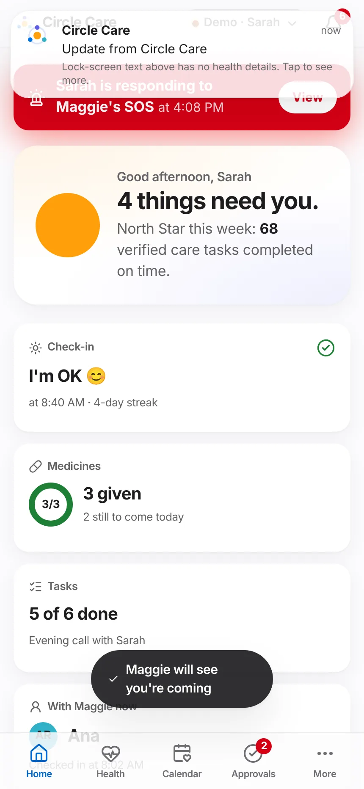
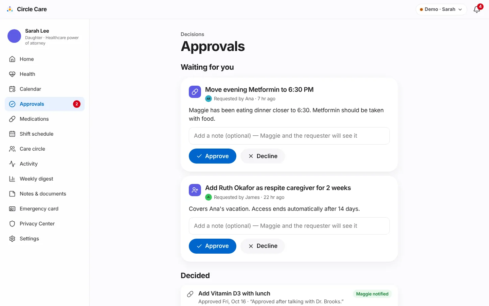
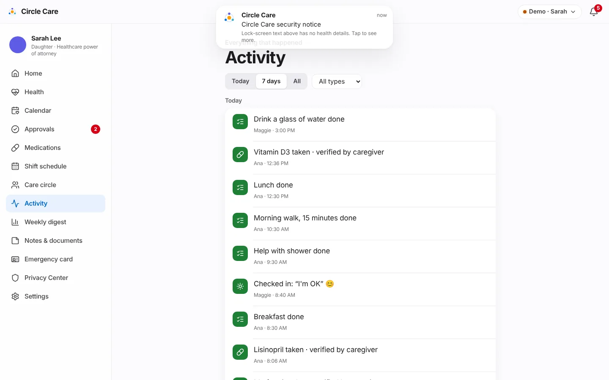
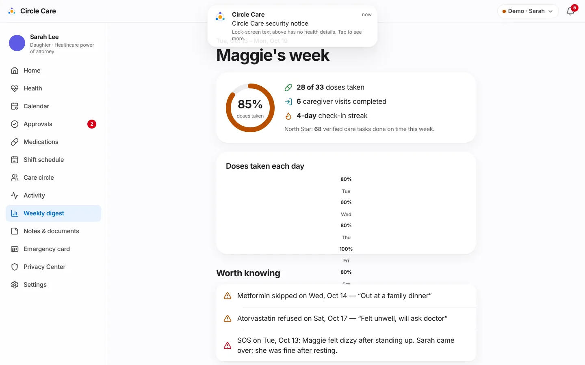
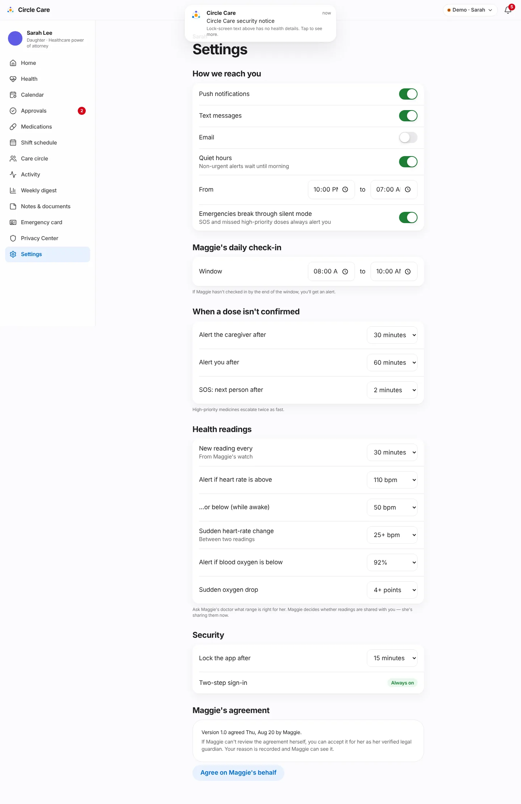

# Guardian dashboard & approvals

| | |
|---|---|
| **Feature ID / area** | F-06 · Guardian home, approvals, activity, weekly digest and settings |
| **Personas** | Sarah (legal guardian); Maggie sees the outcome of every decision |
| **Status** | Built in prototype — notification channels and quiet hours are stored but not delivered |
| **Related stories** | CC-61 today at a glance · CC-62 activity feed · CC-63 alert channels & quiet hours · CC-64 approve / decline requests (+ 24-hour reminder) · CC-65 elder sees decisions · CC-83 weekly family digest (approved addition) · CC-14, CC-42, CC-50, CC-52 settings |
| **Last updated** | 2026-10-19 |

## Overview

**What.** The guardian's command centre. **Home** answers "Is Mom OK today?" in seconds and lists only the things that need Sarah. **Approvals** is where medicine changes, new members and shift swaps wait for her decision. **Activity** is the full history; the **Weekly digest** is the summary; **Settings** controls how and when she is alerted.

**Why.** *"I find out about problems days later, from someone else."* (guardian hypothesis, CC-4). Remote decision-makers need signal, not noise — and the elder must be able to see what was decided about her.

**Business value.** Reduces anxiety-driven calls and missed problems; makes the guardian's legal role concrete (approvals) while keeping the elder informed. The digest is the retention loop for family buyers.

## User journey

### Home — today at a glance (CC-61) {#home}

1. Sarah opens **Home**: *"Good afternoon, Sarah"* and a headline that counts what needs her — *"Maggie's day is on track."*, *"One thing needs you."* or *"3 things need you."* — plus the **North Star**: *"68 verified care tasks completed on time."*
2. Seven tiles, each linking to detail:

    | Tile | Shows |
    |---|---|
    | Check-in | *I'm OK 😊 at 8:40 AM · 4-day streak*, or *Not yet* / *Missed* with the window |
    | Medicines | Ring *3/3*, *3 given*, *2 still to come today* |
    | Tasks | *5 of 6 done* and the next two open tasks |
    | With Maggie now | The checked-in caregiver and check-in time, or *No one* |
    | Health | Latest heart rate · blood oxygen and *N unusual readings today* (only while Maggie shares readings) |
    | Next appointment | Title and *Today at 4:30 PM* |
    | Alerts | *4 new* — *Notifications never show health details* |

3. **Needs your attention** lists, in priority order: an active SOS · late or overdue doses · a missed check-in · a caregiver who hasn't arrived · hand-offs nobody has read (last 3 days) · pending approvals · uncovered shifts this week.
4. **Latest activity** shows the six most recent events with **See all**.

<figure markdown="span">
  { loading=lazy }
  <figcaption>Home on a desktop: status tiles and a short attention list.</figcaption>
</figure>

<figure markdown="span" class="cc-phone">
  { loading=lazy }
  <figcaption>On phones the side menu becomes a tab bar: Home, Health, Calendar, Approvals and More.</figcaption>
</figure>

### Approvals (CC-64, CC-65) {#approvals}

5. **Approvals** has three parts: a **Maggie has a question** panel (if she asked one) with **Call Maggie**; **Waiting for you**; and **Decided**.
6. Each pending request shows its type icon, title, requester and age (*"Requested by Ana · 7 hr ago"*), the reason, a note box (*"Add a note (optional) — Maggie and the requester will see it"*), **Approve** and **Decline**.
7. **Approve** → *"Approved — Maggie has been told"*. The change is applied immediately (medicine schedule, member activated, or shift reassigned).
8. **Decided** lists past decisions with the date and note, and a badge **Maggie notified** or **Maggie saw it** once she taps *OK, got it*.

<figure markdown="span">
  { loading=lazy }
  <figcaption>Two pending requests from the demo seed, and one decided request Maggie hasn't opened yet.</figcaption>
</figure>

### Activity (CC-62)

9. **Activity** — *"Everything that happened"* — groups events by day with filters: **Today / 7 days / All** and a type menu (*Medicines, Tasks, Visits, Hand-offs, Check-ins, Notes, SOS, Approvals*).

<figure markdown="span">
  { loading=lazy }
  <figcaption>The chronological activity feed.</figcaption>
</figure>

### Weekly digest (CC-83)

10. **Maggie's week** shows the past 7 days: a ring with the percentage of doses taken (green at 90% or above, orange below), *doses taken*, *caregiver visits completed*, *check-in streak* and the North Star.
11. **Doses taken each day** charts daily adherence; days below 90% are highlighted.
12. **Worth knowing** lists every dose not taken (with the reason) and any SOS that week.
13. **The email Sarah receives** previews the PHI-free email: *"Maggie's weekly update is ready. This week: 85% of scheduled items completed, 6 visits, and a 4-day check-in streak. Open Circle Care to see the details."* — *"To protect Maggie's privacy, this email never includes medicine names, conditions or notes."*

<figure markdown="span">
  { loading=lazy }
  <figcaption>Weekly digest. In this capture a notification banner overlaps the date range and the daily bar chart rendered as a narrow column; the numbers are correct.</figcaption>
</figure>

### Settings {#settings}

14. **Settings** groups everything Sarah controls:

<figure markdown="span">
  { loading=lazy }
  <figcaption>Guardian settings.</figcaption>
</figure>

## Functional details & business rules

### Settings reference

| Section | Setting | Default | Options |
|---|---|---|---|
| How we reach you | Push notifications / Text messages / Email | On / On / Off | On, off |
| | Quiet hours — *"Non-urgent alerts wait until morning"* | On, 22:00–07:00 | Any times |
| | Emergencies break through silent mode — *"SOS and missed high-priority doses always alert you"* | On | On, off |
| Maggie's daily check-in | Window | 08:00–10:00 | Any times |
| When a dose isn't confirmed | Alert the caregiver after | 30 minutes | 15, 30, 45 |
| | Alert you after | 60 minutes | 45, 60, 90, 120 |
| | SOS: next person after | 2 minutes | 1, 2, 3, 5 |
| Health readings | See [Health insights](health-insights.md#alert-settings) | | |
| Security | Lock the app after | 15 minutes | 1, 5, 15 |
| | Two-step sign-in | Always on | — |
| Maggie's agreement | Shows version, date and who agreed; **Agree on Maggie's behalf** (verified guardian only, reason ≥ 10 characters) | | |

### Approval types

| Kind | Example (seed) | Requested by | On approve |
|---|---|---|---|
| `med-change` | *Move evening Metformin to 6:30 PM* | Ana (caregiver on shift) | Time 18:00 → 18:30; history entry *"(requested by Ana)"* |
| `member` | *Add Ruth Okafor as respite caregiver for 2 weeks* | James (family) | Ruth's status pending → active |
| `shift-swap` | *Swap 08:00–14:00 shift to James* | Caregiver or family | Shift reassigned |

Direct guardian edits also create an **already-approved** record so that Maggie sees them in *Updates about me*.

### Attention list rules

| Item | Condition |
|---|---|
| SOS | Any SOS not resolved |
| Medicine not confirmed | Dose state *late* or *escalated* |
| Missed check-in | No check-in and the window has ended |
| Caregiver hasn't arrived | See late check-in rule ([Shifts](caregiver-shifts-and-handoffs.md)) |
| Hand-off not read | Not acknowledged, sent in the last 3 days |
| Requests need approval | Any pending approval |
| Uncovered shifts | Coverage gaps in the next 7 days |

### Metrics shown

| Metric | Definition (`src/data/selectors.ts`) |
|---|---|
| North Star | Doses taken within 60 minutes of schedule + task completions, last 7 days (`northStar`) |
| Check-in streak | Consecutive days with a check-in, counting back from today (or yesterday if not yet today) |
| Daily adherence | Taken ÷ scheduled doses per day; today counts only doses already due (`adherenceByDay`) |
| Visits completed | Visits with a check-out in the last 7 days |

## Permissions & privacy

| Resource | Read | Write / act |
|---|---|---|
| `approvals` | elder, guardian | approve: guardian · propose: family, pro@shift, pro |
| `history` (activity) | elder, guardian, family | — |
| `digest` | elder, guardian | — |
| `settings` | elder, guardian | guardian (elder only for her own display, lock, sharing and emergency-card fields) |

!!! note "The elder sees every decision"
    Each decision sets `elderSeen = false`, which puts a **New** badge and a red dot on Maggie's *Updates about me*. She can ask a question about any decision.

Viewing Home, Approvals, Activity and the Digest each writes a *"viewed …"* entry to the access log (at most once every 10 minutes per screen).

## Notifications

| Trigger | Recipient | Lock-screen text | In-app detail |
|---|---|---|---|
| New request | Guardian | You have a new request in Circle Care | Ana asked to move evening Metformin to 6:30 PM. |
| Request waiting > 24 hours (CC-64) | Guardian | You have a reminder from Circle Care | "*title*" has been waiting for your decision for over a day. |
| Request decided | Caregiver | You have an update in Circle Care | Sarah approved your request: *title* |
| Maggie asks a question | Guardian | You have a new message in Circle Care | Maggie has a question about "*title*": *question* |

## Accessibility

- Tiles are links with visible text values, not colour-only status.
- The digest's daily chart has an `aria-label` summarising every day (e.g. *"Daily adherence: Tue 80%, Wed 60%…"*).
- Approval note field has an accessible label (*Note*).
- `/app/guardian`, `/app/guardian/approvals`, `/app/guardian/digest` and `/app/guardian/settings` pass axe-core.

## Data captured

| Entity | Fields |
|---|---|
| `Approval` | `kind`, `title`, `detail`, `requestedBy`, `at`, `status`, `decidedAt`, `note`, `payload`, `elderSeen`, `elderQuestion` |
| `Settings` | `channels`, `quietHours`, `criticalBypass`, `checkinWindow`, `doseEscalation`, `escalationDelayMin`, `sessionLockMin`, `consent` |
| `AuditEvent` | `approved` / `declined` entries with the request title |

## Edge cases & error states

| Situation | Behaviour |
|---|---|
| Nothing pending | *"Nothing to approve right now."* |
| No activity for a filter | *"Nothing here for these filters."* |
| Guardian not verified | **Agree on Maggie's behalf** disabled — *"Available once your legal authority is verified."* |
| Health sharing off | Home hides the Health tile |
| Maggie paused sharing | Banner: *"Maggie has paused sharing. You still have access as her legal guardian; other members only receive emergency alerts."* |
| Request decided by James's approval | The decision alert is sent to the caregiver view (the demo has no family app) |

## Test coverage

| Type | Test |
|---|---|
| E2E | *Guardian sign-in with MFA* (greeting) · *Guardian approves request; elder sees decision* · *Weekly digest renders* · *CC-64 24-hour approval reminder* · *CC-22 guardian consents on the elder's behalf with a reason* · *Missed dose escalates…* (*Lisinopril not confirmed* on Home) |
| Unit | `rules.test.ts` — *reminds the guardian about requests older than a day (CC-64)*. `policy.test.ts` — `approvals`, `history`, `digest`, `settings` for every role |

## Known limitations & production gaps

| In the prototype | In production (planned) |
|---|---|
| Channels and quiet hours are saved but not applied | Delivery service that honours channels, quiet hours and critical bypass |
| The digest is a page; no email is sent | Scheduled Sunday email (PHI-free) through a vendor with a BAA if needed; open/click tracking disabled |
| Decision notifications go to the caregiver view only | Notify the actual requester on their channel |
| One guardian per circle | Co-guardians and delegated helpers |
| No AI summaries | Weekly AI health summary — non-diagnostic ([R3](../roadmap.md)) |

## Related pages

- [Medications & tasks](medications-and-tasks.md) · [Caregiver shifts & hand-offs](caregiver-shifts-and-handoffs.md)
- [Health insights](health-insights.md) · [Care calendar](care-calendar.md)
- [Alerts & notifications](alerts-and-notifications.md)
- [Elder experience — Updates about me](elder-experience.md#updates-about-me-cc-65)
