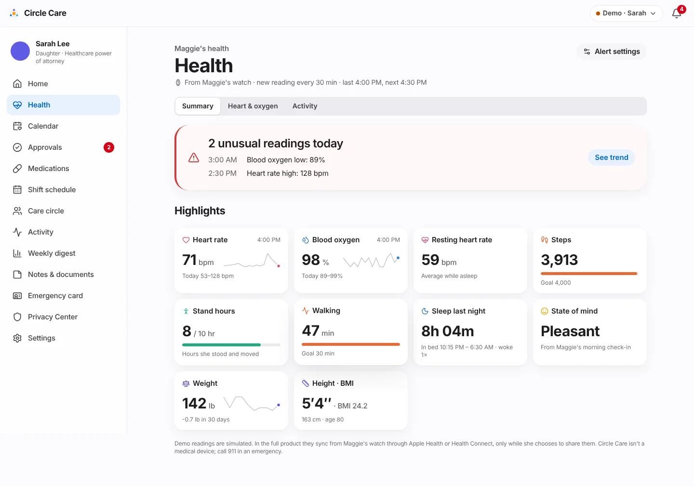
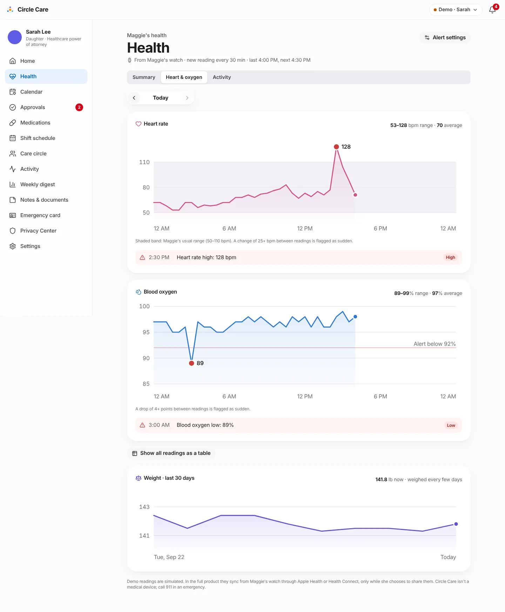
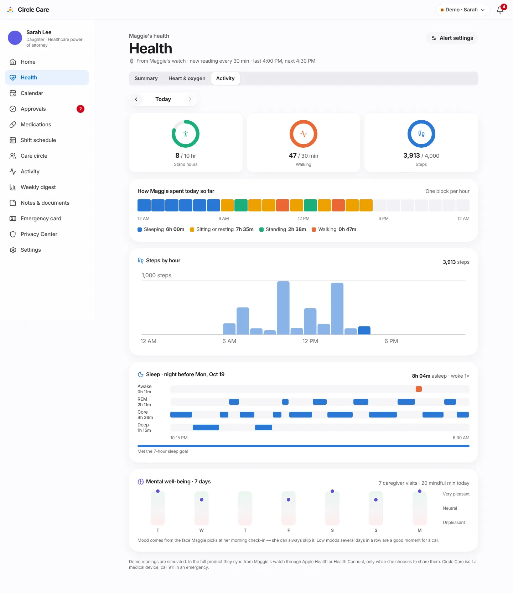
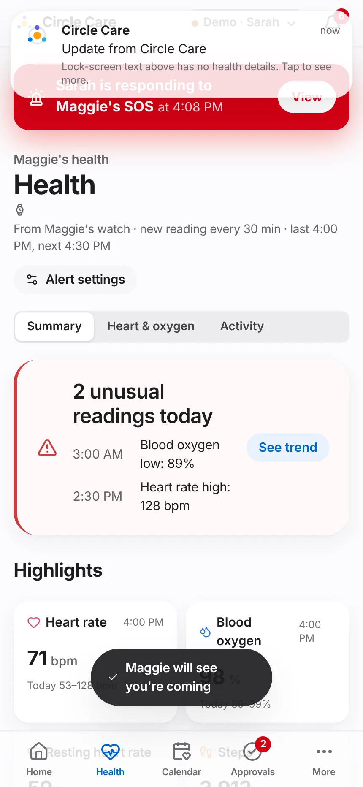

# Health insights

| | |
|---|---|
| **Feature ID / area** | F-07 · Health readings, activity and well-being (`/app/guardian/health`) |
| **Personas** | Sarah (views), Maggie (decides whether readings are shared) |
| **Status** | Partially built — all views, rules and consent work; readings are **simulated**, not read from a wearable |
| **Related stories** | CC-84 health summary & body measurements · CC-85 a reading every 30 minutes · CC-86 abnormal-reading alerts · CC-87 elder's health-sharing consent · CC-88 sudden-change detection · CC-89 – CC-92 activity, sleep and mental well-being · CC-93 weight |
| **Last updated** | 2026-10-19 |

## Overview

**What.** A **Health** section for the guardian with three tabs. **Summary** highlights today's numbers and any unusual readings. **Heart & oxygen** charts heart rate and blood oxygen across the day against Maggie's usual range, with every unusual reading explained and a full readings table, plus 30-day weight. **Activity** shows daily goals, how each hour was spent, steps by hour, last night's sleep stages and a 7-day mood view. Readings arrive every 30 minutes from Maggie's watch — **only while Maggie chooses to share them**.

**Why.** Families worry about the hours between visits. A watch already collects useful signals, but raw data is overwhelming and sharing it without the elder's consent is a privacy failure.

**Business value.** Turns wearable data into a small number of plain-language signals, positions Circle Care for the [Release 3 "Insight & Safety"](../roadmap.md) epics, and demonstrates consent-driven sharing of sensitive data.

!!! warning "Not a medical device"
    Every Health page ends with: *"Demo readings are simulated. In the full product they sync from Maggie's watch through Apple Health or Health Connect, only while she chooses to share them. Circle Care isn't a medical device; call 911 in an emergency."* Alert thresholds are a guardian preference; the settings page advises *"Ask Maggie's doctor what range is right for her."*

## User journey

1. Sarah taps **Health** (tab bar or side menu). The header reads *"From Maggie's watch · new reading every 30 min · last 4:00 PM, next 4:30 PM"* with an **Alert settings** link.
2. **Summary** opens with an attention panel — *"2 unusual readings today"* (e.g. *3:00 AM Blood oxygen low: 89%*; *2:30 PM Heart rate high: 128 bpm*) and **See trend** — or *"All readings in Maggie's usual range today"*.
3. **Highlights** cards: Heart rate, Blood oxygen (each with a sparkline and today's range), Resting heart rate, Steps, Stand hours, Walking, Sleep last night, State of mind, Weight (30-day change) and Height · BMI. Cards open the relevant tab.
4. **Heart & oxygen** shows a day stepper (*Today, Yesterday, …* up to 6 days back). The heart-rate chart shades the usual range (50–110 bpm) and marks unusual points; the oxygen chart draws an *"Alert below 92%"* line. Each chart lists its unusual readings with a tag (*High*, *Low*, *Sudden change*).
5. **Show all readings as a table** reveals every reading with time, heart rate, oxygen and a note (*Asleep* or the flag).
6. **Activity** shows three goal rings (stand hours, walking minutes, steps), **How Maggie spent today so far** (one coloured block per hour: sleeping, sitting or resting, standing, walking), **Steps by hour**, **Sleep · night before** with stage rows (Awake, REM, Core, Deep) and the 7-hour goal, and **Mental well-being · 7 days** from her check-in moods, with caregiver visits and mindful minutes.
7. If Maggie turns sharing off, the page shows **"Maggie isn't sharing health readings"** — *"She can turn this back on in her Privacy Center. Medicines, check-ins, the calendar and SOS work as usual."*

<figure markdown="span">
  { loading=lazy }
  <figcaption>Summary: unusual readings first, then highlights.</figcaption>
</figure>

<figure markdown="span">
  { loading=lazy }
  <figcaption>Heart & oxygen: every unusual reading is labelled and explained.</figcaption>
</figure>

<figure markdown="span">
  { loading=lazy }
  <figcaption>Activity, sleep and well-being.</figcaption>
</figure>

<figure markdown="span" class="cc-phone">
  { loading=lazy }
  <figcaption>The same summary on a phone.</figcaption>
</figure>

## Functional details & business rules

### Readings (CC-85)

| Rule | Value | Source |
|---|---|---|
| Interval | Every **30 minutes** by default; guardian can choose 15, 30 or 60 | `settings.vitals.intervalMin` |
| Today | One reading per interval from midnight up to the current slot | `readingsFor()` in `src/lib/health.ts` |
| Past days | A full day; up to 6 days back in the stepper | |
| Asleep | Before 06:30 or from 22:15 | `asleepAt()` |
| Determinism | Each value is computed from the date and time slot, so the same moment always shows the same reading | `noise()` |
| Built-in demo episodes (today) | 03:00 SpO₂ 89% · 14:30 HR 128 · 15:00 HR 104 · 15:30 HR 88 | `episode()` |

### Unusual-reading detection rules (CC-86, CC-88)

Defaults from `DEFAULT_THRESHOLDS`; Sarah can change them under **Settings → Health readings**. Each reading is compared with its own value and with the previous reading.

| Check | Rule (default) | Flag text | Tag | Alert severity |
|---|---|---|---|---|
| Heart rate high | HR **≥ 110** bpm | *Heart rate high: 128 bpm* | High | Warning |
| Heart rate low | HR **≤ 50** bpm **and awake** (ignored while asleep) | *Heart rate low: 48 bpm* | Low | Warning |
| Sudden heart-rate change | \|HR − previous HR\| **≥ 25** bpm — only if not already high or low | *Sudden heart-rate change: 72 → 110 bpm* | Sudden change | Info |
| Blood oxygen low | SpO₂ **< 92%** | *Blood oxygen low: 89%* | Low | Warning |
| Sudden oxygen drop | previous SpO₂ − SpO₂ **≥ 4** points — only if not already low | *Sudden oxygen drop: 97% → 93%* | Sudden change | Info |

### Alert settings {#alert-settings}

| Setting | Default | Options |
|---|---|---|
| New reading every | 30 minutes | 15, 30, 60 |
| Alert if heart rate is above | 110 bpm | 100, 110, 120, 130 |
| …or below (while awake) | 50 bpm | 40, 45, 50, 55 |
| Sudden heart-rate change (between two readings) | 25+ bpm | 15, 20, 25, 30, 40 |
| Alert if blood oxygen is below | 92% | 88, 90, 92, 94 |
| Sudden oxygen drop | 4+ points | 3, 4, 5, 6 |

### Summary calculations

| Metric | Calculation |
|---|---|
| Resting heart rate | Average of today's readings taken while asleep |
| Today's range | Minimum–maximum of today's readings |
| Weight | Simulated weigh-in every 3 days over 30 days (~64.6 kg ≈ 142 lb), shown in pounds with 30-day change |
| Height · BMI | 163 cm (5′4″); BMI = kg ÷ m² to one decimal |
| Age | Current year − birth year (1946) |

### Activity, sleep and mood (CC-89 – CC-92)

| Element | Rule / goal |
|---|---|
| Daily goals | Stand **10 hours** · walk **30 minutes** · **4,000 steps** · sleep **7 hours** (`GOALS`) |
| Hour blocks | Each hour is *Sleeping* (before 06:00, from 22:00), *Walking* (10:00 and 14:00 walks), *Standing* (7:00, 12:00, 18:00) or *Sitting or resting* |
| Stand hour | An awake hour with standing or walking, or enough movement |
| Sleep | In bed 22:15, up 06:30, cycling Core → Deep → Core → REM, with occasional awakenings |
| Mood | From the face Maggie picks at check-in — she can always skip it |
| Mindful minutes | Simulated, 5–20 per day |

| Check-in face | Mood label | Value |
|---|---|---|
| 😊 | Pleasant | +2 |
| 🙂 | Slightly pleasant | +1 |
| 😌 | Calm | +1 |
| 😐 | Neutral | 0 |
| 😕 | Slightly unpleasant | −1 |
| 😢 | Unpleasant | −2 |
| (none) | No check-in mood | not plotted |

## Permissions & privacy

| Resource | Read | Write |
|---|---|---|
| `vitals` | elder; guardian **only while `shareWithGuardian` is on** | guardian (thresholds) |

Family members and professional caregivers can **never** see health readings, on or off shift.

!!! note "Maggie decides (CC-87)"
    Only Maggie can switch **Share health readings with Sarah** in her Privacy Center (`setHealthSharing` refuses anyone else and logs a `denied` entry). When it is off, the guardian loses the Health page, the Home tile and health alerts — but medicines, check-ins, the calendar and SOS are unaffected. Each change is written to the access log as *"health sharing (on/off)"*.

Opening Health writes *"viewed health readings"* to the access log. Alerts carry the reading in the in-app detail only.

## Notifications

| Trigger | Recipient | Severity | Lock-screen text | In-app detail |
|---|---|---|---|---|
| Unusual reading (only if shared) | Guardian | Warning (high/low) · Info (sudden change) | Circle Care health notice | Heart rate high: 128 bpm at 2:30 PM. Open Health to see the trend. |
| Maggie turns sharing off | Guardian | Info | Update from Circle Care | Maggie stopped sharing her health readings. Her medicines, check-ins and SOS still work as before. |
| Maggie turns sharing on | Guardian | Info | Update from Circle Care | Maggie is sharing her health readings with you again. |

Each reading raises at most one alert per metric (de-duplicated by `vital-<metric>-<time>`).

## Accessibility

- Every chart has a title and an alternative: the readings **table** for vitals; `role="img"` summaries for the day strip and sleep stages (e.g. *"Hours: 6 sleeping, 7 sitting or resting…"*); goal rings are `role="meter"` with values.
- Unusual readings use a reserved red **plus** a text label and a tag — never colour alone.
- Chart colours come from a validated categorical palette (comments in `Health.tsx`).
- `/app/guardian/health` passes axe-core.

## Data captured

| Data | Where | Notes |
|---|---|---|
| Height, birth year, device name | `State.health` | 163 cm, 1946, "Maggie's watch" |
| Presenter overrides | `State.health.overrides[]` | `{at, hr?, spo2?, addedAt}` from *Simulate…* controls |
| Thresholds, interval, sharing choice | `Settings.vitals` | |
| Readings, activity, sleep, weight | **Not stored** | Computed on demand from date and time |

## Edge cases & error states

| Situation | Behaviour |
|---|---|
| Sharing off | Guardian sees the *isn't sharing* screen; Home tile hidden; no alerts |
| Very early in the day | Few readings; summary still renders |
| Presenter *Simulate a sudden heart-rate change* | Latest reading +38 bpm → high and/or sudden-change alert |
| Presenter *Simulate a low blood-oxygen reading* | Latest reading set to 88% → low-oxygen alert |
| Low heart rate while asleep | Not flagged by design |

## Test coverage

| Type | Test |
|---|---|
| Unit — `health.test.ts` | One reading per 30 minutes up to now · honours a different interval · whole day for past days · deterministic · applies presenter overrides · next-reading time · flags high and low HR · no low-HR flag while asleep · sudden change inside the normal range · ignores small changes · low oxygen and sudden drop · uses the guardian's thresholds · finds the built-in demo episodes · activity accounts for every hour · continuous night of sleep · mood mapping · BMI and resting HR · guardian and elder only · guardian loses access when sharing is off |
| E2E | *CC-84/85/86/89-92 guardian Health: summary, vitals, table, activity* · *CC-86 a sudden heart-rate change alerts the guardian* · *CC-87 Maggie controls whether Sarah sees health readings* |
| Accessibility | `/app/guardian/health` |

## Known limitations & production gaps

| In the prototype | In production (planned) |
|---|---|
| Readings are generated by formula | HealthKit (iOS) / Health Connect (Android) sync through native apps ([R2 watch companion & health sync](../roadmap.md)) |
| Fixed thresholds per circle | Clinician-informed personal baselines; trend alerts ([R3](../roadmap.md)) |
| No fall detection | Wearable fall detection, inactivity monitoring ([R3](../roadmap.md)) |
| No reports | Doctor-visit report PDF; weekly AI health summary that **must not diagnose** ([R3](../roadmap.md)) |
| Data computed in the browser | Health data stored only in a BAA-covered backend, encrypted at rest |
| Regulatory position informal | Review whether any feature makes Circle Care a medical device (FDA) before adding interpretation |

## Related pages

- [Privacy Center](privacy-center.md#health-sharing) — the sharing switch
- [Guardian dashboard & approvals](guardian-dashboard-and-approvals.md)
- [Alerts & notifications](alerts-and-notifications.md)
- [Roadmap — Release 3](../roadmap.md#release-3-insight-safety)
