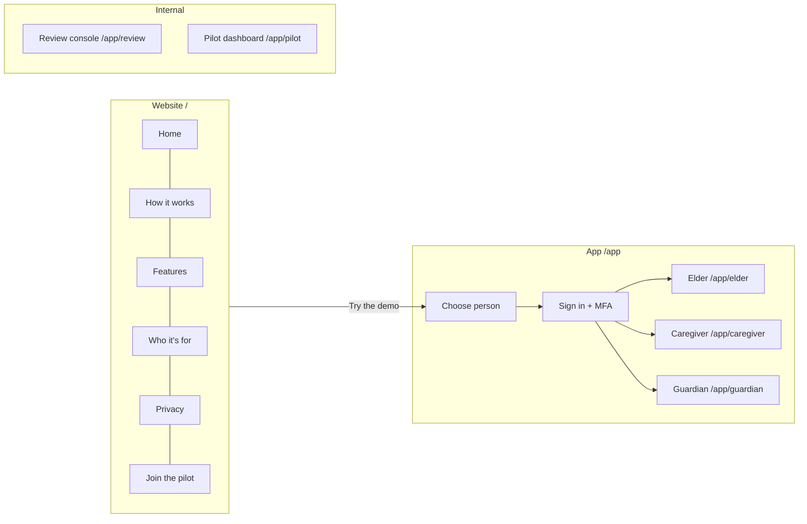

# Features

Every feature area in the Circle Care prototype has its own page. All pages use the same enterprise template so that product, design, engineering, QA and compliance readers can find the same information in the same place.

## Feature catalogue

| ID | Feature area | Personas | Status | Key stories |
|---|---|---|---|---|
| F-01 | [Website & onboarding](website-and-onboarding.md) | Prospects, all personas | Built in prototype | CC-11 – 17, CC-22, CC-75 |
| F-02 | [Elder experience](elder-experience.md) | Elder | Built in prototype | CC-39, 40, 65, 68 – 73 |
| F-03 | [SOS & emergency](sos-and-emergency.md) | Elder, guardian, caregiver | Partially built | CC-46 – 53 |
| F-04 | [Medications & tasks](medications-and-tasks.md) | Guardian, caregiver, elder | Built in prototype | CC-36 – 45 |
| F-05 | [Caregiver shifts & hand-offs](caregiver-shifts-and-handoffs.md) | Caregiver, guardian | Partially built | CC-54 – 60, CC-82 |
| F-06 | [Guardian dashboard & approvals](guardian-dashboard-and-approvals.md) | Guardian | Built in prototype | CC-61 – 64, CC-83 |
| F-07 | [Health insights](health-insights.md) | Guardian, elder | Partially built | CC-84 – 93 |
| F-08 | [Care calendar](care-calendar.md) | Guardian | Built in prototype | CC-94 – 98 |
| F-09 | [Care circle & access](care-circle-and-access.md) | Guardian, elder, review team | Built in prototype | CC-15 – 25 |
| F-10 | [Notes & documents](notes-and-documents.md) | Guardian, caregiver, family | Built in prototype | CC-23, 66, 67 |
| F-11 | [Privacy Center](privacy-center.md) | Elder, guardian | Built in prototype | CC-20, 21, 26 – 33, 81, 87 |
| F-12 | [Alerts & notifications](alerts-and-notifications.md) | All | Partially built | CC-31, 35, 42, 50, 63 |
| F-13 | [Pilot & feedback](pilot-and-feedback.md) | Prospects, internal team | Built in prototype | CC-74 – 77, CC-80 |
| F-14 | [Accounts, identity & payments](accounts-identity-payments.md) | Everyone; payments for the legal guardian | Built | CC-172 – 190 |

### Status definitions

| Status | Meaning |
|---|---|
| Built in prototype | The user-facing behaviour works end to end in the browser prototype with demo data. Production hardening (server, real delivery, compliance) is still required. |
| Partially built | The experience works, but a core dependency is simulated — for example real notifications, GPS, wearable data or emergency calling. |
| Planned | Not built. Appears on the [Roadmap](../roadmap.md). |

## Page template

Every feature page contains, in order:

1. **Header block** — Feature ID / area, personas, status, related stories (CC-…), last updated.
2. **Overview** — what it is, why it exists and its business value.
3. **User journey** — numbered steps with screenshots.
4. **Functional details & business rules** — tables of rules, thresholds and states.
5. **Permissions & privacy** — who can see and do what, referencing `src/data/policy.ts`.
6. **Notifications** — the exact lock-screen-safe wording.
7. **Accessibility**.
8. **Data captured** — fields written.
9. **Edge cases & error states**.
10. **Test coverage** — unit and end-to-end tests.
11. **Known limitations & production gaps**.
12. **Related pages**.

"**In the prototype**" always describes what the code does today. "**In production (planned)**" describes what a real deployment needs and is not built.

## Where features live in the app

The full route table is in [System overview](../architecture/system-overview.md#routes).
