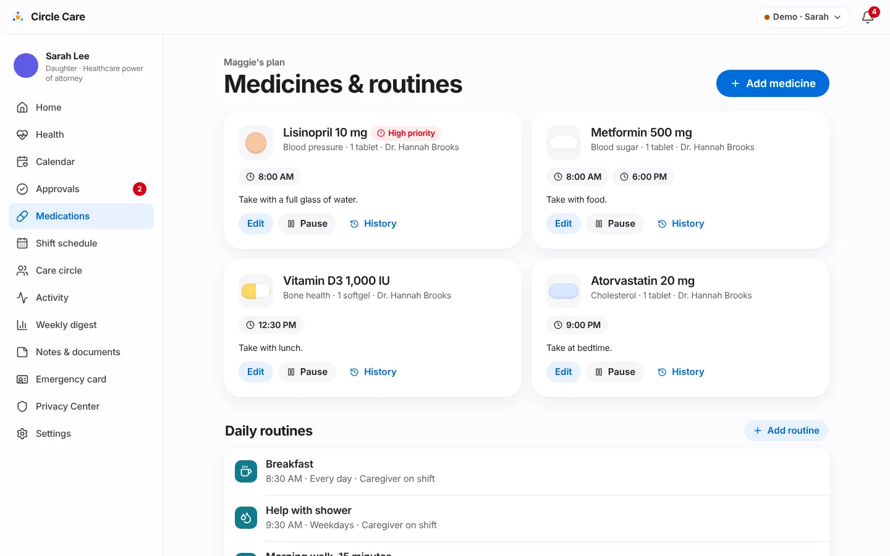

# Medications & tasks

| | |
|---|---|
| **Feature ID / area** | F-04 · Medication schedule, dose confirmation and care tasks |
| **Personas** | Sarah (manages the plan), Ana (gives and verifies doses, completes tasks), Maggie (takes, skips or refuses), James (family) |
| **Status** | Built in prototype |
| **Related stories** | CC-36 add medication · CC-37 edit / pause · CC-38 caregiver's schedule for today · CC-39 reminder · CC-40 taken / skipped / refused · CC-41 caregiver-verified doses · CC-42 missed-dose escalation timers · CC-43 high-priority medicines · CC-44 recurring care tasks · CC-45 complete tasks with notes · CC-64 change requests via approvals |
| **Last updated** | 2026-10-19 |

## Overview

**What.** The guardian maintains Maggie's medicines and daily routines. Each dose appears for Maggie as a reminder and for Ana as a checklist item. Every dose ends up **taken**, **skipped** or **refused** — with a name, a time and, when given during a shift, a **caregiver-verified** mark. Unconfirmed doses escalate: first to the caregiver, then to the guardian, twice as fast for high-priority medicines. Caregivers and family can *request* changes; only the guardian (or Maggie) changes the plan.

**Why.** Medication errors are the most common and most dangerous failure in home care. When three people share responsibility, the problem is usually not forgetfulness but **not knowing what someone else already did**.

**Business value.** Dose confirmation is the core of the North Star metric. Verified doses give families and agencies evidence of care; escalation reduces the time an unconfirmed dose goes unnoticed.

## User journey

### Guardian manages the plan

1. Sarah opens **Medications** — **Medicines & routines**. Each medicine card shows a drawing of the pill, name and strength, a **High priority** or **Paused** badge, purpose · dose · prescriber, time chips and instructions.
2. **Add medicine** opens a form: Name, Strength, Dose, What it's for, Times (add or remove time fields), Instructions, Prescriber, **How it looks** (shape and colour), and a **High priority** switch — *"Missed doses escalate twice as fast and are marked critical."*
3. **Edit** opens the same form; **Pause / Resume** toggles the medicine; **History** lists every change with who and when (e.g. *"times 18:00 → 18:30 (requested by Ana)"*).
4. Under **Daily routines**, **Add routine** creates a recurring task: What, When, Repeats (*Every day / Weekdays / Weekends*), Who (*Caregiver on shift / Maggie*) and an icon.
5. Every change is logged and appears in Maggie's **Updates about me** as a decision.

<figure markdown="span">
  { loading=lazy }
  <figcaption>The guardian's medicine list and daily routines.</figcaption>
</figure>

### Caregiver gives doses and completes tasks

6. When Ana is checked in, **Today with Maggie** lists **Medicines** in time order with a status badge: *Later, Due now, Late, Overdue, Given, Skipped, Declined*. High-priority medicines carry a red **High priority** tag.
7. For an open dose she taps **Given** (toast *"Lisinopril marked as given"*) or **Not given**, which asks *What happened* — **Maggie declined** or **Skipped** — and a reason. *"Maggie's choice is respected. Sarah will see this in the activity feed."*
8. A dose Maggie recorded herself shows **Verify**; tapping it marks the dose as caregiver-verified.
9. The pencil icon opens **Request a change to *medicine***: times (24-hour, comma separated), dose, *Pause this medicine*, and a required **Why?** — *"Nothing changes until Sarah approves. Maggie will see the decision."* → *"Sent to Sarah for approval"*.
10. **Care tasks** are checkboxes. The note icon opens a sheet — *Note (optional)*, e.g. *"walked 15 minutes, a bit tired"* → **Mark done** (*"Sarah and Maggie can see task notes."*).
11. The shift card summarises progress: *"3 of 3 doses given this shift"*.

<figure markdown="span">
  { loading=lazy }
  <figcaption>Ana's checklist. The check-mark after "Given by Ana at 8:06 AM" marks a caregiver-verified dose.</figcaption>
</figure>

### Elder answers her reminder

12. Maggie answers from her reminder card — **I took it**, **Skip this time** or **I don't want to take it** (with an optional reason) — or by voice. See [Elder experience](elder-experience.md#reminder-card-cc-39-cc-40-cc-73).

### Guardian decides a change request

13. Requests appear in **Approvals** ([Guardian dashboard & approvals](guardian-dashboard-and-approvals.md#approvals)). On approval, the change is applied to the medicine and recorded in its history; Ana is told and Maggie sees the decision.

## Functional details & business rules

### Demo medicines (seed data)

| Medicine | Strength · dose | Times | Purpose | Instructions | High priority |
|---|---|---|---|---|---|
| Lisinopril | 10 mg · 1 tablet | 08:00 | Blood pressure | Take with a full glass of water. | **Yes** |
| Metformin | 500 mg · 1 tablet | 08:00, 18:00 | Blood sugar | Take with food. | No |
| Vitamin D3 | 1,000 IU · 1 softgel | 12:30 | Bone health | Take with lunch. | No |
| Atorvastatin | 20 mg · 1 tablet | 21:00 | Cholesterol | Take at bedtime. | No |

Prescriber for all: *Dr. Hannah Brooks* (fictional).

### Dose states and escalation timers

Thresholds come from guardian **Settings → When a dose isn't confirmed** (`settings.doseEscalation`). High-priority medicines use half of each value (`doseThresholds()` in `selectors.ts`).

| State | Standard medicine | High-priority medicine | Caregiver badge |
|---|---|---|---|
| Upcoming | > 15 min before time | > 15 min before time | Later |
| Due | −15 to +30 min | −15 to +15 min | Due now |
| Late | +30 to +60 min | +15 to +30 min | Late |
| Escalated | ≥ +60 min | ≥ +30 min | Overdue |
| Recorded | Any time a record exists | — | Given / Skipped / Declined |

| Escalation step | Default | Options | Recipient |
|---|---|---|---|
| Repeat reminder | +10 min | fixed | Elder |
| Alert the caregiver after | **30 min** | 15 / 30 / 45 | Caregiver |
| Alert you (guardian) after | **60 min** | 45 / 60 / 90 / 120 | Guardian |

### Verification (CC-41)

| Recorded by | `verified` |
|---|---|
| Caregiver while checked in | `true` |
| Elder or family | `false` until a checked-in caregiver taps **Verify** |

### Care tasks (seed data)

| Task | Time | Repeats | Who |
|---|---|---|---|
| Breakfast | 08:30 | Daily | Caregiver on shift |
| Help with shower | 09:30 | Weekdays | Caregiver on shift |
| Morning walk, 15 minutes | 10:30 | Daily | Caregiver on shift |
| Lunch | 12:30 | Daily | Caregiver on shift |
| Drink a glass of water | 15:00 | Daily | Maggie |
| Evening call with Sarah | 19:00 | Daily | Maggie |

A task is **overdue** when it is not done more than 60 minutes after its time.

### Change requests and direct edits

| Who | Path | Effect |
|---|---|---|
| Guardian (or elder) | Edit / Add / Pause directly | Applied immediately; history entry with the exact differences (*times*, *dose*, *paused/resumed*, *marked high-priority*, *instructions updated*); an already-approved decision record is added so Maggie is told |
| Caregiver on shift, family | Request a change | Pending approval; nothing changes until Sarah approves |
| Guardian approves | Approvals | The requested version replaces the medicine; history notes *"(requested by Ana)"* |

### Validation

| Form | Rule |
|---|---|
| Add / edit medicine | Name, strength and dose required; at least one time; every time in `HH:MM` |
| Request a change | At least one valid `HH:MM` time and a reason |
| Add routine | Title required |

## Permissions & privacy

From `MATRIX` in `src/data/policy.ts`:

| Resource | Read | Write | Propose |
|---|---|---|---|
| `meds` | elder, guardian, family, pro@shift | elder, guardian | family, pro@shift |
| `doses` | elder, guardian, family, pro@shift | elder, guardian, family, pro@shift | — |
| `tasks` | elder, guardian, family, pro@shift | elder, guardian, family, pro@shift | family, pro@shift |

!!! note "Minimum necessary for paid caregivers"
    Off shift, Ana's Today screen shows only *"Check in to see today's care plan — To protect Maggie's privacy, caregivers see medicines and tasks only during their shifts."* Every refused action is written to the access log as `denied`.

## Notifications

| Trigger | Recipient | Severity | Lock-screen text | In-app detail |
|---|---|---|---|---|
| +10 min, unconfirmed | Elder | Info | You have a reminder from Circle Care | Time for Lisinopril — 1 tablet. Take with a full glass of water. |
| Caregiver threshold | Caregiver | Warning (critical for high-priority) | You have a reminder from Circle Care | Lisinopril 10 mg (08:00) hasn't been confirmed yet. |
| Guardian threshold | Guardian | Warning (critical for high-priority) | Circle Care needs your attention | Lisinopril (08:00) is 70 minutes overdue and still unconfirmed. This is a high-priority medication. |
| Change requested | Guardian | Info | You have a new request in Circle Care | Ana asked to change Metformin. |
| Request decided | Caregiver | Info | You have an update in Circle Care | Sarah approved your request: *title* |

No lock-screen text names a medicine. Alerts are de-duplicated by key, so each dose slot escalates once per step per day.

## Accessibility

- Pills are drawn in their real colour and shape (`PillArt`) to support recognition, always with the name in text.
- Status is never colour alone: each badge has a word (*Due now*, *Late*, *Overdue*).
- Checkboxes have labels such as *"Breakfast done"*; icon buttons have labels such as *"Request a change to Metformin"* and *"Add a note to Lunch"*.
- `/app/guardian/meds` and `/app/caregiver` pass axe-core.

## Data captured

| Entity | Fields |
|---|---|
| `Medication` | `name`, `strength`, `dose`, `times[]`, `instructions`, `prescriber`, `purpose`, `critical`, `paused`, `pill{color,shape}`, `history[{at,by,change}]` |
| `DoseLog` | `medId`, `date`, `time`, `status`, `by`, `at`, `verified`, `reason?` |
| `CareTask` | `title`, `icon`, `time`, `recurrence`, `assignee` |
| `TaskLog` | `taskId`, `date`, `by`, `at`, `note?` |
| `Approval` (med-change) | `title`, `detail`, `requestedBy`, `payload.med` or `{medId, from, to}` |

## Edge cases & error states

| Situation | Behaviour |
|---|---|
| A medicine is paused | It disappears from today's doses, reminders, the emergency card's current medicines and escalation |
| A dose is recorded twice | The latest record replaces the previous one for that slot |
| A task is unchecked | The task log for today is removed |
| Caregiver checks out with open doses | The hand-off draft lists them under *Still open* |
| Approved request for a medicine that was deleted | Nothing is applied (no matching medicine) |

## Test coverage

| Type | Test |
|---|---|
| E2E | *Missed dose escalates to guardian, caregiver gives it, alert clears* · *CC-45 task note; CC-19 notes open once on shift* · *Guardian approves request; elder sees decision* |
| Unit | `rules.test.ts` — *escalates a missed dose to the caregiver, then the guardian* (and the elder repeat) · *does not repeat the same alert*. `policy.test.ts` — every `meds`, `doses`, `tasks` cell for every role, on and off shift |
| Accessibility | `/app/guardian/meds`, `/app/caregiver`, `/app/elder/next` |

## Known limitations & production gaps

| In the prototype | In production (planned) |
|---|---|
| Medicines entered by hand | FHIR medication import and pharmacy refill integration ([R2](../roadmap.md)) |
| No supply tracking | Refill tracker and low-supply alerts ([R3](../roadmap.md)) |
| No interaction or identity checks | Drug-interaction check and photo pill check — with clinical review ([R3](../roadmap.md)) |
| Escalation runs only while a browser is open | Server-side scheduler and real delivery |
| Times are local device time; no time-zone handling | Store times in the elder's time zone |
| No as-needed (PRN) or tapering schedules | Richer schedule types |

## Related pages

- [Elder experience](elder-experience.md)
- [Caregiver shifts & hand-offs](caregiver-shifts-and-handoffs.md)
- [Guardian dashboard & approvals](guardian-dashboard-and-approvals.md)
- [Alerts & notifications](alerts-and-notifications.md)
- [Care calendar](care-calendar.md) — refills and medication reviews
