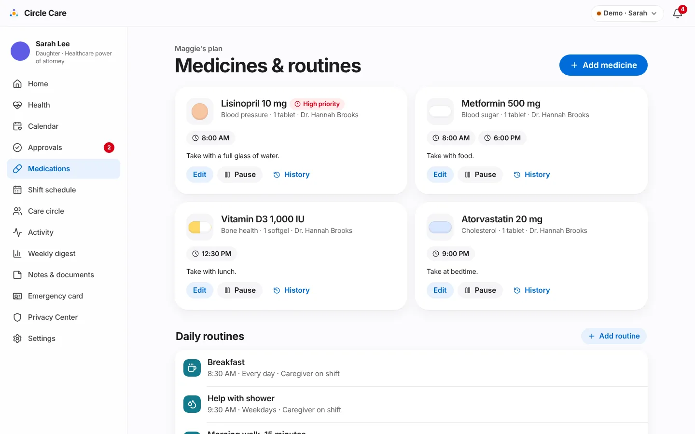
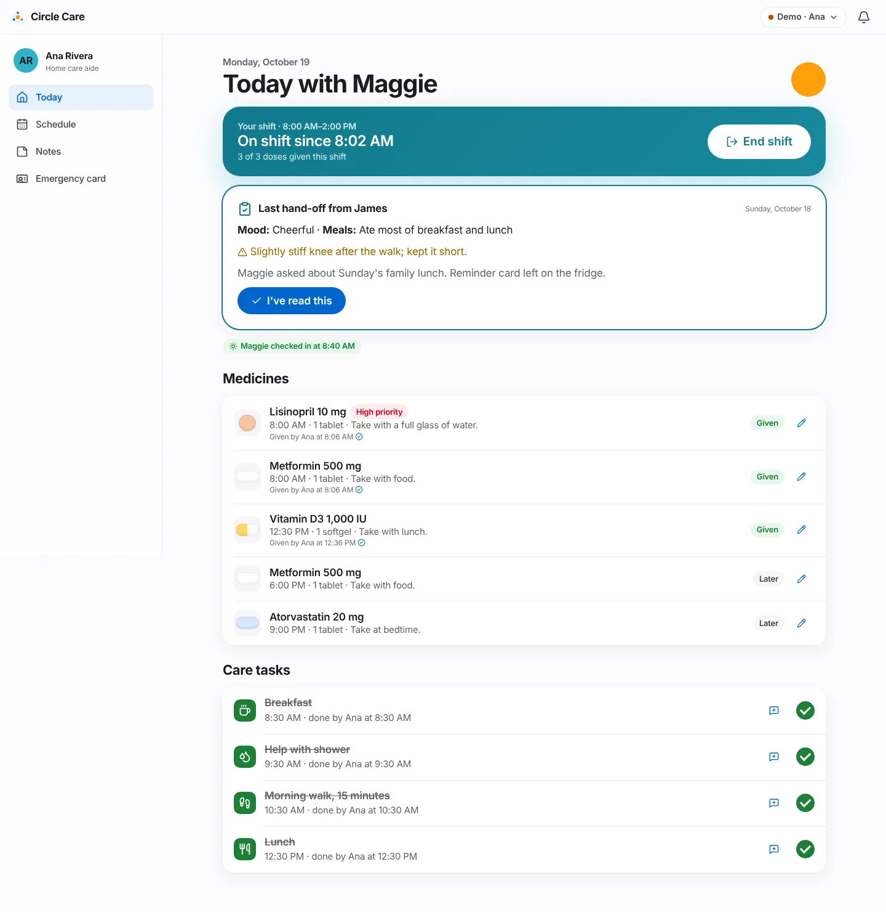

# Medications & tasks

| | |
|---|---|
| **Feature ID / area** | F-04 · Medication schedule, dose confirmation and care tasks |
| **Personas** | Sarah (manages the plan), Ana (gives and verifies doses, completes tasks), Maggie (takes, skips or refuses), James (family) |
| **Status** | Built in prototype |
| **Related stories** | CC-36 add medication · CC-37 edit / pause · CC-38 caregiver's schedule for today · CC-39 reminder · CC-40 taken / skipped / refused · CC-41 caregiver-verified doses · CC-42 missed-dose escalation timers · CC-43 high-priority medicines · CC-44 recurring care tasks · CC-45 complete tasks with notes · CC-64 change requests via approvals · CC-120 pills on hand · CC-121 low-supply alerts and Calendar refills |
| **Last updated** | 2026-11-14 |

## Overview

**What.** The guardian maintains Maggie's medicines and daily routines. Each dose appears for Maggie as a reminder and for Ana as a checklist item. Every dose ends up **taken**, **skipped** or **refused** — with a name, a time and, when given during a shift, a **caregiver-verified** mark. Unconfirmed doses escalate: first to the caregiver, then to the guardian, twice as fast for high-priority medicines. Caregivers and family can *request* changes; only the guardian (or Maggie) changes the plan.

**Why.** Medication errors are the most common and most dangerous failure in home care. When three people share responsibility, the problem is usually not forgetfulness but **not knowing what someone else already did**.

**Business value.** Dose confirmation is the core of the North Star metric. Verified doses give families and agencies evidence of care; escalation reduces the time an unconfirmed dose goes unnoticed.

## User journey

### Guardian manages the plan

1. Sarah opens **Medications** — **Medicines & routines**. Each medicine card shows a drawing of the pill, name and strength, a **High priority** or **Paused** badge, purpose · dose · prescriber, time chips and instructions.
2. **Add medicine** opens a form: Name, Strength, Dose, What it's for, Times (add or remove time fields), Instructions, Prescriber, **How it looks** (shape and colour), and a **High priority** switch — *"Missed doses escalate twice as fast and are marked critical."*
3. **Edit** opens the same form; **Pause / Resume** toggles the medicine; **History** lists every change with who and when (e.g. *"times 18:00 → 18:30 (requested by Ana)"*).
4. Under **Daily routines**, **Add routine** creates a recurring task: What, When, Repeats (*Every day / Weekdays / Weekends*), Who (*Caregiver on shift / Maggie*) and an icon.
5. Every change is logged and appears in Maggie's **Updates about me** as a decision.

<figure markdown="span">
  { loading=lazy }
  <figcaption>The guardian's medicine list and daily routines.</figcaption>
</figure>

### Caregiver gives doses and completes tasks

6. When Ana is checked in, **Today with Maggie** lists **Medicines** in time order with a status badge: *Later, Due now, Late, Overdue, Given, Skipped, Declined*. High-priority medicines carry a red **High priority** tag.
7. For an open dose she taps **Given** (toast *"Lisinopril marked as given"*) or **Not given**, which asks *What happened* — **Maggie declined** or **Skipped** — and a reason. *"Maggie's choice is respected. Sarah will see this in the activity feed."*
8. A dose Maggie recorded herself shows **Verify**; tapping it marks the dose as caregiver-verified.
9. The pencil icon opens **Request a change to *medicine***: times (24-hour, comma separated), dose, *Pause this medicine*, and a required **Why?** — *"Nothing changes until Sarah approves. Maggie will see the decision."* → *"Sent to Sarah for approval"*.
10. **Care tasks** are checkboxes. The note icon opens a sheet — *Note (optional)*, e.g. *"walked 15 minutes, a bit tired"* → **Mark done** (*"Sarah and Maggie can see task notes."*).
11. The shift card summarises progress: *"3 of 3 doses given this shift"*.

<figure markdown="span">
  { loading=lazy }
  <figcaption>Ana's checklist. The check-mark after "Given by Ana at 8:06 AM" marks a caregiver-verified dose.</figcaption>
</figure>

### Elder answers her reminder

12. Maggie answers from her reminder card — **I took it**, **Skip this time** or **I don't want to take it** (with an optional reason) — or by voice. See [Elder experience](elder-experience.md#reminder-card-cc-39-cc-40-cc-73).

### Guardian decides a change request

13. Requests appear in **Approvals** ([Guardian dashboard & approvals](guardian-dashboard-and-approvals.md#approvals)). On approval, the change is applied to the medicine and recorded in its history; Ana is told and Maggie sees the decision.

## Functional details & business rules

### Demo medicines (seed data)

| Medicine | Strength · dose | Times | Purpose | Instructions | High priority |
|---|---|---|---|---|---|
| Lisinopril | 10 mg · 1 tablet | 08:00 | Blood pressure | Take with a full glass of water. | **Yes** |
| Metformin | 500 mg · 1 tablet | 08:00, 18:00 | Blood sugar | Take with food. | No |
| Vitamin D3 | 1,000 IU · 1 softgel | 12:30 | Bone health | Take with lunch. | No |
| Atorvastatin | 20 mg · 1 tablet | 21:00 | Cholesterol | Take at bedtime. | No |

Prescriber for all: *Dr. Hannah Brooks* (fictional).

### Dose states and escalation timers

Thresholds come from guardian **Settings → When a dose isn't confirmed** (`settings.doseEscalation`). High-priority medicines use half of each value (`doseThresholds()` in `selectors.ts`).

| State | Standard medicine | High-priority medicine | Caregiver badge |
|---|---|---|---|
| Upcoming | > 15 min before time | > 15 min before time | Later |
| Due | −15 to +30 min | −15 to +15 min | Due now |
| Late | +30 to +60 min | +15 to +30 min | Late |
| Escalated | ≥ +60 min | ≥ +30 min | Overdue |
| Recorded | Any time a record exists | — | Given / Skipped / Declined |

| Escalation step | Default | Options | Recipient |
|---|---|---|---|
| Repeat reminder | +10 min | fixed | Elder |
| Alert the caregiver after | **30 min** | 15 / 30 / 45 | Caregiver |
| Alert you (guardian) after | **60 min** | 45 / 60 / 90 / 120 | Guardian |

**Doses that cross midnight (CC-199).** A late-evening dose whose escalation is still running at midnight (the guardian step falls at or after 00:00, such as a 23:30 dose with the defaults) keeps escalating the next day with the same steps and timings, and its reminders carry on. It stays under the day it was due, so marking it after midnight (`logDose(…, date)`) resolves its alerts and sends the all-clear as usual. Doses that finished escalating before midnight, and earlier days, are never raised again.

**Last night's doses on the screens.** After midnight, such a dose is listed until someone marks it, labelled as from last night with its time: first in Maggie's *What's next* (*"From last night · 11:30 PM"*, *"Let us know if you took it."*), in a **From last night** section above *Medicines* on Ana's *Today* while she is on shift, and in Sarah's *Needs your attention* (*"Metformin not confirmed"*, *"Due last night at 11:30 PM"*). *I took it*, *Given* and *Not given* pass the day it was due, so its alerts settle and the all-clear goes out; Maggie can also snooze its reminder after midnight. `logDose` accepts only today or yesterday as that day and ignores anything else.

### Verification (CC-41)

| Recorded by | `verified` |
|---|---|
| Caregiver while checked in | `true` |
| Elder or family | `false` until a checked-in caregiver taps **Verify** |

### Care tasks (seed data)

| Task | Time | Repeats | Who |
|---|---|---|---|
| Breakfast | 08:30 | Daily | Caregiver on shift |
| Help with shower | 09:30 | Weekdays | Caregiver on shift |
| Morning walk, 15 minutes | 10:30 | Daily | Caregiver on shift |
| Lunch | 12:30 | Daily | Caregiver on shift |
| Drink a glass of water | 15:00 | Daily | Maggie |
| Evening call with Sarah | 19:00 | Daily | Maggie |

A task is **overdue** when it is not done more than 60 minutes after its time.

### Change requests and direct edits

| Who | Path | Effect |
|---|---|---|
| Guardian (or elder) | Edit / Add / Pause directly | Applied immediately; history entry with the exact differences (*times*, *dose*, *paused/resumed*, *marked high-priority*, *instructions updated*); an already-approved decision record is added so Maggie is told |
| Caregiver on shift, family | Request a change | Pending approval; nothing changes until Sarah approves |
| Guardian approves | Approvals | The requested version replaces the medicine; history notes *"(requested by Ana)"* |

### Validation

| Form | Rule |
|---|---|
| Add / edit medicine | Name, strength and dose required; at least one time; every time in `HH:MM` |
| Request a change | At least one valid `HH:MM` time and a reason |
| Add routine | Title required |

### Refill tracker (CC-120 – CC-121, Sprint 12)

Each medicine can carry a **supply**: the pill count from the last bottle, when it was counted, pills per dose and the pharmacy (demo: *Fog City Pharmacy*, fictional).

| Rule | Detail |
|---|---|
| Pills on hand | Count at the last bottle, minus every dose marked **taken** since. Skipped and refused doses don't use a pill. Never below zero. |
| Pills per dose | Read from the dose text: *2 tablets* uses 2, *1/2 tablet* or *½ tablet* uses 0.5. Changing the dose mid-bottle starts a fresh count from what is left, on the same bottle (no second alert). |
| Days left | Today's doses that nobody has marked yet are set aside first, then whole days at the current schedule: remaining pills ÷ (times a day × pills per dose). The same bottle gives the same answer at 7 AM and at 8 PM. Paused medicines show *Paused* and never alert. |
| Runs out | Today + days left: the last day with every dose covered. |
| Low | Days left at or under the guardian's threshold (*Remind me when a medicine has N days left*, 3–14, default 7). |
| Calendar refill | When low, an orange **Refill** entry is added at 10:00 three days before it runs out (today if that's already past). It isn't added if a refill for that medicine is already scheduled in the window; the screens then show that entry's date. One entry per bottle. Pausing the medicine cancels the automatic entry and resuming brings it back; an entry a person cancelled stays cancelled. |
| Alert | One per bottle, to Sarah and the caregiver: *"Lisinopril: 6 days left. Request a refill from Fog City Pharmacy."* The lock-screen title stays *"You have a reminder from Circle Care"*. |
| Who can act | **Request refill** and **New bottle** show only to people who may change counts, so a refused change never looks like it worked. |
| Change requests | Approving an older change request keeps today's pill count. |
| Request refill | Marks the bottle *requested* (who and when, on the medicine's history), stops repeats and tells the other of Sarah or the caregiver. |
| New bottle | Enter the count (quick picks 30, 60, 90; 1–1000). Resets the count, logs *"New bottle: N on hand"* and closes the automatic Calendar entry for the old bottle. |

Where it shows: a supply row on each **Medications** card (bar, days left, *runs out* date, **Request refill**, **New bottle**), **Pills on hand** on the caregiver's Today (low ones first) and a *Needs your attention* item on the guardian dashboard. Demo seed: Atorvastatin starts at 6 days, so the alert and Calendar refill show on first load; the presenter sheet's *Simulate low Metformin supply* sets Metformin to 7 days.

Mockups: [Sprint 12 design](../../design/sprint-12/README.md).

## Permissions & privacy

From `MATRIX` in `src/data/policy.ts`:

| Resource | Read | Write | Propose |
|---|---|---|---|
| `meds` | elder, guardian, family, pro@shift | elder, guardian | family, pro@shift |
| `doses` | elder, guardian, family, pro@shift | elder, guardian, family, pro@shift | — |
| `tasks` | elder, guardian, family, pro@shift | elder, guardian, family, pro@shift | family, pro@shift |
| `supply` | elder, guardian, family, pro@shift | elder, guardian, family, pro@shift | — |

!!! note "Minimum necessary for paid caregivers"
    Off shift, Ana's Today screen shows only *"Check in to see today's care plan — To protect Maggie's privacy, caregivers see medicines and tasks only during their shifts."* Every refused action is written to the access log as `denied`.

## Notifications

| Trigger | Recipient | Severity | Lock-screen text | In-app detail |
|---|---|---|---|---|
| +10 min, unconfirmed | Elder | Info | You have a reminder from Circle Care | Time for Lisinopril — 1 tablet. Take with a full glass of water. |
| Caregiver threshold | Caregiver | Warning (critical for high-priority) | You have a reminder from Circle Care | Lisinopril 10 mg (08:00) hasn't been confirmed yet. |
| Guardian threshold | Guardian | Warning (critical for high-priority) | Circle Care needs your attention | Lisinopril (08:00) is 70 minutes overdue and still unconfirmed. This is a high-priority medication. |
| Change requested | Guardian | Info | You have a new request in Circle Care | Ana asked to change Metformin. |
| Medicine low (CC-121) | Guardian, caregiver | Warning | You have a reminder from Circle Care | Lisinopril: 6 days left. Request a refill from Fog City Pharmacy. |
| Refill requested | Guardian or caregiver (the other one) | Info | Update from Circle Care | Sarah asked Fog City Pharmacy to refill Lisinopril. |
| Request decided | Caregiver | Info | You have an update in Circle Care | Sarah approved your request: *title* |

No lock-screen text names a medicine. Alerts are de-duplicated by key, so each dose slot escalates once per step per day, also when its escalation runs past midnight (the key carries the day the dose was due).

## Accessibility

- Pills are drawn in their real colour and shape (`PillArt`) to support recognition, always with the name in text.
- Status is never colour alone: each badge has a word (*Due now*, *Late*, *Overdue*).
- Checkboxes have labels such as *"Breakfast done"*; icon buttons have labels such as *"Request a change to Metformin"* and *"Add a note to Lunch"*.
- `/app/guardian/meds` and `/app/caregiver` pass axe-core.

## Data captured

| Entity | Fields |
|---|---|
| `Medication` | `name`, `strength`, `dose`, `times[]`, `instructions`, `prescriber`, `purpose`, `critical`, `paused`, `pill{color,shape}`, `history[{at,by,change}]` |
| `DoseLog` | `medId`, `date`, `time`, `status`, `by`, `at`, `verified`, `reason?` |
| `CareTask` | `title`, `icon`, `time`, `recurrence`, `assignee` |
| `TaskLog` | `taskId`, `date`, `by`, `at`, `note?` |
| `Approval` (med-change) | `title`, `detail`, `requestedBy`, `payload.med` or `{medId, from, to}` |

## Edge cases & error states

| Situation | Behaviour |
|---|---|
| A medicine is paused | It disappears from today's doses, reminders, the emergency card's current medicines and escalation |
| A dose is recorded twice | The latest record replaces the previous one for that slot |
| A task is unchecked | The task log for today is removed |
| Caregiver checks out with open doses | The hand-off draft lists them under *Still open* |
| Approved request for a medicine that was deleted | Nothing is applied (no matching medicine) |

## Test coverage

| Type | Test |
|---|---|
| E2E | *Missed dose escalates to guardian, caregiver gives it, alert clears* · *CC-45 task note; CC-19 notes open once on shift* · *Guardian approves request; elder sees decision* |
| Unit | `rules.test.ts` — *escalates a missed dose to the caregiver, then the guardian* (and the elder repeat) · *does not repeat the same alert* · doses that cross midnight (CC-199): escalation, timings, no repeats, nothing from two nights ago, taken after midnight, reminders and quiet hours. `policy.test.ts` — every `meds`, `doses`, `tasks`, `supply` cell for every role, on and off shift. `everyday.test.ts` — 24 tests for CC-120 and CC-121 (counts, days left morning and evening, pills per dose, threshold, one alert per bottle, Calendar entry and reuse, request and new bottle, pause, approvals keep the count, caregiver off shift refused and audited) |
| Accessibility | `/app/guardian/meds`, `/app/caregiver`, `/app/elder/next` |

## Known limitations & production gaps

| In the prototype | In production (planned) |
|---|---|
| Medicines entered by hand | FHIR medication import and pharmacy refill integration ([R2](../roadmap.md)) |
| Pill counts entered by hand; refill requests are recorded, not sent | Pharmacy refill integration and barcode bottle scan ([R3](../roadmap.md)) |
| No interaction or identity checks | Drug-interaction check and photo pill check — with clinical review ([R3](../roadmap.md)) |
| Escalation runs only while a browser is open | Server-side scheduler and real delivery |
| Times are local device time; no time-zone handling | Store times in the elder's time zone |
| No as-needed (PRN) or tapering schedules | Richer schedule types |

## Related pages

- [Elder experience](elder-experience.md)
- [Caregiver shifts & hand-offs](caregiver-shifts-and-handoffs.md)
- [Guardian dashboard & approvals](guardian-dashboard-and-approvals.md)
- [Alerts & notifications](alerts-and-notifications.md)
- [Care calendar](care-calendar.md) — refills and medication reviews
