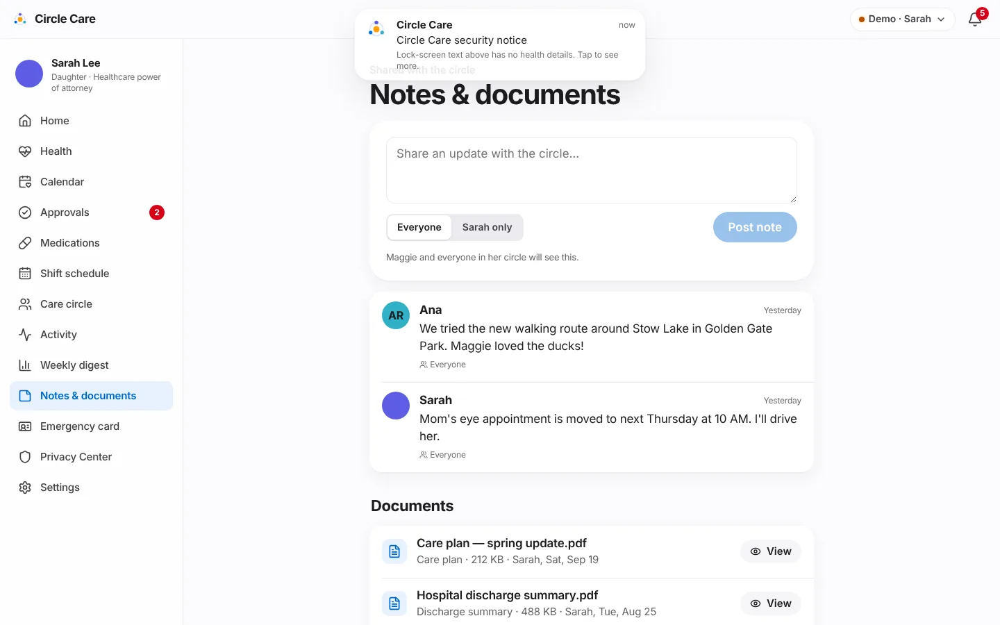

# Notes & documents

| | |
|---|---|
| **Feature ID / area** | F-10 · Care notes with visibility, secure documents (`/app/guardian/notes`, `/app/caregiver/notes`) |
| **Personas** | Sarah (guardian), Ana (on shift), James (family) |
| **Status** | Built in prototype — no server-side virus scan |
| **Related stories** | CC-23 legal-authority upload · CC-66 care notes with visibility · CC-67 secure documents (type check, encryption, watermarked viewer) · CC-19 read guard |
| **Last updated** | 2026-10-19 |

## Overview

**What.** A shared notebook for the circle. Anyone allowed can post a **note** to *Everyone* or to *Sarah only*. **Documents** — care plans, discharge summaries, legal papers — are checked by their real file type, **encrypted on the device**, and opened in a viewer that **watermarks the viewer's name and the time** across the page. Every view goes into Maggie's access log.

**Why.** Care information arrives as scattered texts and paper. Some of it is sensitive (a family concern, a legal document) and should not be visible to everyone; documents copied out of an app are a common source of leaks.

**Business value.** One place for the circle's context; a defensible model for sensitive documents that agencies and compliance reviewers expect.

## User journey

1. Sarah (or Ana while on shift) opens **Notes & documents** — *"Shared with the circle"*.
2. She writes in *"Share an update with the circle…"*, picks **Everyone** or **Sarah only**, and taps **Post note** (*"Note posted"*). The hint explains who will see it.
3. Notes list shows author, time (*"2 days ago"*) and visibility (*Everyone* or a lock and *Sarah only*).
4. **Documents** lists each file with type, size, uploader and date, plus *Verified*, *In review* or *Resubmit* badges for legal documents, and **View**.
5. To upload, she picks a type (*Care plan, Discharge summary, Legal authority* (guardian only), *Other*) and taps **Upload**. *"PDF, PNG or JPEG up to 10 MB. Files are checked, encrypted on this device and shown with the viewer's name watermarked across them. In the full product they're also virus-scanned on our servers."*
6. A wrong file type is rejected: *""fake.pdf" isn't a PDF, PNG or JPEG file. Only those types can be uploaded."* A valid file is added (*"Document added"*, or *"Sent for verification"* for legal authority).
7. **View** opens the document with a repeating watermark such as *"Sarah · Oct 19, 2026, 4:08 PM"*. *"Watermarked for Sarah · … This view was added to Maggie's access log."*

<figure markdown="span">
  { loading=lazy }
  <figcaption>Notes with per-note visibility, and encrypted documents.</figcaption>
</figure>

## Functional details & business rules

### Note visibility

| Visibility | Who sees it in the list | Hint shown to the author |
|---|---|---|
| Everyone | Everyone with `notes: read` | *"Maggie and everyone in her circle will see this."* |
| Sarah only | The guardian and the note's author | *"Only Sarah will see this. Maggie can see notes about her unless Sarah restricts them for a documented reason."* |

!!! warning "Open design question"
    The hint above says Maggie can see notes about her, but the permission matrix gives `notes.private: read` to the **guardian only**, and the elder app has no Notes screen. This conflicts with "her data, her decision" and possibly a right of access; it is logged as a product decision in the [docs index](../research-and-compliance.md#open-findings) and the [permission matrix](../../security/permission-matrix.md#notable-design-choices-to-review).

### Upload checks (`inspectUpload()` in `src/lib/secureStorage.ts`)

| Check | Rule |
|---|---|
| Size | ≤ 10 MB — *"Files must be 10 MB or smaller."* |
| Type | Detected from the file's first bytes, not its name: PDF `%PDF` (25 50 44 46), PNG (89 50 4E 47), JPEG (FF D8 FF) |
| Picker filter | `.pdf, .png, .jpg, .jpeg` |
| Storage | Encrypted with AES-256-GCM under the device key, a fresh 12-byte IV per file, in IndexedDB `circle-care-files` |
| Legal authority | Status *pending*; goes to the [review console](care-circle-and-access.md#guardian-verification-and-review-console) |

### Viewer

| Rule | Value |
|---|---|
| Watermark | *Viewer name · date and time*, repeated across the document |
| PDFs | Opened from a temporary `blob:` URL in an iframe (allowed by the CSP `frame-src blob:`) |
| Images | Shown inline |
| Seed documents | Have no file content; a placeholder card explains *"Sample document from the demo data. Files you upload open here."* |
| Logging | Each open writes *"viewed document "name""* to the access log |

### Demo content

| Item | By | Visibility / type |
|---|---|---|
| *"Mom's eye appointment is moved to next Thursday at 10 AM. I'll drive her."* | Sarah | Everyone |
| *"We tried the new walking route around Stow Lake in Golden Gate Park. Maggie loved the ducks!"* | Ana | Everyone |
| Care plan — spring update.pdf (212 KB) | Sarah | Care plan |
| Hospital discharge summary.pdf (488 KB) | Sarah | Discharge summary |
| Healthcare power of attorney.pdf (1.1 MB) | Sarah | Legal authority — Verified |

## Permissions & privacy

| Resource | Read | Write |
|---|---|---|
| `notes` | elder, guardian, family, pro@shift | elder, guardian, family, pro@shift |
| `notes.private` | guardian | guardian, family, pro@shift |
| `docs` | elder, guardian, family, pro@shift | guardian, family, pro@shift |
| `docs.legal` | elder, guardian | guardian (review: reviewer) |

- The caregiver's Notes route is wrapped in `AccessGuard resource="notes"`. Off shift Ana sees **Available during your shift** — *"Caregivers see Maggie's care details only while checked in to a shift. Check in from Today to continue."* — and the refusal is logged.
- Non-guardians do not see legal-authority documents in the list.

## Notifications

| Trigger | Recipient | Lock-screen text | In-app detail |
|---|---|---|---|
| Legal document uploaded | Guardian | Update from Circle Care | We received "*name*". Our review team usually responds within one business day. |
| Legal document verified / rejected | Elder, guardian | Update from Circle Care | See [Care circle & access](care-circle-and-access.md#notifications) |

New notes and ordinary documents do not raise alerts.

## Accessibility

- The composer has a screen-reader label (*New note*); visibility is a labelled segmented control (*Who can see this note*).
- Upload errors use `role="alert"`.
- The viewer has an accessible name (*"Care plan.pdf, watermarked for Sarah"*); the watermark itself is hidden from assistive technology.
- `/app/guardian/notes` passes axe-core.

## Data captured

| Entity | Fields |
|---|---|
| `CareNote` | `by`, `at`, `text`, `visibility` |
| `CareDoc` | `name`, `kind`, `by`, `at`, `size`, `status?`, `rejectReason?`, `fileId?`, `mime?` |
| Encrypted file store | `{ iv, ct }` per `fileId` |

## Edge cases & error states

| Situation | Behaviour |
|---|---|
| Empty note | **Post note** disabled |
| Disguised file (e.g. an executable renamed `.pdf`) | Rejected by content signature |
| File > 10 MB | Rejected with a size message |
| Encrypted file can't be decrypted (key wiped) | Viewer shows the placeholder card |
| Close the circle | All files and the key are deleted (see [Privacy Center](privacy-center.md#close-this-circle)) |

## Test coverage

| Type | Test |
|---|---|
| E2E | *CC-67 upload checks file type, encrypts, watermarked viewer* (rejects a fake PDF, accepts a 1×1 PNG, watermark contains *Sarah*) · *CC-45 task note; CC-19 notes open once on shift* · *CC-19 caregiver off shift cannot open notes* · *CC-33 close circle deletes data and files* |
| Unit | `policy.test.ts` — `notes`, `notes.private`, `docs`, `docs.legal` for every role |
| Accessibility | `/app/guardian/notes` |

## Known limitations & production gaps

| In the prototype | In production (planned) |
|---|---|
| Files stay on one device | Server storage encrypted at rest with managed keys, behind the same permission checks |
| No malware scanning | Server-side virus scan before storage (stated in the UI) |
| Watermark is visual only | Server-rendered watermarking; download controls |
| Visibility filtering happens in the UI | Field-level filtering in API responses |
| Elder has no Notes screen | Elder access to notes about her, with documented restrictions |
| No document vault features | Legal & insurance vault with renewal reminders ([R4](../roadmap.md)) |

## Related pages

- [Care circle & access](care-circle-and-access.md)
- [Privacy Center](privacy-center.md)
- [Security & privacy](../architecture/security-and-privacy.md)
