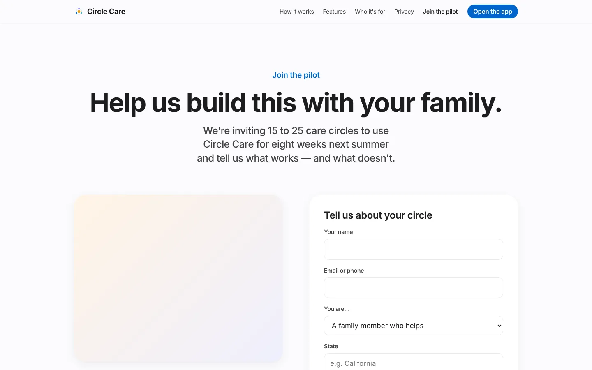
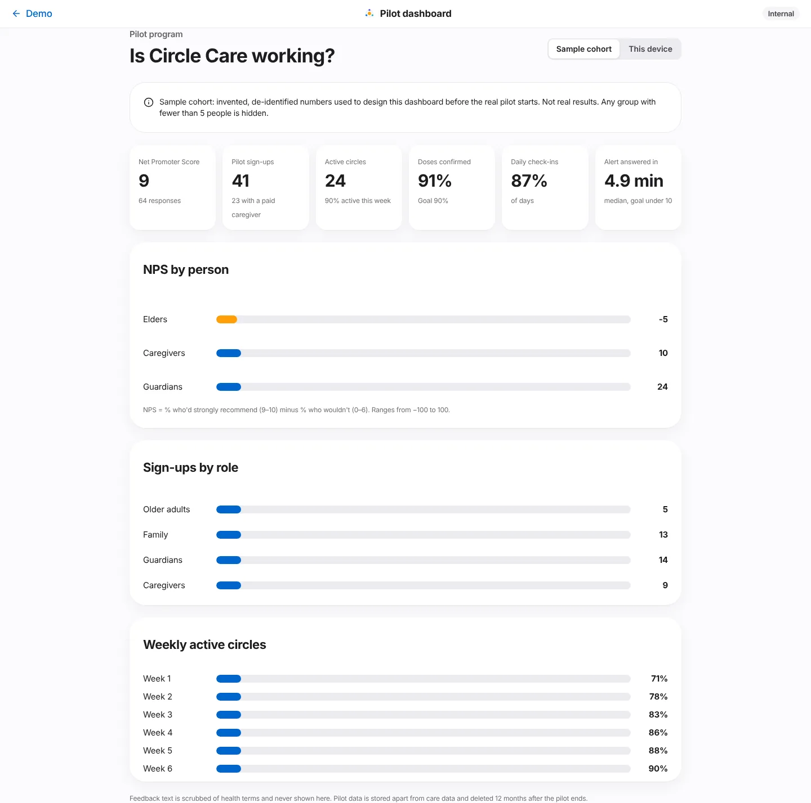

# Pilot & feedback

| | |
|---|---|
| **Feature ID / area** | F-13 · Pilot recruitment, in-app feedback, pilot dashboard and demo mode |
| **Personas** | Prospective pilot families (website), all app personas (survey), internal product team (dashboard), presenters (demo mode) |
| **Status** | Built in prototype — dashboard defaults to a synthetic sample cohort |
| **Related stories** | CC-74 pilot with 15–25 care circles · CC-75 setup call · CC-76 in-app NPS · CC-77 pilot success dashboard · CC-80 persona switcher demo mode (approved addition) |
| **Last updated** | 2026-10-19 |

## Overview

**What.** A **Join the pilot** page recruits families for an 8-week pilot. Inside the app, a one-question **Net Promoter Score** survey collects feedback without health details. An internal **pilot dashboard** shows aggregate results and hides any group smaller than five. **Demo mode** lets a presenter switch persona and simulate events.

**Why.** The product must be validated with real families before it is built for real. Research data must never mix with care data, and small pilots make individuals easy to identify.

**Business value.** Provides the learning loop for the roadmap: recruitment, a standard satisfaction metric and success measures (doses confirmed, check-ins, time to answer an alert) defined before the pilot starts. The full plan is in the [pilot plan (CC-74)](../../pilot/74-pilot-plan.md).

## User journey

### Join the pilot (CC-74)

1. `/pilot` — *"Help us build this with your family."* *"We're inviting 15 to 25 care circles to use Circle Care for eight weeks next summer and tell us what works — and what doesn't."*
2. Promises: *Eight weeks, starting May 2027* · *A 30-minute setup call, two short check-ins, and a final conversation* · *Free for life for pilot families, plus a thank-you gift card* · *You can leave anytime. Your data is deleted when you do.*
3. **Tell us about your circle**: *Your name*, *Email or phone*, *You are…* (older adult / family member / legal guardian or POA / professional caregiver), *State* (*e.g. California*), *Does a professional caregiver visit?*, and consent *"I agree to be contacted about the pilot. Please don't include any health information here."* → **Send** → *"Thank you, (first name). We'll reach out within two weeks to talk about whether the pilot is a good fit for your family."*

<figure markdown="span">
  { loading=lazy }
  <figcaption>Pilot recruitment page.</figcaption>
</figure>

### In-app feedback (CC-76)

4. After a person's **second sign-in**, their home screen shows *"How likely are you to recommend Circle Care to a friend or colleague?"* (*"to a friend"* for the elder) with a 0–10 scale.
5. After choosing a score: *"What's the main reason? (optional)"* — placeholder *"Please don't include health details"* → **Send feedback** (*"Thank you — this helps us improve"*). *"Your answer is stored without your name and kept separate from Maggie's care information."*
6. The ✕ (*Not now*) hides it for the session. Presenters can force it with **Show the feedback survey**.

### Pilot dashboard (CC-77)

7. `/app/pilot` (*Internal*) — *"Is Circle Care working?"* with a data-source switch: **Sample cohort** (invented numbers used to design the dashboard) or **This device** (real responses made in this browser).
8. Headline numbers: Net Promoter Score, pilot sign-ups (with a paid caregiver), and for the sample cohort: active circles, doses confirmed (goal 90%), daily check-ins, and median time to answer an alert (goal under 10 minutes).
9. Bars for **NPS by person**, **Sign-ups by role** and **Weekly active circles**. Any group with fewer than 5 responses shows *"Fewer than 5 — hidden"*.

<figure markdown="span">
  { loading=lazy }
  <figcaption>The internal pilot dashboard (sample cohort — not real results).</figcaption>
</figure>

### Demo mode (CC-80) {#demo-mode}

10. The **Demo · Name** pill opens **Demo mode**: switch to Margaret Lee, Ana Rivera or Sarah Lee; presenter controls; *Review team console*; *Pilot dashboard*; *Reset demo*; *Back to the website*. The full control list is in the [Demo guide](../product/demo-guide.md#presenter-controls-reference).

<figure markdown="span">
  { loading=lazy }
  <figcaption>Demo mode.</figcaption>
</figure>

## Functional details & business rules

### Data minimisation

| Data | Kept | Discarded |
|---|---|---|
| Pilot form | `role`, `state` (trimmed to 30 characters), `hasPro`, time | Name, contact, consent text |
| NPS | `persona`, `score`, scrubbed `comment` (≤ 500 characters), time | Name, member id |

Stored in separate browser keys (`circle-care-pilot-leads`, `circle-care-nps`), never in the encrypted care state. *"Pilot data is stored apart from care data and deleted 12 months after the pilot ends."*

### Health-word scrubbing (`scrubHealth()` in `src/lib/pilot.ts`)

Words replaced with `[removed]` (case-insensitive): mg, mcg, ml, tablet, pill, dose, medic\*, diagnos\*, diabet\*, blood pressure, cholesterol, cancer, dementia, alzheimer\*, depress\*, anxiety, surgery, prescri\*, lisinopril, metformin, atorvastatin, vitamin.

### Survey rules

| Rule | Value |
|---|---|
| Shown when | The persona has signed in at least twice and has not answered on this device |
| Dismissed | For the browser session |
| NPS formula | % scoring 9–10 minus % scoring 0–6, rounded; −100 to 100 |

### Dashboard rules

| Rule | Value |
|---|---|
| Minimum cohort | `MIN_COHORT = 5` — smaller groups hidden; overall NPS hidden below 5 responses |
| Sample cohort | Deterministic pseudo-random data: 64 NPS responses, 41 sign-ups (all California), 24 circles, weekly activity 71% → 90%, doses confirmed 91%, check-ins 87%, median alert answer 4.9 min |
| Free text | Never shown on the dashboard |

## Permissions & privacy

- The dashboard and review console are labelled **Internal** and reached from demo mode; in the prototype they have no separate sign-in.
- Only aggregates are shown; nothing can identify a person or show health details.

!!! warning "Prototype gap"
    The pilot form asks for name and contact but the prototype discards them. A real pilot needs a separate, deletable contact store with its own consent (finding 5 in the [docs index](../research-and-compliance.md#open-findings)).

## Notifications

None. The setup-call request from the welcome tour is stored (`settings.setupCallRequested`) but not routed anywhere.

## Accessibility

- The NPS scale is a `radiogroup` of eleven labelled radios.
- Dashboard bars have text labels and values; hidden groups are announced as *"hidden, fewer than 5 responses"*.
- `/pilot` and `/app/pilot` pass axe-core.

## Data captured

| Store | Fields |
|---|---|
| `PilotLead` | `at`, `role`, `state`, `hasPro` |
| `NpsResponse` | `at`, `persona`, `score`, `comment?` |

## Edge cases & error states

| Situation | Behaviour |
|---|---|
| Consent box unticked | **Send** disabled |
| Comment contains medicine names | Scrubbed before storage |
| No responses on this device | Overall NPS shows *—*; groups hidden |
| Storage blocked | Reads return empty; writes fail silently |

## Test coverage

| Type | Test |
|---|---|
| E2E | *Website: every nav page resolves; pilot sign-up works* · *CC-76 NPS survey scrubs health words; CC-77 dashboard hides small groups* (comment with *metformin* stored as *[removed]*; *This device* shows *Fewer than 5 — hidden*) · *Missed dose escalates…* and others use demo-mode controls |
| Accessibility | `/pilot`, `/app/pilot` |
| Gap | No unit tests for `scrubHealth()` or `npsScore()` |

## Known limitations & production gaps

| In the prototype | In production (planned) |
|---|---|
| Leads and NPS stay in one browser | Separate research data store with retention and deletion |
| Internal pages have no authentication | Internal tools behind staff SSO, MFA and audit |
| Sample cohort is invented | Real pilot data from 15–25 circles over 8 weeks |
| Keyword scrubbing only | Review free text before analysis; consider removing free text |
| Demo mode in the product build | Removed or feature-flagged for production |

## Related pages

- [Pilot plan (CC-74)](../../pilot/74-pilot-plan.md)
- [Demo guide](../product/demo-guide.md)
- [Website & onboarding](website-and-onboarding.md)
- [Roadmap — success metrics](../roadmap.md)
