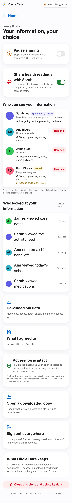
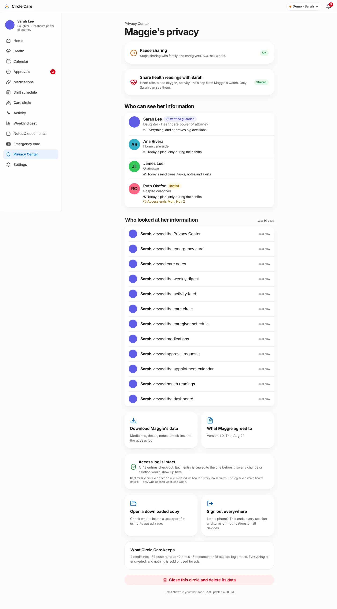
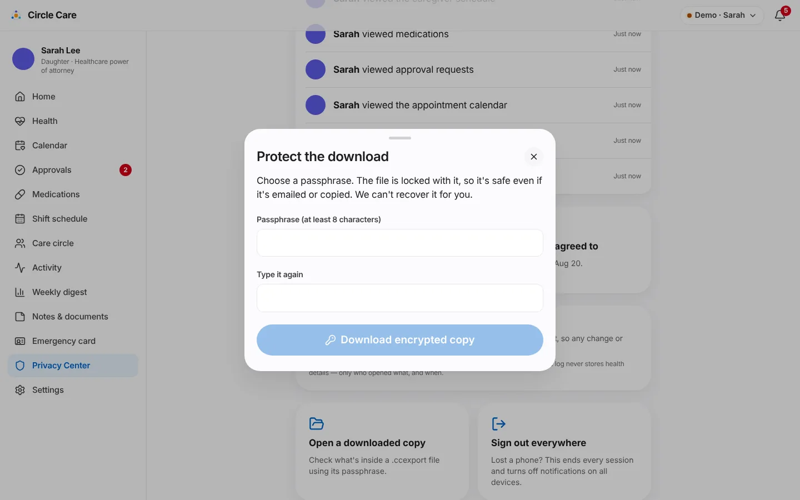

# Privacy Center

| | |
|---|---|
| **Feature ID / area** | F-11 · Elder-controlled privacy (`/app/elder/privacy`, `/app/guardian/privacy`) |
| **Personas** | Maggie (controls), Sarah (views; can export, sign out everywhere and close the circle) |
| **Status** | Built in prototype |
| **Related stories** | CC-81 Privacy Center (approved addition) · CC-20 who can see my data · CC-21 revoke access · CC-22 consent review · CC-26 encrypted storage · CC-27 sign out everywhere · CC-28 tamper-evident log · CC-29 access history · CC-32 export my data · CC-33 close circle and delete · CC-87 health-sharing consent |
| **Last updated** | 2026-10-19 |

## Overview

**What.** One page where the elder sees and controls her information: **pause sharing**, choose whether her **health readings** are shared, see **who can see** her information and **who looked at it**, check that the access log is **intact**, **download** an encrypted copy, review **what she agreed to**, **sign out everywhere**, and **close the circle**. The guardian sees the same page in read-only form for the sharing switches.

**Why.** "Her data. Her decision." is Circle Care's core promise. Without a place to exercise it, privacy is only a policy.

**Business value.** The Privacy Center is the clearest differentiator from monitoring-style competitors ([competitive teardown](../../research/07-competitive-teardown.md)) and directly supports HIPAA-style rights of access, accounting of disclosures and deletion.

## User journey

1. Maggie taps **My privacy** on her home screen: **Your information, your choice** (Sarah sees **Maggie's privacy**).
2. **Pause sharing** — *"Stops sharing with family and caregivers. SOS still works."* When on: *"Sharing is paused. Only SOS alerts go out."* (toast *"Sharing paused"*).
3. **Share health readings with Sarah** — *"Heart rate, blood oxygen, activity and sleep from your watch. Only Sarah can see them."* 
4. **Who can see your information** lists every member with relationship, what they can see (e.g. *"Today's plan, only during their shifts"*), *Invited* and *Access ends* labels, and **Remove** (not for Sarah).
5. **Who looked at your information** — the last 30 days of other people's actions: *"James viewed care notes · 20 hr ago"*, *"Ana created a shift hand-off · Yesterday"*.
6. **Download my data** and **What I agreed to** (*"Version 1.0, Thu, Aug 20."*).
7. **Access log is intact** — *"All 9 entries check out. Each entry is sealed to the one before it, so any change or deletion would show up here."*
8. **Open a downloaded copy** and **Sign out everywhere**.
9. **What Circle Care keeps** — counts of medicines, dose records, notes, documents and access-log entries; *"Everything is encrypted, and nothing is sold or used for ads."*
10. **Close this circle and delete its data**.

<figure markdown="span" class="cc-phone">
  { loading=lazy }
  <figcaption>Maggie's Privacy Center (full page, phone).</figcaption>
</figure>
<figure markdown="span">
  { loading=lazy width="460" }
  <figcaption>Sarah's view: status badges, no switches.</figcaption>
</figure>

### Download an encrypted copy (CC-32)

11. **Download my data** → **Confirm it's you** (*"Downloading health information needs a quick check. The file is saved only to this device."*) → **Confirm with Face ID**.
12. **Protect the download** — *"Choose a passphrase. The file is locked with it, so it's safe even if it's emailed or copied. We can't recover it for you."* Passphrase (≥ 8 characters) twice → **Download encrypted copy** → `circle-care-export-2026-10-19.ccexport` (*"Encrypted copy downloaded"*).
13. **Open a downloaded copy** → choose the file, enter the passphrase → **Unlock** shows a summary (export time, people, medicines, dose records, notes, documents, access-log entries). A wrong passphrase: *"That passphrase doesn't open "file"."* Nothing is uploaded.

<figure markdown="span">
  { loading=lazy }
  <figcaption>Exports are always passphrase-encrypted.</figcaption>
</figure>

### Sign out everywhere (CC-27) {#sign-out-everywhere}

14. **Sign out everywhere** — *"Lost a phone? This ends every session and turns off notifications on all devices."* All personas are signed out, the app returns to the person picker, and Sarah is told.

### Close this circle (CC-33) {#close-this-circle}

15. **Close this circle?** — *"This deletes Maggie's medicines, notes, documents and schedules, removes everyone's access, and erases the encryption key on this device so no copy can be read."* Type **DELETE** → **Delete everything** (or **Keep the circle**).

## Functional details & business rules

| Rule | Value | Source |
|---|---|---|
| Pause sharing — who can change | Elder only (UI switch; guardian sees a badge) | `PrivacyCenter.tsx`, `ELDER_SETTINGS` |
| Pause sharing — effect | Family and pro refused on everything except `sos`, `emergencyCard`, `circle`; guardian keeps access with a banner; caregiver app shows *"Maggie has paused sharing"* | `can()` |
| Health sharing — who can change | Elder only (`setHealthSharing`) | CC-87 |
| Access log shown | Last 30 days, excluding Maggie's own actions, newest 12 | `PrivacyCenter.tsx` |
| Integrity check | `verifyChain()` over the whole log; failure shows *"Access log may have been altered — Entry N of M doesn't match its seal."* | `audit.ts` |
| Retention statement | *"Kept for 6 years, even after a circle is closed, as health privacy law requires."* (`RETENTION_YEARS = 6`) | `audit.ts` |
| Export contents | Members (without photos), medications, doses, tasks, check-ins, notes, document metadata, access log | `doExport` |
| Export encryption | PBKDF2-SHA-256, 250,000 iterations, 16-byte salt → AES-256-GCM, 12-byte IV; file is JSON with `format: "circle-care-export"`, `kdf`, `cipher`, `salt`, `iv`, `data` | `encryptWithPassphrase` |
| Close circle — who | Elder or guardian (`data: delete`) | `closeCircle` |
| Close circle — effect | Removes the stored state, destroys the device key, clears the encrypted file store, records a deletion timestamp, reseeds the demo | `wipeDevice` |

## Permissions & privacy

| Resource / action | Elder | Guardian | Family | Pro |
|---|---|---|---|---|
| `audit` read (access log) | ✓ | ✓ | — | — |
| `data` export | ✓ | ✓ | — | — |
| `data` delete | ✓ | ✓ | — | — |
| `circle` revoke | ✓ | ✓ | — | — |
| `vitals` sharing switch | ✓ (only) | — | — | — |

!!! note "The log holds no health details"
    *"The log never stores health details — only who opened what, and when."* Entries store an actor id, an action and a resource name.

## Notifications

| Trigger | Recipients | Lock-screen text | In-app detail |
|---|---|---|---|
| Sharing paused | Guardian, caregiver | Update from Circle Care | Maggie paused sharing. Only emergency alerts are shared until she resumes. |
| Sharing resumed | Guardian, caregiver | Update from Circle Care | Maggie resumed sharing with the circle. |
| Health sharing on / off | Guardian | Update from Circle Care | See [Health insights](health-insights.md#notifications) |
| Member removed | Guardian | Update from Circle Care | Maggie removed *name* from the circle. |
| Signed out everywhere | Guardian | Update from Circle Care | *Name* signed out of Circle Care on all devices. |

## Accessibility

- Switches are real switches with names (*Pause sharing*, *Share health readings with Sarah*).
- Large action cards are buttons with headings and descriptions; destructive actions use a distinct style and a typed confirmation.
- Passphrase mismatch is announced with `role="alert"`; unlock results with `role="status"`.
- `/app/elder/privacy` and `/app/guardian/privacy` pass axe-core.

## Data captured

| Data | Where |
|---|---|
| `sharingPaused`, `vitals.shareWithGuardian` | `Settings` |
| `exported`, `signed out`, `removed`, `updated` entries | `AuditEvent` |
| Deletion timestamps | `localStorage["circle-care-deletions"]` (outside the encrypted state) |
| Export file | Downloaded to the device only |

## Edge cases & error states

| Situation | Behaviour |
|---|---|
| Passphrase under 8 characters or not matching | Download disabled; mismatch message |
| Wrong passphrase when opening | Error; nothing changes |
| Confirmation text not `DELETE` (case-insensitive) | **Delete everything** disabled |
| Log tampered with | Red *may have been altered* panel with the entry number |
| Guardian taps *What Maggie agreed to* | Toast *"Maggie agreed to version 1.0"* (elder sees the full text) |

## Test coverage

| Type | Test |
|---|---|
| E2E | *Elder pauses sharing; caregiver view is blocked* · *CC-28 integrity check; CC-32 passphrase-encrypted export round-trip* (export contains `AES-256-GCM` and not `Lisinopril`; wrong passphrase fails; right one unlocks) · *CC-26 data at rest in the browser is encrypted* · *CC-87 Maggie controls whether Sarah sees health readings* · *CC-27 sign out everywhere* · *CC-33 close circle deletes data and files* |
| Unit | `audit.test.ts` — links entries, append keeps the chain valid, detects edits, deletions and reordering. `sha256.test.ts` — the pure-JavaScript SHA-256 matches Node's `crypto` for edge-case inputs. `policy.test.ts` — *pausing sharing limits family and caregivers to emergencies (CC-81)* |

## Known limitations & production gaps

| In the prototype | In production (planned) |
|---|---|
| Face ID check before export is simulated | Platform biometric or re-authentication |
| Closing the circle reseeds the demo, so the access log is **not** actually retained for 6 years | Server-side log retained 6 years, held separately; backups purged within 35 days; deletion confirmation email (as the close sheet states) |
| Sign out everywhere affects this browser only | Revoke all server sessions and push tokens |
| Access log lives on one device and can be wiped | Server-side, append-only log anchored externally |
| Deletion affects one browser | Deletion across all devices and backups |

## Related pages

- [Security & privacy](../architecture/security-and-privacy.md)
- [Care circle & access](care-circle-and-access.md)
- [Health insights](health-insights.md)
- [Permission matrix](../../security/permission-matrix.md)
