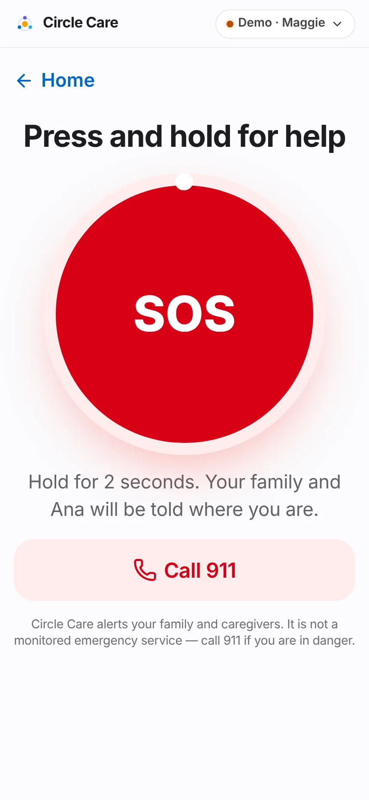
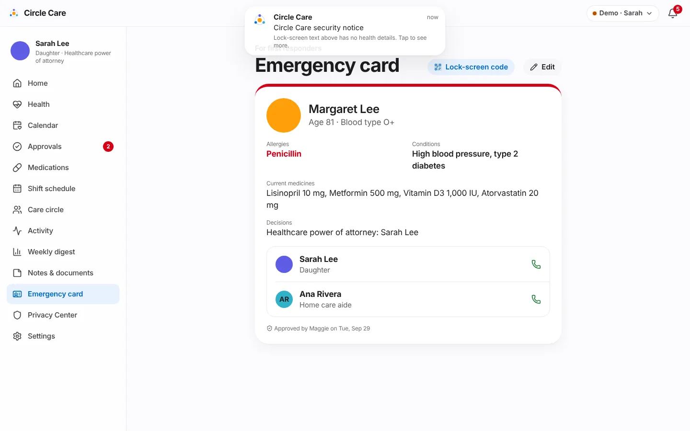

# SOS & emergency

| | |
|---|---|
| **Feature ID / area** | F-03 · Emergency response |
| **Personas** | Maggie (raises SOS), Sarah, Ana and James (responders) |
| **Status** | Partially built — the full flow works in-app; real push/SMS delivery, location and 911 integration are not built |
| **Related stories** | CC-46 hold-to-send SOS · CC-47 call 911 · CC-48 escalation chain · CC-49 acknowledge & resolve · CC-50 critical alerts break through silent mode · CC-52 missed daily check-in · CC-53 emergency card |
| **Last updated** | 2026-10-19 |

## Overview

**What.** Maggie presses and holds **SOS**. After a 10-second chance to cancel, the people on her escalation list are alerted one after another — Sarah first, then Ana after 2 minutes, then James after 4 — **until someone taps "I'm on my way."** Maggie sees who is coming. The responder closes the event with a note of what happened. An **emergency card** gives first responders her allergies, conditions, medicines and contacts, and a **daily check-in** catches the quieter emergencies.

**Why.** A single phone call to a single relative is a fragile safety net. Personal emergency buttons exist, but they rarely tell the elder *who* is coming, and they are disconnected from the family's daily plan.

**Business value.** SOS is the feature families cite first when deciding to adopt a care app. Fast, visible acknowledgement is a pilot success metric (median alert answered in under 10 minutes — see [Pilot & feedback](pilot-and-feedback.md)).

!!! warning "Not an emergency service"
    Every SOS screen says: *"Circle Care alerts your family and caregivers. It is not a monitored emergency service — call 911 if you are in danger."* A **Call 911** button is always visible.

## User journey

### Raising an SOS (elder)

1. Maggie taps the red **SOS** tile on her home screen.
2. **Press and hold for help** — a large round button with a progress ring. *"Hold for 2 seconds. Your family and Ana will be told where you are."* A secondary **Call 911** button sits below.
3. When the ring completes, **Sending for help in 10** counts down. If read-aloud is on she hears *"Sending for help in 10 seconds. Tap cancel if you're OK."*
4. She can tap **Cancel — I'm OK** (*"Cancelled. No one was alerted."*) or **Send now**.
5. At zero, **Help is on the way** — *"We're telling your family now."* **Who we're telling** lists each person: *Alerted*, *In 2 min if no answer*, *In 4 min if no answer*.

<figure markdown="span" class="cc-phone">
  { loading=lazy }
  <figcaption>Hold-to-send prevents accidental alerts.</figcaption>
</figure>
<figure markdown="span" class="cc-phone">
  { loading=lazy }
  <figcaption>10 seconds to cancel.</figcaption>
</figure>
<figure markdown="span" class="cc-phone">
  { loading=lazy }
  <figcaption>The escalation chain, as Maggie sees it.</figcaption>
</figure>

### Responding (guardian, caregiver, family)

6. Every guardian and caregiver screen shows a red bar: **Maggie pressed SOS** *at 4:08 PM* · **Respond**. A critical banner also appears.
7. The responder screen: **Maggie needs help** — *"Pressed SOS at 4:08 PM · Just now"*, location *"At home · 412 Elizabeth St, Noe Valley, San Francisco (demo address)"*, buttons **I'm on my way**, **Call Maggie** and **Call 911**, and the escalation list with *Alerted / Next / Responding* badges.
8. Tapping **I'm on my way** stops escalation and notifies everyone: *"Sarah is responding to Maggie's SOS."*
9. Maggie's screen switches to the responder's photo and **"Sarah is coming"** — *"Stay where you are if you can. Sarah answered at 4:09 PM."*
10. The SOS is closed either by Maggie (**I'm OK now**, recorded as *"Resolved by Maggie — Sarah arrived."*) or by the responder, who must type **What happened? (required to close)** and tap **Mark resolved**.
11. With no active SOS, the responder page shows **No active SOS** — *"Maggie is OK. If she presses SOS, you'll get an alert that breaks through silent mode."* — and a list of **Past alerts** with outcomes.

<figure markdown="span" class="cc-phone">
  { loading=lazy }
  <figcaption>The responder view on a phone.</figcaption>
</figure>

### Emergency card (CC-53) {#emergency-card}

12. **Emergency card** (elder home link, caregiver tab, guardian menu) shows a red-topped card: name, age, blood type, **Allergies** (in red), **Conditions**, **Current medicines** (all non-paused medicines with strength), **Decisions** (directives) and one-tap calls to the first two people on the SOS list.
13. The footer states *"Approved by Maggie on …"* or *"Waiting for Maggie to approve"*.
14. **Edit**: Maggie's edits save immediately. Sarah's edits are sent as **Send to Maggie** — *"Maggie must approve changes before they appear on her card."*
15. **Lock-screen code** shows an example QR code: *"Responders scan this code from Maggie's lock screen to open the card for 1 hour. Each scan is added to the access log."*

<figure markdown="span">
  { loading=lazy }
  <figcaption>The emergency card is approved by Maggie and every view is logged.</figcaption>
</figure>

### Missed daily check-in (CC-52)

16. If Maggie has not tapped **I'm OK** by the end of her check-in window (default 10:00 AM), she gets one more gentle prompt.
17. Fifteen minutes later, Sarah is alerted and her home screen shows **Maggie hasn't checked in** — *"Window ended at 10:00 AM — consider calling."*

## Functional details & business rules

### SOS timing

| Rule | Value | Source |
|---|---|---|
| Hold to arm | 2 seconds (pointer, touch, or Enter/Space held) | `ElderSos.tsx` `HOLD_MS` |
| Cancel window | 10 seconds | `CANCEL_S` |
| Escalation chain (default) | Sarah → Ana → James | `settings.escalation` |
| Step interval | **2 minutes** (guardian can choose 1, 2, 3 or 5) | `settings.escalationDelayMin` |
| Step calculation | `step = floor(minutes since start ÷ interval)`, capped at the last person | `evaluate()` in `store.tsx` |
| Escalation stops | When anyone acknowledges | `sosAcknowledge` |
| Only one active SOS | A second press while one is active does nothing | `sosStart` |
| Offline | If the device is offline, the event is marked `via: "sms-fallback"` and the elder sees *"No internet — SOS will be sent by text message."* | `ElderSos.tsx` |
| Who may change the order | Guardian (Care circle → *Who gets SOS alerts first*, up/down arrows). Maggie can **suggest** a change. | CC-48 |

### SOS states

| State | Meaning | Elder sees | Responders see |
|---|---|---|---|
| `active` | Sent, no one has acknowledged | Help is on the way | Red bar *Maggie pressed SOS* · **Respond** |
| `acknowledged` | Someone tapped *I'm on my way* | *Name* is coming · **I'm OK now** | *Name is responding* · outcome box |
| `resolved` | Closed with an outcome | Home screen | Past alerts |

### Emergency card fields

| Field | Demo value | Editable by |
|---|---|---|
| Allergies | Penicillin | Elder (save) · guardian (needs elder approval) |
| Conditions to share | High blood pressure, type 2 diabetes | Same |
| Decisions and directives | Healthcare power of attorney: Sarah Lee | Same |
| Blood type | O+ | Same |
| Current medicines | Derived from the medication list (paused ones excluded) | Not edited here |
| Contacts | First two people on the SOS list | Not edited here |

## Permissions & privacy

From `src/data/policy.ts`:

| Resource / action | Elder | Guardian | Family | Pro (on or off shift) |
|---|---|---|---|---|
| `sos` read | ✓ | ✓ | ✓ | ✓ |
| `sos` write (raise / resolve as elder) | ✓ | — | — | — |
| `sos` respond (acknowledge / resolve) | — | ✓ | ✓ | ✓ |
| `emergencyCard` read | ✓ | ✓ | ✓ | ✓ |
| `emergencyCard` write | ✓ | — (propose) | — | — |

!!! note "Emergencies are always shared"
    `sos`, `emergencyCard` and `circle` are in `ALWAYS_SHARED`: they keep working for family and caregivers even when Maggie pauses sharing. Professional caregivers can respond to SOS **even when off shift**.

Every emergency-card view is written to the access log (*"viewed the emergency card"*).

## Notifications

| Trigger | Recipients | Severity | Lock-screen text | In-app detail |
|---|---|---|---|---|
| SOS sent | Guardian, caregiver | Critical | Emergency alert from Circle Care | Maggie pressed SOS. Alerting Sarah first. |
| Escalation step | Guardian, caregiver | Critical | Emergency alert from Circle Care | No one has responded yet. Now also alerting *Name*. |
| Acknowledged | Elder, guardian, caregiver | Info | Update from Circle Care | *Name* is responding to Maggie's SOS. |
| Check-in missed (elder prompt) | Elder | Info | You have a reminder from Circle Care | Good morning, Maggie. Tap "I'm OK" so Sarah knows you're fine. |
| Check-in missed (+15 min) | Guardian | Warning | Circle Care needs your attention | Maggie hasn't checked in today (window 08:00–10:00). Consider calling her. |

Critical banners are visually distinct (red). The guardian setting **Emergencies break through silent mode** (*"SOS and missed high-priority doses always alert you"*) is on by default (CC-50).

## Accessibility

- The SOS button is keyboard-operable: holding **Enter** or **Space** arms it; the button's label is *"Press and hold for 2 seconds to send SOS."*
- The countdown number is an `aria-live="assertive"` region; spoken prompts accompany each stage when read-aloud is on.
- Responder buttons are extra-large; Call 911 uses a distinct red style.
- Red is reserved for emergencies across the product.

## Data captured

| Field | Entity |
|---|---|
| `id`, `startedAt`, `status`, `step`, `via` | `SosEvent` (on send) |
| `responderId`, `acknowledgedAt` | `SosEvent` (on acknowledge) |
| `resolvedAt`, `outcome` | `SosEvent` (on resolve) |
| `allergies`, `conditions`, `directives`, `bloodType`, `approvedByElder`, `approvedAt` | `Settings.emergencyCard` |
| `date`, `at`, `mood` | `Checkin` |

## Edge cases & error states

| Situation | Behaviour |
|---|---|
| Finger slips off the button before 2 s | Progress resets; nothing is sent |
| Elder cancels during countdown | Nothing is recorded; spoken *"Cancelled. No one was alerted."* |
| Responder tries to close without a note | **Mark resolved** stays disabled |
| Everyone on the chain has been alerted | Step stays on the last person; alerts continue to show as active |
| A member is removed from the circle | They are removed from the escalation chain automatically |
| Presenter *Trigger SOS from Maggie* | Starts an SOS instantly (skips hold and countdown) |

## Test coverage

| Type | Test |
|---|---|
| E2E | *Elder holds SOS, countdown, sends* (2.3 s mouse hold → *Sending for help in* → **Send now** → *Help is on the way*) · *Guardian acknowledges SOS, elder sees responder, resolves* (*Sarah is coming* → **I'm OK now**) · *CC-14 elder lock option; CC-48 elder suggests SOS-list change* |
| Unit | `rules.test.ts` — missed check-in prompts the elder first, then the guardian 15 minutes later (CC-52). `policy.test.ts` — `sos` and `emergencyCard` permissions for every role, and that they survive *Pause sharing* |
| Gap | No unit test asserts the SOS escalation step timing; it is exercised only manually and through the UI |

## Known limitations & production gaps

| In the prototype | In production (planned) |
|---|---|
| Alerts are in-app only, shown to the guardian and caregiver views | Push with **critical-alert entitlement** (iOS) / high-priority channels (Android), plus SMS and voice-call fallback to each person on the chain ([R2 Native apps](../roadmap.md)) |
| Location is a fixed demo address in Noe Valley, San Francisco | Device location at the moment of SOS, shared only with responders |
| SMS fallback only sets a flag | Real SMS sent from the device or server when offline |
| Call 911 is a `tel:` link | Optional integration with a monitored response partner; legal review of claims |
| `sosStart` is not permission-checked so the presenter can trigger it | Only the elder's device can raise SOS |
| Lock-screen QR is a decorative placeholder | Signed, time-limited emergency link (1 hour) with access logging |
| Emergency card age ("Age 80") is hard-coded | Derive age from date of birth |
| Fall detection, inactivity and wandering alerts not built | [R3 Wearables & Fall Detection](../roadmap.md) |

## Related pages

- [Elder experience](elder-experience.md)
- [Alerts & notifications](alerts-and-notifications.md)
- [Care circle & access](care-circle-and-access.md) — escalation order
- [Guardian dashboard & approvals](guardian-dashboard-and-approvals.md#settings) — check-in window, SOS interval
