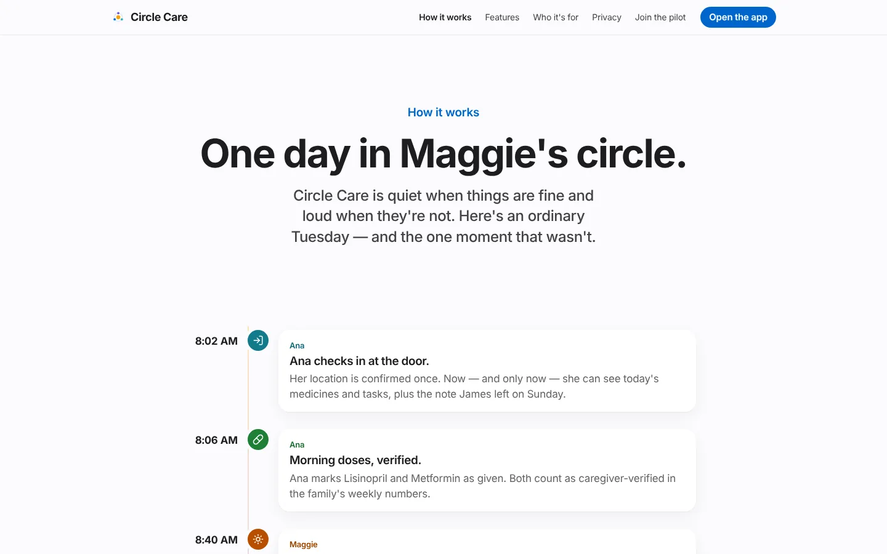
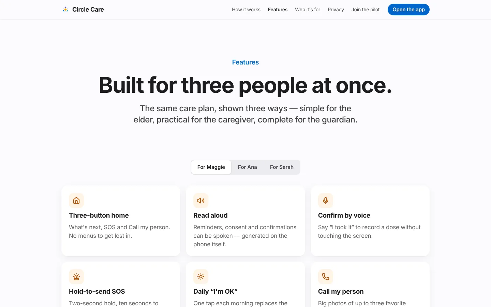
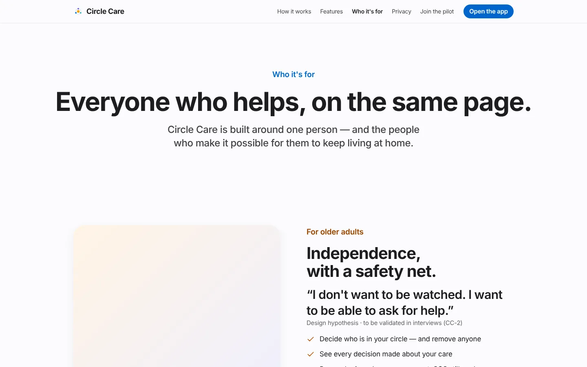
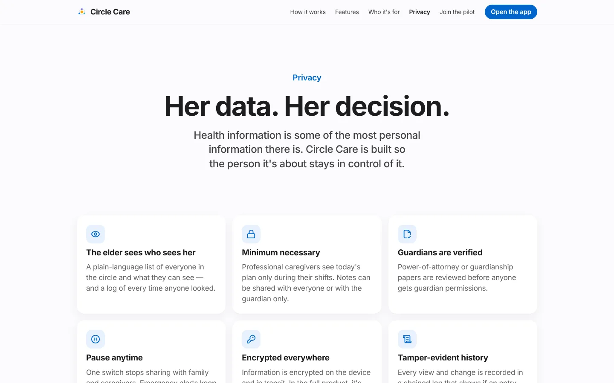
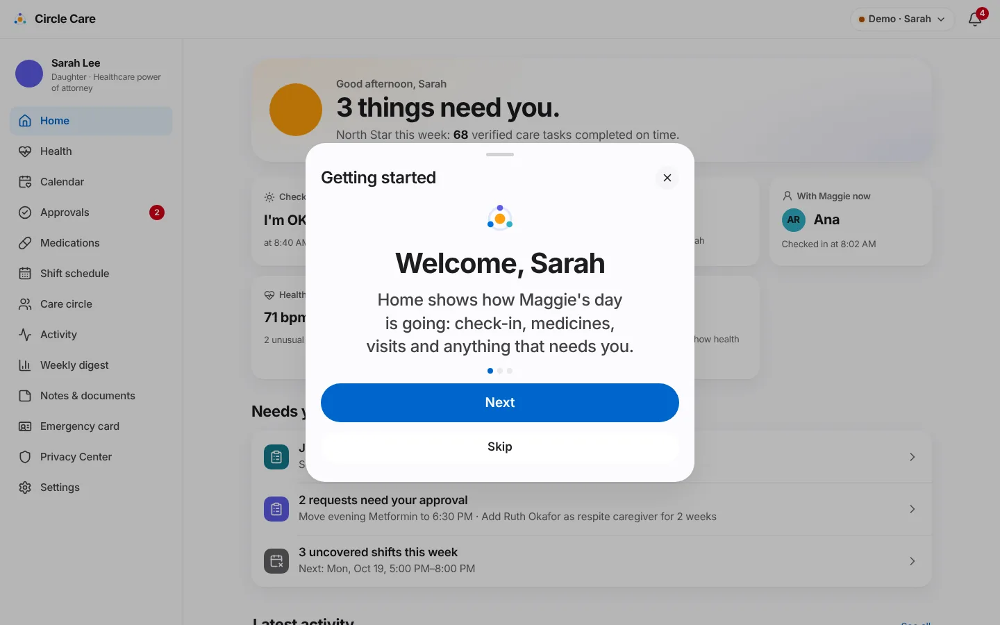

# Website & onboarding

| | |
|---|---|
| **Feature ID / area** | F-01 · Acquisition, identity and first run |
| **Personas** | Prospective families and caregivers (website); Maggie, Ana, Sarah (sign-in); invited members such as Ruth |
| **Status** | Built in prototype — identity is simulated (no real accounts, SMS or biometrics) |
| **Related stories** | CC-11 sign up & sign in · CC-12 MFA · CC-13 elder-friendly sign-in · CC-14 session lock · CC-15 create a circle · CC-17 accept an invitation · CC-22 consent · CC-75 welcome tour & setup call |
| **Last updated** | 2026-10-19 |

## Overview

**What.** A six-page marketing website that explains the product, followed by the app's entry flow: choose a person, sign in (with a second step for caregivers and guardians), accept the privacy agreement (elder), take a short welcome tour, and — for invited helpers — accept an invitation.

**Why.** Families decide whether to trust a care app before they install it. The website states the privacy promise in plain language up front. Inside the app, sign-in must be strong enough for health information yet simple enough for an 80-year-old.

**Business value.** Converts visitors into pilot sign-ups ([Pilot & feedback](pilot-and-feedback.md)), sets expectations about privacy before any data is entered, and reduces setup support through the welcome tour and a free setup call.

## User journey

### Marketing website

1. A visitor lands on **Home** (`/`): *"Care, in one circle."* with **Try the demo** and **See how it works**.
2. **How it works** (`/how-it-works`) tells one ordinary day in Maggie's circle as a timeline (Ana checks in 8:02 AM → doses verified 8:06 → Maggie's "I'm OK" 8:40 → spoken reminder 12:30 PM → SOS 1:35 PM → "I'm on my way" 1:36 → self-writing hand-off 2:00 PM → Sunday digest), then three setup steps: *Create the circle*, *Invite helpers by role*, *Verify the guardian*.
3. **Features** (`/features`) shows the feature list per person behind tabs **For Maggie / For Ana / For Sarah**.
4. **Who it's for** (`/who-its-for`) gives each persona's promise and a hypothesis quote marked *"Design hypothesis · to be validated in interviews"*.
5. **Privacy** (`/privacy`) lists eight privacy pillars, six *"Things we will never do"*, and five FAQs.
6. **Join the pilot** (`/pilot`) collects interest (see [Pilot & feedback](pilot-and-feedback.md)).
7. A translucent top navigation and footer appear on every page; on phones the links collapse into a menu button.

<figure markdown="span">
  { loading=lazy width="420" }
  <figcaption>How it works — one day in Maggie's circle.</figcaption>
</figure>
<figure markdown="span">
  { loading=lazy width="420" }
  <figcaption>Features — the same plan shown three ways.</figcaption>
</figure>

<figure markdown="span">
  { loading=lazy width="420" }
  <figcaption>Who it's for.</figcaption>
</figure>
<figure markdown="span">
  { loading=lazy width="420" }
  <figcaption>Privacy — pillars, "never" list and FAQs.</figcaption>
</figure>

### Entering the app

8. **Try the demo** or **Open the app** goes to `/app`, **Welcome to Circle Care**: *"This demo has one care circle with three people in it. Pick who you'd like to be — you can switch anytime."*
9. The visitor picks **Maggie** (Elder), **Ana** (Caregiver) or **Sarah** (Legal guardian). If that person is already signed in, the app opens directly.

<figure markdown="span">
  { loading=lazy }
  <figcaption>Choose a person. "Start a new care circle" opens the sign-up flow.</figcaption>
</figure>

### Sign-in and MFA (caregiver and guardian)

10. **Hi, Sarah** — *"Sign in to Maggie's care circle."* Email and password are prefilled for the demo. **Continue**.
11. *"New device detected — we'll ask for a second step to keep Maggie's information safe."* The next screen asks: *"Enter the code we sent to your phone."* — *"Sent to •••• 0177. Demo code: 482913"*.
12. A correct code signs the person in and opens their home screen.

<figure markdown="span" class="cc-phone">
  { loading=lazy }
  <figcaption>Step 1: email and password.</figcaption>
</figure>
<figure markdown="span" class="cc-phone">
  { loading=lazy }
  <figcaption>Step 2: six-digit code.</figcaption>
</figure>

### Elder sign-in and consent

13. Maggie's screen says *"Sign in with your face — no password needed."* Tapping **Sign in with Face ID** shows *Looking…* then *Welcome back* (an animation in the demo).
14. Hint: *"Lost your phone? Sarah can help you sign in on a new one — she'll need to confirm it's you."*
15. If Maggie has never agreed to the privacy terms, **Here is how Circle Care works** appears with four plain-language points, a **Read this to me** button and **I understand and agree**. (The seeded demo already has consent, so this step is skipped unless consent is cleared.)

### Welcome tour and setup call

16. The first time each persona opens the app, a **Getting started** sheet shows 3–4 short cards with **Next** / **Skip**.
17. The last card offers **Start using Circle Care** and **I'd like a free setup call** → toast *"We'll call within one business day to help set up"*.

<figure markdown="span" class="cc-phone">
  { loading=lazy }
  <figcaption>The welcome tour (CC-75).</figcaption>
</figure>

### Start a new care circle (sign-up)

18. **Start a new care circle** on the Welcome screen opens a three-step sheet: **Create your account** (name, email or mobile, password with a strength meter, privacy-notice checkbox) → **Verify it's you** (6-digit code) → **Create a care circle** (*Who is this circle for?*, *Your role*). The demo then opens Sarah's example circle.

### Invitation acceptance

19. An invited person opens `/#/app/invite/<memberId>`: *"Sarah invited you to Maggie's care circle"*, their role and end date, and **What you'll be able to see** for their role.
20. **Accept invitation** → *"Welcome to the circle"*. If more than 72 hours have passed: *"This invitation expired after 72 hours"* and **Ask Sarah for a new link**.

## Functional details & business rules

### Sign-in rules

| Rule | Prototype behaviour | Source |
|---|---|---|
| Sign-in method by persona | Elder: biometric-style button only. Caregiver and guardian: email + password, then 6-digit code. | `src/pages/SignIn.tsx` |
| MFA code | Exactly 6 digits; only `482913` is accepted. Non-digits are stripped as you type. | `SignIn.tsx` |
| Wrong code | *"That code didn't match. N tries left."* (5 attempts) | `SignIn.tsx` |
| Lockout | After 5 wrong codes: **Account locked for 15 minutes** — *"After 5 incorrect codes we lock sign-in and let *(name)* know by email."* An alert and a `denied` audit entry are written. A **Reset (demo)** link clears the lock. | `SignIn.tsx`, `store.lockedOut` |
| Session lock | Caregiver and guardian apps lock after **15 minutes** of inactivity (configurable 1 / 5 / 15 in guardian Settings). The elder app never locks by default; she can choose 5 or 15 minutes. Unlock with **Unlock with Face ID** / **Unlock with your face**. | `AppShell.tsx` (CC-14) |
| Sign-out everywhere | See [Privacy Center](privacy-center.md#sign-out-everywhere). | CC-27 |

### Sign-up password rule

| Criterion (1 point each) | Continue enabled when |
|---|---|
| 10 or more characters · upper **and** lower case · a number · a symbol | Score ≥ 3 of 4 **and** the privacy-notice box is ticked |

Weak-password hint: *"Add more: use 10+ characters with upper and lower case, a number and a symbol."*

### Consent (CC-22)

| Item | Rule |
|---|---|
| Who can accept | Maggie herself, **or** a verified guardian on her behalf with a written reason of at least 10 characters (guardian Settings → *Agree on Maggie's behalf*) |
| What is stored | `settings.consent = { version: "1.0", at, by, onBehalfReason? }` |
| Read-aloud | **Read this to me** uses on-device speech synthesis |
| Review later | Privacy Center → *What I agreed to* |

The four consent points, verbatim:

1. *You choose who is in your circle. You can remove people anytime.*
2. *Each person only sees what they need to help you. You can see who looked at your information.*
3. *You can pause sharing with one switch. Emergency alerts still work.*
4. *If you press SOS, we tell your family and caregivers right away.*

### Welcome tour content (CC-75)

| Persona | Cards |
|---|---|
| Elder | Hello, Maggie · One tap each morning · Help is one press away · You're in charge |
| Caregiver | Welcome, Ana · Check in when you arrive · Hand off in a minute |
| Guardian | Welcome, Sarah · You decide the big things · Quiet unless it matters |

Completion is stored per persona in `settings.toured`; a setup-call request sets `settings.setupCallRequested`.

### Invitation rules (CC-17)

| Rule | Value |
|---|---|
| Link validity | 72 hours from `invitedAt`; single use (stated in the invite sheet) |
| What the invitee sees | Role-specific list — professional: *"Today's medications and tasks — only during your shifts"*, the last hand-off, the emergency card; family: today's plan, shared notes, SOS and emergency card; guardian: everything family sees plus approvals, digest and history after verification |
| Elder notified | *"Maggie is notified whenever someone joins her circle."* |

## Permissions & privacy

- Each persona signs in separately; the welcome screen shows *"Fictional demo data, stored only in this browser."*
- Consent on the elder's behalf requires `role === "guardian"` **and** `verification === "verified"` (`store.acceptConsent`). Anyone else is refused and a `denied` audit entry is written.
- Sign-in and sign-out events are audited (`signed in` / `signed out`).
- The invite page shows no health information; the invite message *"contains no health information"* (Circle → Invite sheet).

!!! note "Privacy by default on the website"
    The website collects nothing except the optional pilot form. The pilot form keeps only role, state and whether a paid caregiver visits; name and contact are discarded in the prototype (see [Pilot & feedback](pilot-and-feedback.md)).

## Notifications

| Trigger | Recipient | Lock-screen text | In-app detail |
|---|---|---|---|
| 5 wrong MFA codes | The person locked out | Circle Care security notice | Sign-in was locked for 15 minutes after 5 incorrect codes. If this wasn't you, change your password. |
| New member invited | Elder | Update from Circle Care | *Name* was invited to your circle as *relation*. |

## Accessibility

- Elder sign-in is a single extra-large button; no typing.
- Code field uses `inputMode="numeric"`, `autocomplete="one-time-code"`, an `aria-label` of *6-digit code* and an `aria-describedby` error message.
- The Face ID status is announced through an `aria-live` region (*Looking for your face* / *Signed in*).
- Tour progress dots carry *"Step N of M"*; the sheet is a labelled dialog (*Getting started*).
- Website pages pass axe-core WCAG 2.1 A/AA (`/`, `/how-it-works`, `/features`, `/who-its-for`, `/privacy`, `/pilot`, `/app`).

## Data captured

| Data | Where | Notes |
|---|---|---|
| Sign-in / sign-out | `State.signedIn`, `AuditEvent` | Per persona |
| Consent | `Settings.consent` | Version, time, who, optional on-behalf reason |
| Tour completion | `Settings.toured` | Per persona |
| Setup-call request | `Settings.setupCallRequested` | ISO time |
| Invitation acceptance | `Member.status` → `active` | |
| Sign-up form | Not stored | Demo only — nothing is sent |

## Edge cases & error states

| Situation | Behaviour |
|---|---|
| Wrong code 1–4 times | Inline error with remaining tries; field cleared |
| 5 wrong codes | Lock panel; Sign-in disabled until *Reset (demo)* |
| Unknown invite id | *"This invitation link isn't valid."* with a link to Circle Care |
| Expired invite | Yellow badge and *Ask Sarah for a new link* (toast *"Request sent to Sarah"*; nothing is sent) |
| Already accepted | *"You're in — open Circle Care"* |
| Direct URL to an app page while signed out | Redirects to `/app/sign-in/<persona>` |
| Unknown URL | Redirects to the website home |

## Test coverage

| Type | Test |
|---|---|
| E2E | *Website: every nav page resolves; pilot sign-up works* · *Website: mobile menu navigates* · *Guardian sign-in with MFA* (also completes the tour and requests a setup call) · *MFA lockout after 5 wrong codes* · *CC-22 guardian consents on the elder's behalf with a reason* · *CC-27 sign out everywhere* |
| Accessibility | axe-core on the six website pages and `/app` |
| Unit | Policy tests cover the roles that sign in; no unit test targets the sign-in component |

## Known limitations & production gaps

| In the prototype | In production (planned) |
|---|---|
| Fixed demo code `482913`; no SMS | Real one-time codes via an SMS/voice provider under a BAA, or passkeys / WebAuthn |
| Lockout is UI state only and resets on reload | Server-side rate limiting and lockout, with email notification |
| Face ID is an animation | Platform biometrics (WebAuthn / native) bound to a device key |
| Sign-up creates nothing; demo opens Sarah's circle | Account and circle creation in the backend; elder confirmation of the circle |
| Invitation acceptance sets the member active directly | Single-use signed tokens, identity check, and guardian approval where required |
| No "forgot password" or device recovery | Guardian-assisted elder device recovery as hinted on the elder sign-in screen |
| Website is part of the same React app | Possibly a separate static site with analytics that cannot identify individuals |

## Related pages

- [Personas](../product/personas.md) · [Demo guide](../product/demo-guide.md)
- [Care circle & access](care-circle-and-access.md) — inviting members
- [Privacy Center](privacy-center.md) — consent review, sign-out everywhere
- [Security & privacy](../architecture/security-and-privacy.md)
