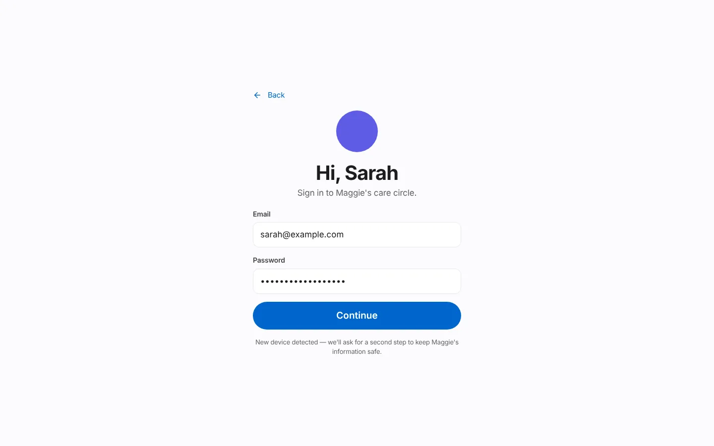
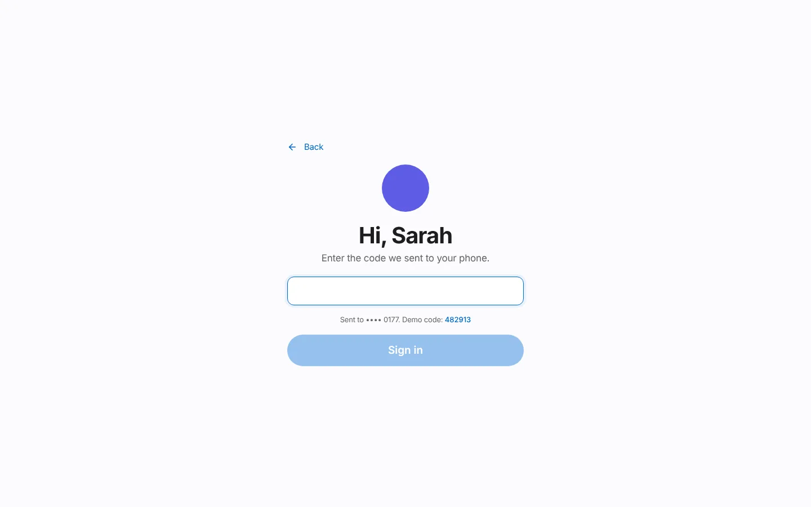
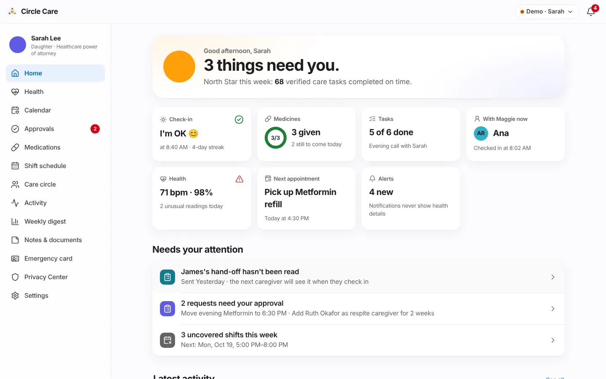
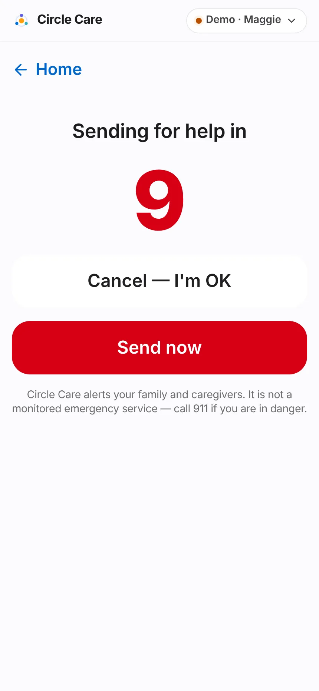
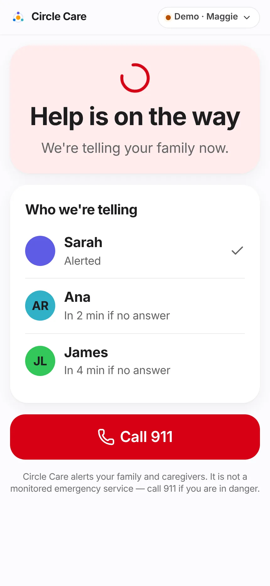
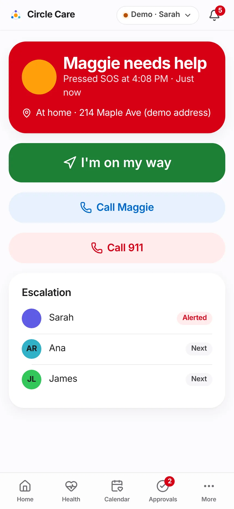
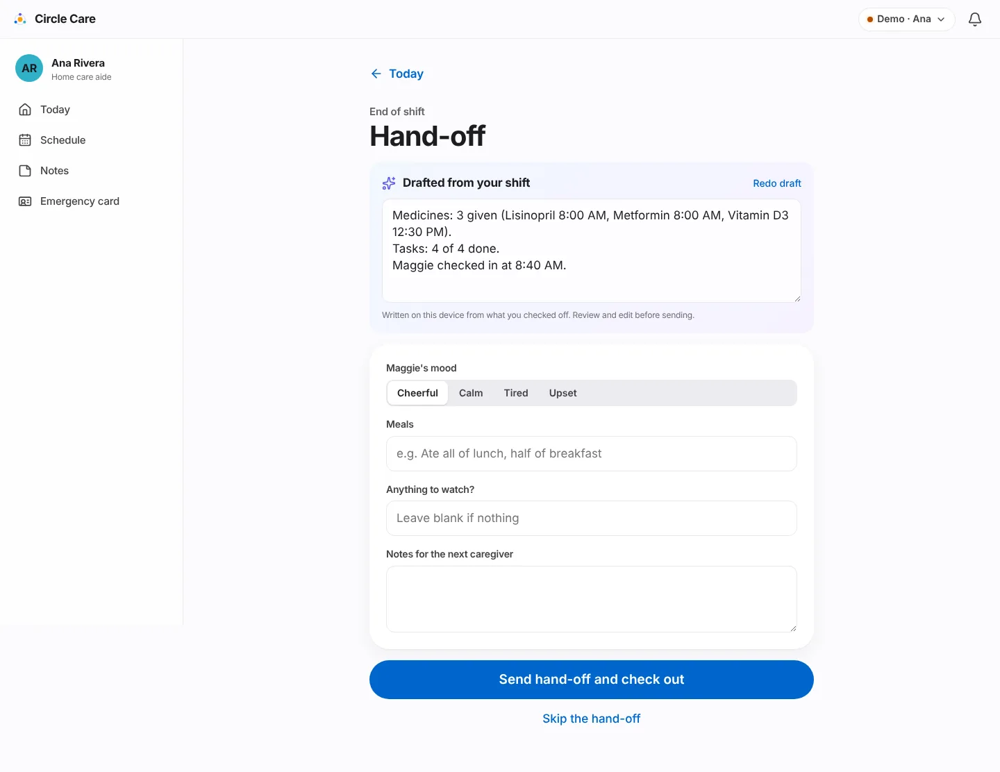
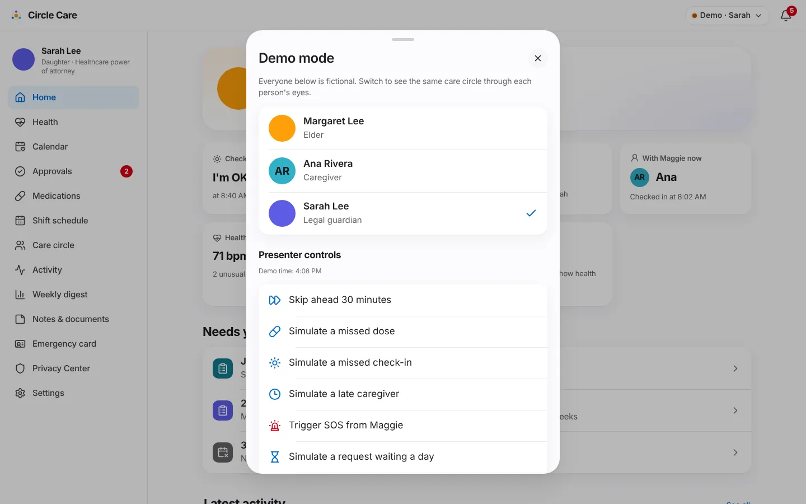

# Demo guide

A step-by-step script for a five-minute live demo of the Circle Care prototype, followed by a reference of every presenter control. Use it for stakeholder reviews, sprint reviews, portfolio walk-throughs and interviews.

!!! tip "Before you start"
    - Open the demo in a desktop browser (wide layout) or on a phone (tab-bar layout). Both work.
    - Open **Demo · Name → Reset demo** so the data matches this script.
    - Demo MFA code: **`482913`** (tap the code on the screen to fill it).
    - The demo clock is real local time plus any time you skip ahead. What is "due" depends on when you present; the script works best between about 9:00 AM and 2:00 PM, when Ana is on shift.

## Where things are

| You want | Go to |
|---|---|
| Website | `/#/` (plus `/#/how-it-works`, `/#/features`, `/#/who-its-for`, `/#/privacy`, `/#/pilot`) |
| Choose a person | `/#/app` |
| Switch person or use presenter controls | The **Demo · Name** pill, top right of the app |
| Review team console | `/#/app/review` (or *Demo mode → Review team console*) |
| Pilot dashboard | `/#/app/pilot` (or *Demo mode → Pilot dashboard*) |

## The five-minute script

### 0:00 — Set the scene (website)

1. Open the website home page. Read the headline: *"Care, in one circle."* One sentence: an older adult, their caregivers and their legal guardian on the same page — with the elder in charge of who sees what.
2. Click **Try the demo**.

### 0:30 — Choose a person and sign in

3. On **Welcome to Circle Care**, point out the three people: Maggie (Elder), Ana (Caregiver), Sarah (Legal guardian). Click **Sarah**.
4. Sign-in is prefilled. Click **Continue**, then enter `482913` (or tap the demo code) and **Sign in**. Mention: *"New device detected — we'll ask for a second step."*
5. If the **Getting started** tour appears, click **Skip** (or show one card).

<figure markdown="span">
  { loading=lazy width="300" }
  <figcaption>Guardian and caregiver sign-in.</figcaption>
</figure>
<figure markdown="span">
  { loading=lazy width="300" }
  <figcaption>Second step: 6-digit code.</figcaption>
</figure>

### 1:00 — Guardian: today at a glance

6. On Sarah's **Home**, read the headline (e.g. *"3 things need you."*) and the **North Star** line.
7. Walk the tiles: Check-in, Medicines ring, Tasks, With Maggie now, Health, Next appointment, Alerts — *"Notifications never show health details."*
8. Point at **Needs your attention**: unread hand-off, pending approvals, uncovered shifts.

<figure markdown="span">
  { loading=lazy }
  <figcaption>Sarah's dashboard: everything that matters today on one screen.</figcaption>
</figure>

### 1:45 — Elder: SOS

9. Open **Demo · Sarah → Margaret Lee** to switch to Maggie. Show the three big buttons.
10. Tap **SOS**, then **press and hold** the round SOS button for 2 seconds. The **"Sending for help in 10"** countdown starts; mention **Cancel — I'm OK**. Tap **Send now** (or wait).
11. Maggie sees **"Help is on the way"** and **Who we're telling**: Sarah *Alerted*, Ana *In 2 min if no answer*, James *In 4 min if no answer*.

<figure markdown="span" class="cc-phone">
  { loading=lazy }
  <figcaption>10 seconds to cancel.</figcaption>
</figure>
<figure markdown="span" class="cc-phone">
  { loading=lazy }
  <figcaption>Escalation chain shown to Maggie.</figcaption>
</figure>

### 2:30 — Guardian responds

12. Switch to **Sarah**. A red bar reads *"Maggie pressed SOS"*. Tap **Respond** and then **I'm on my way**.
13. Switch back to **Maggie**: her screen now says **"Sarah is coming"**. Tap **I'm OK now** to close the SOS (or close it as Sarah with an outcome note).

<figure markdown="span" class="cc-phone">
  { loading=lazy }
  <figcaption>The responder view (phone layout).</figcaption>
</figure>

### 3:15 — A missed dose escalates

14. Open **Demo mode → Simulate a missed dose**. Lisinopril (high priority) is now 70 minutes late, past both escalation thresholds.
15. As **Sarah**, Home shows *"Lisinopril not confirmed · … · high priority"* and a new alert.

### 3:45 — Caregiver: give the dose and hand off

16. Switch to **Ana**. (If she is not on shift, tap **Check in → Check in — I'm here**.)
17. On **Today**, find Lisinopril marked **Overdue**; tap **Given**. Point out *"Given by Ana at … ✓"* — a caregiver-verified dose.
18. Optionally tap **I've read this** on James's hand-off.
19. Tap **End shift**. The **Hand-off** screen shows a summary **"Drafted from your shift"**. Pick a mood and tap **Send hand-off and check out**.

<figure markdown="span">
  { loading=lazy }
  <figcaption>The self-drafting hand-off. Nothing is sent until Ana confirms.</figcaption>
</figure>

### 4:30 — Close on privacy

20. Switch to **Maggie → My privacy**. Show **Pause sharing**, **Share health readings with Sarah**, **Who can see your information** and **Who looked at your information**.
21. Close with the three principles: privacy-first, elder in control, minimum necessary.

!!! tip "Shorter version (3 minutes)"
    Steps 9–13 (SOS round trip), 14–15 (missed dose) and 16–19 (hand-off). This is the script in the repository README.

## Presenter controls reference

Open **Demo · Name** at the top of any app screen. Source: `src/components/PersonaSheet.tsx`.

<figure markdown="span">
  { loading=lazy }
  <figcaption>Demo mode: switch person, then use presenter controls.</figcaption>
</figure>

### Switch person

| Option | Effect |
|---|---|
| Margaret Lee — Elder | Signs in as Maggie if needed and opens `/app/elder` |
| Ana Rivera — Caregiver | Signs in as Ana if needed and opens `/app/caregiver` |
| Sarah Lee — Legal guardian | Signs in as Sarah if needed and opens `/app/guardian` |

### Presenter controls

| Control | Confirmation toast | What it changes |
|---|---|---|
| Skip ahead 30 minutes | "Skipped ahead 30 minutes" | Adds 30 minutes to the demo clock (`clockOffsetMin`). Shown as *Demo time: … (+30 min)*. |
| Simulate a missed dose | "A dose is now 70 minutes late" | Moves today's Lisinopril time to 70 minutes ago and removes today's Lisinopril record. |
| Simulate a missed check-in | "Maggie missed today's check-in" | Removes today's check-in and moves the check-in window to end 30 minutes ago. |
| Simulate a late caregiver | "Ana is running late" | Clears today's visit and moves the shift start to 25 minutes ago. |
| Trigger SOS from Maggie | "SOS sent from Maggie's phone" | Starts an SOS immediately (no hold or countdown). |
| Simulate a request waiting a day | "Ana's request is now 26 hours old" | Back-dates the first pending approval by 26 hours, triggering the 24-hour reminder. |
| Simulate a sudden heart-rate change | "Maggie's watch sent a fast heart-rate reading" | Raises the latest reading's heart rate by 38 bpm. |
| Simulate a low blood-oxygen reading | "Maggie's watch sent a low oxygen reading" | Sets the latest reading's blood oxygen to 88%. |
| Simulate suspicious access | "James opened 9 records in a minute" | Writes 9 "viewed" audit entries for James, triggering the bulk-access alert. |
| Lock the app now | — | Shows the lock screen immediately. |
| Show the feedback survey | — | Shows the NPS card on the current screen. |

### Behind the scenes

| Option | Opens |
|---|---|
| Review team console | `/app/review` — the internal legal-document review queue |
| Pilot dashboard | `/app/pilot` — the internal pilot success dashboard |
| Reset demo | Asks *"Reset the demo to its starting data?"*, then reseeds the data and returns to `/app` |
| Back to the website | `/` |

## Troubleshooting

| Symptom | Fix |
|---|---|
| Caregiver Today says "Check in to see today's care plan" | Ana isn't on shift (before 8:00 AM, after 2:00 PM, on Sunday, or already checked out). Tap **Check in**, or reset the demo. |
| Nothing is due on Maggie's home | All of today's doses are done. Use **Simulate a missed dose** or **Skip ahead 30 minutes**. |
| A sign-in screen appears after switching | Expected the first time for each person; use code `482913`. |
| The app shows "Circle Care is locked" | Inactivity lock (15 minutes for caregiver and guardian). Tap **Unlock with Face ID**. |
| Photos are blank circles | Stock photos load from Unsplash and need internet access. |

## Related pages

- [Personas](personas.md)
- [Features overview](../features/index.md)
- [Website & onboarding](../features/website-and-onboarding.md)
- [Pilot & feedback](../features/pilot-and-feedback.md#demo-mode)
