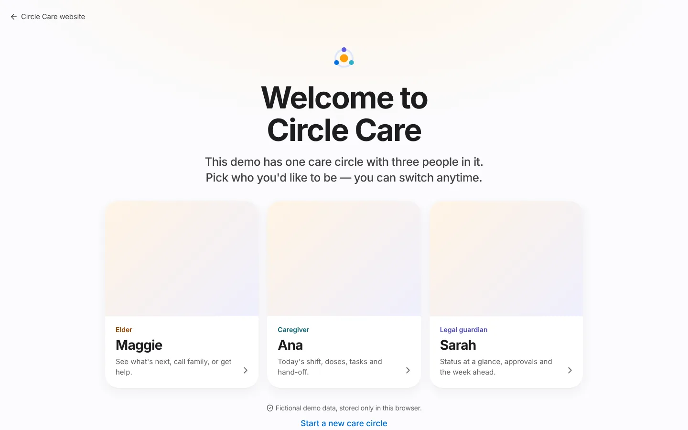

# Personas

Circle Care is designed around one **care circle**: an older adult at the centre and the people who help them. The prototype ships with one fictional circle in San Francisco, California. Each persona below is a *design persona* — the goals and pains are hypotheses to be validated by the research plan ([CC-1 to CC-5](../research-and-compliance.md)), not findings from real interviews.

!!! info "All personas are fictional"
    Names, relationships, phone numbers (`+1 (415) 555-01xx`) and health details are invented for the demo. Any resemblance to real people is coincidental.

## Summary

| Persona | Demo person | Role in code (`Member.role`) | Signs in with | Colour |
|---|---|---|---|---|
| Elder | Margaret "Maggie" Lee, 80 | `elder` | Face ID-style sign-in (no password) | Sunrise orange |
| Legal guardian | Sarah Lee, daughter, healthcare power of attorney | `guardian` (verified) | Email + password + 6-digit code | Indigo |
| Professional caregiver | Ana Rivera, home care aide | `pro` | Email + password + 6-digit code | Teal |
| Family member | James Lee, grandson | `family` | (No dedicated app view in the demo) | Green |
| Respite caregiver | Ruth Okafor | `pro`, time-limited, invite pending | Invitation link | Pink |
| Review team | Internal Trust & Safety | `reviewer` (actor `trust-safety`) | Internal console | — |

The demo has three app experiences — **elder**, **caregiver** and **guardian**. James and Ruth appear in the circle, the SOS chain, shift swaps and approvals, but you cannot sign in as them.

<figure markdown="span">
  { loading=lazy }
  <figcaption>The demo's "Welcome to Circle Care" screen: pick who you want to be. You can switch at any time.</figcaption>
</figure>

---

## Maggie Lee — the elder

Margaret "Maggie" Lee, 80. Widowed, lives alone in her own home in San Francisco. Takes four medicines (blood pressure, blood sugar, vitamin D, cholesterol). Wears a watch that could share heart rate and activity. Still makes her own decisions.

| | |
|---|---|
| **Goals** | Stay in her own home. Remember her medicines without feeling nagged. Be able to get help fast. Keep her dignity and privacy. |
| **Pains** | Small text and busy screens. Feeling watched. Daily "just checking" phone calls. Not knowing what her family decided about her care. |
| **Quote (hypothesis)** | "I don't want to be watched. I want to be able to ask for help." |
| **What she uses** | [Elder home](../features/elder-experience.md) (What's next, SOS, Call my person), reminders with read-aloud and voice answers, daily "I'm OK", [Updates about me](../features/elder-experience.md#updates-about-me-cc-65), [Privacy Center](../features/privacy-center.md), [Emergency card](../features/sos-and-emergency.md#emergency-card), text size and lock settings. |
| **Permissions summary** | Reads everything about herself except guardian-only notes and caregiver hand-offs. Records her own doses and tasks (the matrix also lets her edit medicines, though the elder app offers no screen for it). Owns her emergency card. Invites and removes members (not her guardian). Pauses sharing, controls health-reading sharing, exports and deletes data. Cannot change guardian settings such as alert timing. |

## Sarah Lee — the legal guardian

Sarah Lee, Maggie's daughter, holds a **healthcare power of attorney** (verified by the review team). Lives about two hours away, works full-time.

| | |
|---|---|
| **Goals** | Know Maggie is OK without calling three times a day. Make the important decisions (medicine changes, who joins the circle). Fill gaps in the caregiver schedule before they happen. |
| **Pains** | Finds out about problems days later, from someone else. Too many messages, none of them structured. Responsible for decisions without the information to make them. |
| **Quote (hypothesis)** | "I find out about problems days later, from someone else." |
| **What she uses** | [Guardian dashboard, approvals, activity, digest and settings](../features/guardian-dashboard-and-approvals.md), [Health](../features/health-insights.md), [Calendar](../features/care-calendar.md), [Medications](../features/medications-and-tasks.md), [Shift schedule](../features/caregiver-shifts-and-handoffs.md), [Care circle](../features/care-circle-and-access.md), [Notes & documents](../features/notes-and-documents.md), [Alerts](../features/alerts-and-notifications.md), SOS responder. |
| **Permissions summary** | Reads everything, including guardian-only notes. Writes medicines, schedule, appointments and settings directly. Approves or declines requests. Invites and revokes members. Can edit the emergency card, but her changes wait for Maggie's approval before they count as approved. Sees health readings **only while Maggie shares them**. Keeps access when Maggie pauses sharing. Can accept the privacy agreement on Maggie's behalf only once verified and with a written reason. |

## Ana Rivera — the professional caregiver

Ana Rivera, home care aide from an agency. Works Monday to Saturday, 8:00 AM–2:00 PM. Uses her own phone, sometimes a shared one.

| | |
|---|---|
| **Goals** | Walk in and know exactly what this shift needs. Prove what she did. Hand off cleanly without writing an essay. |
| **Pains** | "Half my morning is figuring out what happened yesterday." Paper logs. Being blamed for missed doses she never knew about. |
| **What she uses** | [Caregiver Today](../features/caregiver-shifts-and-handoffs.md) (check-in, doses, tasks), the end-of-shift [hand-off](../features/caregiver-shifts-and-handoffs.md#smart-hand-off), [Schedule](../features/caregiver-shifts-and-handoffs.md#schedule-offers-and-swaps), Notes (on shift only), Emergency card, Alerts, SOS responder. |
| **Permissions summary** | **Minimum necessary.** Off shift she sees only the circle, the schedule, hand-offs, the emergency card, appointments and SOS. While checked in she can read medicines, doses, tasks, notes and documents, record doses and tasks, write hand-offs and guardian-only notes, and *propose* medicine changes. She can never approve, export, delete or see the digest or access log. |

## James Lee — family member

James Lee, Maggie's grandson. Covers Sunday 10:00 AM–4:00 PM and is third in the SOS chain.

| | |
|---|---|
| **Goals** | Help on weekends without being the one in charge. Know what happened during the week. |
| **Pains** | Doesn't know what changed since last Sunday. |
| **What he uses (in the circle)** | Appears in hand-offs, SOS escalation, shift-swap targets and approvals (he requested Ruth's respite access). No dedicated sign-in view in the demo. |
| **Permissions summary** | Reads today's medicines, doses, tasks, notes, documents, history and appointments. Records doses and tasks, proposes medicine and schedule changes, responds to SOS. Loses everything except SOS, emergency card and circle when Maggie pauses sharing. |

## Ruth Okafor — respite caregiver (time-limited)

Ruth is invited to cover Ana's vacation. Her access is **pending** (she hasn't accepted yet and Sarah hasn't approved the request) and is set to **end automatically after 14 days**. She illustrates time-bound access ([CC-25](../features/care-circle-and-access.md#time-limited-access)) and the invitation flow ([CC-17](../features/website-and-onboarding.md#invitation-acceptance)).

## Review team — internal

An internal Trust & Safety reviewer verifies legal-authority documents (power of attorney, guardianship orders). They see only the legal-document queue, nothing else about the elder ([CC-24](../features/care-circle-and-access.md#guardian-verification-and-review-console)).

## Related pages

- [Permission matrix](../../security/permission-matrix.md) — full role × resource × action table
- [Glossary](glossary.md)
- [Demo guide](demo-guide.md)
- Research guides: [elders](../../research/02-interview-guide-elders.md), [caregivers](../../research/03-interview-guide-caregivers.md), [guardians](../../research/04-interview-guide-guardians.md)
