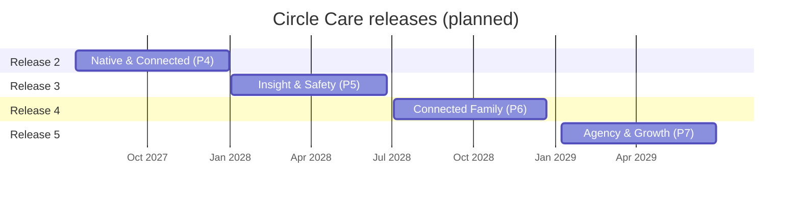
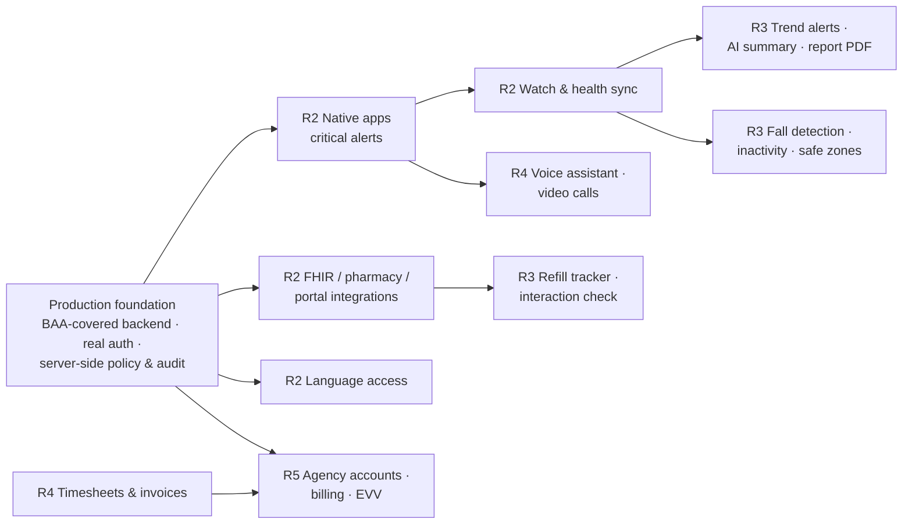

# Roadmap

Future releases after the prototype. **Every item on this page is Planned — none of it is built.** The plan mirrors the Circle Care roadmap in Notion (phases P4–P7); dates are planning targets, not commitments.

!!! info "Where we are"
    The browser prototype (v0.1 – v0.4) delivered the MVP stories and approved additions described in [Features](features/index.md). The next step before any release below is a production foundation — a BAA-covered backend, real authentication and notification delivery — and the 8-week pilot described in the [pilot plan](../pilot/74-pilot-plan.md).

## Timeline

| Release | Phase | Dates | Theme | Epics |
|---|---|---|---|---|
| Release 2 | P4 | Jul 12 – Dec 31, 2027 | Native & Connected | 3 |
| Release 3 | P5 | Jan 3 – Jun 25, 2028 | Insight & Safety | 4 |
| Release 4 | P6 | Jul 3 – Dec 22, 2028 | Connected Family | 4 |
| Release 5 | P7 | Jan 8 – Jun 30, 2029 | Agency & Growth | 1 |

---

## Release 2 — Native & Connected

**P4 · Jul 12 – Dec 31, 2027.** Move from a web prototype to apps people can rely on: native notifications that wake a phone, real health data, real medicine data, and the languages Maggie's neighbours speak.

| Epic | Feature | Value |
|---|---|---|
| **Native Mobile Apps** | iOS & Android apps with critical alerts | SOS and missed high-priority doses break through silent mode — the one thing a web app cannot guarantee |
| | Watch companion & health sync | Real heart rate, oxygen, activity and sleep through HealthKit / Health Connect, replacing simulated readings |
| **Health & Pharmacy Integrations** | FHIR medication import | Medicine lists come from the prescriber's record instead of being typed in, reducing transcription errors |
| | Pharmacy refill integration | Refill status and pickup appear on the calendar automatically |
| | Patient-portal appointment sync | Doctor and lab appointments flow into the care calendar |
| **Language Access** | Spanish, Chinese, Tagalog app experience | Serves the largest non-English-speaking older-adult and caregiver communities in California |
| | Translated notifications & care content | Lock-screen text, reminders and instructions in each person's language |

**Success metrics (proposed targets):** ≥ 95% of SOS alerts delivered to the first responder within 30 seconds · ≥ 90% doses confirmed in pilot circles · ≥ 60% of circles with at least one non-English user active weekly (where applicable) · app store rating ≥ 4.5.

## Release 3 — Insight & Safety {#release-3-insight-safety}

**P5 · Jan 3 – Jun 25, 2028.** Use the data the circle already shares to prevent problems: trends instead of single readings, safer medicines, falls and wandering, and scams.

| Epic | Feature | Value |
|---|---|---|
| **Proactive Health Insights** | Trend alerts | Flags gradual changes (e.g. resting heart rate rising over a week) before they become emergencies |
| | Weekly AI health summary | A plain-language weekly summary for the guardian — descriptive, never diagnostic |
| | Doctor-visit report PDF | One-page report of readings, adherence and notes to bring to appointments |
| **Medication Safety** | Refill tracker & low-supply alerts | Nobody runs out of a critical medicine |
| | Photo pill check | Caregiver or elder confirms the right pill by photo |
| | Drug-interaction check | Warns when a new medicine may interact with current ones |
| **Wearables & Fall Detection** | Wearable fall detection | Automatic SOS when a fall is detected and not cancelled |
| | Inactivity monitoring | Gentle check when there is no movement at unusual times |
| | Safe zones & wandering alerts | Guardian alerted if the elder leaves an agreed area at unusual hours — with the elder's consent |
| **Fraud & Scam Protection** | One-tap scam report & guardian alert | Elder reports a suspicious call or message; guardian is told |
| | Scam-awareness coaching | Short, respectful tips on current scams |

**Success metrics (proposed targets):** median time from abnormal trend to guardian review < 24 hours · zero missed critical refills in pilot circles · fall-alert false-positive rate < 5% · ≥ 70% of elders keep safe-zone consent on after 30 days · reported scam attempts acted on within 1 hour.

## Release 4 — Connected Family

**P6 · Jul 3 – Dec 22, 2028.** Make daily life easier for everyone in the circle — not only safer.

| Epic | Feature | Value |
|---|---|---|
| **Elder Independence & Connection** | Voice-first assistant | Maggie asks "What's next?" or "Call Sarah" hands-free (on-device where possible) |
| | Memory aids | Gentle prompts for names, places and routines |
| | One-tap video calls | Faces, not just voices, with the people she chose |
| | Daily feeling, hydration & meal check-ins | Richer, optional self-reported well-being |
| **Caregiver Support & Workforce** | Voice visit notes | Caregivers dictate the hand-off instead of typing |
| | Photo proof of care | Optional photos for tasks such as wound care or meals |
| | Caregiver burnout check-in | Early warning for overloaded family and professional caregivers |
| | Shift marketplace | Fill open shifts from trusted, vetted caregivers |
| | Timesheets & invoices | Hours from verified visits become timesheets and invoices |
| **Guardian Admin & Finance** | Care expense & benefits tracker | Tracks costs and benefits such as Medicare or long-term-care insurance |
| | Legal & insurance document vault with renewal reminders | POA, insurance cards and directives in one place, with expiry reminders |
| | Guided care-plan builder | Step-by-step care plan for new guardians |
| **Care Access Services** | Telehealth visits | Video appointments from the calendar |
| | Ride booking for appointments | Book transport for medical appointments |
| | Family group chat | Conversation for the circle, with the same privacy rules |

**Success metrics (proposed targets):** elder weekly active rate ≥ 80% · hand-off completion ≥ 95% of shifts · open-shift fill rate ≥ 90% within 48 hours · guardian-reported time on admin down 30% · caregiver burnout check-in response ≥ 50%.

## Release 5 — Agency & Growth

**P7 · Jan 8 – Jun 30, 2029.** A sustainable business: home care agencies as customers and a family subscription.

| Epic | Feature | Value |
|---|---|---|
| **Agency Accounts & Monetization** | Agency multi-client accounts | Agencies manage many circles with role-based staff access |
| | Family subscription billing | Paid plan for families with transparent pricing |
| | Agency caregiver compliance & EVV | Electronic visit verification and caregiver credential tracking for Medicaid-funded care |

**Success metrics (proposed targets):** ≥ 3 agency customers live · ≥ 25% of pilot families convert to paid · EVV records accepted by state systems without manual correction · gross revenue retention ≥ 90%.

---

## Dependencies and sequencing

| Dependency | Why |
|---|---|
| **BAA-covered backend before any real PHI** | Nothing beyond fictional data can be stored until hosting, database, notification and monitoring vendors have signed BAAs and the server enforces the permission matrix |
| **Native apps before fall detection** | Fall detection, critical alerts and continuous health sync need native OS capabilities and entitlements a web app cannot get |
| **Watch & health sync before health insights** | Trend alerts and summaries need real readings |
| **FHIR import before drug-interaction checks** | Interaction checks need structured, coded medicine data |
| **Language access before broad California launch** | Translated notifications must exist before relying on alerts for non-English speakers |
| **Verified visits before timesheets and EVV** | Billing and EVV are built on server-recorded check-ins |

## Risks

| Risk | Release | Mitigation |
|---|---|---|
| **Regulatory: FDA / clinical review for interaction checks and health interpretation** | R3 | Use licensed, clinically validated interaction data; clinical advisory review; regulatory assessment before launch; clear "not a medical device" positioning where valid |
| **AI summaries must not diagnose** | R3 | Descriptive language only, guardrails and human-reviewed templates, no treatment advice, visible "talk to a doctor" guidance, evaluation set before launch |
| Critical-alert entitlement denied by Apple | R2 | Apply early with the SOS use case; fall back to time-sensitive notifications plus SMS/voice |
| Integration access (FHIR, pharmacy, portals) slow or costly | R2 | Start with one EHR vendor and one pharmacy partner; keep manual entry |
| Fall-detection false positives erode trust | R3 | Cancel window, tuning in pilot, elder controls |
| Location features feel like surveillance | R3 | Opt-in by the elder, visible status, easy pause — consistent with the Privacy Center |
| Translation quality for medical instructions | R2 | Professional medical translation and review; no machine translation of instructions without review |
| Marketplace liability and worker classification | R4 | Legal review; vetted partners rather than a gig model |
| EVV varies by state | R5 | Launch with one state aggregator; certify per state |
| Monetisation conflicts with privacy promises | R5 | No advertising or data sales — ever (stated on the website) |

## How the roadmap is managed

- **Source of truth:** Notion *Circle Care — Product Hub* (roadmap, epics, features, user stories). This page is updated when the Notion roadmap changes.
- **Prioritisation:** pilot evidence and the [opportunity solution tree](../research/06-opportunity-solution-tree.md) re-rank epics before each phase.
- **Definition of ready:** each epic needs a validated problem, success metric, privacy review and dependency check.

## Related pages

- [Release notes](product/release-notes.md) — what has shipped in the prototype
- [Security & privacy — what production needs](architecture/security-and-privacy.md#what-production-needs)
- [Pilot plan](../pilot/74-pilot-plan.md)
- [Traceability matrix](traceability.md)
